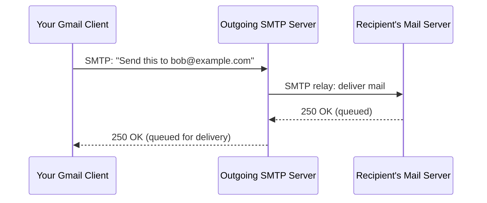
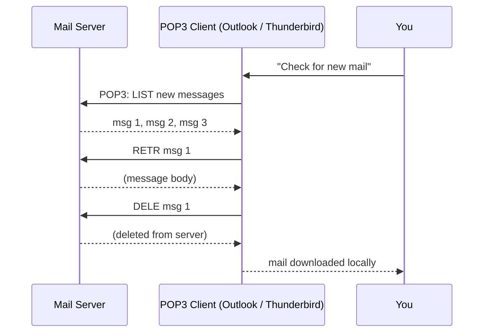

# 🌐 Day 1 — Introduction to Computer Networking

> My first pass at networking fundamentals — what a network actually is, the shapes it takes (LAN / WAN / MAN / WLAN + specialized categories like Mobile / IoT / SDN / Air-Gapped), what the internet really is (hint: not the web), and why protocols are the unsung backbone of every DevOps incident I'll ever debug.

## 📍 Intro — Why This Matters for DevOps

Before I touch a Kubernetes cluster, a cloud VPC, or a misbehaving microservice, I need to internalize one thing: **every distributed system is a network problem wearing a fancy hat.** When a pod can't reach a database, when a deploy "works in staging but not prod," when latency spikes at 3 AM — none of those are app bugs first. They're network phenomena I have to reason about.

So this first note is about getting the vocabulary right. What is a network? What flavors does it come in? What is the internet actually? And what are protocols — the rules that let two machines that have never met agree on how to talk?

By the end, I should be able to look at any production architecture diagram and name every network type, protocol, and boundary I see.

---

## 1️⃣ What Is a Computer Network, Really?

A computer network is **interconnected computing devices that exchange data and share resources with each other.** That's the textbook line — but the useful framing is this: a network is an **agreement** between devices about how to find each other, how to address each other, and how to hand data off reliably.

Two machines on the same network aren't just "plugged into the same wire." They've agreed on:

- **Addressing** — how to identify each other (MAC at Layer 2, IP at Layer 3)
- **Framing** — how to chop bytes into transmittable chunks
- **Ordering & integrity** — how to detect loss and retransmit
- **Semantics** — what the bytes actually *mean* once they arrive

### 🎯 The Four Features That Make a Network a Network

| Feature | What It Means | DevOps Translation |
|---|---|---|
| **Interconnectivity** | Devices linked physically (copper/fiber) or wirelessly (radio) | My K8s nodes need a CNI plugin (Calico / Cilium) to be "interconnected" at the pod level |
| **Data Exchange** | Transfer of files, emails, streams, RPC payloads between devices | Every `kubectl logs`, every Prometheus scrape, every gRPC call is data exchange |
| **Resource Sharing** | Pool printers, storage, compute, GPUs across the network | NFS mounts, shared object storage (S3), distributed databases — all resource sharing |
| **Network Protocols** | Established rules for transmission (TCP/IP being the canonical stack) | Misconfigured protocols = silent failures. A firewall that allows port 443 but drops ICMP breaks path MTU discovery |

> 🧭 **DevOps tip:** When debugging "service A can't talk to service B," walk these four features in order: *Are they interconnected at all?* (CNI / route table) → *Is data exchange attempted?* (SYN sent?) → *Is the shared resource reachable?* (DNS, port) → *Are both sides speaking the same protocol?* (TLS version, HTTP/2 vs HTTP/1.1).

---

## 2️⃣ Network Types by Geography

Networks get classified by **how much real estate they cover.** Here's the mental ladder:

```
┌─────────────────────────────────────────────────────────────────┐
│  GEOGRAPHIC SCOPE LADDER                                        │
│                                                                 │
│   LAN ──┐                                                       │
│         ├── MAN ──┐                                             │
│   WLAN ─┘         │                                             │
│                   └── WAN ──> INTERNET                          │
│                                                                 │
│   ↑ smaller / faster / cheaper / more trusted                   │
│   ↓ larger / slower / costlier / untrusted by default           │
└─────────────────────────────────────────────────────────────────┘
```

### 📋 LAN — Local Area Network

- **Scope:** A home, office, school, single building, or small campus.
- **Speed:** High — typically 1 / 10 / 25 / 100 Gbps over Ethernet or Wi-Fi.
- **Ownership:** One organization owns and trusts it.
- **Tech:** Ethernet (IEEE 802.3), Wi-Fi (IEEE 802.11).
- **DevOps reality:** Every rack in a data center is a LAN. Every AWS VPC subnet is a *virtual* LAN. When I SSH into a box in a private subnet, I'm traversing a LAN.

### 📋 WAN — Wide Area Network

- **Scope:** City, country, global. Connects multiple LANs across long distances.
- **Tech:** Leased telecom lines, MPLS, SD-WAN, undersea cables.
- **DevOps reality:** The link between my on-prem data center and AWS is a WAN. Hybrid cloud = WAN problem. Latency here is measured in tens of milliseconds, not sub-millisecond like LAN.

### 📋 MAN — Metropolitan Area Network

- **Scope:** A city or large campus — bigger than a LAN, smaller than a WAN.
- **Use case:** Municipal services, university campuses, city-wide Wi-Fi.
- **DevOps reality:** Rarely something I directly operate, but a CDN's edge POP within a metro area is effectively a MAN-sized deployment.

### 📋 WLAN — Wireless LAN

- **Scope:** Same as LAN, but the physical layer is radio waves (Wi-Fi) instead of cables.
- **Catch:** Wireless is a shared, half-duplex, lossy medium. Every device competes for airtime.
- **DevOps reality:** Office Wi-Fi flakiness is a real productivity killer, and IoT / warehouse robotics often run over WLAN — meaning packet loss and roaming handoffs become my problem.

> 🧭 **DevOps tip:** When chasing latency between two services, *always check the geographic tier first.* Two pods on the same node: ~0.1ms. Same cluster, different node: ~1ms. Same region, different AZ: ~2ms. Different regions: 20–100ms+. Different continents: 100–300ms. The tier tells you whether to blame the app or the speed of light.

---

## 3️⃣ Specialized Network Categories

Beyond the geographic ladder, there are networks defined by **what they do** rather than where they are:

### 📡 Mobile Networks (Cellular)

- Connect mobile devices via cell towers (base stations).
- Generations: **3G → 4G LTE → 5G.**
- Each base station serves a coverage "cell"; cells hand off devices as they move.
- **DevOps angle:** Mobile users are the worst-case client. High latency, intermittent connectivity, carrier-grade NAT. If my service breaks for mobile users but not desktop, suspect TLS handshake timeouts, large initial payloads, or IPv6-only carrier networks.

### 📟 IoT — Internet of Things

- Physical objects with sensors, processors, software, and network connectivity.
- Ranges from smart-home bulbs to industrial SCADA sensors.
- Constraints: tiny CPUs, low battery, low bandwidth, often no IPv4 support (IPv6 or LoRaWAN).
- **DevOps angle:** IoT fleets taught the industry that you can't SSH into a million devices to fix them. This is where immutable infrastructure, OTA (over-the-air) updates, and MQTT / CoAP brokers came from. Operating IoT at scale is a DevOps discipline unto itself.

### 🧬 SDN — Software-Defined Networking

Worth its own deep dive — see §4.

### 🛡️ Air-Gapped Networks

Worth its own deep dive — see §5.

---

## 4️⃣ SDN — Why It's the Backbone of Cloud Networking

SDN is the most important networking concept I'll meet as a DevOps engineer, so I'll spend real estate on it.

### 💡 The Problem SDN Solves

Traditional networking hardware (switches, routers) ships with **two planes baked into the box:**

```
┌──────────────────────────────────────────┐
│  TRADITIONAL NETWORK DEVICE              │
│  ┌────────────────────────────────────┐  │
│  │  Control Plane (the brain)         │  │
│  │  - routing tables                  │  │
│  │  - OSPF / BGP decisions            │  │
│  │  - ACL logic                       │  │
│  └────────────────────────────────────┘  │
│  ┌────────────────────────────────────┐  │
│  │  Data Plane (the hands)            │  │
│  │  - actually forwards packets       │  │
│  │  - ASIC / NPU does this at line    │  │
│  │    rate                            │  │
│  └────────────────────────────────────┘  │
│  Both locked inside ONE proprietary box  │
└──────────────────────────────────────────┘
```

The result: every box is a snowflake. Reconfiguring means CLI-ing into dozens of vendor-specific devices. Automation is painful. Change windows are scheduled at 2 AM because nobody trusts the config.

### 💡 SDN's Move: Separate the Planes

SDN **physically separates** the control plane from the data plane:

```
┌──────────────────────────────────────┐
│  SDN CONTROLLER (centralized brain)  │
│  - OpenFlow / NETCONF / OVSDB APIs   │
│  - one policy, pushed to all devices │
└───────────────┬──────────────────────┘
                │ southbound API (OpenFlow, etc.)
   ┌────────────┼────────────┐
   ▼            ▼            ▼
┌──────┐    ┌──────┐    ┌──────┐
│switch│    │switch│    │switch│   ← Data plane only
│ (fwd)│    │ (fwd)│    │ (fwd)│     dumb, fast, cheap
└──────┘    └──────┘    └──────┘
```

Now the network is programmable. I can write code (Terraform, Ansible, a controller app) that changes how the entire fabric forwards traffic — no CLI, no snowflakes.

### 🎯 Five Properties That Define SDN

| Property | What It Means | Why DevOps Cares |
|---|---|---|
| **Centralized Control** | One controller sees the whole topology and pushes forwarding rules down | Whole-network observability and policy from a single API |
| **Dynamic Provisioning** | Spin up / tear down network slices in software | This is exactly how AWS VPCs, Kubernetes CNIs, and OpenStack Neutron work |
| **Automated Management** | Policies applied via code, not CLI | CI/CD for network config — versioned, reviewed, rollbackable |
| **Programming Interface (APIs)** | Northbound REST / gRPC APIs let apps talk to the network | Service meshes (Istio / Linkerd) sit here; they're SDN for L7 |
| **Improved Security** | Consistent policy across the whole fabric, pushed from one source | Microsegmentation (zero-trust east-west firewalls) becomes feasible |

> 🧭 **DevOps tip:** When I see a Kubernetes CNI (Calico, Cilium, Antrea) — that's SDN. When I see AWS Security Groups applied at the elastic network interface — that's SDN. When Istio rewrites Envoy configs to enforce mTLS — that's SDN. The entire cloud-native networking stack I operate daily is built on the SDN principle: *separate brain from hands, program the brain.*

---

## 5️⃣ Air-Gapped Networks — When Disconnection Is the Feature

An air-gapped network is **completely isolated from the public internet and physically segregated** from other networks. There is no cable, no wireless link, no VPN bridging it to the outside world.

### 🛡️ Why Air-Gap?

- **Threat model:** If it can't be reached, it can't be remotely attacked. Period.
- **Use cases:** Military systems, classified government networks, industrial control systems (SCADA) for power plants, financial core banking ledgers, medical device QA labs.
- **The trade-off:** Security via isolation vs. operational pain. Updates, patches, and data exchange all require physical media (USB, tape) — which itself becomes the attack vector (think Stuxnet).

### ⚠️ Air-Gap Is a Spectrum, Not a Binary

In practice, "air-gapped" often leaks. Common bridges that defeat the gap:

- USB drives carried in/out (Stuxnet's vector)
- Unintentional Wi-Fi / Bluetooth on supposedly isolated hosts
- Out-of-band management cards (iDRAC / iLO) someone connected to the corporate LAN "for convenience"
- Compromised insiders

> 🧭 **DevOps tip:** I'll rarely operate a true air-gap. But the *pattern* matters: regulated workloads (PCI-DSS cardholder data environment, HIPAA PHI stores, FedRAMP high) often use **logical air-gapping** — strict VPC peering restrictions, no internet gateways, no public IPs, private endpoints only. Same principle, virtualized. When designing isolation for compliance, ask: *"What's the smallest set of allowed ingress paths?"* — then alert on anything else.

---

## 6️⃣ What Is the Internet, Really?

Here's the line that finally clicked for me: **the internet is a globally connected network system facilitating worldwide communication and access to data resources through a vast collection of private, public, business, academic, and government networks.**

The key insight: the internet isn't *one* network. It's a **network of networks** — a federation of independently owned and operated networks that agree to exchange traffic using a common set of protocols (TCP/IP for transport, BGP for routing between them).

### 🧭 Internet vs. World Wide Web — Don't Confuse Them

This distinction trips people up constantly:

| | **Internet** | **World Wide Web** |
|---|---|---|
| **What it is** | Infrastructure: cables, routers, protocols | A service that runs *on top of* the internet |
| **Scope** | Hardware + addressing + transport | HTTP servers + browsers + URLs + HTML |
| **Origin** | ARPANET → NSFNET → 1980s commercialization | Tim Berners-Lee, 1989 |
| **Examples of what's ON it** | Web, email, DNS, SSH, BitTorrent, gaming, FTP | Websites only |

**The internet is the road. The web is one of the trucks driving on it.** Email is another truck. SSH is another. DNS is another. They all share the same road.

### 📦 Internet = Infrastructure That Serves Distributed Applications

The mental model I'll keep:

```
┌────────────────────────────────────────────┐
│  Distributed Applications                  │
│  (web, email, chat, streaming, k8s, etc.)  │
├────────────────────────────────────────────┤
│  Internet (the infrastructure)             │
│  - hosts (end systems)                     │
│  - communication links (fiber, copper, R)  │
│  - routers (forward packets)               │
│  - protocols (TCP/IP, BGP, DNS, ...)       │
└────────────────────────────────────────────┘
```

Applications don't talk to each other directly — they talk *through* the internet's infrastructure. My browser doesn't know where the server physically is; it just hands bytes to the OS, which hands them to the NIC, which hands them to the ISP, which routes them through dozens of autonomous systems until they hit the destination.

> 🧭 **DevOps tip:** When debugging "is it the app or the network?", the framing above is gold. If the app is crashing → app problem. If the app is healthy but can't reach its dependencies → infrastructure problem (DNS, routing, firewall, BGP). The internet layer is *exactly* where my cloud-provider status page checks and BGP looking-glass queries happen.

---

## 7️⃣ Network Protocols — The Rules of the Road

A **network protocol** is an established set of rules that determines how data is transmitted between devices. Specifically, a protocol defines:

- **Message format** — what bytes go where (headers, payload, trailers)
- **Message order / sequence** — who speaks when, who waits, who terminates
- **Duration / timing** — timeouts, retry intervals, keepalive cadence
- **Error handling** — checksums, ACKs, retransmissions, flow control

### 💡 The Alice & Bob Analogy

Think of two humans, Alice and Bob, trying to have a conversation. They've implicitly agreed on:

- **Language** (English) — *analogous to the protocol itself*
- **Greetings** ("hi" → "hi, how are you?") — *analogous to the handshake*
- **Turn-taking** (don't talk over each other) — *analogous to flow control*
- **Confirmations** ("yeah", "uh-huh") — *analogous to ACKs*
- **Repetition on mishearing** ("sorry, say that again?") — *analogous to retransmission*
- **Goodbyes** ("bye" → "bye") — *analogous to connection teardown*

If Alice speaks only Mandarin and Bob speaks only English, no conversation happens — even though they're standing right next to each other. **Same with devices:** two machines on the same cable, speaking different protocols, will never exchange a useful byte.

This maps cleanly onto **client ↔ server:**

```
CLIENT                                    SERVER
  │                                         │
  │  "Hi, I want to talk. Here's my SYN."   │
  │ ──────────────────────────────────────▶│
  │                                         │
  │  "Hi. I acknowledge. Here's my SYN-ACK."│
  │◀────────────────────────────────────── │
  │                                         │
  │  "Got it. ACK. Now let's talk."         │
  │ ──────────────────────────────────────▶│
  │                                         │
  │       [application data flows]          │
  │◀─────────────────────────────────────▶│
  │                                         │
  │  "I'm done. Bye (FIN)."                 │
  │ ──────────────────────────────────────▶│
```

### 🎯 Why Protocols Matter (the four reasons I'll keep repeating)

1. **Correctness** — ensure data is sent and understood correctly.
2. **Interoperability** — Linux, Windows, macOS, iOS, a smart bulb, a mainframe: all can talk because they share protocols.
3. **Reliability** — handle errors, retransmissions, flow control so the network self-heals.
4. **Layering** — define how packets travel through the stack (application → transport → network → link → physical) without each layer caring about the others.

> 🧭 **DevOps tip:** When two services won't talk, the failure is almost always a *protocol mismatch*, not a network outage. TLS 1.2 client vs TLS 1.3-only server. HTTP/2 client vs HTTP/1.1-only server. IPv4-only pod trying to reach IPv6-only service. `nc -zv host port` confirms reachability; the actual app-level failure is a protocol negotiation problem.

---

## 8️⃣ Protocol Taxonomy — The Layered View

Protocols don't all live at the same level. They stack, and each layer trusts the one beneath it:

```
┌─────────────────────────────────────────────────────────┐
│  APPLICATION LAYER                                      │
│  HTTP, HTTPS, FTP, SMTP, DNS, SSH, TELNET, SNMP, MQTT   │
│  ↑ what apps speak                                      │
├─────────────────────────────────────────────────────────┤
│  TRANSPORT LAYER                                        │
│  TCP, UDP, QUIC                                         │
│  ↑ reliability / multiplexing / flow control            │
├─────────────────────────────────────────────────────────┤
│  NETWORK LAYER                                          │
│  IP (v4 & v6), ICMP, OSPF, BGP, IPsec                   │
│  ↑ addressing + routing across networks                 │
├─────────────────────────────────────────────────────────┤
│  LINK LAYER                                             │
│  Ethernet, Wi-Fi, ARP, PPP                              │
│  ↑ frame delivery on one physical link                  │
└─────────────────────────────────────────────────────────┘
```

This stack (a simplified OSI / TCP-IP hybrid) matters because **each layer's debugging tool is different:**

- Application → `curl`, `telnet`, app logs
- Transport → `ss`, `netstat`, `tcpdump port 443`
- Network → `traceroute`, `ping`, `ip route`, BGP looking glass
- Link → `tcpdump -i eth0`, `ethtool`, switch CLI

### 📊 Protocol Categories at a Glance

| Category | Protocols | Purpose |
|---|---|---|
| **Communication / Transport** | TCP, UDP | Data transport, reliability, speed control |
| **Routing / Network** | IP, ICMP, OSPF, BGP | Packet addressing and routing across networks |
| **Application** | HTTP, FTP, SMTP, DNS | Web browsing, file transfer, email, domain lookups |
| **Security** | HTTPS, SSL / TLS, IPsec | Encrypting and securing data |
| **Management** | SNMP, DHCP | Network monitoring and automatic IP assignment |

---

## 9️⃣ The Protocols I'll Meet Daily

A quick tour of the headline protocols — just enough to recognize them today; I'll go deep on each in later notes.

### 🔌 TCP — Transmission Control Protocol

The workhorse of reliable communication. Connection-oriented, ordered, loss-recovering. Almost every web request, database query, and SSH session rides TCP.

### 🌐 HTTP — HyperText Transfer Protocol

The protocol of the web. Stateless, request/response. Its secure variant **HTTPS** = HTTP over TLS. Almost every public API I build will be HTTPS.

### 📤 SMTP — Simple Mail Transfer Protocol

Designed to **send and distribute outgoing email.** Push model — it hands mail to the next server and forgets. Doesn't store mail long-term.

### 📁 FTP — File Transfer Protocol

Moves files between machines. Two channels (control + data), historically cleartext. Mostly replaced by SFTP / HTTPS in modern infra, but still everywhere in legacy B2B integrations.

### 🖥️ TELNET

Remote login protocol — the original way to get a shell on a remote machine. **Cleartext, no encryption.** Modern infra replaced it with SSH decades ago. I'll only meet it in legacy gear or as a quick port-reachability probe (`telnet host 3306`).

> 🧭 **DevOps tip:** Every protocol above maps to a default port. Memorize these — I'll cite them in incidents constantly:
>
> | Port | Protocol |
> |---|---|
> | 22 | SSH |
> | 23 | TELNET |
> | 25 | SMTP |
> | 53 | DNS |
> | 80 | HTTP |
> | 443 | HTTPS |
> | 587 | SMTP (submission) |
> | 21 | FTP (control) |

---

## 🔟 Email Protocol Flow — SMTP vs POP3

Email is special because **sending and receiving are handled by different protocols.** This trips beginners; here's the clean version.

### ✉️ SMTP — Sending (Push)

SMTP **pushes** mail from sender → server, and server → server. It doesn't pull, doesn't store long-term. It's a courier.



### 📥 POP3 — Receiving (Pull)

POP3 **pulls** mail from the server down to a single device. Classic behavior: once downloaded, the server copy is deleted. No multi-device sync — which is why POP3 has been largely replaced by IMAP in modern email clients, but it's still the right answer for one-device offline access.



### 💡 Mnemonic That Sticks

| Protocol | Verb | Mental Model |
|---|---|---|
| **SMTP** | **S**ending | Push out — courier hands off, forgets |
| **POP3** | **P**ulling | Pull down — fetch to one device, server wipes |

> 🧭 **DevOps tip:** In production I'll rarely run my own mail server (SES, SendGrid, Postmark handle SMTP). But the protocol still matters: transactional email failures are almost always SMTP rejection codes (550, 554). When a "password reset email never arrived," check SMTP logs for the bounce code before blaming the app.

---

## 🧾 Summary

| Concept | What It Is | Why It Matters for DevOps |
|---|---|---|
| **Computer Network** | Interconnected devices that exchange data + share resources | Every distributed system I operate IS a network problem first |
| **Interconnectivity** | Devices linked physically or wirelessly | CNI plugins, VPC peering, physical cabling all deliver this |
| **Data Exchange** | Transfer of files / emails / streams / RPC | Every kubectl call, Prometheus scrape, gRPC request is this |
| **Resource Sharing** | Pooling printers / storage / compute across network | NFS, S3, shared DBs, distributed caches |
| **Network Protocols** | Rules governing transmission (format / order / timing / errors) | Mismatched protocols = silent failures I'll debug at 3 AM |
| **LAN** | Local Area Network — home / office / single site | Data center racks, VPC subnets, K8s node-local traffic |
| **WAN** | Wide Area Network — city / country / global | Hybrid cloud links, region-to-region traffic, MPLS / SD-WAN |
| **MAN** | Metropolitan Area Network — city / campus | CDN metro POPs, municipal Wi-Fi, university backbones |
| **WLAN** | Wireless LAN — Wi-Fi, not cables | Office Wi-Fi, IoT fleets, warehouse robotics — lossy shared medium |
| **Mobile Network** | Cellular (3G / 4G / 5G), base stations serve cells | Mobile clients = worst-case latency + NAT; design APIs to survive them |
| **IoT** | Networked physical objects with sensors / CPUs | Forced the industry to invent OTA, MQTT, immutable fleets |
| **SDN** | Software-Defined Networking — separated control & data planes | AWS VPCs, K8s CNIs, Istio, AWS SGs — ALL are SDN |
| **SDN Control Plane** | Centralized brain that decides routing | Where Terraform / Cilium / Istio push policy |
| **SDN Data Plane** | Dumb, fast forwarding hardware / software | OVS, eBPF, Envoy — line-rate packet pushers |
| **Air-Gapped Network** | Physically + logically isolated from internet | Military / SCADA / classified; pattern = compliance isolation (PCI / HIPAA) |
| **Internet** | Network of networks, TCP/IP + BGP federation | The road everything rides on |
| **World Wide Web** | HTTP service ON TOP of the internet | One truck on the road; not the road itself |
| **Distributed Applications** | Apps that exchange data across end systems | Everything I build / deploy is one |
| **Protocol** | Rules: message format + sequence + timing + error handling | Without shared protocols, two devices on the same wire can't talk |
| **Alice / Bob Analogy** | Human conversation = protocol handshake | Language = protocol, greetings = handshake, "say again?" = retransmit |
| **Application Layer Protocols** | HTTP, FTP, SMTP, DNS, SSH | What apps speak; debug with `curl` / `telnet` |
| **Transport Layer Protocols** | TCP, UDP, QUIC | Reliability / multiplexing; debug with `ss` / `netstat` / `tcpdump port N` |
| **Network Layer Protocols** | IP, ICMP, OSPF, BGP, IPsec | Addressing + routing; debug with `ping` / `traceroute` / `ip route` |
| **TCP** | Reliable, ordered, connection-oriented transport | Web, DB, SSH all ride TCP |
| **HTTP / HTTPS** | Stateless request/response, web protocol (HTTPS = HTTP+TLS) | Every public API |
| **SMTP** | Simple Mail Transfer Protocol — SENDS mail (push) | Transactional email; debug via SMTP bounce codes (550 / 554) |
| **POP3** | Post Office Protocol v3 — RECEIVES mail (pull, deletes from server) | Mnemonic: POP = Pulling; replaced by IMAP for multi-device |
| **FTP** | File Transfer Protocol — two channels (control + data), cleartext | Legacy B2B; prefer SFTP / HTTPS |
| **TELNET** | Remote login, cleartext — replaced by SSH | Only useful today as a port probe (`telnet host 3306`) |
| **Common Ports** | 22 SSH / 23 TELNET / 25 SMTP / 53 DNS / 80 HTTP / 443 HTTPS / 587 SMTP-submit / 21 FTP-control | Memorize these; cited in every incident |
| **Layered Debugging** | Each layer has its own toolset | App → curl, Transport → ss / tcpdump, Network → ping / traceroute, Link → ethtool / switch CLI |
