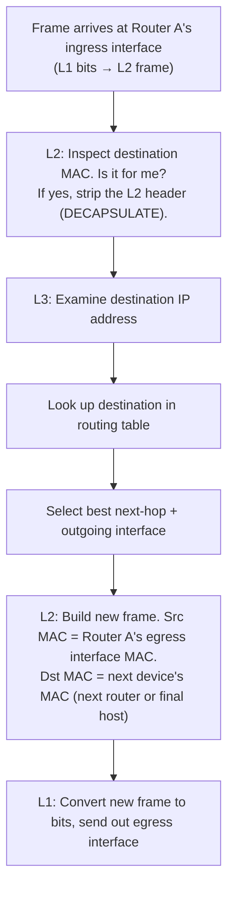

# 🌐 The OSI Model: Overview, Layers, Workflow, Devices & History

> My second pass at networking fundamentals — the seven-layer Open Systems Interconnection model that every network certification, every cloud architecture diagram, and every 3 AM incident debug quietly assumes I have memorized. Today is the overview pass: the layers, the protocol data units (PDUs), the software/hardware split, how a photo actually travels from Computer X to Computer Y, what routers really do (hint: they only speak three of the seven layers), the network devices by OSI layer (hub / switch / router), the alternative models (DOD / TCP/IP), and the Cold War history that birthed all of this.

---

## 1️⃣ What Is the OSI Model?

The **Open Systems Interconnection (OSI) model** is a seven-layer conceptual framework developed by **ISO** (International Organization for Standardization) to standardize how disparate network systems communicate. The keyword is *conceptual* — it's a teaching and design reference, not a protocol implementation. The actual internet runs on the simpler TCP/IP stack (more on that in §10), but OSI is the map I'll navigate by.

---

## 2️⃣ The Seven Layers — A Bottom-Up Tour

OSI layers are **numbered from the bottom up**: Physical is Layer 1, Application is Layer 7. The numbering matters because every networking conversation uses the shorthand "L3" or "L7" — and now I'll know exactly what they mean.

```
┌────┬───────────────┬───────────────────────────────────────────┐
│ L7 │ Application   │  HTTP, FTP, SMTP, DNS, SSH                │
├────┼───────────────┼───────────────────────────────────────────┤
│ L6 │ Presentation  │  TLS/SSL, JPEG, MPEG, ASCII, encryption   │
├────┼───────────────┼───────────────────────────────────────────┤
│ L5 │ Session       │  Sockets, RPC, session management         │
├────┼───────────────┼───────────────────────────────────────────┤
│ L4 │ Transport     │  TCP, UDP, QUIC   ← "the heart"           │
├────┼───────────────┼───────────────────────────────────────────┤
│ L3 │ Network       │  IP (v4/v6), ICMP, OSPF, BGP, IPsec       │
├────┼───────────────┼───────────────────────────────────────────┤
│ L2 │ Data Link     │  Ethernet, Wi-Fi, ARP, PPP, MAC addressing│
├────┼───────────────┼───────────────────────────────────────────┤
│ L1 │ Physical      │  cables, fiber, radio, voltages, bits     │
└────┴───────────────┴───────────────────────────────────────────┘
        ↑                                              ↑
   hardware side                              software side
```

### 📋 Layer-by-Layer Breakdown

**L1 — Physical Layer**
Deals with the **physical connection** between devices. Transmits **raw bit streams** over a medium — electrical signals on copper, light pulses on fiber, radio waves for Wi-Fi. No concept of frames, addresses, or meaning. Just bits on a wire.

**L2 — Data Link Layer**
Responsible for **node-to-node data transfer** on the same local network. Structures raw bits into **frames**, attaches **MAC addresses** (source + destination), and detects errors via **CRC** (Cyclic Redundancy Check). Ethernet, Wi-Fi, and PPP live here.

**L3 — Network Layer**
Manages **logical addressing (IP)** and **routing** of data *across* networks. Determines the best path from source to destination, even when that path crosses dozens of intermediate routers. The Internet Protocol (IP) is the canonical L3 protocol. **Routers** are L3 devices.

**L4 — Transport Layer**
Ensures **complete, reliable data transfer** (when using TCP) or fast best-effort delivery (when using UDP). Handles segmentation (chopping data into transmittable chunks), reassembly, flow control, error detection, and **port-based multiplexing** (so multiple apps can share one IP). This is the layer where TCP and UDP live.

**L5 — Session Layer**
Establishes, manages, and terminates **sessions** between applications. Handles session checkpointing and recovery — if a connection drops mid-transfer, the session layer remembers where to resume. Often folded into the application layer in real-world TCP/IP implementations, but conceptually distinct.

**L6 — Presentation Layer**
Responsible for **data translation, encryption, and compression**. Takes data the application understands (a JPEG, an HTML document, a serialized protobuf) and prepares it for the network. **TLS lives here conceptually** — it encrypts/decrypts the payload before handing it down.

**L7 — Application Layer**
The layer closest to the user. Provides services like resource sharing, remote file access, email exchange, directory lookup, and web browsing. **HTTP, FTP, SMTP, DNS, SSH** all live at L7. Note: the application layer *provides services to applications* — it isn't the application itself. Chrome isn't L7; HTTP is L7.

---

## 3️⃣ Software Layers vs Hardware Layers — And the Heart in Between

The seven layers split cleanly into three groups:

```
┌──────────────────────────────────────┐
│  SOFTWARE LAYERS (L5, L6, L7)        │
│  - closest to user applications      │
│  - handled in code: browsers,        │
│    email clients, OS processes       │
│  - data formatting, encryption,      │
│    sessions, user interaction        │
│  - libraries, APIs, protocols like   │
│    HTTP, FTP, SMTP                   │
└──────────────────────────────────────┘
              ↕
┌──────────────────────────────────────┐
│  TRANSPORT (L4) — the heart          │
│  - bridges software ↔ hardware       │
│  - the layer where TCP/UDP live      │
└──────────────────────────────────────┘
              ↕
┌──────────────────────────────────────┐
│  NETWORK + HARDWARE (L1, L2, L3)     │
│  - signal transmission, framing,     │
│    MAC addressing, IP routing        │
│  - cables, NICs, switches, routers   │
└──────────────────────────────────────┘
```

### 💡 The Mental Shortcut

- **L5–L7:** I implement these in software. Browsers, mail clients, my Go / Python services. No special hardware needed.
- **L1–L2:** I need hardware. Cables, NICs, switch ports. Even in the cloud, these exist — they're just virtualized.
- **L3:** Needs a routing or switching device. In cloud, that's the VPC router and route tables.
- **L4:** Sits in the middle. **Mostly software** (the kernel's TCP/IP stack), but tightly coupled to the network. Deservedly called the **heart** — see §4.

### 🧩 Worked Example — Opening a Web Page

When I open a web page, all three software layers fire in sequence:

| Layer | What It Does | Concrete Action |
|---|---|---|
| **L7 Application** | Uses HTTP to fetch the page | Browser issues `GET /index.html` |
| **L6 Presentation** | Encrypts the request | TLS wraps the HTTP payload in an encrypted record |
| **L5 Session** | Manages the persistent connection | HTTP keep-alive maintains the TCP session across multiple requests |

Then the request crosses down through L4 (TCP segment), L3 (IP packet), L2 (Ethernet frame), L1 (bits on the wire) — and the reverse happens at the server.

---

## 4️⃣ Why L4 Transport is the "Heart of the OSI Model"

The transport layer earned its nickname for four reasons that I'll keep returning to:

### 1️⃣ It Bridges Software and Hardware

Above L4: software (L5–L7). Below L4: hardware / network (L1–L3). L4 is the **translation point** where application-level concerns (reliability, ordering, multiplexing) get converted into network-level realities (segments traveling across unreliable IP). Without it, applications would have to implement their own reliability on top of raw IP — which is exactly what early networked applications had to do, and it was miserable.

### 2️⃣ It Provides Reliable Delivery

TCP gives me:

- **All data received** — via ACKs and retransmissions
- **No duplication** — via sequence numbers
- **In-order delivery** — via sequence number ordering
- **Segmentation & reassembly** — splitting a 10 MB file into ~1,500-byte segments and stitching them back together at the destination

No other layer does all of this. L3 (IP) is best-effort and unreliable — packets can be dropped, duplicated, or arrive out of order. L4 is what turns IP's "fire and forget" into "guaranteed delivery."

### 3️⃣ It Controls Flow and Congestion

- **Flow control** — prevents a fast sender from overwhelming a slow receiver (TCP sliding window)
- **Congestion control** — detects when the network itself is overloaded and backs off (TCP congestion avoidance: slow start, AIMD, BBR)

This is what keeps the internet from collapsing under load. Without L4 congestion control, every connection would blast packets at line rate and routers would melt.

### 4️⃣ It Handles Port Numbers — Multiplexing

A single host running SSH (22), HTTP (80), DNS (53), and SMTP (25) simultaneously needs the incoming packets routed to the right application. **Port numbers** at L4 are how that happens. Without ports, IP would deliver packets to a host but the host wouldn't know which process should receive them.

```
┌──────────────────────────────────────────────────┐
│  ONE HOST, ONE IP, MULTIPLE APPS                 │
│                                                  │
│  IP: 10.0.0.5                                    │
│  ├── :22   → sshd process                        │
│  ├── :80   → nginx process                       │
│  ├── :443  → nginx process (TLS)                 │
│  ├── :53   → dnsmasq process                     │
│  └── :9090 → prometheus process                  │
│                                                  │
│  L4 port numbers demultiplex incoming traffic    │
└──────────────────────────────────────────────────┘
```

> 🧭 **DevOps tip:** When "the app is down," check L4 first. `ss -tlnp` shows every listening TCP port and the process behind it. If the port isn't listening, the app crashed — that's an app problem. If the port IS listening but remote clients can't connect, walk down to L3 (firewall / routing) or L7 (TLS / app-level rejection). L4 is usually the cheapest layer to check and the most common failure point.

---

## 5️⃣ Protocol Data Units (PDUs) — What Each Layer Calls the Data

Here's a piece of OSI jargon that took me a while to internalize: **each layer has its own name for the chunk of data it handles.** I tend to call everything "packets" colloquially, but strictly speaking, "packet" is the L3 term only.

```
LAYER    PDU NAME           WHAT'S IN IT
─────────────────────────────────────────────────────────────
L7       Message            HTTP request, SMTP commands, DNS query
L6       Message            (still a message — encrypted/compressed)
L5       Message            (still a message — session-tagged)
L4       Segment            TCP segment = data + TCP header (ports, seq, ack)
L3       Packet / Datagram  Packet = segment + IP header (src/dst IP)
L2       Frame              Frame = packet + Ethernet header (src/dst MAC) + trailer (CRC)
L1       Bit                A single 0 or 1 on the wire
```

### 📊 The Encapsulation Stack — How a PDU Grows as It Descends

```
        ┌─────────────────────────────────────────┐
   L7   │            HTTP message                 │
        └─────────────────────────────────────────┘
        ┌─────────────────────────────────────────┐
   L6   │  [TLS header]  HTTP message             │
        └─────────────────────────────────────────┘
        ┌─────────────────────────────────────────┐
   L5   │  [Session info] [TLS] HTTP message      │
        └─────────────────────────────────────────┘
        ┌─────────────────────────────────────────┐
   L4   │ [TCP hdr] [Sess] [TLS] HTTP message     │  ← SEGMENT
        └─────────────────────────────────────────┘
        ┌─────────────────────────────────────────┐
   L3   │[IP hdr][TCP][Sess][TLS] HTTP message    │  ← PACKET / DATAGRAM
        └─────────────────────────────────────────┘
        ┌─────────────────────────────────────────┐
   L2   │[Eth hdr][IP][TCP][Sess][TLS] HTTP [CRC] │  ← FRAME
        └─────────────────────────────────────────┘
        ┌─────────────────────────────────────────┐
   L1   │ 0 1 1 0 0 1 0 1 1 1 0 0 1 0 1 0 ...     │  ← BITS
        └─────────────────────────────────────────┘
```

### 💡 Two Names for the Same Thing

At L3, the literature uses two names interchangeably: **packet** and **datagram**. They're the same PDU. "Datagram" leans toward connoting connectionless service (UDP datagrams), "packet" leans toward connection-oriented (TCP packets), but technically both describe the L3 PDU.

---

## 6️⃣ Network Devices by OSI Layer — Hub, Switch, Router

The three classic network devices map cleanly to OSI layers, and the layer they operate at determines exactly what they can and cannot understand.

### 🔌 Hub — Layer 1 (Physical)

A hub is the dumbest possible network device. It connects multiple Ethernet devices into a single network segment by **repeating incoming signals to every other port**, with zero filtering or addressing logic.

**Key characteristics:**

- **Half-duplex** — can send OR receive at a time, never both. Collisions are routine.
- **Operates on raw signals** — no concept of MAC addresses, frames, or packet contents.
- **Broadcasts everything everywhere** — every incoming frame goes out every other port.
- **Bandwidth is shared** across all ports. A 100 Mbps hub with 4 ports gives each port ~25 Mbps effective.

**Pros / Cons table:**

| Pros | Cons |
|---|---|
| Simple to install and configure | High collision rate (half-duplex) |
| Low cost | No intelligent forwarding or filtering |
| Zero management overhead | Bandwidth shared among all ports |
| Useful for tiny temporary networks | Security risk: every port sees all data |
| Reliable signal regeneration | Limited scalability |

### 🔀 Switch — Layer 2 (Data Link)

A switch is the smart successor to a hub. It connects multiple devices on a LAN but **forwards frames only to the port where the destination MAC lives** — unicast, not broadcast.

**Core functions:**

| Function | What It Does |
|---|---|
| **MAC Address Learning** | Inspects incoming frames, records (source MAC, ingress port) in its MAC address table |
| **Unicast Forwarding** | Looks up destination MAC in the table, sends frame out only that port |
| **Frame Filtering** | If destination MAC is on the same port the frame came in on, drops it |
| **Full-Duplex Support** | Each port can send and receive simultaneously — collisions eliminated on switched links |

A switch starts with an empty MAC table and learns by observation. When it sees a frame from an unknown source, it records the MAC. When it needs to forward to an unknown destination, it falls back to flooding (broadcast) — but only until it learns the destination's port from the return traffic.

### 🌐 Router — Layer 3 (Network)

A router forwards data **between different networks** based on **IP addresses**, not MAC addresses. It's what connects a home LAN to an ISP's WAN, and what connects VPC subnets to each other.

**Key facts:**

- Makes forwarding decisions based on the **destination IP address** in the L3 packet header.
- Uses a **routing table** to pick the best next-hop for each destination network.
- Connects networks that use **different L2 technologies** (e.g., Ethernet on one side, PPP on the other).
- **Does NOT touch L4–L7** — it doesn't care about TCP ports, HTTP content, or TLS state. More on this in §8.

### 📊 Hub vs Switch vs Router — At a Glance

| | **Hub** | **Switch** | **Router** |
|---|---|---|---|
| **OSI Layer** | L1 | L2 | L3 |
| **Addressing** | None | MAC | IP |
| **Forwarding** | Broadcast to all ports | Unicast to learned port | Route to best next-hop |
| **Duplex** | Half | Full | Full |
| **Collision Domain** | All ports share one | Per-port | N/A (L3) |
| **Broadcast Domain** | All ports share one | All ports share one (unless VLAN-segmented) | Per-interface (routers don't forward L2 broadcasts) |
| **Modern Status** | Extinct | Everywhere | Everywhere (physical and virtual) |

---

## 7️⃣ OSI Workflow — Sending a Photo from Computer X to Computer Y

Time to make this concrete. Let me trace a photo being sent from Computer X to Computer Y through a multi-hop network. This is **encapsulation**: data descending the OSI stack at the sender, getting wrapped with each layer's header as it goes.

### 🎯 The Scenario

```
   ┌──────┐    ┌────────┐    ┌────────┐    ┌────────┐    ┌──────┐
   │  PC  │────│ Switch │────│Router A│────│Router B│────│ PC Y │
   │   X  │    │   1    │    │        │    │        │    │      │
   └──────┘    └────────┘    └────────┘    └────────┘    └──────┘
```

Computer X wants to send a photo to Computer Y. The photo starts life at L7 as application data inside an email client or browser. Then it descends.

### 📤 Encapsulation at Computer X (Walking Down the Stack)

```
L7 Application   : "Here's a photo. Send it."
                   Data = photo bytes
                       │
                       ▼
L6 Presentation : Compress the photo (JPEG), optionally encrypt
                   Data = compressed photo bytes
                       │
                       ▼
L5 Session      : Establish a session between X and Y
                   Data = compressed photo + session metadata
                       │
                       ▼
L4 Transport    : Choose TCP (reliable) or UDP (fast). For a photo, TCP.
                   Chop data into segments. Add TCP header (ports, seq #, ack)
                   PDU = SEGMENT
                       │
                       ▼
L3 Network      : Add source IP (X's IP) + destination IP (Y's IP)
                   PDU = PACKET
                       │
                       ▼
L2 Data Link    : Enclose packet in a frame. Add source MAC (X's NIC)
                   + destination MAC (next device on path — Switch 1, then
                   Router A). Add CRC trailer.
                   PDU = FRAME
                       │
                       ▼
L1 Physical     : Convert frame into bits. Send as electrical signals
                   over the Ethernet cable.
                   PDU = BITS
```

### 🧩 The TCP-vs-UDP Decision at L4

This is the **speed vs reliability** choice point:

| Protocol | When to Choose | Example Use Cases |
|---|---|---|
| **TCP** | Every byte must arrive, in order, no duplicates | Photo transfer, file download, database queries, SSH, HTTP |
| **UDP** | Speed matters more than perfect delivery; losses tolerable | Live video streaming, online gaming, VoIP, DNS queries, DHCP |

For a photo, **TCP is almost always correct** — a single lost pixel would corrupt the image. For a livestream, **UDP is fine** — losing one frame out of 30 per second is invisible.

---

## 8️⃣ The Router's Job — Decapsulate to L3, Decide, Re-Encapsulate

Here's the insight that makes the whole model click: **routers don't process all seven layers.** They only touch L1, L2, and L3. They never look at TCP ports, HTTP content, or TLS state.

### 🔍 What Router A Does When the Frame Arrives



### 📥 Decapsulation (Only Down to L3)

| Step | Layer | Action |
|---|---|---|
| 1 | L1 Physical | Receive bit stream from the incoming medium |
| 2 | L2 Data Link | Convert bits back to a frame. Inspect destination MAC — confirm the frame is addressed to me. Strip L2 header (**decapsulation**) |
| 3 | L3 Network | Examine destination IP. Look up in routing table. Select next-hop and outgoing interface. |

That's it. The router does **not** look at the TCP segment header, the HTTP payload, the TLS record — nothing above L3. Those layers are opaque payload as far as the router is concerned.

### 📤 Re-Encapsulation (Back Up to L2)

| Step | Layer | Action |
|---|---|---|
| 4 | L2 Data Link | Build a **new** frame. Source MAC = router's egress interface. Destination MAC = MAC of the next-hop device (next router, or final host). |
| 5 | L1 Physical | Send the new frame out the egress interface as bits. |

### 💡 The Key Insight — IP is End-to-End, MAC is Hop-Local

The **L3 packet (source IP = X, destination IP = Y) is unchanged** end-to-end. But the **L2 frame is rebuilt at every router hop** — new source MAC, new destination MAC, new CRC. The MAC addresses are *hop-local*; the IP addresses are *end-to-end*.

```
At Router A ingress:   [Eth hdr: X_mac → A_ingress_mac] [IP: X → Y] [TCP] [payload]
                                  ↓ decapsulate to L3
At Router A's brain:                                     [IP: X → Y] [TCP] [payload]
                                  ↓ re-encapsulate
At Router A egress:    [Eth hdr: A_egress_mac → B_mac]   [IP: X → Y] [TCP] [payload]
```

The IP header (X → Y) is preserved across every hop. The Ethernet header is replaced at every hop.

---

## 9️⃣ Reaching the Destination — Full Decapsulation Back Up to L7

The "decap and re-encap at L1–L3" pattern repeats at every router along the path. Only when the packet finally reaches Computer Y does the **full seven-layer decapsulation** happen — because only the destination host cares about everything above L3.

### 📥 Decapsulation at Computer Y (All Seven Layers)

| Step | Layer | Action at Computer Y |
|---|---|---|
| 1 | **L1 Physical** | Bits arrive on the NIC. Convert to a frame. |
| 2 | **L2 Data Link** | Validate destination MAC (is it me? yes). Check CRC. Strip L2 header → reveal packet. |
| 3 | **L3 Network** | Validate destination IP (is it me? yes). Strip IP header → reveal segment. |
| 4 | **L4 Transport** | Reassemble segments in order (TCP sequence numbers). Check for losses → request retransmission if needed. Strip TCP header → reveal message. |
| 5 | **L5 Session** | Re-establish / continue the session context (TCP connection matched to a socket). |
| 6 | **L6 Presentation** | Decrypt (TLS) and decompress the payload. |
| 7 | **L7 Application** | Render the photo in the app. |

### 🎯 Why Routers Don't Touch L4–L7

Because the router's job is **moving packets closer to their destination**, not interpreting what's inside them. The router has no reason to know that this packet is part of a TCP session carrying an HTTP request to fetch a JPEG. That's the destination's job.

This separation is what lets the internet scale. If every router had to track TCP session state for every flow passing through it, the internet's routers would need petabytes of memory just for session tables. Instead, routers keep stateless routing tables with millions of route entries — and the endpoints keep TCP session state for their own connections only.

---

## 🔟 Other Network Models — DOD vs OSI vs TCP/IP

The OSI model is the **teaching** framework, but the internet doesn't actually run on seven discrete layers. Two alternative models show up constantly in production literature, and they're more compact.

### 📊 Three-Model Comparison

| **DOD (Department of Defense)** | **OSI** | **TCP/IP (Internet Protocol Stack)** |
|---|---|---|
| 4 layers | 7 layers | 4 layers |
| Process / Application | L7 Application | Application |
|  | L6 Presentation |  |
|  | L5 Session |  |
| Host-to-Host | L4 Transport | Transport |
| Internet | L3 Network | Network |
| Network Access | L2 Data Link | Network Interface (Link & Physical combined) |
|  | L1 Physical |  |

### 💡 How They Map

```
DOD (4-layer)            OSI (7-layer)            TCP/IP (4-layer)
─────────────            ─────────────            ────────────────
Process/Application  ←   L7 + L6 + L5         →   Application
Host-to-Host         ←   L4 Transport         →   Transport
Internet             ←   L3 Network           →   Network
Network Access       ←   L2 + L1              →   Network Interface
```

### 🎯 Why Two Models Collapsed Layers

The DOD and TCP/IP models merged L5–L7 into one "Application" layer because in practice, the distinctions between session / presentation / application rarely show up as separate protocols. **TLS (L6), HTTP (L7), and session management (L5)** are all bundled into a single HTTPS implementation in modern software. Forcing them into separate OSI layers was over-engineering for the real world.

Similarly, L1 and L2 collapsed because in modern networking, the physical medium and the link protocol are tightly coupled — Ethernet-over-copper is one integrated thing, not two.

### 🧭 Which Model Should I Use?

- **OSI** for teaching and certification. The seven layers are the universal vocabulary.
- **TCP/IP** for actually understanding internet protocols. Most RFCs and production docs use the 4-layer framing.
- **DOD** shows up in older military / government networking docs; rarely in modern cloud work.

> 🧭 **DevOps tip:** When reading AWS or Kubernetes networking docs, they implicitly use the **TCP/IP model**. "Application-layer load balancer" means L7 (HTTP). "Network-layer load balancer" means L3 (IP). "Transport-layer load balancer" means L4 (TCP/UDP). The OSI numbering (L4/L7) shows up in product names ("Layer 7 load balancing") but the actual implementation uses the TCP/IP stack's collapsed layers.

---

## 1️⃣1️⃣ A Brief History of Computer Networking

Knowing where the model came from makes it stick. The OSI model didn't appear in a vacuum — it's the formalization of patterns that emerged from three decades of networking experiments.

### 🕰️ Timeline

| Year | Event | Why It Matters |
|---|---|---|
| **1969** | **ARPANET** — first operational packet-switched network, 4 nodes connected at 50 Kbps (UCLA, Stanford Research Institute, UC Santa Barbara, University of Utah) | The internet's seed. First TCP/IP implementation. Funded by ARPA (US DoD), driven by Cold War survivability requirements. |
| **Early 1970s** | **CYCLADES** — French research network | Pioneered **packet switching** and was explicitly designed for **internetworking** (interconnecting multiple independent networks). Heavily influenced the OSI model itself. |
| **1970s–80s** | OSI model formalized by ISO | The seven-layer framework born — partly as a reaction to ARPANET's ad-hoc growth. |
| **1980s** | TCP/IP suite commercialized; NSFNET backbone | The internet's actual protocol stack wins the protocol wars (vs. OSI protocols, which lost despite the model winning). |
| **1990s** | **World Wide Web** emerges (Tim Berners-Lee, 1989) | Brought the internet into homes and businesses. Killer apps: email, web, instant messaging, P2P file sharing (Napster). |
| **2000s–present** | Cloud, mobile, IoT, SDN | Networking virtualized, software-defined, API-driven. |

### 💡 The Two Big Ideas That Survived

**1. Packet Switching (vs. Circuit Switching)**

Pre-internet telephone networks used **circuit switching** — a dedicated end-to-end circuit was reserved for each call. ARPANET and CYCLADES proved that **packet switching** (chopping data into labeled packets that share the network with everyone else's packets) was more resilient and efficient. The internet is packet-switched end-to-end.

**2. Layering**

The decision to split networking into distinct layers (each with a single concern) was the architectural bet that allowed the internet to scale from 4 nodes to billions of devices. Each layer can evolve independently — IPv6 didn't require rewriting HTTP; QUIC didn't require re-cabling the oceans.


---

## 🧾 Summary

| Concept | What It Is | Why It Matters for DevOps |
|---|---|---|
| **OSI Model** | 7-layer conceptual framework (ISO) for standardizing network communication | The universal vocabulary for talking about where network problems live |
| **Why OSI Exists** | Understand architecture, decompose complexity, ensure interoperability, isolate faults | Naming the layer = naming the debugging tool |
| **L1 Physical** | Raw bit transmission over copper / fiber / radio | Cables, NICs, signal levels. Rare to debug in cloud; common on-prem |
| **L2 Data Link** | Frames, MAC addresses, CRC error detection, node-to-node on same LAN | Switches, ARP, `tcpdump -e`, MAC flapping alerts |
| **L3 Network** | IP addressing, routing across networks, packets / datagrams | `ping`, `traceroute`, `ip route`, VPC route tables, BGP |
| **L4 Transport** | TCP/UDP, segmentation, ports, reliability, flow / congestion control | `ss`, `netstat`, `tcpdump port N`, port-exhaustion debugging |
| **L5 Session** | Session establishment / management / termination between apps | Mostly folded into L7 in real TCP/IP; conceptually distinct |
| **L6 Presentation** | Data translation, encryption (TLS), compression | TLS debugging, cert errors, charset / encoding issues |
| **L7 Application** | HTTP, FTP, SMTP, DNS, SSH — services for apps | `curl`, app logs, HTTP status codes, API contract failures |
| **Software Layers** | L5, L6, L7 — implemented in code, no special hardware | Browsers, services, OS processes |
| **Hardware Layers** | L1, L2 — need cables, NICs, switches | Physical / virtual network interface cards, switch ports |
| **L4 "The Heart"** | Bridges software ↔ hardware; TCP reliability + port multiplexing | Where reliability is born; without it, apps would reinvent TCP |
| **PDU Names per Layer** | L7 / L6 / L5: Message, L4: Segment, L3: Packet / Datagram, L2: Frame, L1: Bit | Knowing PDU names makes tcpdump output readable |
| **Packet vs Datagram** | Two names for the same L3 PDU | "Datagram" connotes connectionless (UDP); "packet" connotes connection-oriented (TCP) — technically identical |
| **Encapsulation** | Each layer wraps the layer above's PDU with its own header, descending the stack | How data flows down; headers stripped at destination |
| **Decapsulation** | Each layer strips its header, ascending the stack | How data flows up at destination; routers only decap to L3 |
| **Hub (L1)** | Repeats signals to all ports, half-duplex, no filtering | Effectively extinct; conceptually survives in Wi-Fi's shared medium |
| **Switch (L2)** | Learns MAC → port mappings, forwards frames unicast | ToR switches in data centers; AWS ENIs are virtual switch ports |
| **Router (L3)** | Forwards packets between networks using IP + routing table | VPC routers, Transit Gateway, BGP peering |
| **Collision Domain** | Set of devices that can collide when transmitting simultaneously | Per-port on switches; shared on hubs; N/A for routers |
| **Broadcast Domain** | Set of devices that receive the same L2 broadcast | One per switch / VLAN; routers don't forward L2 broadcasts |
| **TCP vs UDP (L4 choice)** | TCP = reliable / ordered / connection-oriented; UDP = fast / best-effort / connectionless | TCP for files / DB / SSH; UDP for livestream / gaming / DNS queries / QUIC |
| **Port Multiplexing** | L4 port numbers route incoming packets to the correct process | `ss -tlnp` — the first command I run when "the app is down" |
| **Router L1–L3 Only** | Routers decap to L3, route, re-encap with new L2 header — never touch L4–L7 | Lets internet scale statelessly; routers don't track TCP sessions |
| **Stateful Firewall Violation** | Stateful firewalls DO track L4 TCP sessions (unlike pure routers) | Costs memory + connection limits; AWS Network Firewall, iptables conntrack |
| **DOD Model (4 layers)** | Process / App + Host-to-Host + Internet + Network Access | Older military / government framing |
| **TCP/IP Model (4 layers)** | Application + Transport + Network + Network Interface | What the internet actually runs on; what RFCs use |
| **OSI vs TCP/IP** | OSI = teaching framework (7 layers); TCP/IP = implementation (4 layers) | Use OSI for vocabulary, TCP/IP for production docs |
| **ARPANET (1969)** | First packet-switched network, 4 nodes at 50 Kbps, ARPA / DoD funded | The internet's seed; Cold War survivability = "design for failure" |
| **CYCLADES (early 1970s)** | French research network, pioneered packet switching + internetworking | Influenced OSI model; internetworking = connecting independent networks |
| **Packet Switching** | Data chopped into labeled packets sharing the network | Beat circuit switching; foundation of internet resilience |
| **World Wide Web (1989)** | Tim Berners-Lee's HTTP / HTML service on top of the internet | Brought internet to mainstream; not the internet itself — one service on it |
| **Killer Apps of 1990s** | Email, web, instant messaging, P2P file sharing (Napster) | Drove mass internet adoption |
| **Layered Debugging Toolset** | L1 → cable / ethtool, L2 → tcpdump -e / arp, L3 → ping / traceroute / ip route, L4 → ss / nc, L7 → curl | The OSI model IS the menu of debugging tools |
| **Design for Failure Heritage** | Multi-AZ, multi-region design is the modern echo of ARPANET survivability | Why cloud architects insist on AZ redundancy — it's a 1969 idea, not a 2010s one |
