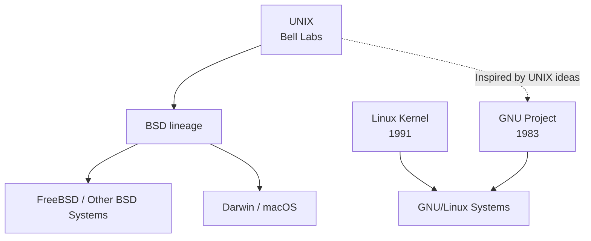
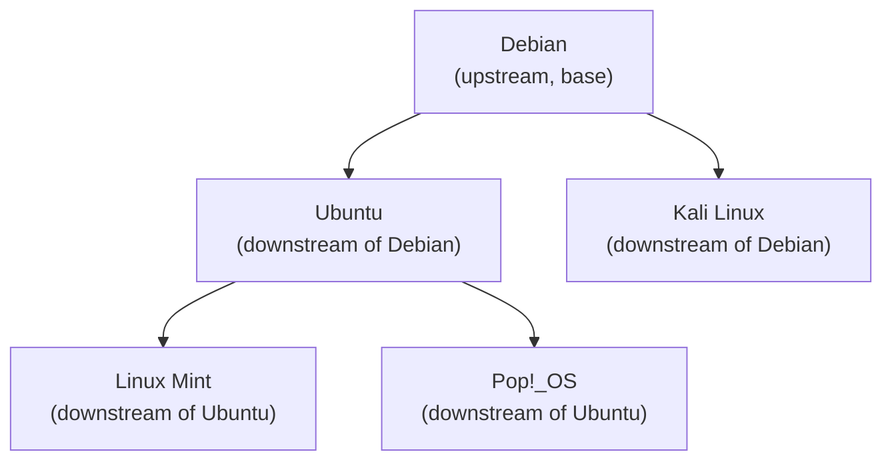

# 🐧 Linux Learning Journey: Foundations (UNIX → Linux → Distros)

> **Goal:** Build the mental model — what Linux actually *is*, where it came from, and why every DevOps tool you'll ever touch sits on top of it.

---

## 📍 Let's Begin Our Linux Learning Journey

Before we type a single command, we have to settle one question that confuses almost every beginner:

> **Is Linux an operating system?**

Spoiler: **No. Linux is a *kernel*.** The thing you install on your laptop called "Ubuntu" or "Fedora" is an *operating system* built *around* the Linux kernel.

To understand why that distinction matters — and why it shapes everything in DevOps (containers, CI/CD runners, Kubernetes nodes, cloud VMs) — we have to start one step earlier: with **UNIX**.

---

## 1️⃣ What is UNIX?

**UNIX** is the grandparent operating system, originally built at **Bell Labs (AT&T) in the late 1960s–early 1970s** by Ken Thompson, Dennis Ritchie, and others. It introduced ideas we now take for granted: a hierarchical file system, plain-text configuration files, pipes, and the idea that "**everything is a file**."

> *"Linux is considered a **Unix-like operating system** which basically means that Linux derives heavy inspiration from Unix without actually conforming to be a full Unix operating system. macOS and FreeBSD would be two more examples of a Unix-like operating system."*

So there's a real difference between:

- **Official UNIX** — certified by The Open Group, pays for the UNIX trademark (e.g., older Solaris, AIX, HP-UX; macOS is actually certified UNIX).
- **Unix-like** — behaves like UNIX, follows its principles and APIs, but isn't certified (Linux, FreeBSD in some readings, etc.).

### 🌳 The Two Branches of the UNIX Family

UNIX split over the decades into two major lineages that every DevOps engineer should recognize:

```
                 ┌─────────────────────────────┐
                 │      Original UNIX          │
                 │   (Bell Labs, ~1970s)       │
                 └──────────────┬──────────────┘
                                │
              ┌─────────────────┴─────────────────┐
              ▼                                   ▼
   ┌────────────────────┐              ┌────────────────────┐
   │   BSD Branch       │              │   GNU Branch       │
   │ Berkeley Software  │              │  "GNU's Not Unix"  │
   │ Distribution       │              │  (FSF / Stallman)  │
   └─────────┬──────────┘              └──────────┬─────────┘
             │                                    │
   ┌─────────┴──────────┐                         │
   │ FreeBSD            │                         ▼
   │ OpenBSD            │              ┌────────────────────┐
   │ NetBSD             │              │  Linux             │
   │ macOS (Darwin)     │              │  (Linus Torvalds,  │
   └────────────────────┘              │   1991)            │
                                       └────────────────────┘
```

- **BSD branch** → gave us FreeBSD, OpenBSD, NetBSD, and (via Darwin) **macOS**.
- **GNU branch** → Richard Stallman's Free Software Foundation was building a free Unix-like OS, but they were missing one piece: the **kernel**. Linus Torvalds filled that gap in 1991 with the **Linux kernel**, and the GNU userland + Linux kernel became what we today just call "Linux."

> 💡 **DevOps note:** When you SSH into a Mac and into an Ubuntu server, the commands *feel* the same — `ls`, `cat`, `grep`, `ps`. That's because both are Unix-like. But the kernels underneath (Darwin vs Linux) are completely different codebases.

---

## 2️⃣ The UNIX Philosophy

The four principles that lays out Linux. These aren't history lessons — they're the *design DNA* of every Linux tool you'll use as a DevOps engineer (`grep`, `sed`, `docker`, etc.).

### 📜 The Four Principles

**1. Do one thing well.**
> *Make each program do one thing well. To do a new job, build afresh rather than complicate old programs by adding new "features."*

Each tool should have a single, focused responsibility. `grep` searches. `sort` sorts. `wget` downloads. They don't try to be everything.

**2. Expect every program's output to become another program's input.**
> *Expect the output of every program to become the input to another, as yet unknown, program. Don't clutter output with extraneous information. Avoid stringently columnar or binary input formats. Don't insist on interactive input.*

This is the foundation of **pipes** (`|`) and the Unix stream model. Output should be clean, plain text, line-based — so any tool can consume it.

**3. Build software to be tried early.**
> *Design and build software, even operating systems, to be tried early, ideally within weeks. Don't hesitate to throw away the clumsy parts and rebuild them.*

This is the original version of "release early, release often" — the same idea behind Agile, CI/CD, and DevOps culture itself.

**4. Prefer tools over manual labor.**
> *Use tools in preference to unskilled help to lighten a programming task, even if you have to detour to build the tools and expect to throw some of them out after you've finished using them.*

Automate. Build a tool once, even if you'll only use it twice. This is the literal ancestor of **Infrastructure as Code (IaC)**, Ansible playbooks, Terraform modules, and shell scripting.

---

## 3️⃣ From UNIX to LINUX

Here's a subtle but crucial point most beginners miss:

> *"Linux is not directly derived from the Unix codebase. Linus Torvalds created his own version of Unix from scratch, being compatible where it made sense but also branching off in his own directions. He did this because there was no free and open source version of Unix available at the time that satisfied his needs."*

So Linux is **NOT** UNIX. It:
- ❌ Shares **no code** with the original UNIX
- ✅ Shares the **philosophy** (the 4 principles above)
- ✅ Shares the **APIs** (POSIX — so most Unix programs port over)
- ✅ Was built from scratch by **Linus Torvalds in 1991**, when he was a university student in Finland

### 🧬 Why Linus Built It

In 1991, if you wanted a Unix-like OS, your options were:
1. Buy expensive proprietary UNIX (Solaris, AIX) — 💸
2. Use BSD — but the BSD lawsuit made its licensing uncertain at the time
3. Use MINIX — but its license forbade commercial use, and it was meant for teaching only

Linus wanted a **free, open-source, production-grade** Unix-like kernel for his 386 PC. So he wrote one. He announced it on the `comp.os.minix` newsgroup with the famously humble line: *"I'm doing a (free) operating system (just a hobby, won't be big and professional like gnu)..."*

The rest is history.

### 🔁 UNIX → Linux Lineage at a Glance



---

## 4️⃣ What is Linux? (Kernel vs Operating System)

This is **the single most important concept of Day 1**. Get this wrong, and the rest of Linux will confuse you.

> **Linux is NOT an operating system. Linux is a KERNEL.**

### 💭 Analogy: The Car

Think of an operating system like a car:

- The **kernel** is the **engine** — it sits between you (the driver = software) and the road (the hardware). You never directly touch the engine; you use the steering wheel, pedals, and dashboard (the rest of the OS).
- The **operating system** is the whole car — engine + chassis + dashboard + seats + infotainment system.

You can't drive an engine down the road. You need the rest of the car. But every car needs an engine.

### 📐 The Layered View

```
   ┌─────────────────────────────────────────────────────────┐
   │                   USER APPLICATIONS                     │
   │      (nginx, docker, your Node app, kubectl, vim)       │
   ├─────────────────────────────────────────────────────────┤
   │                  GNU USERLAND / SHELL                   │
   │         (bash, coreutils, ls, cat, grep, awk)           │
   ├─────────────────────────────────────────────────────────┤
   │              SYSTEM LIBRARIES (glibc, etc.)             │
   ├─────────────────────────────────────────────────────────┤
   │  ╔═════════════════════════════════════════════════╗    │
   │  ║              SYSTEM CALL INTERFACE              ║    │
   │  ╠═════════════════════════════════════════════════╣    │
   │  ║                   LINUX KERNEL                  ║    │
   │  ║  ┌─────────────┐ ┌──────────┐ ┌──────────────┐  ║    │
   │  ║  │  Process    │ │ Memory   │ │   File       │  ║    │
   │  ║  │  Mgmt       │ │ Mgmt     │ │   Systems    │  ║    │
   │  ║  ├─────────────┤ ├──────────┤ ├──────────────┤  ║    │
   │  ║  │  Scheduling │ │ Drivers  │ │   Network    │  ║    │
   │  ║  │  (CPU)      │ │ Stack    │ │   Stack      │  ║    │
   │  ║  └─────────────┘ └──────────┘ └──────────────┘  ║    │
   │  ╚═════════════════════════════════════════════════╝    │
   ├─────────────────────────────────────────────────────────┤
   │                HARDWARE (CPU, RAM, Disk, NIC)           │
   └─────────────────────────────────────────────────────────┘
```

### 🔧 What the Kernel Actually Does

| Kernel Responsibility | What it means | DevOps impact |
|---|---|---|
| **Process Management** | Decides which program runs, when, for how long. Schedules CPU time. | `kill`, `top`, `htop`, cgroups, container isolation |
| **Memory Management** | Allocates RAM to processes, handles virtual memory & swap. | OOM kills in production, container memory limits |
| **File System Management** | Reads/writes to disk: ext4, xfs, btrfs, etc. | Mounting volumes, persistent volumes in K8s |
| **Device Drivers** | Talks to hardware (NIC, GPU, disk controllers). | Networking, GPU passthrough, storage drivers |
| **Network Stack** | Implements TCP/IP, routing, firewalls. | `iptables`, `ip`, service mesh, CNI plugins |
| **System Call Interface** | The API user programs use to ask the kernel to do things. | `strace`, `ltrace`, debugging production issues |

> 💡 Linux (the kernel) handles **Hardware Communication, Process Management, Memory Management, Device Drivers**. The Operating System is *all of that* PLUS the user interface, application management, and file system tooling layered on top.

---

## 5️⃣ Why Linux Matters in Modern Computing (DevOps Perspective)

If you're learning Linux to become a DevOps engineer, you're not learning a "nice to have." You're learning the **substrate** that runs ~96% of the top 1 million web servers, 100% of Android, and essentially every cloud workload.

### 🌍 Where Linux Runs the Modern World

```
   ┌────────────────────────────────────────────────────────┐
   │              THE MODERN DEVOPS STACK                   │
   ├────────────────────────────────────────────────────────┤
   │  Cloud (AWS, GCP, Azure)   →  Mostly Linux VMs         │
   │  Containers (Docker)       →  Linux containers         │
   │  Kubernetes                →  Linux control plane      │
   │  CI/CD (GitHub Actions,    →  Linux-based runners      │
   │         GitLab CI, Jenkins)                            │
   │  Web Servers (nginx,       →  Born on Linux            │
   │         Apache)                                        │
   │  Databases (Postgres,      →  Linux-first              │
   │         MySQL, Redis)                                  │
   │  IaC (Ansible, Terraform)  →  SSHs into Linux hosts    │
   │  Edge / IoT               →  Embedded Linux everywhere │
   └────────────────────────────────────────────────────────┘
```

### 🎯 Why DevOps Engineers MUST Know Linux

| Reason | Example |
|---|---|
| **Linux is widely used in production server environments.** | When the on-call pager goes off at 3 AM, you SSH into a Linux box — not a Windows desktop. |
| **Containers ARE Linux.** | A Docker container is just Linux namespaces + cgroups. No Linux, no containers. |
| **All config is text files.** | `/etc/nginx/nginx.conf`, `~/.ssh/config`, `~/.kube/config`. Learn to read & edit them efficiently. |
| **Automation is shell + Python on Linux.** | Bash scripts, Ansible modules, Python tooling — all assume a Linux environment. |
| **Debugging requires Linux tooling.** | `strace`, `tcpdump`, `journalctl` — these don't exist on Windows in the same form. |

> 🧭 **The DevOps mindset:** *"If I can't SSH into it, read its logs, and understand what the kernel is doing, I can't operate it in production."* Linux is the literacy of operations.

---

## 6️⃣ Distributions (Distros) — One Kernel, Many Flavors

Now the part that confuses every beginner: **if Linux is just a kernel, what is "Ubuntu"? What is "Fedora"? What is "Arch"?**

### 🎯 The Core Idea

> **Linux is one kernel project with multiple versions and configurations and there are MANY Linux distributions.**

A **distribution (distro)** is what you get when someone takes:
- The **Linux kernel** (the same one, from `kernel.org`), **+**
- A **package manager** (`apt`, `dnf`, `pacman`), **+**
- A **set of pre-installed tools** (GNU coreutils, shell, editors), **+**
- (optionally) a **desktop environment** (GNOME, KDE, XFCE), **+**
- **Configuration, defaults, and branding**

…and ships it as a complete, installable operating system.

```
                    ┌──────────────────────────┐
                    │     THE LINUX KERNEL     │
                    │  (one ring to rule them  │
                    │   all — from kernel.org) │
                    └─────────────┬────────────┘
                                  │
            ┌─────────────────────┼─────────────────────┐
            │                     │                     │
   ┌────────▼─────────┐  ┌────────▼────────┐  ┌─────────▼───────┐
   │  Debian family   │  │  Red Hat family │  │   Arch family   │
   │  (apt, dpkg)     │  │  (dnf, rpm)     │  │   (pacman)      │
   └────────┬─────────┘  └────────┬────────┘  └─────────┬───────┘
            │                     │                     │
   ┌────────┴────────┐   ┌────────┴────────┐     ┌──────┴──────┐
   │ Ubuntu          │   │ RHEL            │     │ Arch        │
   │ Linux Mint      │   │ Fedora          │     │ Manjaro     │
   │ Pop!_OS         │   │ CentOS Stream   │     │ EndeavourOS │
   │ Kali Linux      │   │ Rocky Linux     │     └─────────────┘
   └─────────────────┘   │ AlmaLinux       │
                         └─────────────────┘
```

### 🆚 Debian Family vs Red Hat Family (the two you'll meet in DevOps)

| Aspect | Debian / Ubuntu | Red Hat / RHEL / Fedora |
|---|---|---|
| **Package manager** | `apt`, `dpkg` (`.deb` files) | `dnf`, `rpm` (`.rpm` files) |
| **Service manager** | `systemd` (modern) | `systemd` (modern) |
| **Default shell** | `bash` | `bash` |
| **Typical use** | Personal, cloud VMs, containers, ML | Enterprise servers, banking, government |
| **Support model** | Community (Ubuntu has paid Canonical support) | Paid enterprise support from Red Hat/IBM |
| **Release cadence** | Ubuntu LTS every 2 years | RHEL every ~3 years |

> 💡 **DevOps tip:** When reading tutorials, **always check whether the tutorial is for Debian/Ubuntu or RHEL/Fedora**. The commands differ — `apt install nginx` vs `dnf install nginx`. This is the #1 source of beginner confusion.

### 🌊 Upstream and Downstream Distros

Distros build on each other. The course material nails this:

> *"Downstream distro means Ubuntu is built on top of Debian. Debian is the base distro; Ubuntu adds more code and features on top. Likewise, Mint is downstream of Ubuntu — it's built on top of Ubuntu."*



**Vocabulary:**
- **Upstream** = the source project a distro derives from (Debian is upstream of Ubuntu).
- **Downstream** = the derived distro (Ubuntu is downstream of Debian; Mint is downstream of Ubuntu).

**Why this matters:** If you find a bug in Linux Mint, it might actually be a bug in Ubuntu, which might actually be a bug in Debian. Fixing it upstream fixes it for everyone downstream. This is the **open-source collaboration model** — and the same model Kubernetes, Helm, and most CNCF projects use.

### 🏗️ What's Actually "Built Around" the Kernel

> *"The Linux kernel handles memory, scheduling, processes, and file system — the core operations. A distribution (distro) takes that kernel and adds: a desktop environment, programs, package manager, and networking — to make a complete operating system."*

| Layer | Component | Examples |
|---|---|---|
| **Kernel** | Linux | (same for all distros, version may vary) |
| **Init system** | Manages boot & services | `systemd` (almost everywhere now) |
| **Package manager** | Installs/removes software | `apt`, `dnf`, `pacman`, `zypper` |
| **GNU coreutils** | Basic commands | `ls`, `cp`, `cat`, `mv`, `rm` |
| **Shell** | Command interpreter | `bash`, `zsh`, `fish` |
| **Desktop environment** | GUI | GNOME, KDE, XFCE, Cinnamon |
| **Pre-installed apps** | Browser, office, etc. | Firefox, LibreOffice |
| **Config & defaults** | Branding, file layout | Ubuntu brown vs Fedora blue |

Linux distributions share the Linux kernel project, but may package different kernel versions, configurations, and distribution-specific patches. They also differ in their user-space components, package managers, defaults, and system configuration.

---

## 🧾 Summary

| Concept | One-line takeaway |
|---|---|
| **UNIX** | The original 1970s OS from Bell Labs; its philosophy & APIs still rule the world. |
| **Unix-like** | Behaves like UNIX but isn't certified — Linux, macOS, FreeBSD. |
| **UNIX Philosophy** | Do one thing well • Pipe programs together • Build early, iterate • Automate with tools. |
| **Linux ≠ OS** | Linux is a **kernel** (the engine). The OS = kernel + userland + tools. |
| **Linus Torvalds** | Wrote the Linux kernel from scratch in 1991, **not** from UNIX code. |
| **Why Linux for DevOps** | Servers, containers, K8s, cloud, IaC — all run on Linux. It's the substrate. |
| **Distro** | One kernel + many packaging choices = many distributions. |
| **Upstream/downstream** | Debian → Ubuntu → Mint. Bugs and fixes flow up & down this chain. |

---