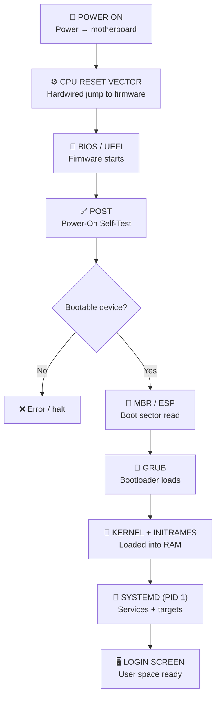

# 🐧 Linux Learning Journey: The Boot Process (Power Button → Login Prompt)

> **Goal:** Understand every step from the moment you press power to the moment you see a login prompt — because in DevOps, you'll troubleshoot boot failures, rescue broken GRUB, and debug services that refuse to start.

---

## 📍 Why the Boot Process Matters to DevOps

Day 1 we covered what Linux *is*. Day 2 we learned to *use* the shell. Today we go under the hood: **how does a Linux machine actually come to life?**

You might think this is academic. It's not. Consider these real-world DevOps scenarios:

- A production server reboots after a kernel update and **never comes back** — stuck at a GRUB prompt. Do you know how to rescue it?
- A cloud VM fails to boot because the `initramfs` can't find the root filesystem. Can you diagnose it?
- A service won't start at boot. Is it a systemd issue, a dependency issue, or a kernel module that didn't load?
- You need to change the default boot target from graphical to multi-user (text-only) on a headless server. Where do you look?

Every one of these requires understanding the boot sequence. Let's walk through it — from the very first electron that hits the motherboard.

---

## 1️⃣ The Big Picture — 8 Steps from Power to Login

Before diving into details, here's the full sequence. Memorize this skeleton — everything else is just filling in the blanks.

```
   POWER ON ──▶ CPU RESET VECTOR ──▶ BIOS/UEFI ──▶ POST
                                                      │
                                                      ▼
                                                MBR / ESP
                                                      │
                                                      ▼
                                                    GRUB
                                                      │
                                                      ▼
                                            KERNEL + INITRAMFS
                                                      │
                                                      ▼
                                                   SYSTEMD
                                                      │
                                                      ▼
                                              LOGIN SCREEN
```

| # | Step | What happens |
|---|---|---|
| 1 | **Power On** | Power flows to the motherboard and all hardware components. |
| 2 | **CPU & Reset Vector** | The CPU executes hardcoded instructions pointing to the firmware. |
| 3 | **BIOS / UEFI** | Firmware runs POST (Power-On Self-Test), then searches for a bootable device. |
| 4 | **MBR / ESP** | Firmware reads the boot sector (MBR for BIOS, ESP for UEFI). |
| 5 | **GRUB** | The bootloader loads into memory. |
| 6 | **Kernel & Initramfs** | The Linux kernel + temporary initial RAM filesystem load into memory. |
| 7 | **Systemd / Init** | Kernel launches `systemd` (PID 1), which initializes services and targets. |
| 8 | **Login Screen** | System reaches its target state. You see a login prompt. |

Now let's walk through each one in detail.



---

## 2️⃣ Power On, CPU & the Reset Vector

When you press the power button, the same sequence fires whether you're starting a fresh server or rebooting one.

### ⚡ Power Flows

Power flows to the motherboard and every component — CPU, RAM, disk, NIC. The machine is now "alive" but has no idea what to do.

### 🧠 The CPU's Dirty Little Secret

Here's something that surprises most beginners: **the CPU is the brain of the computer, but on first startup, it doesn't know what to do.** It's a blank slate. No program counter, no instructions queued.

So manufacturers **hardwire** a fix. On startup or reset, the CPU jumps to a fixed memory address called the **Reset Vector**. This address is etched into the silicon — it never changes.

```
   ┌───────────────────────────────────────────────────┐
   │                   CPU (on power up)               │
   │                                                   │
   │   "I have no idea what to do..."                  │
   │            │                                      │
   │            ▼  (hardwired jump)                    │
   │   ┌─────────────────┐                             │
   │   │  RESET VECTOR   │  ← fixed address in silicon │
   │   │  e.g. 0xFFFF0   │                             │
   │   └────────┬────────┘                             │
   │            │                                      │
   │            ▼                                      │
   │   points to non-volatile memory on motherboard    │
   └───────────────────────────────────────────────────┘
```

### 💾 Non-Volatile Memory — Where the Firmware Lives

The Reset Vector points to **non-volatile memory** built into the motherboard — memory that retains data even without power. Two flavors:

| Type | Used in | Notes |
|---|---|---|
| **ROM** (Read-Only Memory) | Older systems | Truly read-only — can't update without swapping the chip |
| **Flash Memory** | Modern systems | Rewritable — this is *why* you can update your BIOS/UEFI today |

This memory contains the **BIOS** or **UEFI** firmware — the very first real program the CPU runs.

> 💡 This is why firmware updates are a thing: modern systems use flash memory, so vendors can ship patches. It's also why a bad firmware update can "brick" a motherboard — you've corrupted the only code the CPU knows how to run.

---

## 3️⃣ BIOS vs UEFI — The Firmware

The firmware is the **"first program"** the CPU executes. It's stored by the hardware vendor (Dell, HP, Lenovo, etc.) and lives on the motherboard itself.

### 📜 Two Generations of Firmware

| | **BIOS** | **UEFI** |
|---|---|---|
| **Full name** | Basic Input/Output System | Unified Extensible Firmware Interface |
| **Era** | Older systems (1980s–2010s) | Modern systems (2010s–present) |
| **Disk scheme** | **MBR** — limits disk size to **2 TB** | **GPT** — no practical size limit |
| **Boot speed** | Slower | Faster |
| **Security** | Less secure | **Secure Boot** (verifies kernel signature) |
| **UI** | Text-only, keyboard navigation | Mouse-capable, graphical |

### ✅ POST — Power-On Self-Test

Once the firmware starts, it runs **POST (Power-On Self-Test)**. This is the firmware checking and initializing every hardware component — keyboard, screen, RAM, disk, NIC — to make sure everything is healthy *before* loading an OS.

If POST finds a problem, you'll typically see (or hear) an error:
- **Beep codes** — patterns of beeps indicating which component failed (RAM, GPU, etc.)
- **On-screen error message** — if the display works
- **Halt** — the system stops and refuses to boot

### 🔍 Searching for a Bootable Device

Once POST passes, the firmware searches for a **bootable device** — an SSD, HDD, USB drive, network (PXE boot), or even older media like CDs/floppies. The search order is configurable in BIOS/UEFI settings:

```
   Boot Order (configurable):
   ┌──────────────────────────────────────┐
   │  1. Hard Drive (default)             │
   │  2. USB Drive                        │
   │  3. Network (PXE)                    │
   │  4. CD/DVD                           │
   └──────────────────────────────────────┘
```

> 🧭 **DevOps angle:** **PXE boot** (network boot) is how bare-metal servers in data centers get provisioned automatically. The server has no OS — it boots from the network, downloads an installer image, and installs itself. Tools like MAAS, Foreman, and Cobbler rely on this. Understanding the boot order is understanding how infrastructure gets built at scale.

---

## 4️⃣ MBR vs ESP — Where the Bootloader Lives

Once the firmware finds a bootable device, it needs to read the **boot sector** — the very first chunk of data that tells it what to load next. The structure of this sector depends on whether you're using BIOS or UEFI.

### 💽 MBR (Master Boot Record) — For BIOS Systems

The MBR is the **first sector** of a bootable device, and it's tiny — just **512 bytes**. That's smaller than this paragraph. Here's how those 512 bytes are carved up:

```
   ┌────────────────────────────────────────────────────────┐
   │              MBR — 512 bytes total                     │
   ├───────────────────┬──────────────────┬─────────────────┤
   │  Boot Loader Code │  Partition Table │ Boot Signature  │
   │     446 bytes     │     64 bytes     │    2 bytes      │
   ├───────────────────┼──────────────────┼─────────────────┤
   │  Small code that  │  Tells OS where  │  Marker (0x55   │
   │  loads the next   │  partitions are  │  0xAA) —        │
   │  stage (GRUB)     │  on the disk     │  "valid MBR"    │
   └───────────────────┴──────────────────┴─────────────────┘
```

- **Boot Loader Code (446 bytes):** A tiny code snippet whose only job is to load the *next* stage of the bootloader (in Linux, this is **GRUB**). It's too small to do anything fancy — it just hands off to something bigger.
- **Partition Table (64 bytes):** Tells the bootloader and OS where each partition lives on the disk. Each partition entry takes 16 bytes, so MBR supports a maximum of **4 primary partitions** (or 3 primary + 1 extended).
- **Boot Signature (2 bytes):** A magic marker (`0x55 0xAA`) that tells the firmware "yes, this is a valid MBR — you may proceed." Without it, the firmware rejects the disk as non-bootable.

> ⚠️ **The 2 TB limit:** MBR uses 32-bit LBA (Logical Block Addressing), which caps addressable disk size at **2 TB**. If you buy a 4 TB disk and partition it with MBR, half the space is unusable. This is a major reason UEFI/GPT replaced BIOS/MBR.

### 📂 ESP (EFI System Partition) — For UEFI Systems

UEFI takes a completely different approach. Instead of reading a 512-byte boot sector, UEFI directly targets a special partition called the **ESP (EFI System Partition)** on a **GPT-formatted disk**.

| | MBR | ESP |
|---|---|---|
| **Size** | 512 bytes (one sector) | **100–500 MB** (a full partition) |
| **Partition scheme** | MBR partition table | GPT (GUID Partition Table) |
| **What's stored** | Tiny bootloader code + partition table | **Executable files** like `GRUBX64.EFI` (Linux) or `BOOTX64.EFI` (Windows) |
| **How firmware finds it** | Reads first sector of disk | Mounts the ESP, runs the `.efi` file directly |

```
   UEFI boot path:
   ┌──────────┐      ┌─────────────────┐      ┌──────────────────┐
   │  UEFI    │────▶│  ESP partition  │────▶│  GRUBX64.EFI     │
   │ firmware │      │  (FAT32, ~300MB)│      │  (executable)    │
   └──────────┘      └─────────────────┘      └──────────────────┘
                           │
                     holds .efi files for
                     every OS you boot
```

UEFI doesn't need the "tiny bootloader → bigger bootloader" dance that MBR does. It can directly execute `.efi` files, which is cleaner and more flexible.

At this point — whether you came through BIOS+MBR or UEFI+ESP — the **GRUB bootloader** is now loaded into memory and in control.

---

## 5️⃣ GRUB — The Grand Unified Bootloader

### 🎯 What is GRUB?

**GRUB** = **G**rand **U**nified **B**ootloader. It's the standard bootloader for Linux. **GRUB2** is the modern, modular, UEFI-compatible version — better filesystem support, scripting, and graphical features.

Other bootloaders you might encounter:
- **LILO** (Linux Loader) — outdated, rarely used in modern distros
- **systemd-boot** — a lean alternative used by some distros
- **rEFInd** — popular on Macs for multi-boot

But GRUB2 is what you'll see 95% of the time.

### 🔧 What GRUB Does

1. **Reads its config** — typically `grub.cfg`, located in `/boot/grub/` (BIOS) or inside the ESP (UEFI).
2. **Displays a menu** — lists available OS kernels. If you don't pick one, it auto-selects the default after a timeout.
3. **Locates the kernel binary** (`vmlinuz`) and the **initial RAM filesystem** (`initramfs` / `initrd`).
4. **Loads both into RAM** and hands control over to the kernel.

```
   ┌───────────────────────────────────────────────────┐
   │                   GRUB MENU                       │
   │                                                   │
   │   ▶ Ubuntu 22.04.3 LTS (default)                 │
   │     Ubuntu 22.04.3 LTS (recovery mode)            │
   │     Ubuntu 22.04.3 LTS (older kernel 5.15.0-83)   │
   │     Memory test (memtest86+)                      │
   │                                                   │
   │   The selected entry will start in 5s...          │
   └───────────────────────────────────────────────────┘
                  │
                  ▼ (user picks or timeout)
   ┌───────────────────────────────────────────────────┐
   │  GRUB loads into RAM:                             │
   │   • vmlinuz   (compressed kernel binary)          │
   │   • initramfs (temporary root filesystem)         │
   │                                                   │
   │   Then hands control to the kernel.               │
   └───────────────────────────────────────────────────┘
```

> 🧭 **DevOps angle:** Ever seen a server stuck at a `grub>` prompt with a blinking cursor? That's GRUB's rescue shell — it means GRUB loaded but couldn't find its config or the kernel. Knowing how to manually load a kernel from the `grub>` prompt (`linux /boot/vmlinuz...`, `initrd /boot/initrd...`, `boot`) is a production lifesaver. We'll cover GRUB rescue in detail later.

---

## 6️⃣ The Kernel & Initramfs

The kernel is now in memory. But it can't just start running services — it needs to find the *real* root filesystem first, and that's where `initramfs` comes in.

### 🧠 The Linux Kernel Boots

The kernel binary (`vmlinuz`) is **compressed** — it has to be, to fit on the boot media. So the first thing it does is **decompress itself** in RAM.

Then, using the drivers and modules provided by `initramfs`, the kernel:
1. **Scans and recognizes** the main hard disks and storage controllers
2. **Mounts the real root filesystem** (the actual `/` on your disk)
3. **Unmounts the temporary initramfs**
4. **Shifts operations entirely** to the real root filesystem
5. **Launches the first user-space process:** `systemd` (PID 1)

### 📦 Initramfs — The Temporary Root Filesystem

**Initramfs** (Initial RAM Filesystem) is a temporary filesystem loaded directly into RAM. Its job is simple but critical: **help the kernel find, mount, and transition to the real root filesystem.**

```
   ┌──────────────────────────────────────────────────────────┐
   │                    BOOT TIMELINE                         │
   ├──────────────────────────────────────────────────────────┤
   │                                                          │
   │  [GRUB loads]                                            │
   │       │                                                  │
   │       ▼                                                  │
   │  ┌─────────────────────────────────┐                     │
   │  │  initramfs in RAM (temporary)   │                     │
   │  │  contains: drivers, LVM, RAID,  │                     │
   │  │  encryption tools, mount utils  │                     │
   │  └────────────┬────────────────────┘                     │
   │               │                                          │
   │               ▼  (kernel uses these drivers)             │
   │  ┌─────────────────────────────────┐                     │
   │  │  Real root filesystem mounted   │                     │
   │  │  (the actual / on disk)         │                     │
   │  └────────────┬────────────────────┘                     │
   │               │                                          │
   │               ▼                                          │
   │  initramfs cleared from RAM                              │
   │  kernel fully runs from real root                        │
   │               │                                          │
   │               ▼                                          │
   │  kernel launches systemd (PID 1)                         │
   │                                                          │
   └──────────────────────────────────────────────────────────┘
```

**Why does the kernel need this?** Because the real root filesystem might live on:
- An **LVM** volume (needs LVM drivers)
- A **RAID** array (needs RAID drivers)
- An **encrypted** partition (needs dm-crypt tools)
- A **network** filesystem (needs NFS/iSCSI drivers)

The kernel can't load these drivers from the root filesystem *because it hasn't mounted the root filesystem yet* — classic chicken-and-egg. Initramfs breaks the cycle by shipping the necessary drivers *in RAM*.

> 🧭 **DevOps angle:** If you've ever updated a kernel and rebooted into a "kernel panic — unable to mount root fs" error, it's almost always an `initramfs` problem — the new kernel didn't regenerate its initramfs with the right storage drivers. On Debian/Ubuntu: `update-initramfs -u -k all`. On RHEL: `dracut --regenerate-all`. This is a DevOps interview question that comes up constantly.

---

## 7️⃣ Systemd (PID 1) vs Legacy Init

The kernel has mounted the root filesystem. Now it launches the **first user-space process** — and this process has a special role: it becomes the ancestor of *every other process* on the system.

### 🚀 Systemd — The Modern Init

On modern Linux, the first process is **systemd**. You can verify this:

```bash
$ ps -p 1
  PID TTY          TIME CMD
    1 ?        00:00:02 systemd
```

**PID 1** — every other process you'll ever run is a descendant of systemd. It's the root of the process tree.

### 📋 What Systemd Does

Systemd is responsible for bringing the entire user-space up:

| Task | Example |
|---|---|
| **Initialize services & targets** | Based on config in `/etc/systemd/system/` |
| **Mount filesystems** | `/home`, `/var`, swap, etc. |
| **Start networking** | NetworkManager, networkd |
| **Start background services** | sshd, cron, docker, nginx |
| **Handle user logins** | `getty` / display manager |
| **Load desktop environment** | GNOME, KDE panels & menus |

### 🎯 Targets (Modern Runlevels)

Systemd decides which mode to boot into using **targets**. You can check your default:

```bash
$ systemctl get-default
multi-user.target
```

Common targets:

| Target | What it boots into | Old runlevel equivalent |
|---|---|---|
| `graphical.target` | Full GUI (desktop environment) | Runlevel 5 |
| `multi-user.target` | Text-only, multi-user (headless server) | Runlevel 3 |
| `rescue.target` | Single-user rescue mode | Runlevel 1 |
| `reboot.target` | Reboot | Runlevel 6 |
| `poweroff.target` | Shutdown | Runlevel 0 |

Change the default:

```bash
sudo systemctl set-default multi-user.target   # text-only server
sudo systemctl set-default graphical.target    # desktop
```

The default is stored as a symlink: `/etc/systemd/system/default.target → /lib/systemd/system/multi-user.target`.

### ⚡ Parallel Initialization — Why Systemd is Faster

Legacy init systems started services **sequentially** — one after another, based on rigid dependency ordering. If service A took 10 seconds to start, service B waited 10 seconds before even trying.

Systemd starts services **in parallel**, using dependency graphs to figure out what *can* start simultaneously. The result: dramatically faster boot times.

```
   Legacy Init (SysVinit) — Sequential:
   ──▶ [network] ──▶ [sshd] ──▶ [docker] ──▶ [nginx] ──▶ ready
        3s           2s          5s          2s        = 12s total

   Systemd — Parallel:
   ──▶ [network] ──▶ [sshd] ─┐
                └──▶ [docker] ──▶ [nginx] ──▶ ready
                                              = ~8s total
   (services with no dependency on each other start at once)
```

### 📜 Legacy Init (SysVinit) — For Context

Older systems (Red Hat 6, CentOS 6, early Debian) used **SysVinit** — inspired by Unix System V. It also had PID 1, but worked very differently:

- Config lived in `/etc/inittab` and `/etc/rc.d/`
- Used numbered **runlevels** (0–6) instead of named targets
- Services started **sequentially** via shell scripts in `/etc/init.d/`
- Boot was noticeably slower

You'll still encounter SysVinit on legacy systems and in some embedded devices. But for any modern server, **systemd is the standard**.

> 💡 If you ever see `/etc/inittab` on a system, you're looking at a very old (or very specialized) box. Modern systemd distros don't use it.

---

## 8️⃣ User Space & the Login Prompt

Once systemd finishes bringing up all services and reaching the target state, the **login screen** appears.

```
   ┌──────────────────────────────────────────────┐
   │                                              │
   │   Ubuntu 22.04.3 LTS  server01  tty1         │
   │                                              │
   │   server01 login: ubuntu                     │
   │   Password:                                  │
   │                                              │
   └──────────────────────────────────────────────┘
```

You're now in **user space** — the realm where your applications, scripts, and processes run. The kernel continues managing hardware and resources in the background, but you're free to work.

### 🔄 The Full Picture — One More Time

```
   POWER BUTTON
       │
       ▼
   ┌─────────┐     ┌──────────┐     ┌─────────┐     ┌──────────┐
   │  Power  │───▶│   CPU    │───▶│ BIOS/   │───▶│  POST    │
   │  flows  │     │ Reset    │     │ UEFI    │     │  checks  │
   └─────────┘     │ Vector   │     │ firmware│     │  HW      │
                   └──────────┘     └─────────┘     └────┬─────┘
                                                         │
                                                         ▼
   ┌──────────┐     ┌──────────┐     ┌─────────┐     ┌──────────┐
   │  Login   │◀───│ Systemd  │◀───│ Kernel  │◀───│  GRUB    │
   │  screen  │     │ (PID 1)  │     │ + initr │     │ bootload │
   └──────────┘     └──────────┘     └─────────┘     └──────────┘
                                                         ▲
                                                         │
                                                    ┌──────────┐
                                                    │ MBR/ESP  │
                                                    │ boot sec │
                                                    └──────────┘
```

---

## 🧾 Summary

| Concept | One-line takeaway |
|---|---|
| **Boot process** | 8 steps: Power → Reset Vector → BIOS/UEFI → POST → MBR/ESP → GRUB → Kernel+Initramfs → Systemd → Login. |
| **Reset Vector** | Hardwired memory address the CPU jumps to on power-up — points to motherboard firmware. |
| **ROM vs Flash** | Old systems used read-only ROM; modern systems use rewritable flash (hence firmware updates). |
| **BIOS vs UEFI** | BIOS = old, MBR, 2TB limit, slow, no Secure Boot. UEFI = modern, GPT, fast, Secure Boot. |
| **POST** | Power-On Self-Test — firmware checks all hardware before loading an OS. |
| **Boot order** | Configurable sequence of devices the firmware tries (disk, USB, network/PXE, etc.). |
| **MBR** | First 512-byte sector: 446B bootloader code + 64B partition table + 2B signature. Max 2TB, 4 partitions. |
| **ESP** | EFI System Partition (100–500MB) on GPT disks; holds `.efi` executables the firmware runs directly. |
| **GRUB** | Grand Unified Bootloader — reads `grub.cfg`, shows kernel menu, loads `vmlinuz` + `initramfs` into RAM. |
| **Initramfs** | Temporary root filesystem in RAM; provides drivers (LVM, RAID, encryption) so kernel can mount the *real* root. |
| **Kernel boot** | Decompresses → scans hardware via initramfs drivers → mounts real root → launches systemd (PID 1). |
| **Systemd** | Modern init, PID 1, starts services in parallel via dependency graph. Replaced SysVinit. |
| **Targets** | Systemd's named boot modes: `graphical.target`, `multi-user.target`, `rescue.target`. Replace old runlevels. |
| **SysVinit** | Legacy init — sequential startup, `/etc/inittab`, runlevels 0–6. Still seen on old/embedded systems. |
| **`ps -p 1`** | Verify what's running as PID 1 — `systemd` on modern Linux. |
| **`systemctl get-default`** | Check which target the system boots into by default. |
| **DevOps relevance** | Boot knowledge = ability to rescue broken GRUB, fix initramfs failures, change boot targets, debug services that won't start. |
