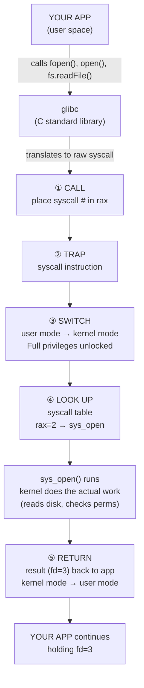

# 🌉 System Calls — The Bridge

> **Goal:** Understand how an app in user space actually crosses the privilege boundary into kernel space — the 5-step syscall lifecycle, the role of glibc, and the catalog of available calls.

---

## 📍 The Hard Boundary

Here's a fact that surprises most beginners: **your apps cannot touch hardware directly.** Not your browser, not your Python script, not even `cat`. If they could, any program could read another program's memory, crash the system, or steal data.

The CPU enforces a hard boundary between two worlds:

```
   ┌─────────────────────────────────────────────────────────┐
   │                      USER SPACE                         │
   │                                                         │
   │   browser    python    music-player    editor    nginx  │
   │     ●          ●           ●             ●        ●     │
   │                                                         │
   │   "Limited privileges — can't touch hardware directly"  │
   └─────────────────────────╤───────────────────────────────┘
                             │
                    ═════════╪═════════  ← PRIVILEGE BOUNDARY
                             │          (red line — enforced by CPU)
                    ═════════╪═════════
                             │
   ┌─────────────────────────╴───────────────────────────────┐
   │                    KERNEL SPACE                         │
   │                                                         │
   │                    🐧 the kernel                        │
   │                                                         │
   │   ┌───────┐   ┌───────┐   ┌───────────────┐             │
   │   │ Memory│   │  CPU  │   │ Hardware/Disk │   FULL      │
   │   └───────┘   └───────┘   └───────────────┘  CONTROL    │
   │                                                         │
   └─────────────────────────────────────────────────────────┘
```

- **User space** — where your apps live. Limited privileges. Cannot directly access memory, CPU, or hardware.
- **Kernel space** — where the Linux kernel lives. **Full control** over memory, CPU, and all hardware.

If a user-space app tries to access hardware directly, the CPU blocks it (red ❌). The **only sanctioned way** to cross the boundary is through a **system call** — a controlled gate where the app politely asks the kernel to do something on its behalf.

> 🧭 **DevOps angle:** This is *why* containers are secure-by-design. Every containerized app is just a normal user-space process making syscalls. The kernel is shared — and the kernel enforces the boundary. A container can't escape without a kernel bug.

---

## 1️⃣ A Syscall, Step by Step

A syscall isn't magic — it's a precise **5-step process**: **Call → Trap → Switch → Look up → Return**.

```
  ┌───────────────────────────────────────────────────────────────┐
  │                  THE SYSCALL LIFECYCLE                        │
  │                                                               │
  │  ① CALL    ② TRAP    ③ SWITCH    ④ LOOK UP    ⑤ RETURN  │
  │                                                               │
  │  app calls  CPU traps  user mode →  kernel uses   result      │
  │  a function  to kernel  kernel mode  syscall table  back      │
  │  (e.g. open)             (privileges ↑)  to find func         │
  │                                                               │
  │  ◀───────────── happens in microseconds ─────────────▶      │
  └───────────────────────────────────────────────────────────────┘
```

Let's walk through each step.

### ① Call — The App Asks

It starts with your program calling a function. Here's a C program:

```c
// my_program.c
int fd = open("notes.txt", O_RDONLY);
read(fd, buf, 100);
```

- `open("notes.txt", O_RDONLY)` — asks the kernel to open `notes.txt` for reading. Returns a **file descriptor** (`fd`).
- `read(fd, buf, 100)` — asks the kernel to read up to 100 bytes from that file into `buf`.

These look like ordinary function calls, but they're not — they're **system calls in disguise**. Under the hood, they trigger the syscall mechanism.

### ② Trap — The CPU Catches It

The app can't just *walk* into kernel space. It has to **trap** — a special CPU instruction that says "I need the kernel's attention."

On **x86-64** Linux, this looks like assembly:

```asm
mov  rax, 2      ; put syscall number 2 (open) into the rax register
syscall          ; trap! — CPU switches to kernel mode
```

- `mov rax, 2` — places the number **2** into the `rax` register. On x86-64 Linux, **2 = `open`**.
- `syscall` — the actual trap instruction. The CPU catches it and knows: "time to enter kernel mode."

### ③ Switch — User Mode → Kernel Mode

This is the privilege flip. The CPU transitions from **user mode** (limited) to **kernel mode** (**full privileges unlocked**).

```
        USER MODE                          KERNEL MODE
   ┌──────────────────┐              ┌──────────────────────┐
   │  limited         │   switch →   │  full privileges     │
   │  can't touch HW  │ ───────────▶│  can access memory,  │
   │  sandboxed       │              │  CPU, all hardware   │
   └──────────────────┘              └──────────────────────┘
                  "Full privileges unlocked"
```

Now the kernel is running — not your app. The kernel has the keys to the kingdom.

### ④ Look Up — The Syscall Table

The kernel doesn't guess what you want. It looks at the number in `rax` (in our case, `2`) and uses it as an **index** into the **syscall table** — an array of function pointers.

```
   ┌──────────────────────────────┐
   │           SYSCALL TABLE      │
   ├─────────┬────────────────────┤
   │ number  │  kernel function   │
   ├─────────┼────────────────────┤
   │    0    │  sys_read          │
   │    1    │  sys_write         │
   │    2    │  sys_open  ◀─── rax = 2, so this one runs!
   │    3    │  sys_close         │
   │    9    │  sys_mmap          │
   │   12    │  sys_brk           │
   │   57    │  sys_fork          │
   │   59    │  sys_execve        │
   │   ...   │  ...               │
   └─────────┴────────────────────┘
```

`rax = 2` → kernel looks up entry 2 → finds `sys_open()` → calls it. The kernel function does the actual work (talks to the disk, checks permissions, opens the file).

### ⑤ Return — Back to User Mode

`sys_open()` finishes and returns a **file descriptor** (e.g., `fd = 3`). The CPU switches back to **user mode**, and your program continues from where it left off — now holding `fd = 3`, which it can pass to future `read()` calls.

```
   ┌─────────────┐                       ┌─────────────┐
   │ Your program│  ── fd = 3 ────────▶ │   Kernel    │
   │             │  ◀────────────────── │  (done)     │
   └─────────────┘                       └─────────────┘
                                        ⏱ microseconds
```

The whole round-trip takes **just microseconds**. And every single thing your apps do — reading files, sending network packets, allocating memory, creating processes — goes through this gate.

> 💡 **`strace`** is the DevOps tool that traces every syscall a program makes. Run `strace cat /etc/hostname` and you'll see dozens of syscalls (`openat`, `read`, `write`, `close`...) fly by. It's the single best debugging tool for "why is my app slow / failing?"

---

## 2️⃣ Libraries Do the Talking — glibc

You might notice: we wrote `open()` and `read()` in C, but the actual syscall was `openat()` (in the screenshot analysis). And in Python you write `f = open("a.txt")`, in Node.js `fs.readFile("a.txt", cb)`. Three different languages, same task — what's happening?

**Apps don't talk to the kernel directly. Libraries do the talking.**

```
   ┌──────────┐  ┌───────────┐  ┌───────────┐
   │    C     │  │  Python   │  │  Node.js  │
   │ fopen()  │  │  open()   │  │fs.readFile│
   └────┬─────┘  └─────┬─────┘  └─────┬─────┘
        │              │              │
        └──────────────┼──────────────┘
                       ▼
              ┌──────────────────┐
              │   glibc          │  ← "the translator"
              │  (C standard     │     (friendly call → raw syscall)
              │   library)       │
              └────────┬─────────┘
                       │
                       ▼  raw syscall
              ┌─────────────────┐
              │   openat(...)   │  ← the REAL syscall
              │   (kernel)      │
              └─────────────────┘
```

### What glibc Does

**glibc** (GNU C Library) is the **C standard library** on Linux. It's the friendly middleman:

1. Your code calls a **friendly function**: `fopen("a.txt")`, `open("a.txt")`, `fs.readFile("a.txt")`
2. The language runtime (CPython for Python, libuv for Node.js) eventually calls into **glibc**
3. glibc translates the friendly call into the **raw syscall**: `openat(...)`
4. glibc triggers the trap, the kernel runs `sys_openat()`, result comes back

Every high-level language's standard library ultimately bottoms out in **glibc calls** on Linux. This is why:
- A Python `open()` and a C `fopen()` both end up as the same `openat` syscall
- A Node.js `fs.readFile` and a Rust `File::open` both hit the same kernel function
- The kernel doesn't care what language you used — it only sees syscalls

> 🧭 **DevOps angle:** This is why **`strace` works on any program** regardless of language. `strace python3 script.py`, `strace node app.js`, `strace nginx` — they all show syscalls, because every language funnels through glibc → kernel.

---

## 3️⃣ The Syscall Catalog

The kernel exposes a **catalog** of syscalls, organized into categories. Here are the ones you'll meet most often:

### 📂 File Operations

| Syscall | What it does |
|---|---|
| `open()` / `openat()` | Open a file — returns a file descriptor |
| `read()` | Read bytes from an fd into a buffer |
| `write()` | Write bytes from a buffer to an fd |
| `close()` | Close an fd |
| `stat()` | Get file metadata (size, permissions, timestamps) |

### 🎭 Process Operations

| Syscall | What it does |
|---|---|
| `fork()` | Duplicate the current process |
| `exec()` / `execve()` | Replace the current program with a new one |
| `exit()` | Terminate the current process |
| `wait()` / `waitpid()` | Wait for a child process to finish |

### 🌐 Network Operations

| Syscall | What it does |
|---|---|
| `socket()` | Create a network socket |
| `bind()` | Bind a socket to an address/port |
| `connect()` | Connect to a remote address |
| `send()` / `recv()` | Send/receive data |

### 💾 Memory Operations

| Syscall | What it does |
|---|---|
| `mmap()` | Map a file or device into memory |
| `brk()` | Adjust the program break (heap boundary) |

### 🔢 Syscall Numbers (x86-64 Linux)

Each syscall has a **unique ID number**. The number differs per architecture, but on **x86-64** Linux:

| # | Syscall |
|---|---|
| 0 | `read()` |
| 1 | `write()` |
| 2 | `open()` |
| 3 | `close()` |
| 9 | `mmap()` |
| 12 | `brk()` |
| 57 | `fork()` |
| 59 | `execve()` |

These numbers are what go into the `rax` register before the `syscall` instruction (recall Step ② Trap). The kernel's syscall table uses them to find the right function.

> 💡 You can see all syscalls your kernel supports: `man 2 syscalls` (section 2 of the manual is dedicated to syscalls). And `ausyscall --dump` lists them with numbers on audit-enabled systems.

---

## 4️⃣ The Full Picture — One More Time



**Every. Single. Thing.** your apps do that involves I/O, processes, memory, or network — goes through this 5-step gate. There is no shortcut. The boundary is enforced by the CPU itself.

---

## 🧾 Summary

| Concept | One-line takeaway |
|---|---|
| **User space** | Where apps live — limited privileges, can't touch hardware. |
| **Kernel space** | Where the kernel lives — full control over memory, CPU, hardware. |
| **Privilege boundary** | Hard line enforced by the CPU — apps can't cross directly. |
| **System call (syscall)** | The ONLY sanctioned way to cross the boundary — app politely asks the kernel. |
| **5-step lifecycle** | Call → Trap → Switch → Look up → Return. |
| **① Call** | App calls a function (`open`, `read`) — actually a syscall in disguise. |
| **② Trap** | `syscall` instruction on x86-64; CPU catches it and prepares to enter kernel mode. |
| **③ Switch** | User mode → kernel mode. "Full privileges unlocked." |
| **④ Look up** | Kernel uses `rax` register value as index into the **syscall table** to find the right function. |
| **⑤ Return** | Kernel function runs, result comes back (e.g., `fd=3`), CPU returns to user mode. |
| **Speed** | The whole round-trip takes **microseconds**. |
| **glibc** | The C standard library — translates friendly calls (`fopen`) into raw syscalls (`openat`). |
| **Language agnostic** | Python, Node.js, Rust, Go — all funnel through glibc → kernel. The kernel only sees syscalls. |
| **Syscall catalog** | Files (`open`/`read`/`write`/`close`), processes (`fork`/`exec`/`wait`), network (`socket`/`bind`/`connect`), memory (`mmap`/`brk`). |
| **Syscall numbers** | Each has a unique ID per architecture. x86-64: `read=0`, `write=1`, `open=2`, `fork=57`, `execve=59`. |
| **`strace`** | DevOps power tool — traces every syscall a program makes. Works on any language. |
| **`man 2 syscalls`** | Lists all syscalls your kernel supports. |

---

← Back to [How Apps Talk to the Linux Kernel](./README.md) | Previous: [POSIX — The Contract](./1-posix-the-contract.md) | Next: [Processes — The Runtime](./3-processes-the-runtime.md) →
