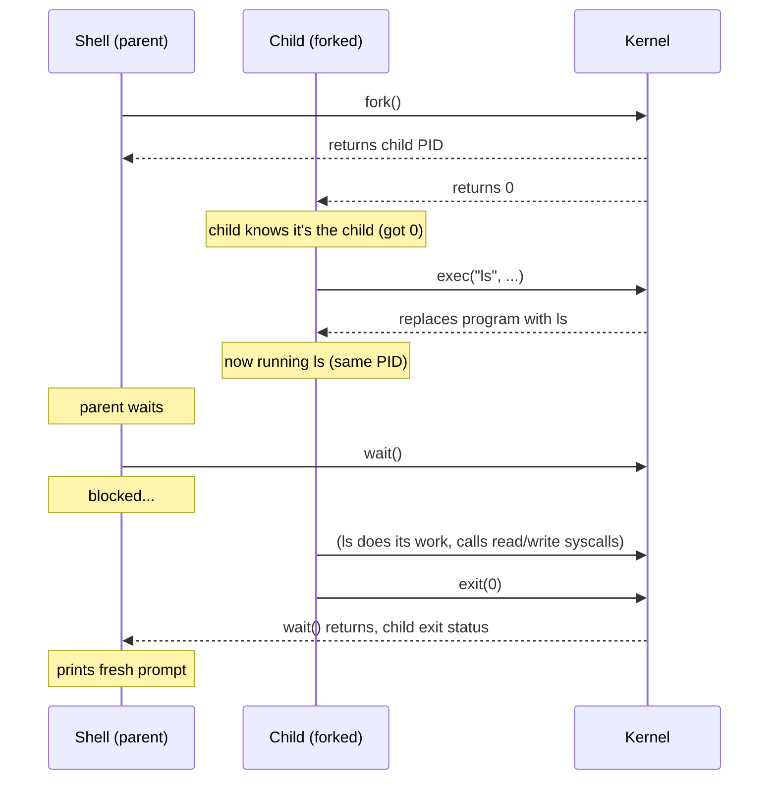

# 🎭 Processes — The Runtime

> **Goal:** Understand how processes are created and transformed on Linux — the three primitives (`fork`, `exec`, `clone`) that build every process, thread, and container you'll ever run.

---

## 📍 Every Process Has a Parent

Here's a fact worth pausing on: **every single process on a Linux machine has a parent.**

That terminal you just opened. The browser sitting in the background. The quiet little daemon keeping your clock accurate. None of them appeared out of nowhere. **Something else created them.** There's always a chain of ancestry running upward all the way to the very first process the kernel starts:

```
   PID 1 (systemd)  ◀── started by the kernel
       │
       ├── fork+exec ──▶  PID 742  (sshd)
       │                    │
       │                    ├── fork+exec ──▶  PID 1337  (your login shell: bash)
       │                    │                    │
       │                    │                    ├── fork+exec ──▶  PID 1401  (ls)
       │                    │                    ├── fork+exec ──▶  PID 1402  (grep)
       │                    │                    └── fork+exec ──▶  PID 1403  (vim)
       │                    │
       │                    └── fork+exec ──▶  PID 1338  (another user's shell)
       │
       ├── fork+exec ──▶  PID 800  (nginx)
       │                    ├── fork ──▶  PID 801  (nginx worker)
       │                    ├── fork ──▶  PID 802  (nginx worker)
       │                    └── fork ──▶  PID 803  (nginx worker)
       │
       └── fork+exec ──▶  PID 900  (dockerd)
                            └── clone+exec ──▶  PID 950  (container process)
```

Every arrow is a "created by" relationship. Every process traces back to **PID 1** — which on modern Linux is `systemd`. (We covered this in [Day 3 — The Boot Process](../03-boot-process/README.md).) 

> **Linux gives us just three primitives for the whole job: `fork`, `exec`, and `clone`. Three. That's it.**

---

## 1️⃣ What Is a Process, Really?

Before the primitives, let's nail down what a "process" actually *is*.

The kernel keeps a big structure for each one — the **`task_struct`** (often called the **Process Control Block**, or PCB). It holds everything the OS needs to know:

```
   ┌──────────────────────────────────────────────────┐
   │              task_struct  (PCB)                  │
   ├──────────────────────────────────────────────────┤
   │  • PID — uniquely names this process             │
   │  • Virtual address space — it believes it owns   │
   │    all of memory                                 │
   │  • Open file descriptor table                    │
   │  • Saved registers — so the CPU can pick up      │
   │    exactly where the process left off            │
   │  • Signal handlers                               │
   │  • Parent PID, children list                     │
   │  • Scheduling info (priority, state)             │
   │  • Credentials (uid, gid)                        │
   └──────────────────────────────────────────────────┘
```

**That structure *is* the process.** It's not the code, it's not the data — it's the kernel's bookkeeping for a running program.

> 🧭 **DevOps angle:** When you run `ps aux`, you're reading a view of these `task_struct`s. When you run `top` or `htop`, you're watching them get rescheduled by the CPU. The `/proc/<pid>/` directory is literally the kernel exposing these structures as files (recall: *everything is a file*).

---

## 2️⃣ Why Not Just `CreateProcess`?

If you've ever written code on Windows, you might wonder: **why not just call `CreateProcess` and be done with it?** Windows genuinely has that — one call, one brand new process.

**Linux took a different road.** There is no `create_a_process` syscall. Instead, the kernel hands you **small, sharp building blocks** and lets you combine them yourself.

```
   WINDOWS:                          LINUX:
   ┌──────────────┐                  ┌──────┐  ┌───────┐  ┌──────┐
   │ CreateProcess│  ← one big call  │ fork │  │ exec  │  │ wait │
   │ (does it all)│                  │ copy │  │replace│  │ block│
   └──────────────┘                  └──────┘  └───────┘  └──────┘
                                        │         │         │
                                        └────┬────┘         │
                                             ▼              │
                                        combine them ───────┘
                                        however you want
```

That single design choice — *small composable primitives instead of one big call* — explains almost everything strange and wonderful about how Unix-like systems behave.

---

## 3️⃣ `fork` — The Copy Machine

### What It Does

`fork` **doesn't create a new program.** It **duplicates the process that calls it.** The kernel copies the parent's:
- Page tables (memory)
- File descriptor table
- Signal handlers
- ...the whole lot

You end up with a second process that is essentially a **photocopy** running the very same code from the very same point.

> Imagine standing in a room and suddenly there's a second you, mid-sentence, identical right down to the shoe size. That's `fork`.

### The Twist: `fork` Returns Twice

This confuses everyone the first time. **`fork` is a single call that returns twice:**

```
   ┌──────────────────────────────────────────────────────┐
   │                    fork() called                     │
   └───────────────────────┬──────────────────────────────┘
                           │
              ┌────────────┴─────────────┐
              ▼                          ▼
   ┌───────────────────┐       ┌──────────────────┐
   │   PARENT          │       │   CHILD          │
   │   returns child   │       │   returns 0      │
   │   PID (positive)  │       │                  │
   └───────────────────┘       └──────────────────┘
   (if error: returns -1 to the parent only)
```

- In the **parent** → returns the **child's PID** (a real positive number)
- In the **child** → returns **`0`**
- On **error** → returns **`-1`** to the parent (no child was created)

That's why you always see code patterns like:

```c
pid_t p = fork();
if (p == 0) {
    // I'm the child — call exec() to become a new program
} else if (p > 0) {
    // I'm the parent — wait() for the child
} else {
    // fork failed
}
```

You're not comparing anything meaningful — you're answering one question: **"Am I the parent or am I the child?"**

### Copy-on-Write (COW) — Why `fork` Is Fast

A naive `fork` would copy **every page of memory**. For a large process, that would be brutally slow. **Linux doesn't do that.**

Instead, it uses **Copy-on-Write (COW)**:

```
   IMMEDIATELY AFTER fork:              LATER, when child WRITES:

   ┌─────────┐  ┌─────────┐            ┌─────────┐  ┌─────────┐
   │ PARENT  │  │ CHILD   │            │ PARENT  │  │ CHILD   │
   │ page A  │  │ page A  │            │ page A  │  │ page A' │
   │ (read   │  │ (read   │   write →  │ (orig)  │  │ (copy   │
   │  only)  │  │  only)  │            │         │  │  made)  │
   └────┬────┘  └────┬────┘            └─────────┘  └─────────┘
        │            │                       ▲           ▲
        └─────┬──────┘                       │           │
              │                              │           │
         SAME physical page            only NOW does the
         (shared, marked read-only)    kernel copy the page
```

1. Parent and child **share** the same physical memory pages
2. Pages are marked **read-only**
3. When either process tries to **write** — *only then* does the kernel copy that specific page

Most children barely touch most of their parent's memory (they usually call `exec` immediately, which replaces the whole address space anyway). So in practice, `fork` stays cheap — a bit of page-table bookkeeping instead of wholesale duplication.

### ⚠️ The Fork Bomb

`fork` is easy to abuse. Write a loop that forks inside itself, and each child forks again, doubling every time. That's a **fork bomb**:

```bash
:(){ :|:& };:      # the classic bash fork bomb
```

This defines a function `:` that calls itself twice in the background, then invokes it. It will cheerfully **exhaust the process table** until your machine stops responding. Don't run it.

> 🧭 **DevOps angle:** This is why production systems set `ulimit -u` (max user processes) and cgroup PID limits. A misbehaving container can't fork-bomb the host if its PID budget is capped.

---

## 4️⃣ `exec` — The Transformer

### What It Does

`fork` gives us duplication. What it does *not* give us is **transformation**. The child is a copy — running *your* program, not the one you wanted to run. That's where `exec` comes in.

`exec` **loads a brand new program image** into the process that calls it, **overwriting its memory** with fresh code and data.

### The `exec` Family

It's a **family**, not a single call. You'll meet `execl`, `execlp`, `execle`, `execv`, `execvp`, `execve`, and a few cousins. They all do the same thing — load a new program — but let you pass **arguments and environment variables differently**.

Underneath, they're all **thin wrappers around one real syscall: `execve`**.

```
   ┌────────────────────────────────────────────────┐
   │              execve()  ← the real syscall      │
   │              (the only one that exists)        │
   └───────────────────────┬────────────────────────┘
                           │
          ┌────────┬───────┼───────┬────────┐
          ▼        ▼       ▼       ▼        ▼
       execl    execlp  execle   execv    execvp
       (list)  (list,  (list,   (vector) (vector,
                path)  env)               path)
```

Think of the family as **friendly dials** you can turn to pass arguments as a list vs. an array, search `PATH` or not, pass environment or inherit — all driving the same engine under the hood.

### What Makes `exec` Special

```
   BEFORE exec:                       AFTER exec:
   ┌────────────────────┐             ┌────────────────────┐
   │  Process (PID 500) │             │  Process (PID 500) │ ← SAME PID!
   │  running: shell    │   exec ls   │  running: ls       │ ← different program
   │  memory: shell code│ ─────────▶ │  memory: ls code   │ ← memory wiped & rebuilt
   │  fd table: [0,1,2] │             │  fd table: [0,1,2] │ ← usually carried over
   └────────────────────┘             └────────────────────┘
```

- **The process itself doesn't go anywhere.** The PID stays exactly the same. It *is* the same process.
- **What changes is its body.** The address space is wiped and rebuilt from the new executable. Registers are reset to that program's entry point.
- **Open file descriptors usually carry straight over** (unless marked `FD_CLOEXEC`).
- **If `exec` succeeds, it never returns.** There's no line of code after it in the old program — because the old program no longer exists. It worked, so it vanished.

---

## 5️⃣ The Shell Pattern: `fork` + `exec` + `wait`

Put the two together and you get the **single most important pattern in Unix**. You want to run `ls`? Here's what your shell does — **every single time you press Enter**:



1. **Shell forks itself** → making a copy of the shell process
2. **Child immediately calls `exec`** → its body is replaced by the `ls` program
3. **Parent sits in `wait`** → holding the terminal until the child finishes
4. **Child finishes** → parent prints a fresh prompt

**No magic, no special mechanism — just `fork`, `exec`, and `wait`.** That whole dance happens every time you press Enter, and it happens in **milliseconds**.

```c
// The fork-exec-wait pattern in ~5 lines of C:
pid_t p = fork();
if (p == 0) {
    execvp("ls", args);    // child: become ls
} else {
    waitpid(p, &status, 0); // parent: wait for child
}
```

---

## 6️⃣ Zombies and Orphans

### 🧟 Zombies

When a child exits, the kernel **keeps a small record of it around** — its **exit status** — until the parent comes to collect it via `wait`. Until the parent collects it, the dead child is called a **zombie**.

```
   Child exits                        Parent calls wait()
        │                                    │
        ▼                                    ▼
   ┌──────────────┐                    ┌──────────────┐
   │  ZOMBIE      │  ── status ──────▶│  REAPED      │
   │  finished but│      collected     │  cleaned up  │
   │  still in    │                    │  slot freed  │
   │  process tbl │                    │              │
   └──────────────┘                    └──────────────┘
```

A zombie is **finished but still occupying a slot** in the process table. If a parent never calls `wait`, zombies accumulate — eventually exhausting the process table. (This is why long-running daemons must reap their children.)

### 👶 Orphans

If the **parent dies first**, the orphaned child gets **reparented to PID 1** (`systemd`), which reaps it cleanly when it exits.

```
   BEFORE:                      AFTER parent crashes:
   parent (PID 500)             parent (PID 500) ✗ dead
     └── child (PID 501)          │
                                  ▼
                              child (PID 501) — now orphaned
                                  │
                                  ▼ reparented to
                              PID 1 (systemd) ← adopts & reaps
```

This is why `systemd` (PID 1) is so important — it's the **ultimate adoptive parent**, ensuring no process becomes a permanent zombie.

> 🧭 **DevOps angle:** If you see a `<defunct>` or `Z` state in `ps aux`, that's a zombie. It means a parent process isn't reaping its children. In containerized apps, this usually means your app's process manager (tini, dumb-init, or the container runtime itself) isn't doing its job — which is why Docker added `--init`.

---

## 7️⃣ `clone` — The Modern General-Purpose Primitive

Now for the third primitive — and honestly the most interesting one. Everything we've talked about (`fork`, threads, `vfork`) is actually built on top of **`clone`**.

### The Idea

Where `fork` gives you **no choices** at all (just copy everything), `clone` hands you a **`flags` argument**. Those flags decide **precisely what the new task shares with its creator**: memory, files, file-system context, signal handlers, and more.

> It's less like a photocopier and more like a **mixing desk with a whole wall of switches** in front of you.

### The Clone Flags

| Flag | What it shares | Effect |
|---|---|---|
| `CLONE_VM` | Same memory / address space | New task sees parent's memory |
| `CLONE_FILES` | Open file descriptor table | New task shares open files |
| `CLONE_FS` | File-system info (cwd, root, umask) | Same working directory |
| `CLONE_SIGHAND` | Signal handlers | Same signal behavior |
| `CLONE_THREAD` | Same thread group | Makes it a **thread**, not a separate process |
| `CLONE_NEWPID` | New PID namespace | Process sees itself as PID 1 (used by containers) |

**Same call, wildly different results purely from choosing flags.** That flexibility is the whole reason `clone` exists.

### How `clone` Builds Everything

```
   ┌──────────────────────────────────────────────────────────┐
   │                        clone()                           │
   │              (the universal primitive)                   │
   │                                                          │
   │   flags = ┌─────────────────────────────────────┐        │
   │           │ pick any combination of switches    │        │
   │           └─────────────────────────────────────┘        │
   └────────────────────────┬─────────────────────────────────┘
                            │
       ┌────────────────────┼────────────────────┐
       │                    │                    │
       ▼                    ▼                    ▼
   ┌────────┐         ┌──────────┐         ┌───────────────┐
   │ fork   │         │ thread   │         │ container     │
   │ (copy  │         │ (share   │         │ (new pid,     │
   │  all,  │         │  memory, │         │  net, mount   │
   │  share │         │  files,  │         │  namespaces)  │
   │  none) │         │  thread) │         │               │
   └────────┘         └──────────┘         └───────────────┘
```

| Want to create... | Use clone with... |
|---|---|
| A **new process** (like `fork`) | No sharing flags — child gets its own copy of everything |
| A **new thread** | `CLONE_VM | CLONE_FILES | CLONE_FS | CLONE_SIGHAND | CLONE_THREAD` |
| A **container** | Thread flags **+ namespace flags** (`CLONE_NEWPID`, `CLONE_NEWNET`, `CLONE_NEWNS`, ...) |

### Threads Are Just Tasks

This settles an old argument: **Linux doesn't have a separate "thread" object in the kernel.** A thread is just a **task created with a particular combination of clone flags** — shared memory, shared file table, same thread group.

- **Upside:** Because they share an address space, **switching between threads is cheap** and they see each other's data instantly with no copying.
- **Downside:** The very same fact — since threads share everything, **one thread corrupting memory can bring the whole process down** with it.

---

## 8️⃣ Two Shortcuts Worth Knowing

### `vfork` — The Old, Dangerous Trick

`vfork` is an older optimization. The child **borrows the parent's memory** without copying page tables at all, and the **parent is suspended** until the child either `exec`s or exits.

- **Fast** — no page table duplication
- **Dangerous** — the child must not touch much (it's sharing the parent's actual memory, not a copy)
- **Modern advice:** Don't use it. Use `posix_spawn` instead.

### `posix_spawn` — The Modern Portable Answer

`posix_spawn` is a clean interface for the classic `fork` + `exec` pattern. On Linux, it might use `clone` or `vfork` underneath — but you don't care. You just say **"spawn this program"** and let the platform pick the fast path.

```c
// Instead of:
pid_t p = fork();
if (p == 0) execvp(prog, args);
else waitpid(p, &status, 0);

// You can do:
posix_spawn(&pid, prog, &file_actions, &attrs, argv, environ);
waitpid(pid, &status, 0);
```

It's the **portable, safe** way to do what `fork`+`exec` does — defined by POSIX (recall the previous note).

---

## 9️⃣ You've Been Using These All Along

You've been using all of this your whole career, probably without noticing:

| What you see | What's happening underneath |
|---|---|
| **Containers (Docker)** | `clone` with namespace flags stacked together — new PID namespace, new network namespace, new mount namespace. *Which is why a process inside a container can believe it's the first process on the system.* |
| **systemd starting a service** | `fork` + `exec` for each service it starts |
| **Your terminal, every command** | The `fork` + `exec` + `wait` dance we just watched |
| **nginx worker processes** | `fork` (no `exec` — workers run the same nginx code) |
| **Multi-threaded app** | `clone` with `CLONE_VM | CLONE_THREAD | ...` |
| **CI/CD pipeline spawning steps** | `fork` + `exec` for each step |

Different layers, the **same three primitives** doing all the work underneath.

---

## 🔟 Side-by-Side Comparison

| | `fork` | `exec` | `clone` |
|---|---|---|---|
| **What it does** | Duplicates the current process | Replaces the program inside a process | Creates a task with exactly the sharing you specify |
| **PID** | Child gets a new PID | PID stays the same | Depends on flags |
| **Memory** | Starts shared (read-only), COW on write | Old memory wiped, new program loaded | Shared or copied — you choose via flags |
| **Returns** | Twice (parent: child PID, child: 0) | Never (on success — old program gone) | Once, to the parent |
| **Reach for it when** | You need a **copy** | You need to **become something else** | You need **fine-grained control** over sharing |
| **Built from** | It's a syscall | It's a syscall (family wraps `execve`) | It's the **real** primitive — `fork` and threads are built on top |

---

## 1️⃣1️⃣ The Big Picture

```
   fork copies.        exec transforms.       clone does both on your terms.

   ┌──────────┐        ┌──────────┐          ┌──────────────────┐
   │  fork()  │        │  exec()  │          │     clone()      │
   │          │        │          │          │  flags = ???     │
   │  "make   │        │  "become │          │                  │
   │   a copy"│        │   someone│          │  switches you    │
   │          │        │   else"  │          │  control"        │
   └────┬─────┘        └────┬─────┘          └────────┬─────────┘
        │                   │                         │
        └───────┬───────────┘                         │
                │                                     │
                ▼                                     │
       fork + exec = run a program                    │
       (what your shell does)                         │
                                                      │
                              ┌───────────────────────┘
                              │
              ┌───────────────┼───────────────┐
              ▼               ▼               ▼
          threads        containers        vfork
          (shared)       (namespaces)      (borrowed mem)
```

Every process you have ever run, every shell command, every server, every container — came from that trio working together. Once you spot `fork`, `exec`, and `wait` hiding inside your terminal prompt, you can't unsee it.

---

## 🧾 Summary

| Concept | One-line takeaway |
|---|---|
| **Every process has a parent** | All the way up to PID 1 (`systemd`). Nothing appears from nowhere. |
| **`task_struct` (PCB)** | The kernel's bookkeeping for a process — PID, address space, fd table, registers. |
| **3 primitives** | `fork`, `exec`, `clone`. That's all Linux gives you — no `CreateProcess`. |
| **Composable design** | Small building blocks you combine yourself — explains Unix's strange, wonderful behavior. |
| **`fork`** | Duplicates the calling process. Photocopy. Returns **twice** (parent gets child PID, child gets 0). |
| **Copy-on-Write (COW)** | Parent & child share pages read-only; only copied when one writes. Makes `fork` cheap. |
| **Fork bomb** | `:(){ :\|:& };:` — recursive forking exhausts the process table. Why `ulimit -u` exists. |
| **`exec` family** | `execl`, `execv`, `execvp`, ... — all wrap the real syscall `execve`. |
| **`exec` behavior** | Replaces program image, **keeps the same PID**, wipes memory, **never returns** on success. |
| **Shell pattern** | `fork` → child `exec`s the command → parent `wait`s. Every Enter press. |
| **Zombie** | Child exited but parent hasn't called `wait` yet — still occupies a process table slot. |
| **Orphan** | Parent died first → child **reparented to PID 1** (systemd), which reaps it. |
| **`clone`** | The modern general-purpose primitive. `flags` argument decides what's shared. |
| **`CLONE_VM`** | Share memory/address space. |
| **`CLONE_FILES`** | Share open file descriptor table. |
| **`CLONE_THREAD`** | Same thread group → makes it a **thread**, not a process. |
| **`CLONE_NEWPID`** | New PID namespace → used by **containers**. |
| **Threads = clone** | Linux has no separate "thread" object. Threads are tasks with shared-memory clone flags. |
| **Containers = clone** | `clone` with namespace flags (`CLONE_NEWPID`, `CLONE_NEWNET`, `CLONE_NEWNS`...). |
| **`vfork`** | Old, fast, dangerous — child borrows parent's memory, parent suspended. Avoid. |
| **`posix_spawn`** | Modern portable API for fork+exec — defined by POSIX. |
| **systemd** | `fork`s + `exec`s every service it starts. |
| **`<defunct>` / `Z` state** | Zombie process — parent isn't reaping. Docker `--init` / `tini` fixes this in containers. |

---

← Back to [How Apps Talk to the Linux Kernel](./README.md) | Previous: [System Calls — The Bridge](./2-system-calls-the-bridge.md) |

