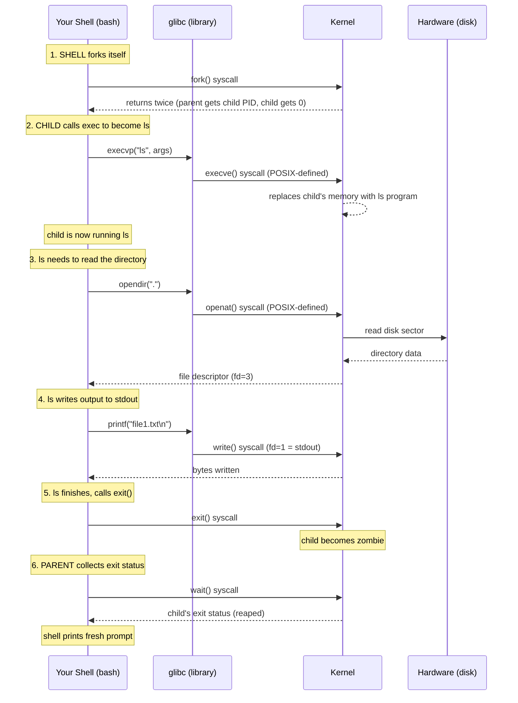

# 🐧 Linux Learning Journey: How Apps Talk to the Linux Kernel

> **Goal:** Connect three ideas that meet at the same place — **POSIX** (the contract), **system calls** (the mechanism), and **processes** (the actors) — so you understand the full path from "app wants something" to "kernel does it."

---

## 📍 The Question That Ties It All Together

Every DevOps engineer eventually asks: **"When I run `cat file.txt`, what actually happens between my terminal and the hardware?"**

The answer is a three-part story, and the three topics I learned today are the three layers of that story:

1. **POSIX** — the *contract*. It defines what the valid requests are. "If you call yourself a Unix-like OS, you must honor these calls."
2. **System calls (syscalls)** — the *mechanism*. The actual bridge between user space and kernel space. The controlled gate.
3. **Processes** — the *actors*. The running programs that make the calls. And ironically, processes themselves are *created* by syscalls (`fork`, `exec`, `clone`).

```
   ┌──────────────────────────────────────────────────────────────┐
   │                     YOUR APP (cat, nginx, docker)            │
   │                       "I want to read a file"                │
   └───────────────────────────┬──────────────────────────────────┘
                               │
                               │  calls a friendly function
                               │  e.g. fopen(), open(), fs.readFile()
                               ▼
                     ┌─────────────────────┐
                     │   LIBRARY (glibc)   │  ← translates friendly
                     │   "the translator"  │     calls into raw syscalls
                     └──────────┬──────────┘
                                │
                                │  raw syscall: openat(...)
                                ▼
   ═════════════════════════════╪═════════════════════════════════
                                │  ← PRIVILEGE BOUNDARY
                                │     (user mode → kernel mode)
   ═════════════════════════════╪═════════════════════════════════
                                │
                                ▼
                     ┌─────────────────────┐
                     │   LINUX KERNEL      │  ← does the actual work
                     │   sys_open() runs   │     (talks to hardware)
                     └──────────┬──────────┘
                                │
                                ▼
                     ┌─────────────────────┐
                     │   HARDWARE (disk)   │
                     └─────────────────────┘
```

**POSIX** is the rulebook that says `open()` must exist and behave a certain way. **Syscalls** are the actual gate-crossing. **Processes** are the "app" boxes at the top — and they're spawned by *other* syscalls (`fork`/`exec`/`clone`).

---

## 🧩 The Three Pieces — And Where They Meet

### 📜 Piece 1: POSIX — The Contract

**POSIX** = **P**ortable **O**perating **S**ystem **I**nterface (the **X** is a nod to UNIX).

Born in 1988 from the IEEE to end the "Unix wars" — a chaotic era where AIX, HP-UX, and SunOS all behaved differently, and code written for one broke on another. POSIX fixed this by defining a **common contract**: if your OS claims POSIX compliance, it must provide these specific system calls, these behaviors, these tools.

POSIX standardizes: the file system interface, file descriptors, processes, signals, pipes, standard streams, threads (Pthreads), the shell, utilities (`ls`, `cat`, `grep`...), file permissions (rwx), and environment variables.

→ **Full note:** [`1-posix-the-contract.md`](./1-posix-the-contract.md)

### 🌉 Piece 2: System Calls — The Mechanism

Apps **cannot touch hardware directly**. The CPU enforces a hard boundary between **user space** (where your apps live, limited privileges) and **kernel space** (where the kernel lives, full control over memory, CPU, and hardware).

The *only* sanctioned way to cross that boundary is a **system call** — a controlled gate where the app politely asks the kernel to do something on its behalf.

A syscall happens in **5 steps**: Call → Trap → Switch → Look up → Return. Apps don't write raw syscalls, though — they call friendly library functions (`fopen`, `open`, `fs.readFile`), and **glibc** (the C standard library) translates those into the actual syscall (`openat`, `read`, `write`...).

The kernel exposes a **catalog** of syscalls: file ops (`open`, `read`, `write`, `close`), process ops (`fork`, `exec`, `wait`), network ops (`socket`, `bind`, `connect`), memory ops (`mmap`, `brk`).

→ **Full note:** [`2-system-calls-the-bridge.md`](./2-system-calls-the-bridge.md)

### 🎭 Piece 3: Processes — The Actors

A **process** is a running program. The kernel tracks each one in a structure called `task_struct` (the Process Control Block) — holding its PID, virtual address space, open file descriptors, and saved registers.

Every process has a **parent**, all the way up to **PID 1** (`systemd` on modern Linux). And the kernel gives us just **three primitives** to create and transform processes:

| Primitive | What it does | Returns |
|---|---|---|
| **`fork`** | Duplicates the calling process — a near-identical child | Twice: child PID in parent, `0` in child |
| **`exec`** | Replaces the program inside a process with a new one | Never returns (on success) — old program is gone |
| **`clone`** | The modern general-purpose primitive — flags decide what's shared | New task (process OR thread OR container) |

The **shell pattern** is `fork` + `exec` + `wait`: every time you press Enter, the shell forks itself, the child calls exec to become `ls` (or whatever you typed), and the parent waits. **Threads** are just `clone` with shared-memory flags. **Containers** are `clone` with namespace flags. Same primitive, different flags.

→ **Full note:** [`3-processes-the-runtime.md`](./3-processes-the-runtime.md)

---

## 🔗 Where They All Meet — The `ls` Command

Here's the moment everything connects. You type `ls` and press Enter:



Every arrow crossing into the kernel is a **syscall**. Every syscall is **defined by POSIX**. And the process running `ls` was **created by `fork` + `exec`** — themselves syscalls. The three layers are inseparable.

> 🧭 **The DevOps takeaway:** Once you see this, you understand *why* containers work (they're clone+namespaces), *why* shell scripts are portable (POSIX), *why* `strace` is your best debugging tool (it shows every syscall an app makes), and *why* a "hung process" usually means it's stuck in a syscall waiting for I/O.

---

## 📚 Reading Order

| # | Note | What it covers | Read time |
|---|---|---|---|
| 1 | [`1-posix-the-contract.md`](./1-posix-the-contract.md) | History, file descriptors, signals, pipes, threads, compliance | ~10 min |
| 2 | [`2-system-calls-the-bridge.md`](./2-system-calls-the-bridge.md) | User/kernel space, 5-step syscall lifecycle, glibc, syscall catalog | ~10 min |
| 3 | [`3-processes-the-runtime.md`](./3-processes-the-runtime.md) | fork, exec, clone, COW, zombies, threads, containers | ~12 min |

Read them in order — each builds on the previous.

> 💡 **Looking for a quick refresher, the complete master-overview?** Check out the [master-overview](./master-overview/README.md).
---

## 🧾 Summary

| Concept | One-line takeaway |
|---|---|
| **The unifying question** | "When I run a command, what happens between my terminal and the hardware?" |
| **POSIX** | The *contract* — defines what syscalls and behaviors a Unix-like OS must provide. |
| **System calls** | The *mechanism* — the only sanctioned bridge between user space and kernel space. |
| **Processes** | The *actors* — running programs that make syscalls; created by `fork`/`exec`/`clone`. |
| **glibc** | The *translator* — converts friendly calls (`fopen`) into raw syscalls (`openat`). |
| **The connection** | Processes make syscalls (defined by POSIX, translated by glibc) to ask the kernel to do work. |
| **DevOps relevance** | Containers = clone+namespaces. `strace` = syscall tracing. Portability = POSIX. Process debugging = fork/exec/wait. |
