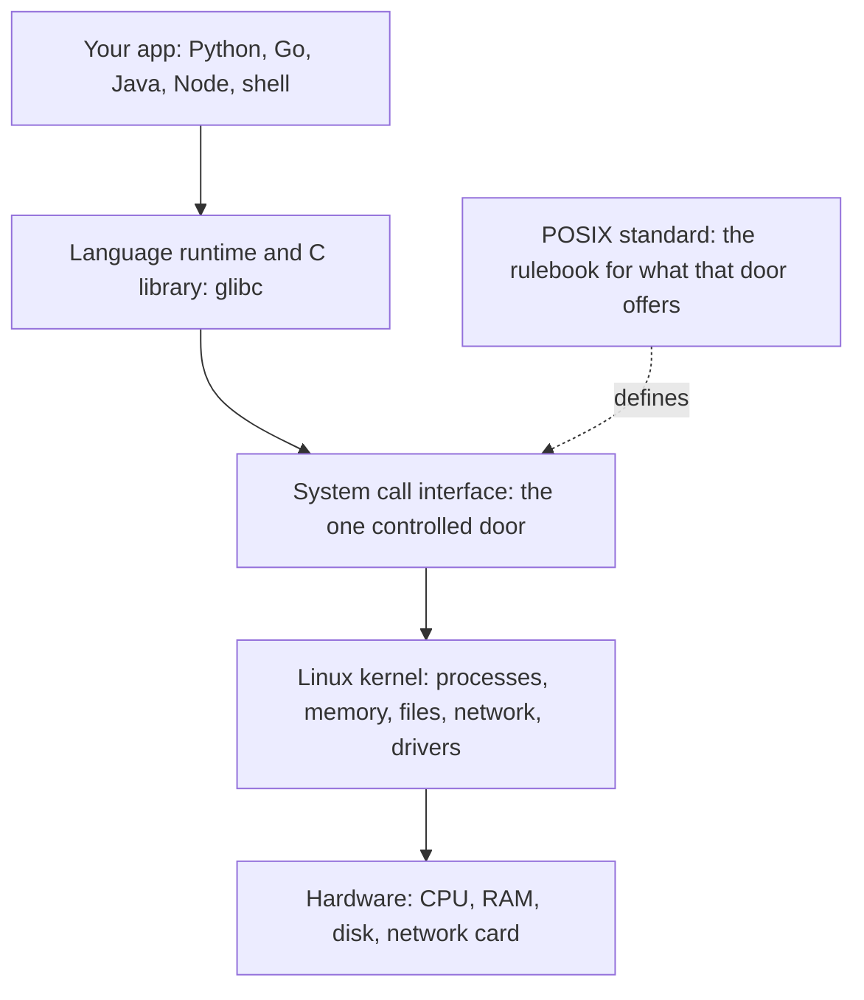
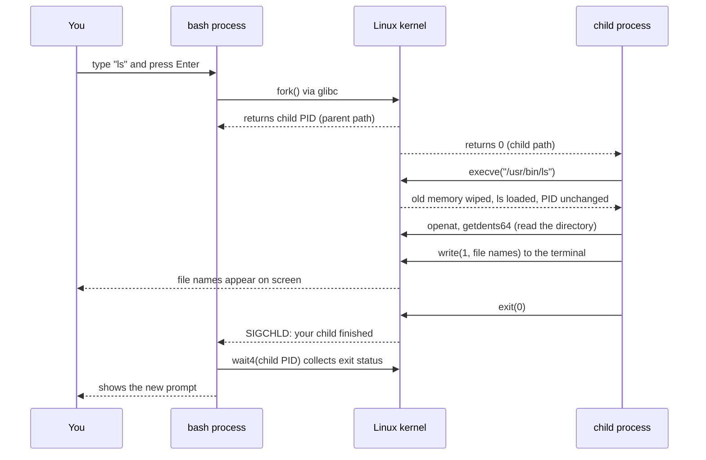

# 🐧 Linux Learning Journey: How Apps Talk to the Kernel (Syscalls, POSIX & Processes)

> **Goal:** Understand the one conversation every program on Linux is having with the kernel: how an app asks for a file, a network connection, or a new process, what standard makes those requests portable, and how `fork`, `exec`, and `clone` are built out of those requests.

---

## 📍 Who Actually Does the Work?

When your program opens a file, sends a network request, or starts another program, who is doing the work?

Is it your code? Your language? A library?

The honest answer is **all of them, in layers**. But at the very bottom of that chain sits the **Linux kernel**, the only part of the system that is allowed to touch the hardware. Every layer above it eventually asks the kernel for help. The bridge between your program and the kernel is the **system call**, or **syscall**.

> 💡 **Mental model:** Your computer is a city. Apps are citizens. The kernel is the power plant and the water facility. Citizens cannot walk in and flip switches. They go through controlled entrances with guards, and the entrances are called system calls.

---

## 🗺️ The Big Picture: The Layers Between Your Code and the Hardware

Four ideas meet in this note. This diagram shows where each one sits.



| Layer | Role | Analogy |
|---|---|---|
| **Your app** | Asks for something in friendly terms (`open`, `fs.readFile`, `fopen`) | A citizen with a request |
| **glibc** | Turns friendly calls into raw syscalls | A translator |
| **POSIX** | A standard that says which calls must exist and how they behave | The rulebook for the counter |
| **Syscall interface** | The single official entry point into the kernel | The guarded border crossing |
| **Kernel** | Does the real work, checks permissions, talks to hardware | The city's utilities |

---

## 1️⃣ Two Worlds: User Space and Kernel Space

Linux splits memory and CPU privileges into two worlds:

- **User space:** where your applications run. Code here has limited power. It cannot touch hardware directly, and it cannot read another program's memory.
- **Kernel space:** where the kernel runs. It has full control over hardware, memory, and the CPU.

```
   ┌─────────────────────────────────────────────────────────┐
   │                      USER SPACE                         │
   │   [ browser ]   [ python ]   [ music ]   [ editor ]     │
   │         │            │                                  │
   │         └────── system call (syscall) ───┐              │
   ├──────────────────────────────────────────┼──────────────┤
   │                    KERNEL SPACE          ▼              │
   │   ┌──────────┐   ┌──────────┐   ┌──────────────┐        │
   │   │ Memory   │   │   CPU    │   │   Hardware   │        │
   │   └──────────┘   └──────────┘   └──────────────┘        │
   │                    FULL CONTROL                         │
   └─────────────────────────────────────────────────────────┘
```

### 🤔 Why Keep Them Separate?

If every app could write straight to the disk or send raw network packets, one buggy program could corrupt the whole system. A malicious program could read another user's data.

The kernel acts as a **trusted gatekeeper**. It validates every request, checks permissions, and makes sure one app cannot break everyone else. This separation is the main reason Linux is both stable and secure.

> 🧭 **DevOps angle:** When a container "escapes," or a process reads files it should not, you are looking at a failure of this boundary. Much of container security is about controlling what can cross it (you'll see that in section 🔟).

---

## 2️⃣ POSIX: The Contract Apps Rely On

### 🧩 The Problem POSIX Solved

In the 1970s and 80s, AT&T's UNIX was split into many versions. IBM had AIX, HP had HP-UX, Sun had SunOS. A program written for one often broke on another. Developers rewrote the same code again and again. This was called the **UNIX wars** and the **portability problem**.

In 1988 the IEEE published the first **POSIX** standard. **POSIX** stands for **Portable Operating System Interface**. The "X" is a nod to UNIX.

### 📜 What POSIX Actually Is

POSIX is a **rulebook for the interface**, not for the internals. It says:

> "If you call yourself a POSIX-compliant system, you must provide these functions, with these behaviors, and these tools."

It covers files, processes, threads, signals, pipes, standard streams, environment variables, file permissions, and the shell and its basic tools (`ls`, `cat`, `grep`, `sed`, `awk`, `sort`, and more).

It does **not** say how the kernel is written. It is like a power outlet standard. You don't care about the wiring inside the wall as long as your plug fits.

```
   POSIX interface (the outlet)           Implementation (the wiring)
   ┌───────────────────────────┐         ┌───────────────────────────┐
   │ open()  read()  write()   │         │  Linux kernel             │
   │ fork()  exec()  wait()    │  ────▶ │  XNU (macOS)              │
   │ pthread_create()          │         │  FreeBSD kernel           │
   │ signals, pipes, fds       │         │  each has its own code    │
   └───────────────────────────┘         └───────────────────────────┘
        same plug, different wiring
```

### 🏅 Who Is POSIX?

- **macOS** is officially certified as UNIX (and therefore POSIX-conformant).
- **Linux** is not officially certified, mainly because certification costs money. In practice it follows POSIX very closely.
- **BSD** systems are highly POSIX compatible.
- **Windows** was historically not POSIX compatible. **WSL** (Windows Subsystem for Linux) brought a real Linux environment to Windows in 2016, and WSL2 ships a full Linux kernel.

> 💡 **DevOps payoff:** A shell script that uses only POSIX features runs the same on your Mac, on an Ubuntu server, and inside an Alpine container. That is why CI scripts, Dockerfiles, and init scripts lean on POSIX behavior.

---

## 3️⃣ System Calls: The Door Between the Worlds

### 🪜 A Syscall, Step by Step

When your program calls `open("notes.txt", O_RDONLY)`, five things happen:

| Step | What happens |
|---|---|
| **1. Call** | Your code calls a library function (for example, `open`). |
| **2. Trap** | The library runs a special CPU instruction. On x86-64 it is `syscall`. This raises the CPU from user mode to kernel mode. |
| **3. Switch** | The CPU enters kernel mode. The kernel now has full privileges. |
| **4. Look up** | The kernel reads the **syscall number** (in the `rax` register on x86-64) and finds the matching kernel function in its **syscall table**. |
| **5. Return** | The kernel runs the function, puts the result in `rax`, and switches the CPU back to user mode. |

```
   Your code                                      Kernel
   ─────────                                      ──────
   open("notes.txt")
        │
        ▼
   glibc: mov rax, 2        ; 2 = open
          syscall           ; ───── TRAP ─────▶  CPU enters kernel mode
                                                 │
                                                 ▼
                                          syscall table[2]
                                                 │
                                                 ▼
                                          sys_open("notes.txt")
                                          checks permission, opens file
                                                 │
   fd = 3  ◀──── return value in rax ──────────┘ CPU back to user mode
```

### 🧮 The Syscall Table

The kernel keeps a numbered table. Every syscall has a fixed number. Some common ones on x86-64:

| Number | Syscall | Purpose |
|---|---|---|
| 0 | `read` | Read bytes from a file descriptor |
| 1 | `write` | Write bytes to a file descriptor |
| 2 | `open` | Open a file (modern glibc uses `openat`) |
| 3 | `close` | Close a file descriptor |
| 9 | `mmap` | Map a file or memory into the address space |
| 12 | `brk` | Move the end of the heap |
| 57 | `fork` | Duplicate the calling process |
| 59 | `execve` | Replace the program inside a process |

Linux has several hundred syscalls, roughly 350 to 450 on x86-64 depending on kernel version. They are grouped by job, as shown in section 5.

### ⚠️ When Things Go Wrong: The Return Value

Syscalls signal errors in a specific way:

- Success: the return value is zero or a positive number (for example, the new file descriptor, or the number of bytes written).
- Failure: the kernel returns a negative error code. The C library turns that into `-1` and stores the reason in the global variable `errno`.

You will see this in `strace` output as `= -1 ENOENT (No such file or directory)`. That is the kernel saying "the file does not exist."

### 💰 Why Syscalls Cost Something

Crossing the border is not free. Every trap and switch takes time, and security fixes such as the mitigations for the Meltdown CPU bug made crossing more expensive. The usual cost is hundreds of nanoseconds to a few microseconds per call. That sounds tiny, but a program that makes a million tiny syscalls pays for it.

This is one reason **vDSO** exists (section 🔟) and why good programs batch their reads and writes.

---

## 4️⃣ Libraries: The Translator Between Your Code and the Kernel

You almost never write syscalls by hand. Your language calls a library, and the library calls the kernel:

```
   Python:  open("a.txt")          ┐
   C:       fopen("a.txt", "r")    ├──▶  wrapper  ──▶  openat()  ──▶  kernel
   Node.js: fs.readFile("a.txt")   ┘     (glibc)      (real syscall)
```

The **C standard library**, usually **glibc** on Linux, is the most common translator. It provides friendly functions like `printf`, `fopen`, and `malloc`, and turns them into the right syscalls.

> 🧭 **Man page tip:** Two sections of the manual matter here.
>
> ```bash
> man 2 write     # section 2: the raw system call (the kernel's door)
> man 3 printf    # section 3: the library function (the translator)
> ```
>
> When you are unsure which one you need, check both. Section 2 tells you what the kernel does. Section 3 tells you what your language gets.

---

## 5️⃣ The Syscall Catalog: Grouped by Job

Syscalls are organized by what they are for. Here is the big picture:

```
   ┌─────────────────┬─────────────────┬─────────────────┬─────────────────┐
   │      FILES      │    PROCESSES    │     NETWORK     │     MEMORY      │
   ├─────────────────┼─────────────────┼─────────────────┼─────────────────┤
   │ open / openat   │ fork / clone    │ socket          │ mmap            │
   │ read            │ execve          │ bind            │ brk             │
   │ write           │ exit            │ connect         │ munmap          │
   │ close           │ wait4           │ send / recv     │                 │
   │ stat            │ kill            │ listen / accept │                 │
   │                 │                 │                 │                 │
   └─────────────────┴─────────────────┴─────────────────┴─────────────────┘
```

Every DevOps tool you will use is a stack of these. `docker run` ends up calling `clone` with namespace flags. `nginx` uses `socket`, `bind`, `listen`, and `accept`. A database uses `mmap` and `fsync`.

---

## 6️⃣ Everything Is a File: File Descriptors

### 🎟️ The Ticket Stub

When you open a file, the kernel does not hand you the file. It hands you a **file descriptor (fd)**, a small integer that works like a ticket stub. You show the ticket to the kernel, and it knows which open file you mean.

```c
int fd = open("notes.txt", O_RDONLY);   // fd is probably 3
read(fd, buf, 100);                     // "read from ticket 3"
close(fd);                              // "return ticket 3"
```

By POSIX convention, three descriptors are already open for every process:

| fd | Name | Points to | Typical use |
|---|---|---|---|
| **0** | stdin | Keyboard, or pipe input | Where the program reads input |
| **1** | stdout | Screen, or pipe output | Normal output |
| **2** | stderr | Screen, or error log | Error messages |

Your first `open()` usually returns **3**, because 0, 1, and 2 are already taken.

### 🧩 One Interface for Everything

The same `read()` and `write()` work on files, sockets, pipes, terminals, and devices. This is the Unix idea of **everything is a file**. It means one small set of calls covers almost all I/O.

```
   Regular file ──┐
                  │
   Socket ────────┼──▶  fd  ──▶  read() / write() / close()   (same calls for all)
                  │
   Pipe ──────────┘
```

Linux even exposes processes and kernel settings as files. Look at `/proc/self/fd` to see the descriptors of the program you are currently running.

---

## 7️⃣ Processes: Built From Three Primitives

This is the section where the **process topic** and the **kernel topic** meet. Linux does not have a single "create a process" system call. Instead, it gives you small building blocks:

- **`fork`** duplicates a process. It copies.
- **`exec`** replaces a process's program. It transforms.
- **`clone`** creates a task with exactly the sharing you choose. It does both, on your terms.

Windows has a single `CreateProcess` call. Linux takes a different road, and that choice explains a lot about how Unix-like systems behave.

### 7.1 What Is a Process to the Kernel?

A **process** is a running program. The kernel keeps one structure per process, called `task_struct` (also known as the **Process Control Block**, or PCB). It holds everything the kernel needs.

```
   struct task_struct  (one per process)
   ┌──────────────────────────────────────────────┐
   │ PID              4127    ← unique number     │
   │ PPID             1       ← parent's PID      │
   │ Address space            ← "I own all memory"│
   │   code | data | heap | stack                 │
   │ Open file table  0 1 2 3 ...                 │
   │ Signal handlers                              │
   │ Saved registers  RIP RSP RAX  ← where to     │
   │                                  resume      │
   └──────────────────────────────────────────────┘
```

### 7.2 fork: Duplicate Me

`fork` makes a near-identical copy of the calling process. Same code, same open files, same point in execution.

```
   BEFORE fork                AFTER fork
   ┌──────────┐               ┌──────────┐   parent (PID 100)
   │ my_app   │     ──▶      │ my_app   │   fork() returns 4128
   │ PID 100  │               └──────────┘
   └──────────┘               ┌──────────┐   child  (PID 4128)
                              │ my_app   │   fork() returns 0
                              └──────────┘
```

**The twist:** `fork` returns **twice**, once in each process. The parent gets the child's PID (a positive number). The child gets `0`. On error, the parent gets `-1`. That is why you see code that checks the return value. It is answering one question: *"Am I the parent or the child?"*

```c
pid_t pid = fork();
if (pid == 0) {
    /* I am the child */
} else if (pid > 0) {
    /* I am the parent, and pid is the child's PID */
} else {
    /* fork failed */
}
```

#### ⚡ Copy-on-Write: Why fork Is Cheap

A naive `fork` would copy every page of memory. For a large process that would be very slow. Linux does something smarter:

1. Parent and child **share** the same physical memory pages.
2. The shared pages are marked **read-only**.
3. When either process **writes** to a page, the kernel copies just that page.

```
   parent (PID 100) ──┐
                      ├──▶  shared pages  [ read-only ]
   child  (PID 4128)──┘          │
                                 │  child writes to page 3
                                 ▼
                          kernel copies page 3 only
                          child gets its own page 3
```

Most children touch only a small fraction of their parent's memory, so `fork` stays cheap in practice. This is also why copy-on-write is one of the most important ideas in the memory topic.

#### 💣 The Limits of fork

- The child is a **copy**. It runs your program, not the one you wanted. It cannot transform itself into something else. That is `exec`'s job.
- `fork` is easy to abuse. A loop that forks inside itself doubles the process count on every pass. That is a **fork bomb**, and it can exhaust the process table until the machine stops responding.

> ⚠️ Never run a fork bomb on a machine you care about. Understanding the doubling is enough for now.

> 🧭 **DevOps angle:** Linux limits this with `ulimit -u` (max user processes) and, in containers, with `pids.max` in cgroups. Setting a process limit on a container is a standard protection against runaway forks.

### 7.3 exec: Swap the Program

`exec` loads a **completely different program** into the current process. The process stays the same. Its body is replaced.

```
   BEFORE exec                           AFTER exec
   ┌────────────────────┐               ┌────────────────────┐
   │ PID 4128           │               │ PID 4128           │  ← same PID
   │ program: my_app    │   ──────▶    │ program: ls        │
   │ memory: my_app's   │               │ memory: ls's only  │  ← old memory wiped
   └────────────────────┘               └────────────────────┘
```

What changes and what stays:

| Changes | Stays the same |
|---|---|
| The program code | The PID |
| The memory layout (old memory is thrown away) | The parent process |
| The registers (reset to the new program's entry point) | Most open file descriptors |

**If `exec` succeeds, it never returns.** There is no line of your old code after it, because the old program no longer exists. If it returns at all, something went wrong.

The `exec` family is a set of friendly wrappers over one real syscall, `execve`:

```
   execl    args as a List
   execv    args as a Vector (array)
   execlp   search $PATH for the program name
   execvp   array args + PATH search
   execle   pass your own Environment
   execvpe  array args + PATH search + custom Environment
                  │
                  ▼
              execve()   ← the one real system call
```

### 7.4 The Classic Pattern: fork, exec, wait

Put the two together and you get the most important pattern in Unix. This is what happens every time you type `ls` and press Enter:

```
   bash (PID 100)
      │
      ├── fork()  ──▶  child (PID 101), a copy of bash
      │                    │
      │                    └── exec("ls")  ──▶  child becomes ls
      │
      └── wait()  ◀── waits for PID 101 to finish, then shows the prompt again
```

No special mechanism. Just `fork`, `exec`, and `wait`.

### 7.5 wait, Zombies, and Orphans

When a child exits, the kernel keeps a small record of it, including its exit status, until the parent collects it with `wait`.

- **Zombie:** a child that has exited but whose parent has not yet called `wait`. It is finished, but it still takes a slot in the process table. You see it as `Z` or `<defunct>` in `ps`.
- **Orphan:** a child whose parent died first. The kernel gives it to **PID 1** (systemd, or your container's init), which collects it and cleans up.

```bash
ps -eo pid,ppid,stat,comm | awk '$3 ~ /Z/'    # list zombies
```

> 🧭 **DevOps angle:** Zombies are why containers need a proper init. If your app spawns children and never waits for them, zombies pile up. Tools like `tini` or `docker run --init` solve this.

### 7.6 clone: The Mixing Desk

`clone` is the most flexible of the three. Where `fork` gives you no choices, `clone` takes a **flags** argument. Each flag decides what the new task **shares** with its creator.

```
   fork()   ──▶  copies everything (copy-on-write)
   clone()  ──▶  you pick: share it, or copy it, flag by flag
```

| Flag | What the new task shares |
|---|---|
| `CLONE_VM` | The same memory (address space) |
| `CLONE_FILES` | The same open file descriptor table |
| `CLONE_FS` | The same current directory, root, and umask |
| `CLONE_SIGHAND` | The same signal handlers |
| `CLONE_THREAD` | Joins the same thread group (this is what makes it a thread) |
| `CLONE_NEWPID` | A brand-new PID namespace ("I am PID 1 in here") |
| `CLONE_NEWNET` | A brand-new network namespace |

The same call with different flags gives you very different results:

```
   few or no sharing flags      ──▶  a new process   (like fork)
   VM + FILES + SIGHAND + THREAD ──▶  a thread        (shares everything)
   NEWPID + NEWNET + NEWNS      ──▶  a container     (isolated view of the system)
```

> 🧭 **DevOps angle:** A Docker container is not a special object in the kernel. It is a process created with `clone` and namespace flags. Your container thinks it is PID 1 because `CLONE_NEWPID` gave it its own PID numbering.

### 7.7 Threads Are Just Tasks

Here is a fact that surprises many beginners: **the Linux kernel has no separate "thread" object.** A thread is a task created with `clone` using the sharing flags above. Each thread gets its own task ID (TID), but threads in the same process share memory, file descriptors, and signal handlers.

```
   one process = one thread group

   shared memory:  [ code | data | heap | stacks ]
                      ▲        ▲        ▲
                   thread 1  thread 2  thread 3   (each has its own stack)
```

**POSIX threads (pthreads)** is the standard API for this. It defines how to create threads (`pthread_create`), synchronize them (mutexes and semaphores), and clean them up (`pthread_join`). Almost every multithreaded C or C++ program on Linux and macOS uses it.

- **Upside:** threads share data instantly, with no copying. Switching between them is cheap.
- **Downside:** the same sharing means one thread corrupting memory can crash the whole process.

```bash
ps -eLf | head -n 15     # -L shows threads (LWP = light-weight process = thread)
ls /proc/$$/task         # every thread of your current shell
```

### 7.8 Two Shortcuts: vfork and posix_spawn

- **`vfork`** is an old, fast trick. The child borrows the parent's memory without copying page tables, and the parent is suspended until the child either calls `exec` or exits. It is fast, but dangerous: the child must not touch much.
- **`posix_spawn`** is the modern, portable answer. It gives you "fork plus exec" in one clean call. On Linux it usually uses `clone` (with `vfork`-style sharing) underneath, but you do not need to care. You say "start this program," and the platform picks the fast path.

### 7.9 Side by Side

| | `fork` | `exec` | `clone` |
|---|---|---|---|
| **What it does** | Duplicates the current process | Replaces the program inside the process | Creates a task with exactly the sharing you choose |
| **PID** | Child gets a new PID | Keeps the same PID | Depends on the flags |
| **Memory** | Shared read-only, copy-on-write | Old memory thrown away | Shared or copied, your flags decide |
| **Use it when** | You need a copy | You need to become something else | You need fine control (threads, containers) |

---

## 8️⃣ Pipes and Redirection: Wiring Processes Together

Remember the Unix idea: each program does one thing, and programs connect through plain text streams. The **pipe** is the kernel object that makes this work.

A pipe is just **two file descriptors**: one for writing and one for reading. Whatever goes in one end comes out the other.

### 🔗 How the Shell Builds `ls | grep txt`

The shell does not do anything magical. It uses `pipe`, `fork`, `dup2`, and `exec`:

```
   1. Shell calls pipe()          ──▶  kernel gives two fds: [read end, write end]

   2. Shell forks child A         ──▶  child A: dup2(write end, 1)   ← its stdout goes into the pipe
                                       child A: exec("ls")

   3. Shell forks child B         ──▶  child B: dup2(read end, 0)    ← its stdin comes from the pipe
                                       child B: exec("grep", "txt")

   4. Shell closes both pipe ends in the parent, then waits

   ls ──stdout──▶ [ pipe ] ──stdin──▶ grep
```

`dup2(old, new)` is the key syscall here. It makes descriptor `new` a copy of `old`. By rewiring fd 0 or fd 1 before calling `exec`, the program never knows the difference. It still just reads stdin and writes stdout.

### 📁 Redirection Works the Same Way

`ls > files.txt` uses the same trick:

```
   child: fd = open("files.txt", ...)   → fd 3
   child: dup2(3, 1)                    → stdout now points to files.txt
   child: exec("ls")                    → ls writes to stdout, which is the file
```

This is why **the program does not need to know where its output goes.** It writes to fd 1, and the shell decides whether fd 1 is the screen, a file, or a pipe.

### 🧭 The Three Streams in Practice

```bash
ls /nope 1> out.txt 2> err.txt    # stdout to out.txt, stderr to err.txt
ls /nope > all.txt 2>&1           # both to the same file (2>&1 means "make fd 2 a copy of fd 1")
```

Notice the difference: `1>` and `2>` are the same mechanism applied to different descriptors.

---

## 9️⃣ Signals: Messages From the Kernel to a Process

**Signals** are the kernel's way of tapping a process on the shoulder. A signal says "something happened" or "please do something." They are the POSIX version of an interrupt message.

Signals are sent with the `kill` syscall (despite the name, it is not always about killing):

| Signal | Number | Default meaning | Who sends it |
|---|---|---|---|
| `SIGINT` | 2 | Interrupt (stop politely) | You, with Ctrl+C |
| `SIGKILL` | 9 | Die now, no cleanup | `kill -9`, the kernel (OOM) |
| `SIGSEGV` | 11 | Invalid memory access (crash) | The kernel, after a bad memory access |
| `SIGTERM` | 15 | Please shut down gracefully | `kill`, `systemctl stop`, Kubernetes, Docker |
| `SIGCHLD` | 17 | A child process changed state | The kernel, to the parent |
| `SIGHUP` | 1 | Terminal disconnected | The kernel, when the terminal closes |

### 🪝 Handlers: Programs Can React

A program can install a **signal handler** with `sigaction`, a function that runs when a signal arrives. This is how a web server reloads its config on `SIGHUP`, or how a database flushes data on `SIGTERM`.

```
   signal arrives  ──▶  kernel interrupts the process
                             │
                ┌────────────┴────────────┐
                │ handler installed?      │
                ▼                         ▼
          yes: run the handler       no: default action
                                     (terminate, ignore, or dump core)

   SIGKILL and SIGSTOP are the exceptions: they cannot be caught or ignored.
```

> 🧭 **DevOps angle:** This is why "try SIGTERM first" is the production habit. SIGTERM lets the app run its handler and clean up. SIGKILL skips all of that. Kubernetes and Docker send SIGTERM first, then SIGKILL after a grace period.

---

## 🔟 Memory and Speed: brk, mmap, and vDSO

### 🧠 Asking for More Memory

When your program needs memory, `malloc` in C does not create it from nothing. It asks the kernel to grow the heap:

- **`brk`** moves the end of the **heap** (the "program break") up or down. Used for small and medium allocations.
- **`mmap`** maps a fresh region of memory, or a **file**, directly into the address space. Used for large allocations and for file access.

```
   process memory                         after brk() / mmap()
   ┌──────────────┐                       ┌──────────────┐
   │ stack        │                       │ stack        │
   ├──────────────┤  ← program break      ├──────────────┤
   │ (free space) │                       │ new heap     │  ← brk moved the break up
   ├──────────────┤                       ├──────────────┤
   │ heap         │                       │ heap         │
   ├──────────────┤                       ├──────────────┤
   │ data / code  │                       │ data / code  │
   └──────────────┘                       └──────────────┘
```

### 🗂️ mmap: Files as Memory

`mmap` can map a file into memory. You then read the file by reading memory addresses. No `read()` loop is needed, and the kernel loads pages only when you touch them.

```
   data.db (file on disk)
       │
       │  mmap(...)
       ▼
   ┌──────────────────────────────┐
   │ mapped region in your memory │   p[100]  ← reads byte 100 of the file
   └──────────────────────────────┘
```

Databases such as SQLite use `mmap` for fast access to their files. Two processes can also map the **same** region with `MAP_SHARED`, which gives them a fast shared-memory channel.

> 🧭 **Where this goes next:** How a virtual address becomes a physical one (page tables and the TLB) is the core of the memory topic. This section is the doorway.

### 🔒 seccomp: Limiting Which Syscalls a Program Can Make

**seccomp** (secure computing mode) lets a program restrict which syscalls it may make. Every syscall is checked against a filter before the kernel runs it.

```
   app ──▶ syscall: reboot()  ──▶ seccomp filter ──▶ BLOCKED (EPERM)
   app ──▶ syscall: read()    ──▶ seccomp filter ──▶ allowed ──▶ kernel
```

Docker applies a default seccomp profile to containers. It blocks dangerous calls such as `reboot`, `kexec_load`, and loading kernel modules. Even if an attacker compromises the app, they cannot make those calls.

> 🧭 **DevOps angle:** A container failing with `Operation not permitted` on a call that works on your host is often seccomp at work. You can see the blocked call with `strace`, and you can relax the profile with `--security-opt seccomp=...` (only with care).

### ⚡ vDSO: The Shortcut

Some syscalls run so often that the cost of crossing the border matters. `clock_gettime()` (asking for the time) is the classic example.

The **vDSO** (virtual dynamic shared object) is a small piece of kernel code that the kernel maps into every process's address space. Calls like `clock_gettime()` run from that mapped code, so they look like syscalls but **never cross into kernel mode**.

```
   normal syscall:   user ──▶ kernel ──▶ user       (trap + switch, twice)
   vDSO call:        user ──────────────▶ user       (stays in user space)
```

---

## 🎬 Putting It All Together: What Happens When You Type `ls`

Here is the whole note in one picture. Every earlier section shows up in this sequence.



Read it from top to bottom and you have covered the whole note:

1. **POSIX** says `fork`, `execve`, `wait4`, and `write` must exist and behave a certain way.
2. **glibc** wraps each one so bash can call it like a normal function.
3. **Each call is a syscall**, crossing from user space into kernel space and back.
4. **`fork` creates the child**, `execve` turns it into `ls`, and `wait4` collects it.
5. **`write(1, ...)` uses a file descriptor**. The shell decided that fd 1 points to your terminal.
6. **`SIGCHLD` tells bash** that its child is done.

---

## 🔬 Hands-On: Watch the Kernel Conversation

These commands are safe to run on any Linux machine.

**1. See the syscalls behind a simple command (summary table)**

```bash
strace -c ls > /dev/null
```

**2. See every syscall for one command, with arguments and return values**

```bash
strace ls /tmp 2>&1 | head -n 25
```

**3. Filter to just `openat` calls, to see which files a program opens**

```bash
strace -e trace=openat cat /etc/hostname
```

**4. See the process-creation syscalls a shell uses (fork, exec, wait)**

```bash
strace -f -e trace=process bash -c 'ls > /dev/null'
```

The `-f` flag follows child processes. Without it, you would only see the parent.

**5. See the file descriptors your current shell has open (0, 1, 2 and more)**

```bash
ls -l /proc/$$/fd
```

`$$` is the PID of your current shell.

**6. See your shell's parent and the process tree**

```bash
ps -o pid,ppid,comm -p $$
ps -ef --forest | head -n 20
```

**7. See the threads of a process**

```bash
ls /proc/$$/task
grep Threads /proc/$$/status
```

**8. Read the syscall documentation (section 2) and the library documentation (section 3)**

```bash
man 2 write
man 3 printf
```

**9. See where a pipe connects two processes**

```bash
ls -l /proc/self/fd/ | cat
```

Inside the pipe, `ls` writes to fd 1, and the listing shows that fd 1 points to a `pipe:[...]` entry instead of your terminal.

---

## 🧯 Troubleshooting Map: Symptom → Syscall Clue

`strace` is the closest thing Linux has to an X-ray for programs. Here is how common symptoms map to what you would see.

| Symptom | What to look for in `strace` | Likely cause |
|---|---|---|
| App is slow, CPU looks idle | Thousands of tiny `read` or `write` calls | Unbuffered I/O, batch the calls |
| App says "file not found" but the file exists | `openat(...) = -1 ENOENT` with an unexpected path | Wrong working directory or path |
| `Permission denied` | `openat(...) = -1 EACCES` | File permissions or ownership |
| Container fails with `Operation not permitted` | Call returns `-1 EPERM` | seccomp profile blocking the call |
| Process hangs on a network call | `connect` or `recvfrom` that never returns | Network or firewall, or wrong host |
| Many zombie children | `wait4` never appears | Parent never reaps its children |

> 💡 **Tip:** `strace -c` (summary) first, then `strace -e trace=...` to focus. Watching all syscalls on a busy program produces an enormous amount of output.

---

## 🧾 Summary

| Concept | One-line takeaway |
|---|---|
| **User vs kernel space** | Apps run in user space with limited power. The kernel runs in kernel space with full control. |
| **System call** | The controlled door between the two worlds. Triggered by a CPU instruction (`syscall` on x86-64). |
| **Syscall number** | Each syscall has a fixed number. The kernel uses it to find the right function. |
| **Return value** | Success returns zero or a positive number. Failure returns a negative error, which libc sets in `errno`. |
| **POSIX** | The IEEE standard (1988) for the interface, not the internals. Same plug, different wiring. |
| **glibc** | The C library that translates friendly calls into raw syscalls. |
| **File descriptor** | A small integer ticket for an open file, socket, or pipe. 0 = stdin, 1 = stdout, 2 = stderr. |
| **Everything is a file** | One set of calls (`read`, `write`, `close`) works on files, sockets, pipes, and devices. |
| **task_struct (PCB)** | The kernel's record for each process: PID, address space, files, signals, registers. |
| **fork** | Duplicates the process. Returns twice: child PID in the parent, zero in the child. Uses copy-on-write. |
| **exec** | Replaces the program inside the same process. The PID stays. If it succeeds, it never returns. |
| **wait** | Parent collects the child's exit status. Uncollected children are zombies. Orphans go to PID 1. |
| **clone** | The general primitive. Flags choose what is shared. Threads and containers are built from it. |
| **Threads** | Tasks created with sharing flags. The kernel has no separate thread object. |
| **pipe + dup2** | How the shell wires one program's stdout into another's stdin. |
| **Signals** | Messages to a process. SIGTERM asks politely, SIGKILL cannot be caught. |
| **brk / mmap** | How a program asks the kernel for memory. mmap can map files too. |
| **seccomp** | A filter that blocks syscalls a program should not make. Used by Docker. |
| **vDSO** | Kernel code mapped into your process, so common calls like `clock_gettime` never cross the border. |

---