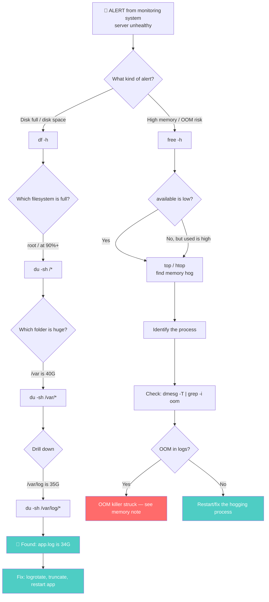

# 🛠️ Monitoring Commands — `df`, `du`, `free`

> **Goal:** Master the three commands you'll type every day as a DevOps engineer — `df` (filesystem disk space), `du` (per-directory disk usage), and `free` (RAM stats) — including the flags that matter and the real-world scenarios where each one shines.

---

## 📍 The Three Commands at a Glance

| Command | What it shows | Scope |
|---|---|---|
| **`df`** | Filesystem **disk space** — total, used, available per mount point | Whole filesystems |
| **`du`** | **Disk usage** of specific files and directories | Files & directories (deep dive) |
| **`free`** | **RAM** — total, used, free, buff/cache, available, swap | System memory |

```
   ┌──────────────────────────────────────────────────────────────┐
   │                    THE MONITORING TOOLBOX                    │
   │                                                              │
   │  DISK (storage)              RAM (memory)                    │
   │  ┌─────────────┐             ┌─────────────┐                 │
   │  │     df      │             │    free     │                 │
   │  │ "filesystem │             │  "RAM stats"│                 │
   │  │  overview"  │             │             │                 │
   │  └──────┬──────┘             └─────────────┘                 │
   │         │                                                    │
   │         ▼                                                    │
   │  ┌─────────────┐                                             │
   │  │     du      │                                             │
   │  │ "per-folder │                                             │
   │  │  deep dive" │                                             │
   │  └─────────────┘                                             │
   └──────────────────────────────────────────────────────────────┘
```

The first two (`df` and `du`) deal with **physical disk storage** — your SSD/HDD. The third (`free`) deals with **RAM**. Confusing them is a common beginner mistake — disk and RAM are completely different resources.

---

## 1️⃣ `df` — Disk Free (Filesystem Overview)

The **`df`** command provides information about the **filesystem disk space** — showing how much total storage exists, how much is used, and how much is available.

### 📋 Basic Usage

```bash
$ df -h
Filesystem      Size  Used Avail Use% Mounted on
/dev/sda1        50G   25G   23G  52% /
/dev/sda2       200G  180G   15G  92% /home
tmpfs           8.0G  2.1G  6.0G  26% /tmp
```

The **`-h`** flag stands for **human-readable** — it displays sizes in KB, MB, or GB rather than raw 1K-blocks. Without `-h`, the output is much harder to read:

```bash
$ df
Filesystem     1K-blocks      Used Available Use% Mounted on
/dev/sda1       52428800  26214400  24117248  52% /
```

### 📊 What Each Column Means

| Column | Meaning |
|---|---|
| **Filesystem** | The device/partition (e.g., `/dev/sda1`, `tmpfs`) |
| **Size** | Total size of the filesystem |
| **Used** | How much is currently used |
| **Avail** | How much is available for new data |
| **Use%** | Percentage used |
| **Mounted on** | Where this filesystem is mounted (e.g., `/`, `/home`) |

### 🎯 Use Cases

**As a system administrator:**
- Monitor disk space over time to check if enough storage is available
- Integrate with automated monitoring (Prometheus, Datadog, Nagios) to trigger alerts if usage crosses a threshold (e.g., **80%**)

**Customizing the output format:**

| Flag | Output format |
|---|---|
| (default) | 1K-blocks |
| `-k` | Kilobytes |
| `-m` | Megabytes |
| `-h` | Human-readable (KB/MB/GB — **most common**) |

> 🧭 **DevOps angle:** `df -h` is the first command you type when you get a "disk full" alert. It tells you *which* filesystem is full. Then you switch to `du` to find *what's* filling it up.

---

## 2️⃣ `du` — Disk Usage (Per-Folder Deep Dive)

While `df` looks at overall filesystem disk space, **`du`** summarizes the **disk usage of specific files and directories** — a deep dive into individual folder-level and sub-folder usage.

### 📋 Basic Usage

Running just `du` displays **every file and folder** inside the current directory — which can produce a LOT of output:

```bash
$ du
4   ./subdir1
8   ./subdir2/file.txt
12  ./subdir2
24  .
```

(Numbers are in KB by default; empty files often show `0`.)

### 🎯 Checking a Specific Folder

To check the size of a specific folder, use **`-s`** (summary) and **`-h`** (human-readable):

```bash
$ du -sh /var/log
4.9G    /var/log
```

| Flag | Meaning |
|---|---|
| **`-s`** | **Summary** — just the total, don't list every sub-item |
| **`-h`** | **Human-readable** — KB/MB/GB instead of raw blocks |
| **`-c`** | Produce a **grand total** at the end (useful when summing multiple paths) |
| **`-a`** | Show sizes of **all individual files**, not just directories |
| **`-BM`** | Scale sizes in **megabytes** |
| **`-BG`** | Scale sizes in **gigabytes** |

### 📊 Common Combinations

```bash
# Summary of one folder (most common)
$ du -sh /var/log
4.9G    /var/log

# Summary with grand total for multiple paths
$ du -shc /var/log /home /tmp
3.2G    /var/log
15G     /home
500M    /tmp
18.7G   total                    ← grand total from -c

# Show every file's size (deep dive)
$ du -ahc /var/log
4.0K    /var/log/app.log
8.0K    /var/log/syslog
2.1G    /var/log/nginx
...
4.9G    /var/log
4.9G    total

# Scale in gigabytes
$ du -BG /var/lib/docker
25G     /var/lib/docker
```

### 🔍 The Real-World DevOps Scenario

Here's the classic debugging flow when disk usage spikes:

```
   🚨 ALERT: "Disk usage 94% on /dev/sda1"
       │
       ▼
   1. $ df -h              ← confirm which filesystem is full
      → root partition at 94%
       │
       ▼
   2. $ sudo du -sh /*     ← find which top-level folder is huge
      → /var is 40 GB
       │
       ▼
   3. $ sudo du -sh /var/* ← drill down into /var
      → /var/log is 35 GB
       │
       ▼
   4. $ sudo du -sh /var/log/*
      → /var/log/app.log is 34 GB  ← 🎯 FOUND IT
       │
       ▼
   5. Fix it: rotate/truncate the log, restart the app,
      set up logrotate to prevent recurrence
```

> 🧭 **DevOps angle:** If your disk utilization spikes to 90%+, use `du` to **pinpoint which specific folder or application is consuming the most space**, then coordinate with the development team to clean it up. `du` is your scalpel; `df` is your x-ray.

---

## 3️⃣ `free` — RAM Statistics

Unlike `df` and `du` (which deal with physical disk storage), the **`free`** command provides information about **RAM (Random Access Memory)**.

### 📋 Basic Usage

```bash
$ free -h
               total    used    free    shared    buff/cache    available
Mem:           15Gi    4.8Gi   210Mi    310Mi         10Gi        9.9Gi
Swap:          2.0Gi     0B    2.0Gi
```

The **`-h`** flag gives human-readable output (GB/MB instead of bytes).

### 📊 What Each Column Means

| Column | Meaning |
|---|---|
| **total** | Total physical RAM (or swap) |
| **used** | Memory used by apps + kernel |
| **free** | Truly idle memory (nothing using it) |
| **shared** | Memory used by tmpfs, IPC shared memory |
| **buff/cache** | Page cache + buffers (reclaimable) |
| **available** | **Memory ready for new apps** — the one to watch |

> ⚠️ Recall from the user-facing memory note: **don't panic at low `free` — check `available`.** Linux uses free RAM for caching (page cache), which is instantly reclaimable. `available` estimates how much is actually usable for new applications.

### 🎯 Use Cases

**Deployment checks:**

If you're deploying an application that requires a specific amount of RAM (e.g., 5 GB), check beforehand with `free` to ensure the server has enough resources:

```bash
$ free -h
               total    used    available
Mem:           15Gi    4.8Gi      9.9Gi   ← ✅ 9.9 GB available > 5 GB required
```

**Performance testing:**

While an application is running, monitor how much memory it consumes in real-time. If it leaks memory or consumes too much, you can catch it early.

### ⏱️ Advanced Flags — Live Monitoring

| Flag | What it does |
|---|---|
| **`-h`** | Human-readable (GB/MB) |
| **`-s N`** | **Refresh every N seconds** (until you stop with `Ctrl + C`) |
| **`-c N`** | Run **N times** then exit (at 1-second intervals) |

```bash
# Refresh every 3 seconds (until Ctrl+C)
$ free -h -s 3
               total    used    free    shared    buff/cache    available
Mem:           15Gi    4.8Gi   210Mi    310Mi         10Gi        9.9Gi
               15Gi    4.9Gi   200Mi    310Mi         10Gi        9.8Gi   ← 3s later
               15Gi    5.0Gi   190Mi    310Mi         10Gi        9.7Gi   ← 6s later
^C

# Run exactly 4 times then exit
$ free -c 4
               total    used    free    shared    buff/cache    available
Mem:        16309556 5033820 215340   317440     10406396    10151228
               ...   (repeats 3 more times, then exits)
```

The `-s` (refresh interval) flag is perfect for **watching memory during a load test or deployment** — you can see memory consumption change in real time without manually re-running the command.

---

## 4️⃣ The Complete DevOps Monitoring Flow

Here's how these three commands work together in a real incident:



---

## 5️⃣ Quick Reference Cheat Sheet

| Command | Flag | What it does | Example |
|---|---|---|---|
| `df` | `-h` | Human-readable filesystem overview | `df -h` |
| `df` | `-k` / `-m` | Sizes in KB / MB | `df -m` |
| `du` | `-s` | Summary (one line per path) | `du -s /var` |
| `du` | `-h` | Human-readable | `du -sh /var/log` |
| `du` | `-c` | Grand total | `du -shc /var /home` |
| `du` | `-a` | Show all files (not just dirs) | `du -ah /var/log` |
| `du` | `-BM` / `-BG` | Scale in MB / GB | `du -BG /var/lib/docker` |
| `free` | `-h` | Human-readable RAM | `free -h` |
| `free` | `-s N` | Refresh every N seconds | `free -h -s 3` |
| `free` | `-c N` | Run N times then exit | `free -c 4` |

### 🧠 Memory Hook

| Command | Full name | "What does it do?" one-liner |
|---|---|---|
| **`df`** | **D**isk **F**ree | "How much disk is **free** on each filesystem?" |
| **`du`** | **D**isk **U**sage | "How much disk does **this** folder use?" |
| **`free`** | (free memory) | "How much **RAM** is free/available?" |

> **`df` = filesystem x-ray. `du` = folder scalpel. `free` = RAM stethoscope.**

---

## 🧾 Summary

| Concept | One-line takeaway |
|---|---|
| **`df`** | Shows filesystem disk space — total/used/available per mount point. Whole-filesystem view. |
| **`df -h`** | Human-readable (GB/MB). The most common form. First command for "disk full" alerts. |
| **`du`** | Shows disk usage of specific files & directories. Deep-dive tool. |
| **`du -sh <folder>`** | Summary + human-readable — the most common form. "How big is this folder?" |
| **`du -shc`** | Add a grand total at the end. Useful for summing multiple paths. |
| **`du -ahc`** | Show every file's size + grand total. Deepest dive. |
| **`-BM` / `-BG`** | Scale sizes in megabytes / gigabytes. |
| **`free`** | Shows RAM stats — total/used/free/shared/buff-cache/available + swap. |
| **`free -h`** | Human-readable RAM. Watch the `available` column, not `free`. |
| **`free -s N`** | Refresh every N seconds. Live monitoring during load tests/deployments. |
| **`free -c N`** | Run N times then exit. Bounded monitoring. |
| **Disk vs RAM** | `df`/`du` = disk (storage). `free` = RAM (memory). Don't confuse them. |
| **The debugging flow** | `df -h` → find full filesystem → `du -sh /*` → drill down → find the culprit → fix it. |
| **DevOps integration** | `df` feeds disk alerts (Prometheus, Datadog). `free` feeds memory alerts. `du` is your manual drill-down tool. |

---

← Back to [Linux Memory](./README.md) | Previous: [Kernel Internals](./2-memory-kernel-internals.md) |
