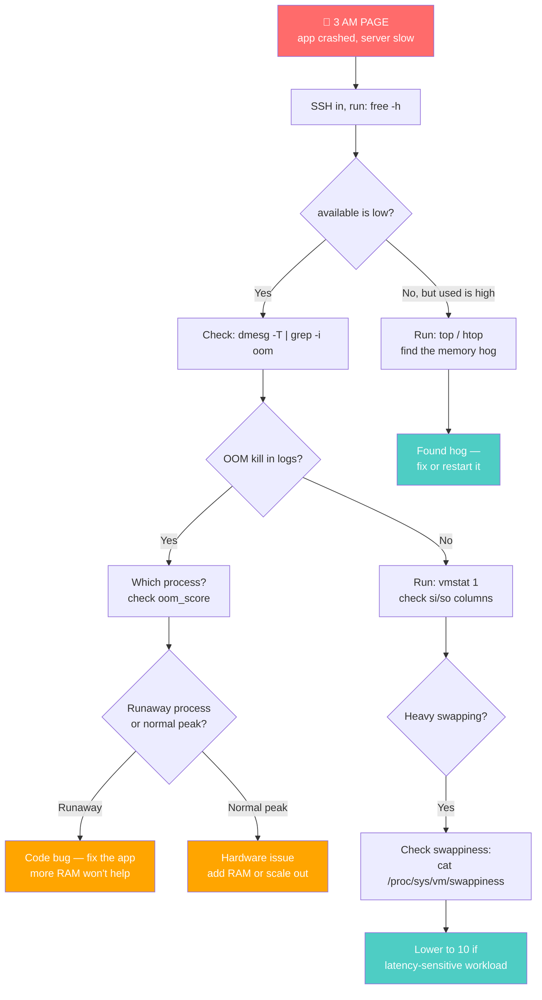

# 🐧 Linux Learning Journey: Linux Memory — From RAM to OOM Killer

> **Goal:** Understand Linux memory from three angles that meet at the same place — the **user-facing model** (what `free -h` actually means), the **kernel internals** (page tables, TLB, VMAs), and the **monitoring commands** (`df`, `du`, `free`) you'll use daily as a DevOps engineer.

---

## 📍 Why Memory Is the #1 DevOps Skill

If you've ever been paged at 3 AM because "the server is slow" or "the app crashed" — 9 times out of 10, the root cause is **memory**. Processes dying out of nowhere. Cryptic OOM messages in the logs. `free -h` showing "almost no free memory" and you panicking.

Here's the thing: **on Linux, almost no free memory is usually a *good* sign.** Linux has a philosophy:

> **"Idle RAM is wasted RAM."**

Linux will actively use your free memory to make the system *faster*. This is by design — not a bug, not a memory leak, Linux being clever. Understanding *why* is the difference between a DevOps engineer who panics and one who debugs.

This note set covers the full stack:

```
   ┌───────────────────────────────────────────────────────────────┐
   │  WHAT YOU SEE              WHAT THE KERNEL DOES               │
   │                                                               │
   │  $ free -h         ◀───────  page cache, buffers, swap       │
   │  $ df -h           ◀───────  filesystem disk space           │
   │  $ du -sh /var     ◀───────  per-directory disk usage        │
   │  $ top / htop      ◀───────  per-process memory (task_struct)│
   │  $ cat /proc/meminfo ◀─────  the raw source of truth         │
   │                                                               │
   │  $ dmesg | grep -i oom ◀──── OOM killer logs                 │
   │                                                               │
   └───────────────────────────────────────────────────────────────┘
                            │
                            ▼
   ┌────────────────────────────────────────────────────────────────┐
   │              KERNEL MEMORY MANAGEMENT                          │
   │                                                                │
   │   Virtual Memory ─▶ Page Tables (PGD→PUD→PMD→PTE) ─▶ TLB     │
   │        │                                              │        │
   │        ▼                                              ▼        │
   │   VMAs (virtual memory areas) ──▶ struct page ──▶ mem_map    │
   │   (mapping files/anonymous)     (metadata)      (array)        │
   │                                                                │
   │   Swap (partition/file) ◀── swappiness (0-100)                │
   │   Huge Pages (4KB / 2MB / 1GB) ──▶ compound pages / folios    │
   │   Overcommit (lazy allocation) ──▶ OOM killer (last resort)   │
   └────────────────────────────────────────────────────────────────┘
```

---

## 🧩 The Three Pieces

### 💭 Piece 1: The User-Facing Model

What RAM actually is, why Linux eats all your "free" memory on purpose (page cache + buffers), how virtual memory gives each process its own address space, how swap works as overflow, how to tune swappiness, and the dramatic last-resort of the **OOM killer** — the kernel's grim reaper that sacrifices a process to save the system.

This is the layer every DevOps engineer *must* understand to read `free -h` without panicking, debug crashes, and tune production servers.

→ **Full note:** [`1-memory-user-facing.md`](./1-memory-user-facing.md)

### 🧠 Piece 2: Kernel Internals — How the Kernel Finds Things in Memory

Under the hood: how virtual addresses translate to physical ones via **4-level page tables** (PGD → PUD → PMD → PTE), the **TLB** (translation lookaside buffer) that caches translations, **page faults** when the TLB misses, **VMAs** (virtual memory areas) for mapping files and anonymous memory, **`struct page`** and **`mem_map`** for tracking physical frames, **sparse memory** for hot-pluggable RAM, and **compound pages / folios** for managing huge pages safely.

This is the deeper "how it actually works" layer — essential for understanding *why* huge pages help, *how* swap is tracked, and *what* the OOM killer sees.

→ **Full note:** [`2-memory-kernel-internals.md`](./2-memory-kernel-internals.md)

### 🛠️ Piece 3: Monitoring Commands — `df`, `du`, `free`

The three commands you'll type every day as a DevOps engineer:

| Command | What it shows |
|---|---|
| **`df`** | Filesystem disk space (total/used/available per mount) |
| **`du`** | Disk usage of specific files & directories (deep dive) |
| **`free`** | RAM (total/used/free/buff-cache/available + swap) |

→ **Full note:** [`3-monitoring-commands.md`](./3-monitoring-commands.md)

---

## 🔗 Where They All Meet — The 3 AM Page

Here's the scenario that ties everything together. It's 3 AM. Your pager goes off: "prod-api-01 is slow, app crashed."



Every box in that flow uses a concept from this note set:
- **`free -h`** → user-facing model (Piece 1) + monitoring command (Piece 3)
- **`dmesg | grep oom`** → OOM killer (Piece 1)
- **`oom_score`** → how the kernel ranks victims (Piece 1 + Piece 2)
- **`vmstat 1`** → monitoring tools (Piece 1 + Piece 3)
- **Swappiness** → swap tuning (Piece 1)
- **Page tables / TLB / swap tracking** → why swapping is slow (Piece 2)

> 🧭 **The DevOps takeaway:** Memory issues are the #1 cause of production incidents. The engineers who can read `free -h` calmly, check `dmesg` for OOM events, and know *why* `available` matters more than `free` are the ones who fix things at 3 AM instead of making them worse.

---

## 📚 Reading Order

| # | Note | What it covers | Read time |
|---|---|---|---|
| 1 | [`1-memory-user-facing.md`](./1-memory-user-facing.md) | RAM, page cache, virtual memory, swap, swappiness, OOM killer, huge pages, overcommit, monitoring tools | ~15 min |
| 2 | [`2-memory-kernel-internals.md`](./2-memory-kernel-internals.md) | Page tables (4-level), TLB, page faults, VMAs, struct page, mem_map, sparse memory, compound pages/folios, virtual address layout | ~15 min |
| 3 | [`3-monitoring-commands.md`](./3-monitoring-commands.md) | `df`, `du`, `free` — flags, use cases, practical examples | ~7 min |

Read them in order — Piece 2 builds on Piece 1, and Piece 3 is the practical toolbox for both.

---

## 🧾 Summary

| Concept | One-line takeaway |
|---|---|
| **"Idle RAM is wasted RAM"** | Linux eats your free memory for caching — by design, not a bug. |
| **`free` vs `available`** | `free` = truly idle. `available` = usable for new apps (includes reclaimable cache). Watch `available`. |
| **Page cache** | Linux caches file contents in RAM — repeated reads hit RAM (~100ns) not disk (~10ms, 100,000x slower). |
| **Virtual memory** | Each process thinks it owns all memory. Kernel maps virtual → physical via page tables. Processes are isolated. |
| **Swap** | Disk overflow for RAM. A partition or a file. Slower than RAM but a lifesaver when memory is tight. |
| **Swappiness (0-100)** | How aggressively kernel swaps. Default 60. Database? Set to 10 or 1. Check: `cat /proc/sys/vm/swappiness`. |
| **OOM killer** | Kernel's last resort — kills a process to save the system. Based on `oom_score` (memory used, runtime, root, priority). |
| **Huge pages** | 2MB or 1GB pages instead of 4KB — fewer page table entries, faster lookups. Explicit or Transparent (THP). |
| **Overcommit** | Linux promises more memory than physically exists (lazy allocation). Calculated gamble — overflow = OOM. |
| **Page tables (4-level)** | PGD → PUD → PMD → PTE. 9 bits per level + 12-bit offset = 48-bit virtual address. |
| **TLB** | Translation Lookaside Buffer — CPU cache of recent virtual→physical translations. Small (16-64 entries/core) but critical. |
| **VMA** | Virtual Memory Area — maps a range of virtual addresses to a file or anonymous memory. Enables mmap and lazy allocation. |
| **`struct page`** | Kernel's metadata for each physical page frame — flags + reference count. No address stored; derived from position in `mem_map`. |
| **Compound pages / folios** | Managing multiple pages as one (for huge pages). Folios = the safe API for compound pages. |
| **`df`** | Filesystem disk space (total/used/available). `df -h` for human-readable. |
| **`du`** | Disk usage of files/directories. `du -sh /folder` for summary. |
| **`free`** | RAM stats. `free -h` for human-readable. `free -s N` refreshes every N seconds. |
| **DevOps relevance** | Memory issues = #1 production incident cause. Calmly reading `free -h` + checking `dmesg` for OOM = the difference between fixing and panicking. |
