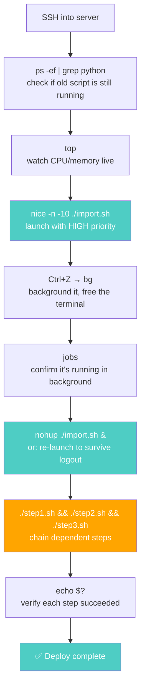

# 🐧 Linux Learning Journey: Process Management — Viewing, Controlling & Persisting Processes

> **Goal:** Connect four pieces that meet at the same place — **`ps`** (snapshot of running processes), **`top`** (live monitoring), **exit codes & process operators** (chaining commands), and **`jobs`/`bg`/`fg`/`nice`/`nohup`** (controlling, prioritizing, and persisting processes) — so you can fully manage any process on a Linux server.

---

## 📍 The Unified Picture

Every DevOps engineer needs to answer four questions about processes, constantly:

1. **"What's running right now?"** → `ps` (snapshot) or `top` (live)
2. **"Did my last command succeed?"** → exit codes (`$?`)
3. **"How do I chain commands based on success/failure?"** → process operators (`&&`, `||`, `;`)
4. **"How do I control a process — background it, prioritize it, keep it alive after I log out?"** → `jobs`/`bg`/`fg`/`nice`/`nohup`

These four pieces aren't isolated tools — they're one coherent workflow:

```
   ┌──────────────────────────────────────────────────────────────┐
   │                   PROCESS MANAGEMENT WORKFLOW                │
   │                                                              │
   │  VIEW              CHAIN              CONTROL                │
   │  ┌─────┐           ┌─────┐            ┌─────┐                │
   │  │ ps  │           │ $?  │            │jobs │                │
   │  │ top │           │ &&  │            │ bg  │                │
   │  │     │           │ ||  │            │ fg  │                │
   │  │     │           │ ;   │            │nice │                │
   │  │     │           │$()  │            │nohup│                │
   │  └─────┘           └─────┘            └─────┘                │
   │   "what's          "did it           "control the            │
   │    running?"        work? chain       process —              │
   │                      them"            background,            │
   │                                       prioritize,            │
   │                                       persist"               │
   └──────────────────────────────────────────────────────────────┘
```

---

## 🧩 The Four Pieces

### 📋 Piece 1: `ps` — The Process Snapshot

**`ps`** = **P**rocess **S**tatus. It displays running processes — a static snapshot at the moment you run it. Every process has a unique **PID (Process ID)** assigned by the kernel. `ps` shows you PID, TTY, TIME, CMD by default; `ps -ef` adds UID, PPID, START; `ps aux` adds `%CPU` and `%MEM`.

The classic DevOps pattern: **`ps -ef | grep <service>`** to check if a specific app (like Apache) is running, then cross-verify with `systemctl status <service>`.

→ **Full note:** [`1-ps-command.md`](./1-ps-command.md)

### 📊 Piece 2: `top` — Live Process Monitoring

**`top`** = **T**able **O**f **P**rocesses. Unlike `ps` (static snapshot), `top` provides **real-time, live monitoring** — CPU usage, memory consumption, running tasks, and active processes, refreshing every 3 seconds by default.

The screen splits into two sections: **system summary** (uptime, load average, tasks, CPU states, memory) at the top, and a **dynamic process table** at the bottom. Interactive keys let you kill processes (`k`), filter by user (`u`), sort by memory (`M`), change refresh delay (`d`), and more.

→ **Full note:** [`2-top-command.md`](./2-top-command.md)

### 🔗 Piece 3: Exit Codes & Process Operators — Chaining Commands

Every command returns an **exit code** (0-255) when it finishes. **0 = success, anything else = failure.** You check it with `echo $?`. This is how Bash decides whether to run the next command in a chain.

**Process operators** use exit codes to control sequencing:
- **`&&`** (AND) — run second command **only if the first succeeded**
- **`||`** (OR) — run second command **only if the first failed**
- **`;`** (semicolon) — run commands **no matter what**
- **`$()`** (subcommand) — capture a command's output and insert it into another

This is the foundation of every shell script and CI/CD pipeline you'll ever write.

→ **Full note:** [`3-exit-codes-operators.md`](./3-exit-codes-operators.md)

### 🎛️ Piece 4: Process Control — `jobs`, `bg`, `fg`, `nice`, `nohup`

Viewing processes is one thing — **controlling** them is another. These five commands let you:

| Command | What it does |
|---|---|
| **`jobs`** | List active/stopped jobs in your current terminal session |
| **`bg`** | Resume a suspended job **in the background** |
| **`fg`** | Bring a background job back to the **foreground** |
| **`nice`** | Launch a process with a custom **priority** (-20 to 19) |
| **`nohup`** | Keep a process running **after you log out** ("No Hang Up") |

→ **Full note:** [`4-process-control.md`](./4-process-control.md)

---

## 🔗 Where They All Meet — The Production Debugging Scenario

Here's a scenario that uses all four pieces together. You SSH into a server and need to deploy a long-running data import script:



Every arrow uses a concept from this note set:
- **`ps -ef | grep`** → Piece 1 (ps)
- **`top`** → Piece 2 (top)
- **`nice -n -10`** → Piece 4 (nice)
- **`Ctrl+Z` → `bg` → `jobs`** → Piece 4 (jobs/bg)
- **`nohup`** → Piece 4 (nohup)
- **`&&` chaining** → Piece 3 (process operators)
- **`echo $?`** → Piece 3 (exit codes)

> 🧭 **The DevOps takeaway:** Process management is the daily bread of operations. The engineers who can instantly check what's running (`ps`/`top`), chain commands reliably (`&&`/`||`), and keep long-running tasks alive across disconnects (`nohup`/`jobs`) are the ones who ship deployments calmly instead of fighting fires.

---

## 📚 Reading Order

| # | Note | What it covers | Read time |
|---|---|---|---|
| 1 | [`1-ps-command.md`](./1-ps-command.md) | `ps` basics, `ps -ef`, `ps aux`, `ps -u`/`-g`, `ps -ejH` (tree), `grep` filtering | ~8 min |
| 2 | [`2-top-command.md`](./2-top-command.md) | `top` layout (summary + process table), all interactive keys, column meanings | ~8 min |
| 3 | [`3-exit-codes-operators.md`](./3-exit-codes-operators.md) | Exit codes (0-255 reference), `&&`/`||`/`;` operators, `$()` subcommands | ~8 min |
| 4 | [`4-process-control.md`](./4-process-control.md) | `jobs`/`bg`/`fg`, `nice` (-20 to 19), `nohup` + `nohup.out` | ~8 min |

Read them in order — each builds on the previous, and together they form a complete process management toolkit.

---

## 🧾 Summary

| Concept | One-line takeaway |
|---|---|
| **`ps`** | Process Status — static snapshot of running processes. Default shows current shell only. |
| **`ps -ef`** | Every process, full format (adds UID, PPID, START). Most common admin form. |
| **`ps aux`** | BSD-style — adds `%CPU` and `%MEM`. No hyphen. |
| **`ps -ejH`** | Process tree — shows parent/child hierarchy. |
| **`ps -ef \| grep <svc>`** | The classic DevOps pattern to check if a service is running. |
| **`top`** | Table of Processes — real-time, live monitoring (refreshes every 3s). |
| **`top` keys** | `k` (kill), `u` (filter user), `M` (sort memory), `d` (refresh delay), `f` (fields), `r` (renice). |
| **Exit code** | 0-255 returned by every command. 0 = success, non-zero = failure. Check with `echo $?`. |
| **Common exit codes** | 0=success, 1=error, 127=not found, 130=Ctrl+C, 137=SIGKILL, 255=out of bounds. |
| **`&&`** | AND — run second command only if first **succeeded** (exit 0). |
| **`\|\|`** | OR — run second command only if first **failed** (non-zero). |
| **`;`** | Semicolon — run commands **no matter what**. |
| **`$()`** | Subcommand — capture a command's output and insert it into another. |
| **`jobs`** | List active/stopped jobs in current terminal. |
| **`bg %N`** | Resume suspended job N **in the background**. |
| **`fg %N`** | Bring job N to the **foreground**. |
| **`nice -n <val>`** | Launch process with priority -20 (highest) to 19 (lowest). Negative needs root. |
| **`nohup`** | "No Hang Up" — process survives terminal disconnect. Output → `nohup.out`. |
| **DevOps relevance** | Process management = daily operations. `ps`/`top` to see, `&&`/`||` to chain, `nohup`/`nice` to control. |
