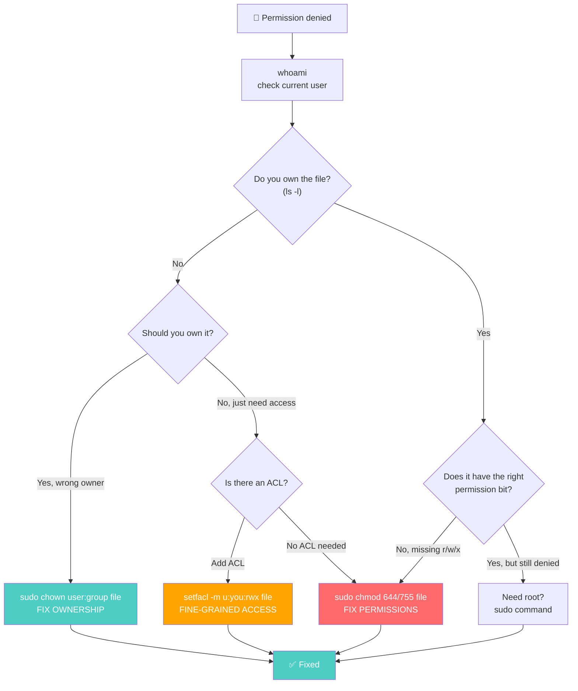

# 🐧 Linux Learning Journey: Permissions & Access Control

> **Goal:** Master Linux's entire security model — from **who you are** (users & groups) to **what you can do** (permissions via `chmod`) to **who owns what** (`chown`) to **fine-grained control** (ACLs) to **how files are stored and linked** (inodes & links) — plus your **shell environment** configuration.

---

## 📍 The Question That Ties It All Together

Every DevOps engineer eventually hits the wall of "Permission denied." The question is: **do you understand WHY?**

```
   $ ./deploy.sh
   bash: ./deploy.sh: Permission denied
```

That error could mean any of:
- The file doesn't have the **execute** bit set → `chmod +x deploy.sh`
- The file is owned by the **wrong user** → `sudo chown appuser:appuser deploy.sh`
- You're not in the right **group** → `sudo usermod -aG deploy paul`
- An **ACL** is blocking you → `setfacl -m u:paul:rwx deploy.sh`
- You need **root** privileges → `sudo ./deploy.sh`

Understanding Linux's security model means you can diagnose *which* of these is the problem in seconds, not hours. This note set covers all five layers:

```
   ┌──────────────────────────────────────────────────────────────┐
   │              LINUX ACCESS CONTROL — 5 LAYERS                 │
   │                                                              │
   │  WHO YOU ARE          → Users, Groups, sudo, root            │
   │  WHAT YOU CAN DO      → chmod (r, w, x — symbolic + octal)   │
   │  WHO OWNS WHAT        → chown (user:group)                   │
   │  FINE-GRAINED CONTROL → ACLs (setfacl, getfacl)              │
   │  HOW FILES WORK       → Inodes, hard links, symbolic links   │
   │                                                              │
   │  + YOUR ENVIRONMENT   → .bashrc, .bash_profile, env vars     │
   └──────────────────────────────────────────────────────────────┘
```

---

## 🧩 The Six Pieces

### 👤 Piece 1: Users, Groups & Superuser

Linux is multi-user. Every file belongs to a **user** and a **group**. The `root` user can do anything. Regular users use `sudo` to escalate. The **Principle of Least Power** says: give each user only the minimum permissions necessary — limits damage from breaches and mistakes.

Commands: `whoami`, `id`, `useradd`, `passwd`, `userdel`, `usermod -aG`, `/etc/passwd`.

→ **Full note:** [`1-users-groups-sudo.md`](./1-users-groups-sudo.md)

### 🔐 Piece 2: Permissions & Ownership (`chmod` + `chown`)

The heart of Linux security. Every file has a **10-character permission string** (`-rwxr-xr--`) decoded as: file type + owner + group + others. `chmod` changes *what actions* are allowed (r/w/x). `chown` changes *who owns* the file.

Two modes for `chmod`: **symbolic** (`u+w`, `o-rwx`, `u=rwx,g=rx,o=r`) and **octal** (`755`, `644`, `600`, `400`). Production baselines matter — `400` for SSH keys, `644` for web files, `755` for directories. **Never use `777` in production.**

→ **Full note:** [`2-permissions-ownership.md`](./2-permissions-ownership.md)

### 🎛️ Piece 3: Access Control Lists (ACLs)

Standard permissions (`chmod`) only handle owner/group/others — three buckets. What if you need to give **one specific user** access without changing ownership or group membership? That's what **ACLs** are for.

`setfacl -m u:alice:rwx file.txt` gives alice rwx without touching the standard permission bits. `getfacl` shows the ACL. `setfacl -b` strips all ACLs. Essential for onboarding/offboarding contractors without disrupting existing access.

→ **Full note:** [`3-acls.md`](./3-acls.md)

### 🔗 Piece 4: Inodes & File Links

Every file on Linux has an **inode** (index node) — a data structure storing the file's metadata (owner, permissions, data block pointers) but **not the filename**. The filename is just a pointer to the inode.

This enables two kinds of links:
- **Hard links** (`ln original.txt hardlink.txt`) — share the same inode; deleting the original doesn't destroy data until all links are gone
- **Symbolic links** (`ln -s original.txt symlink.txt`) — a separate file pointing to the target path; if the original is deleted, the symlink breaks

→ **Full note:** [`4-inodes-links.md`](./4-inodes-links.md)

### 🌍 Piece 5: Environments & Shell Configuration

Your shell environment is configured by a hierarchy of files: `/etc/environment` (system-wide), `~/.bashrc` (every session), `~/.bash_profile` (login sessions). Environment variables (`PATH`, `HOME`, `USER`) are inherited by child processes.

`printenv` shows all current env vars. The `.bash_profile` sources `.bashrc` pattern ensures your config runs on every session.

→ **Full note:** [`5-environments.md`](./5-environments.md)

---

## 🔗 Where They All Meet — The "Permission Denied" Flowchart

Here's the debugging flow that ties every piece together. You get "Permission denied" on a file:



Every path uses a concept from this note set:
- **`whoami`** → Piece 1 (users)
- **`ls -l` ownership** → Piece 2 (permissions/ownership)
- **`chown`** → Piece 2 (ownership)
- **`chmod`** → Piece 2 (permissions)
- **`setfacl`** → Piece 3 (ACLs)
- **`sudo`** → Piece 1 (superuser)
- **Inode understanding** → Piece 4 (how `ls -l` reads metadata)

> 🧭 **The DevOps takeaway:** Permission errors are the #1 cause of deployment failures. The engineers who can read `ls -l` output fluently, know the difference between `chmod` and `chown`, and understand when to reach for `setfacl` vs `sudo` are the ones who fix things in minutes instead of hours.

---

## 📚 Reading Order

Here's the table with the "Read time" column removed:

| # | Note | What it covers |
|---|---|---|
| 1 | [`1-users-groups-sudo.md`](./1-users-groups-sudo.md) | Users, groups, `whoami`/`id`, `useradd`/`passwd`/`userdel`/`usermod`, `sudo`, root, Principle of Least Power, `/etc/passwd` |
| 2 | [`2-permissions-ownership.md`](./2-permissions-ownership.md) | The 10-char string, r/w/x for files vs dirs, `chmod` (symbolic + octal), production baselines (400/600/644/700/755), `777` anti-pattern, `chown`, when to use which |
| 3 | [`3-acls.md`](./3-acls.md) | ACLs, `setfacl`/`getfacl`, `-m`/`-x`/`-b`/`-R` flags, onboarding/offboarding scenarios |
| 4 | [`4-inodes-links.md`](./4-inodes-links.md) | Inodes, `ls -li`/`stat`, hard links vs symbolic links, use cases, cross-filesystem linking |
| 5 | [`5-environments.md`](./5-environments.md) | `printenv`, `/etc/environment`, `.bashrc` vs `.bash_profile`, env var inheritance |

Read them in order — each builds on the previous, and together they form a complete picture of Linux access control.

---

## 🧾 Summary

| Concept | One-line takeaway |
|---|---|
| **Users & groups** | Every file belongs to a user and a group. `root` can do anything. `sudo` escalates. |
| **Principle of Least Power** | Give each user only the minimum permissions necessary. Limits breach/mistake damage. |
| **`whoami` / `id`** | Check current user / check UID + GIDs. |
| **`useradd -m -s /bin/bash`** | Create a user with home dir and bash shell. |
| **`usermod -aG wheel lulu`** | Add user `lulu` to the sudo/wheel group (`-aG` = append to group). |
| **`/etc/passwd`** | System user database — lists all users. |
| **`/bin/false` shell** | Restricted shell — user can't log in interactively (used for service accounts). |
| **10-char permission string** | `-rwxr-xr--` = file type + owner(rwx) + group(r-x) + others(r--). |
| **r/w/x for files** | read=open, write=modify, execute=run. |
| **r/w/x for dirs** | read=list(ls), write=create/delete files inside, execute=enter(cd). |
| **`chmod` symbolic** | `u+w` (add), `o-rwx` (remove), `u=rwx,g=rx,o=r` (set exact). |
| **`chmod` octal** | r=4, w=2, x=1. Add them: 7=rwx, 6=rw-, 5=r-x, 4=r--. Three digits = owner/group/others. |
| **`400`** | SSH private keys (`.pem`) — only owner can read. SSH rejects if others have access. |
| **`600`** | App configs, DB secrets, `.env` files. Owner read/write only. |
| **`644`** | Standard files, web pages (HTML/CSS). Owner writes, others read. |
| **`700`** | Private scripts. Only owner can run/modify. |
| **`755`** | Directories & executables. Owner full, others can enter/list. |
| **`777`** | ☠️ NEVER in production. Everyone can read/write/execute. Security disaster. |
| **`chown`** | Change *who owns* the file. `sudo chown user:group file`. Almost always needs sudo. |
| **`chown -R`** | Recursive — applies to directory and everything inside. |
| **`chmod` vs `chown`** | `chmod` = what actions allowed. `chown` = who owns it. |
| **ACLs** | Fine-grained permissions for specific users/groups beyond owner/group/others. |
| **`setfacl -m u:alice:rwx`** | Give alice rwx without changing ownership or group. |
| **`getfacl`** | View ACL settings on a file. |
| **`setfacl -b`** | Strip ALL ACL entries — return to baseline permissions. |
| **`setfacl -R`** | Recursive — apply to directory tree. |
| **Inode** | Index node — stores file metadata (owner, permissions, data pointers) but NOT filename. |
| **`ls -li` / `stat`** | Inspect inodes — see inode numbers and metadata. |
| **Hard link** | `ln original.txt hardlink.txt` — shares same inode. Deleting original doesn't destroy data. |
| **Symbolic link** | `ln -s original.txt symlink.txt` — separate file pointing to path. Breaks if original deleted. |
| **`printenv`** | Display all currently set environment variables. |
| **`/etc/environment`** | System-wide env vars — available to all users. |
| **`.bashrc`** | Runs at the start of *every* bash session. User-specific customizations. |
| **`.bash_profile`** | Runs only at first interactive login shell. Often sources `.bashrc`. |
| **DevOps relevance** | Permission errors = #1 deployment failure cause. Master `ls -l`, `chmod`, `chown`, `setfacl` to fix in minutes. |
