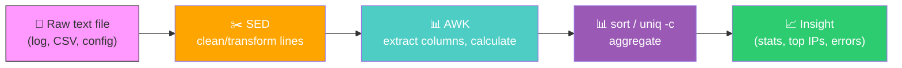

# 🐧 Linux Learning Journey: Text Processing — AWK & SED

> **Goal:** Master Linux's two most powerful text-processing tools — **AWK** (column/field extraction and data analysis) and **SED** (line manipulation and find/replace) — and know exactly when to use each.

---

## 📍 The Two Tools Every DevOps Engineer Must Master

As a DevOps engineer, you will constantly encounter **text-based data streams**: server logs (`access.log`), configuration files, CSV reports, or output from system commands (`df -h`, `ps aux`). Raw text is everywhere, and you need to slice, filter, transform, and analyze it.

Two tools dominate Linux text processing:

```
   ┌──────────────────────────────────────────────────────────────┐
   │              TEXT PROCESSING — TWO TOOLS                     │
   │                                                              │
   │   AWK (data analytics workbench)                             │
   │   ├── Slices text into COLUMNS and ROWS                      │
   │   ├── Extracts fields ($1, $2, $3...)                        │
   │   ├── Performs calculations (sum, average, count)            │
   │   ├── Full programming language (variables, loops, if/else)  │
   │   └── Best for: log parsing, CSV analysis, metrics           │
   │                                                              │
   │   SED (scalpel)                                              │
   │   ├── Finds, replaces, inserts, deletes LINES                │
   │   ├── Substitution: s/old/new/g                              │
   │   ├── In-place file editing (-i)                             │
   │   ├── Regex-based pattern matching                           │
   │   └── Best for: config updates, cleanups, line removal       │
   └──────────────────────────────────────────────────────────────┘
```

While tools like `grep` can find *lines*, AWK can slice those lines into *words and columns*, perform calculations, and filter data with surgical precision. SED can then *transform* those lines — replacing text, deleting unwanted rows, or inserting new content.

---

## 🧩 The Two Pieces

### 📊 Piece 1: AWK — The Data Analytics Workbench

**AWK** is not just a command — it's a **domain-specific programming language** designed for extracting and manipulating text data in columns and rows. Named after its creators (Alfred **A**ho, Peter **W**einberger, and Brian **K**ernighan).

AWK views every file as **records (rows)** split into **fields (columns)**. Built-in variables (`$1`, `$2`, `NR`, `NF`, `$NF`) let you reference any column by number. It supports `BEGIN`/`END` blocks for setup and summary, variables for calculations, and full conditionals.

**Classic DevOps pattern:** `ps aux | awk '$4 > 5.0 {print $1, $2, $11}'` — find processes using more than 5% memory.

→ **Full note:** [`1-awk.md`](./1-awk.md)

### ✂️ Piece 2: SED — The Stream Editor Scalpel

**SED** (Stream Editor) is a non-interactive, automated text editor that processes a file **line-by-line** from top to bottom. It reads each line into memory (the **Pattern Space**), performs transformations, and outputs the result.

The most common SED command is **substitution** (`s/old/new/g`). SED can also delete lines, insert new content, append text, and perform regex-based matching — all without ever opening a graphical editor.

**Classic DevOps pattern:** `sed -i 's/API_ENV=staging/API_ENV=production/g' .env` — update a config value directly on disk.

→ **Full note:** [`2-sed.md`](./2-sed.md)

---

## 🔗 Where They Meet — AWK vs SED Comparison

Both are foundational command-line text processors, but they're built for entirely different jobs:

| Feature | SED (Stream Editor) | AWK (Text Processing Language) |
|---|---|---|
| **Core Purpose** | **Line manipulation** (find, replace, delete, insert text) | **Column/Field data extraction** and mathematical calculations |
| **How it views data** | Line-by-line strings | Records (rows) split into **Fields (`$1, $2, $3`)** |
| **Best at** | Quick config updates (`s/foo/bar/g`), stripping comment lines, cleanups | Parsing logs, calculating sums/averages, filtering numeric metrics |
| **Programming Power** | Limited (conditional pattern matching and basic flags) | Full programming language (variables, loops, arrays, `if/else`) |
| **Named after** | Stream Editor | **A**ho, **W**einberger, **K**ernighan |
| **Mental model** | Pattern Space (one line at a time in memory) | Records (rows) + Fields (columns) |

### 🎯 The Analogy

```
   ┌──────────────────────────────────────────────────────────────┐
   │  SED is a SCALPEL:                                           │
   │  Perfect for cutting out specific words, replacing           │
   │  configuration strings, or slicing out unwanted lines.       │
   │  Fast, precise, surgical.                                    │
   │                                                              │
   │  AWK is a DATA ANALYTICS WORKBENCH:                          │
   │  Perfect for taking a messy spreadsheet or log file,         │
   │  breaking it into columns, calculating totals, and           │
   │  restructuring the output.                                   │
   │  Powerful, programmable, analytical.                         │
   └──────────────────────────────────────────────────────────────┘
```

---

## 🔄 How They Work Together in Pipelines

AWK and SED are often **chained together** in pipelines. Here's the typical DevOps workflow:



### 📋 Real Pipeline Examples

```bash
# 1. Find top 5 IPs hitting your nginx server (AWK + sort + head)
awk '{print $1}' /var/log/nginx/access.log | sort | uniq -c | sort -rn | head -5

# 2. Clean a config file (strip comments) then extract a value (SED + AWK)
sed '/^#/d' nginx.conf | awk '{print $1, $2}'

# 3. Replace a config value, then verify it (SED + AWK)
sed -i 's/API_ENV=staging/API_ENV=production/g' .env
awk -F= '/API_ENV/ {print $2}' .env

# 4. Find processes using >5% memory, then kill them (AWK + xargs + kill)
# Use AWK to generate a report first: DevOps principle: observability first, diagnosis second, intervention third.
ps aux | awk 'NR == 1 || $4 > 5.0 { 
    print $1, $2, $4, $11 
}'
# Then inspect a particular PID:
ps -p 1234 -o pid,ppid,user,%mem,%cpu,stat,cmd 
kill -TERM 1234 #If you have confirmed that it should stop, try a normal termination first

# 5. Count HTTP status codes from access logs (AWK + sort + uniq)
awk '{print $9}' /var/log/nginx/access.log | sort | uniq -c | sort -rn
```

---

## 🎯 Real Production Scenarios for DevOps Engineers

| Scenario | Tool | Command | Why it matters |
|---|---|---|---|
| **Parsing web server logs** | AWK | `awk '{print $1}' /var/log/nginx/access.log` | Extract client IP addresses to analyze visitors or trace DDoS sources |
| **Summing disk space** | AWK | `df -h \| awk '{print $5, $6}'` | Extract disk utilization % and mount points from storage output |
| **Finding memory-hogging processes** | AWK | `ps aux \| awk '$4 > 5.0 {print $1, $2, $11}'` | Filter processes where memory usage exceeds 5% |
| **Counting log entries** | AWK | `awk '/INFO/ {count++} END {print count}' app.log` | Count how many times "INFO" appears in a log |
| **Fetching logs by time range** | AWK | `awk '$2 >= "08:50:00" && $2 <= "08:59:59" {print}' app.log` | Extract logs from a specific time window |
| **Updating CI/CD env vars** | SED | `sed -i 's/API_ENV=staging/API_ENV=production/g' .env` | Instantly update config flags on disk |
| **Stripping comments from config** | SED | `sed '/^#/d' nginx.conf` | Delete all lines starting with `#` for clean viewing |
| **Parsing CSV files** | AWK | `awk -F, '{print $2}' employees.csv` | Extract specific columns from comma-separated files |
| **Deleting empty lines** | SED | `sed '/^$/d' file.txt` | Clean up files by removing blank lines |
| **Counting HTTP status codes** | AWK | `awk '{print $9}' access.log \| sort \| uniq -c` | Count error frequencies (200, 404, 500) |

> 🧭 **The DevOps takeaway:** If you're working with **columns and numbers**, reach for AWK. If you're working with **lines and text replacement**, reach for SED. And when you need both — chain them in a pipeline. These two tools, combined with `grep`, `sort`, and `uniq`, let you analyze any text data on any Linux server without writing a single Python script.

---

## 📚 Reading Order

| # | Note | What it covers | Read time |
|---|---|---|---|
| 1 | [`1-awk.md`](./1-awk.md) | AWK: records/fields, `$1`/`$2`/`NR`/`NF`/`$NF`, pattern matching, CSV delimiters, filtering, functions (`gsub`/`length`/`toupper`), `BEGIN`/`END` blocks, scripting | ~15 min |
| 2 | [`2-sed.md`](./2-sed.md) | SED: Pattern Space, viewing (`p`/`-n`), substitution (`s/old/new/g`/`-i`), deletion (`d`), insertion (`a`/`i`/`c`), regex anchors, POSIX classes | ~12 min |

Read AWK first (it's the more powerful tool), then SED (the scalpel). Then practice chaining them together.

---

## 🧾 Summary

| Concept | One-line takeaway |
|---|---|
| **AWK** | Data analytics workbench — slices text into columns/rows, performs calculations. Named after Aho, Weinberger, Kernighan. |
| **SED** | Stream Editor scalpel — finds, replaces, inserts, deletes lines. Non-interactive text editor. |
| **AWK views data as** | Records (rows) split into Fields (columns: `$1`, `$2`, `$3`...). |
| **SED views data as** | Lines in a Pattern Space (one at a time in memory). |
| **`NR`** | AWK: Number of Record (current line number). |
| **`NF`** | AWK: Number of Fields (columns in current line). |
| **`$0`** | AWK: the entire line. SED: also the entire pattern space. |
| **`$NF`** | AWK trick: print the LAST column regardless of count. |
| **`-F`** | AWK: set field separator (e.g., `-F,` for CSV, `-F:` for /etc/passwd). |
| **`s/old/new/g`** | SED: substitute old with new, globally (all occurrences on a line). |
| **`-i`** | SED: in-place editing (modifies the file on disk). |
| **`-n`** | SED: suppress automatic printing (use with `p` to print only matches). |
| **`d`** | SED: delete command. |
| **`p`** | SED: print command. |
| **`BEGIN`/`END`** | AWK blocks: BEGIN runs before reading, END runs after all lines. |
| **`gsub()`** | AWK: global substitution function. |
| **AWK vs SED** | AWK = columns + calculations. SED = lines + replacement. |
| **When to use AWK** | Log parsing, CSV analysis, summing/averaging, filtering by numeric column. |
| **When to use SED** | Config updates, stripping comments, deleting lines, find-and-replace. |
| **Pipeline pattern** | SED (clean) → AWK (analyze) → sort/uniq (aggregate) = DevOps text processing. |
| **DevOps relevance** | These two tools + grep + sort + uniq = analyze any text data on any server without Python. |
