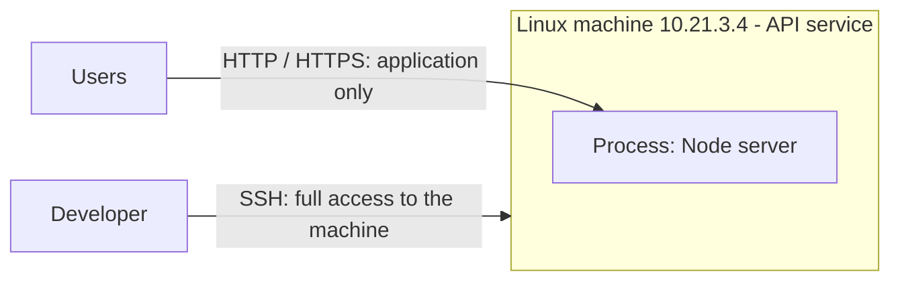
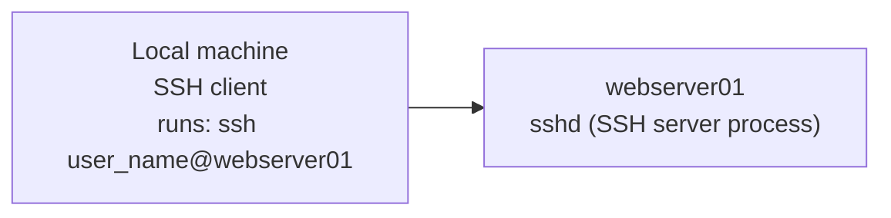

# 1. What is SSH?

SSH (Secure Shell) is the standard way to connect to another machine over a network and control it from a terminal. This file covers what SSH is, why it replaced Telnet, the client/server split, port 22, and the difference between the two protocol versions.

---

## 1.1 Definition

SSH is a network protocol, meaning a set of agreed rules, that lets two devices communicate and share data over an **encrypted** connection. The most common case is a local computer (a laptop or desktop) controlling a remote Linux server.

In Linux, `ssh` is also the command-line utility that uses this protocol to reach and manage another machine.

SSH was created in 1995 by Tatu Ylönen, a Finnish computer scientist, to fix the privacy problems of the older remote-access tools. It has been the standard for secure remote access since then.

## 1.2 Why servers need SSH

Most servers have no monitor, keyboard or mouse attached. They sit in a data center, often in a different city or country. Administrators and developers still need to install software, edit files, read logs and restart services on them.

SSH solves this by working like a forwarded keyboard. Any command typed in the local terminal (`ls`, `cat`, `mkdir`, and so on) is executed on the remote machine, and the output comes back to the local terminal. The only difference from sitting in front of the server is the distance.

Things that can be done over an SSH session:

- install software and update applications
- create, edit and remove files
- run scripts
- start, stop and restart services
- read logs
- manage processes, restart or shut down the operating system

## 1.3 Before SSH: Telnet

Telnet also provided remote access, but it sent everything as **plain text**: the username, the password, every command and every response. Anyone who could capture the network traffic could read all of it.

SSH encrypts the whole session from the moment the connection starts. Someone capturing the traffic only sees unreadable data.

| | Telnet | SSH |
|---|---|---|
| Data on the network | Plain text | Encrypted |
| What an eavesdropper sees | Username, password, commands | Unreadable data |
| Everyday comparison | A postcard that anyone along the way can read | A locked case that only the receiver can open |
| Status today | Replaced for remote access | The standard |

## 1.4 Application access vs full machine access

A server is reached in two very different ways.

- **Ordinary users** talk to the application running on the machine over **HTTP or HTTPS**. For example, a Node.js server process receives requests and answers them. Users can only do what the application allows.
- **Developers and administrators** need **full access to the machine**: creating and removing files, managing processes, restarting or shutting down the operating system. SSH is the protocol that provides this level of control securely.



## 1.5 The two parts of every SSH connection

| Part | Where it runs | Job |
|---|---|---|
| **SSH client** | On the local machine (the one typing) | Starts the connection |
| **SSH server** (daemon, called **sshd**) | On the remote machine being accessed | Runs in the background and waits for incoming connections |

The server listens and the client connects. On Linux the server process is commonly called `sshd` (the "d" stands for daemon, a program that runs in the background).



### The basic command

```bash
ssh user_name@host
```

- `user_name` is an existing account on the remote machine.
- `host` is the IP address or the domain name of the remote machine.

For the connection to work:

1. The SSH daemon must be installed and running on the target.
2. A user account with valid credentials must already exist on that target. Knowing only the IP address is not enough.

When the command runs, two things happen. First, the client and server build an encrypted connection (a secure tunnel). Second, the server verifies the identity of the user. Both steps are explained in [4. Connection handshake](4-connection-handshake.md).

## 1.6 Port 22

A port is like a numbered door on a server. A server has thousands of them, and each kind of traffic uses its own door. **SSH listens on TCP port 22 by default.** When the client starts a connection it knocks on door 22 of the server.

Points to remember about port 22:

- Servers use a **firewall** to control which ports are reachable. Web ports such as 80 (HTTP) and 443 (HTTPS) are normally open to everyone.
- Port 22 gives full control of the machine, so it needs strict protection and strong authentication.
- Many firewalls leave port 22 open, which is why SSH often gets through even when other ports are blocked.
- Administrators can change the SSH port in the configuration. This is covered in [6. Config file and hardening](6-config-file-and-hardening.md).

## 1.7 What SSH is used for

- **Remote login and command execution** on servers
- **Secure file transfer** with SCP and SFTP (see [7. File transfer and tunneling](7-file-transfer-and-tunneling.md))
- **Tunneling** other network traffic through an SSH connection, for example reaching a database that is not exposed publicly
- **Automation and deployment**, because scripts can log in without typing a password (see [5. SSH key authentication](5-ssh-key-authentication.md))
- **Git operations**, such as pushing code to GitHub

Where SSH shows up in practice:

- Cloud providers (AWS, Google Cloud, Azure) use SSH keys when a Linux virtual machine is created.
- Developers push code to GitHub and GitLab over SSH.
- CI/CD pipelines deploy to servers over SSH.
- Automation tools such as Ansible connect to machines over SSH.
- Penetration testers use it for secure access during authorized tests.
- Embedded IoT devices often run a small SSH server for remote management.

## 1.8 SSH-1 vs SSH-2

SSH has two protocol versions. At the start of every connection, both sides announce which version they support and agree on one.

| Feature | SSH-2 (modern, secure) | SSH-1 (legacy, insecure) |
|---|---|---|
| Design | Split into separate transport, authentication and connection protocols | One single protocol |
| Integrity check | Strong cryptographic check | Weak CRC-32 check |
| Key exchange | Diffie-Hellman key exchange, so no separate server key is needed | A server key protects the session key |
| Certificates | Supports public key certificates | Not supported |
| Session keys | Replaced periodically during a session | Not supported |

SSH-2 is the version standardized by the IETF (Internet Engineering Task Force) and is the one used everywhere today. SSH-1 is deprecated and has known security flaws.

### Algorithm families inside SSH-2

SSH-2 lets the two sides choose between several algorithms for each job:

| Job | What it does | Examples named |
|---|---|---|
| Cipher | Encrypts and decrypts the data | AES (for example AES-256), 3DES, Blowfish, Twofish, Serpent, CAST-128, ARCFOUR |
| MAC (message authentication code) | Checks that data was not changed | HMAC-SHA1, HMAC-MD5, SHA-2 |
| Key exchange | Lets both sides arrive at the same secret key | Diffie-Hellman (DH), elliptic curve DH (ECDH) |
| Compression | Optionally shrinks the data | none, zlib |

AES-256 for encryption, SHA-2 for integrity and DH or ECDH for key exchange are the examples given for typical negotiation. The older names in the table are listed only to show what the protocol can support. How the choice is made is explained in [4. Connection handshake](4-connection-handshake.md).

---

[Back to chapter overview](README.md) | Next: [2. Setup and first connection](2-setup-and-first-connection.md)
