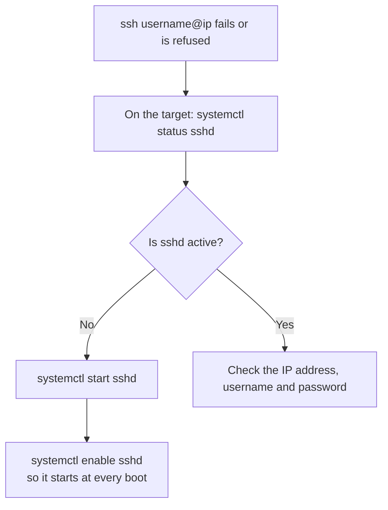

# 2. Setup and first connection

Before an SSH connection can work, the remote machine needs the SSH service installed and running. This file covers how to check that, how to install and manage the service, and two worked connection examples (PuTTY and Linux to Linux).

---

## 2.1 What has to be in place

| Side | Needs |
|---|---|
| **Target (remote) machine** | OpenSSH server installed, the `sshd` service running, an existing user account with valid credentials |
| **Local machine** | An SSH client (the `ssh` command on Linux and macOS, PuTTY on Windows, SSH apps on Android and iOS) |

OpenSSH comes as two packages: **openssh-clients** (the side that connects out) and **openssh-server** (the `sshd` service that accepts connections).

## 2.2 Checking whether SSH is installed

| Command | What it checks |
|---|---|
| `ls /etc/ssh/sshd_config` | Whether the SSH server configuration file exists. If it exists, the server package is normally installed. |
| `rpm -qa \| grep ssh` | Lists installed packages with "ssh" in the name, to see whether the OpenSSH packages are present. This works on RPM-based distributions. |
| `systemctl status sshd` | Whether the SSH service is active and running |

## 2.3 Installing OpenSSH

RPM-based distributions (CentOS and similar):

```bash
sudo yum install openssh-clients openssh-server
```

Fedora:

```bash
sudo dnf install -y openssh-server
```

Debian and Ubuntu based distributions:

```bash
sudo apt install openssh-client openssh-server
```

By default Fedora already has the SSH client. The server daemon may be missing or not running, which is why the server package is installed explicitly.

## 2.4 Managing the SSH service

SSH runs as a service, and `systemctl` is used to control it.

| Command | Meaning |
|---|---|
| `systemctl status sshd` | Shows the current state. A healthy service shows `active (running)` in green. |
| `systemctl start sshd` | Starts the service now, if it is inactive |
| `systemctl enable sshd` | Makes the service start automatically every time the machine boots |
| `sudo systemctl enable --now sshd` | Does both in one command: enables at boot and starts immediately |
| `systemctl restart sshd` | Stops and starts the service again, needed after the configuration file is changed |

> **Risk:** `restart` after editing the configuration can lock the user out if the new configuration is wrong or blocks the current login method.
> **Safer way:** test the file first with `sudo sshd -t` and keep one login session open while testing a new one. The full routine is in [6. Config file and hardening](6-config-file-and-hardening.md).

## 2.5 Starting a connection

```bash
ssh username@ip_address
```

On the very first connection to a machine, SSH shows the server's fingerprint and asks whether to trust it. The meaning of that prompt is explained in [4. Connection handshake](4-connection-handshake.md). After that, the server asks for the account password (or uses a key, see [5. SSH key authentication](5-ssh-key-authentication.md)). Once authenticated, the terminal gives full control of the remote machine.

## 2.6 Example 1: connecting with PuTTY

PuTTY is a graphical terminal program, used to manage a remote Linux server from a Windows or other desktop machine.

1. Open PuTTY and select the **Session** category.
2. Enter the **IP address** of the target server and make sure the port is `22`.
3. Click **Open** to start the connection.
4. Enter the remote **username** and **password** when prompted.
5. After authentication, the window is a full terminal on the remote server.

Right-clicking the title bar of the PuTTY window offers an option to open a duplicate session, which is useful for working in several windows on the same server.

## 2.7 Example 2: Linux server to Linux server

Logging in to a remote Linux server (for example Kali Linux) directly from the terminal of another Linux server (for example CentOS):

1. On the target server, find its IP address:

   ```bash
   ip a
   ```

2. From the other server, connect with the remote username and that IP:

   ```bash
   ssh username@192.168.x.x
   ```

3. Enter the account password when asked.

### If the connection fails or is refused

The most common cause is that the SSH service is not running on the target.



## 2.8 SSH clients by platform

| Platform | Client |
|---|---|
| Linux and macOS | The built-in terminal and the `ssh` command |
| Windows | An SSH client such as PuTTY |
| Android and iOS | SSH apps |

## 2.9 Quick reference

| Action / command | Purpose |
|---|---|
| `ssh user@ip_address` | Log in to another Linux machine remotely |
| `ip a` | Find the IP address of a machine |
| `ls /etc/ssh/sshd_config` | Check that the SSH server configuration exists |
| `rpm -qa \| grep ssh` | Check whether OpenSSH packages are installed |
| `systemctl status sshd` | Check whether the SSH service is active |
| `systemctl start sshd` | Start the SSH service |
| `systemctl enable sshd` | Start the SSH service automatically at boot |
| Port `22` | Default port for SSH |

---

Previous: [1. What is SSH?](1-what-is-ssh.md) | [Back to chapter overview](README.md) | Next: [3. Encryption behind SSH](3-encryption-behind-ssh.md)
