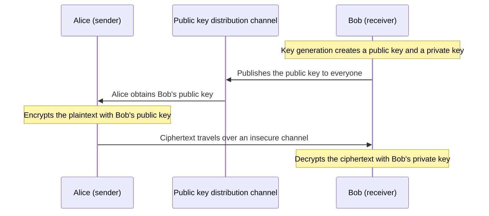
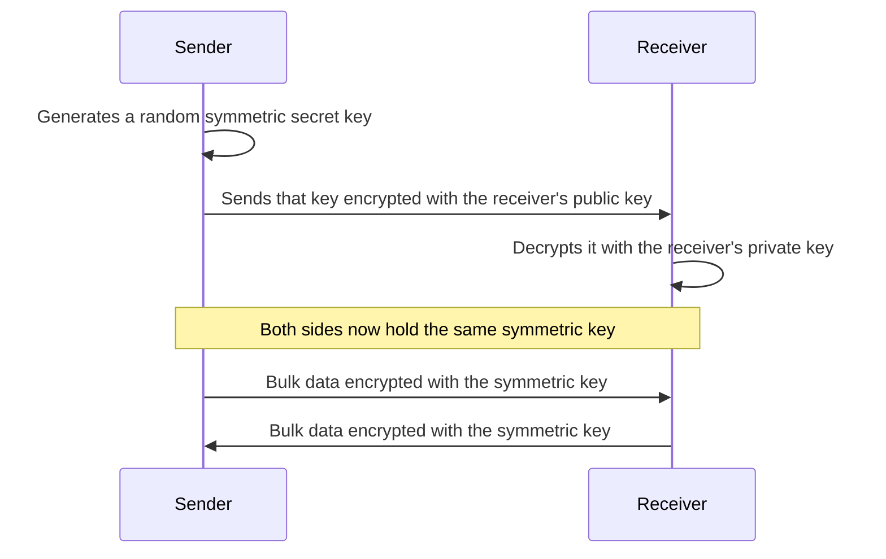
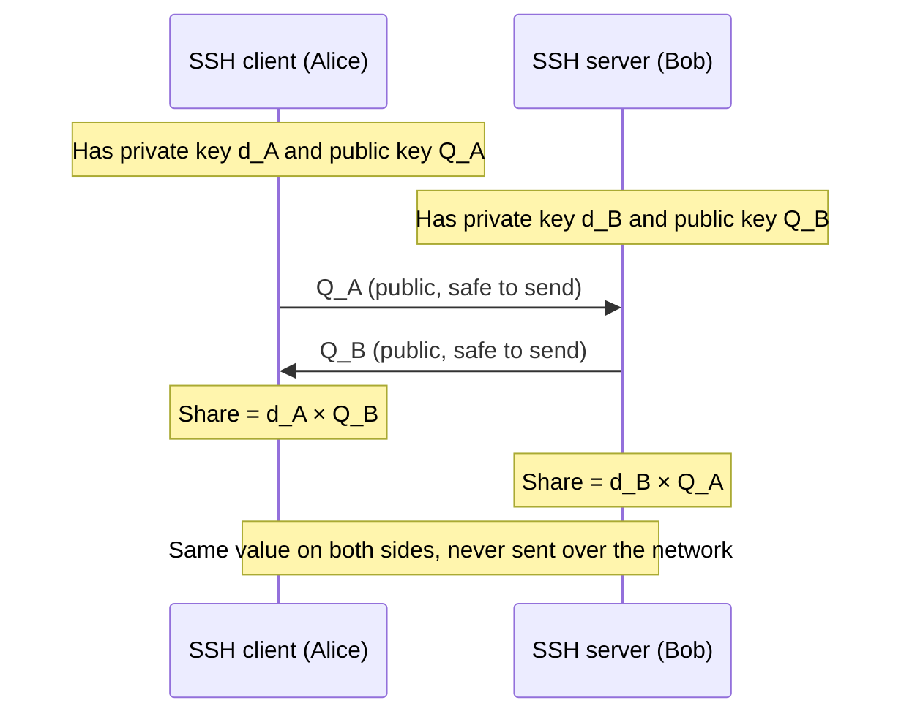
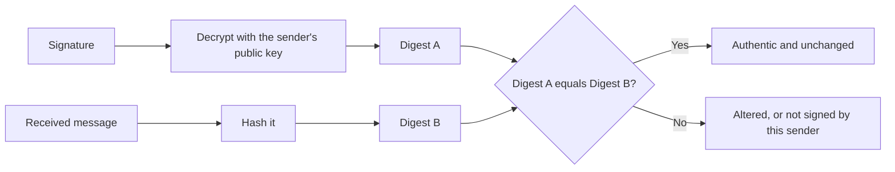

# 3. Encryption behind SSH

SSH is safe because of the cryptography under it. This file covers the ideas needed to follow how a connection is secured: ciphers, symmetric and asymmetric encryption, why SSH combines both (hybrid encryption), how the two sides agree on a secret key without ever sending it (Diffie-Hellman), and what hashing and digital signatures are.

---

## 3.1 What a cipher is

A **cipher** is an algorithm, a fixed procedure, used to perform encryption (turning readable data into unreadable data) and decryption (turning it back).

- **Plaintext** is the readable data.
- **Ciphertext** is the encrypted, unreadable data.

## 3.2 Symmetric encryption

Symmetric encryption uses **one shared secret** for both encrypting and decrypting. Both parties hold the same key or function.

Simple illustration: a cipher that reverses the alphabet turns `ABC` into `ZYX`, and applying the same reversal turns `ZYX` back into `ABC`.

Characteristics:

- Fast
- Low CPU cost
- The ciphertext is the same size as the plaintext

**The problem:** both sides must first have the same secret, and getting the secret to a distant server over a network is risky. Anyone sitting in the middle who intercepts it can use it too.

## 3.3 Asymmetric encryption (public key cryptography)

Asymmetric encryption uses **a pair of keys** with different roles.

| Key | Who holds it | Role |
|---|---|---|
| **Public key** | Shared openly with anyone | Used to encrypt data meant for the key owner |
| **Private key** | Kept strictly secret, never shared | The only key that can decrypt what the public key encrypted |

Everyday picture: the public key is a padlock that anyone can snap shut, and the private key is the only key that opens it.

Relationship between the two: the public key can be derived from the private key, but the private key cannot be worked out from the public key. This one-way relationship is what makes it safe to hand the public key to everyone.

Algorithms and methods that produce such key pairs include **RSA**, **DSA** and **Ed25519**.

The flow, with Bob as the key owner and Alice as the sender:



Even if someone watches the insecure channel, they only see ciphertext. Without Bob's private key it cannot be decrypted.

## 3.4 Why SSH does not use asymmetric encryption for everything

Asymmetric encryption solves the sharing problem, but it is not practical for large amounts of data:

- it is slower
- it needs much larger keys
- the ciphertext becomes larger than the plaintext (ciphertext expansion)

| | Symmetric | Asymmetric |
|---|---|---|
| Speed | Fast | Slow |
| CPU cost | Low | High |
| Ciphertext size | Same as plaintext | Larger than plaintext |
| Key size | Smaller | Much larger |
| Weakness | The secret key must be shared safely | Not practical for bulk data |

## 3.5 Hybrid encryption

The practical answer is to use both. SSH, SSL/TLS and IPsec all follow this pattern.

| Stage | Type used | Purpose |
|---|---|---|
| Key exchange / handshake | Asymmetric | Safely arrive at a shared secret without exposing it on the network |
| Bulk data transfer | Symmetric | Encrypt the ongoing traffic quickly with low CPU cost once both sides have the shared key |

In short, asymmetric encryption solves key distribution and symmetric encryption provides speed.

A general way to hand over a symmetric key with asymmetric encryption looks like this:



That is the general idea of hybrid encryption. SSH-2 goes one step further: the symmetric key is **never sent at all**, not even in encrypted form. Both sides calculate it separately. That is the next section.

## 3.6 Ephemeral key exchange (Diffie-Hellman)

### The problem

Client and server have never talked before, and anyone might be listening. They still need to agree on a secret key for fast symmetric encryption. How can a secret be shared when every message may be intercepted?

### The idea (colour-mixing picture)

1. Two people each pick a **private secret colour**.
2. Both mix their secret colour into a **shared public colour** and swap the mixtures.
3. Each then adds their own secret colour into the mixture received from the other.
4. Both end up with the **same final colour**. An eavesdropper saw the mixtures but cannot separate out the secret colours.

The final colour stands for the shared secret key. It was calculated on each side and never travelled over the network.

### What happens in SSH

- Client and server each generate a temporary key pair and exchange only the **public** parts.
- Each side combines its own private key with the other side's public key.
- Both independently compute the **same secret**. This is the base for the **session key**, the symmetric key used for the rest of the connection.
- The key is **ephemeral**: it exists only for that session and is discarded at the end. The next connection produces a brand new key.

A consequence is **perfect forward secrecy**: even if keys are compromised in the future, data from past sessions stays safe.

### The maths as shown in the diagrams (elliptic curve Diffie-Hellman)

| Symbol | Meaning |
|---|---|
| `d_A`, `d_B` | Private keys of the two sides (Alice and Bob), never sent |
| `G` | A fixed public value used by both sides in the formula |
| `Q_A = d_A × G` | Public key of Alice, calculated from her private key |
| `Q_B = d_B × G` | Public key of Bob, calculated from his private key |

The two sides swap `Q_A` and `Q_B`, then each calculates the shared key:

```text
Alice: Share = d_A × Q_B
Bob:   Share = d_B × Q_A
```

Both results are the same value, so both sides hold the same shared key.



This shared key is then used with symmetric encryption for all the session data.

## 3.7 Hashing

A **hashing algorithm** takes a message of any length and produces a **fixed-size output** called a hash, digest or "fingerprint".

A toy example to show the idea: take the word `hello`, convert each letter to its position in the alphabet (h=8, e=5, l=12, l=12, o=15) and add them up. The result is 52. Real hashing algorithms (SHA-2 is one that was named) are far more complex; the addition only shows that a message of any size ends up as one small fixed-size value.

Important property: a tiny change in the original message produces a completely different hash.

## 3.8 Two ways to use a key pair

| Goal | What is encrypted, and with which key | Result |
|---|---|---|
| **Confidentiality** | The message is encrypted with the **receiver's public key**. Only the receiver's private key can decrypt it. | Only the intended receiver can read the data |
| **Authentication and integrity** | A hash of the message is encrypted with the **sender's private key**. This is a **digital signature**. | Proves who signed it and proves it was not changed |

### Why a digital signature signs a hash and not the whole message

A private key cannot practically encrypt an entire large message, because asymmetric encryption is heavy and slow. Instead:

1. The message is run through a hashing algorithm to get a small fixed-size digest.
2. Only that digest is encrypted with the private key. The result is the signature.


### Verifying a signature

The receiver decrypts the signature with the **sender's public key** to get one digest, hashes the received message to get another, and compares them.



- A match proves that the sender's private key made the signature (**authentication**).
- A match also proves the message was not altered on the way (**integrity**).

In practice, signatures are widely used on certificates, software packages and emails.

## 3.9 Summary

- A cipher is an algorithm for encryption and decryption.
- Symmetric encryption is fast but needs a safely shared key. Asymmetric encryption uses a public/private pair but is slow for bulk data.
- SSH uses both: asymmetric ideas for the handshake and key agreement, symmetric encryption for the actual data.
- In SSH-2 the shared session key is calculated on both sides with a Diffie-Hellman exchange and never sent. It is temporary and different for every session.
- A hash turns any message into a small fixed fingerprint. A signature is a hash encrypted with a private key.

---

Previous: [2. Setup and first connection](2-setup-and-first-connection.md) | [Back to chapter overview](README.md) | Next: [4. Connection handshake](4-connection-handshake.md)
