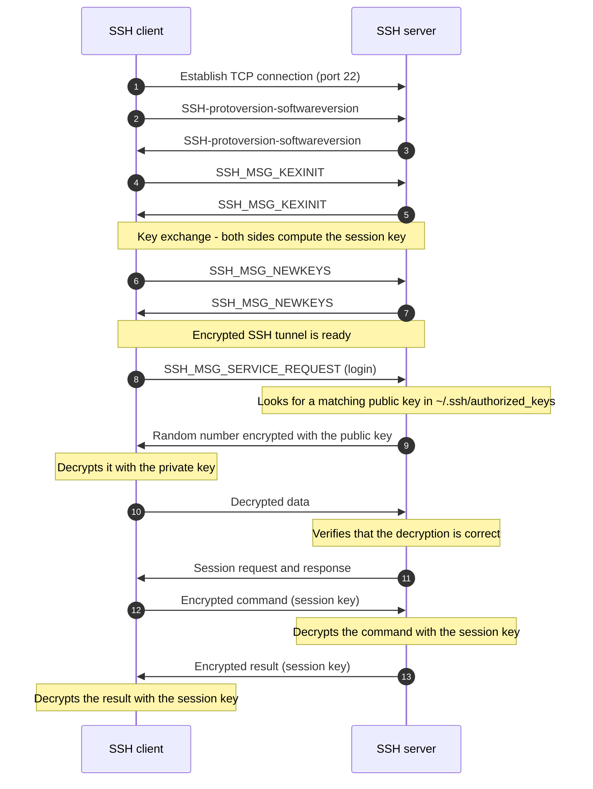
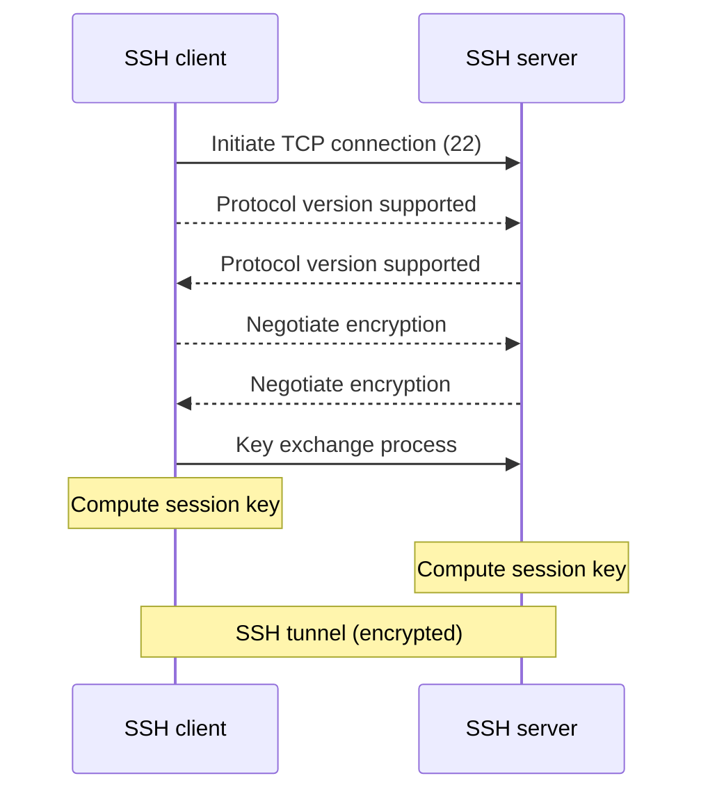
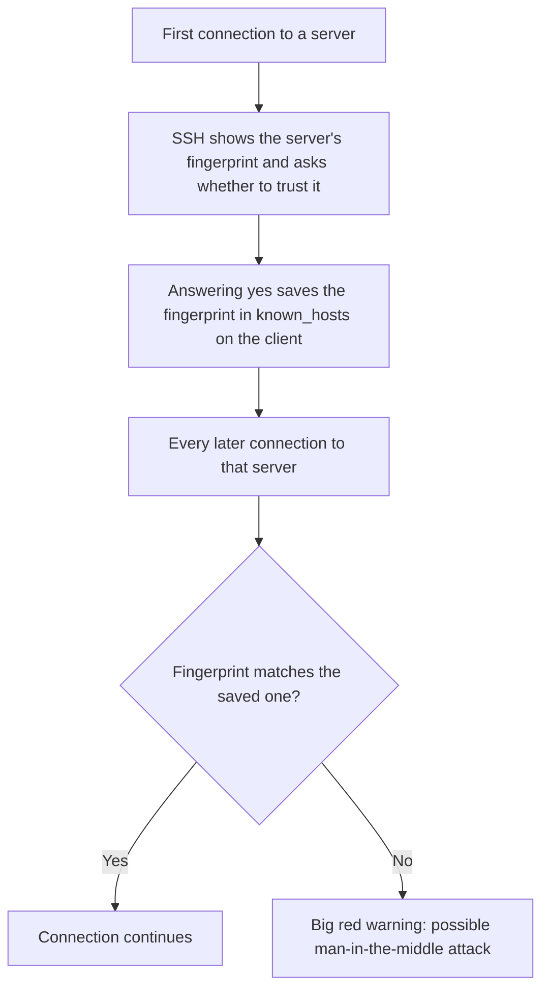
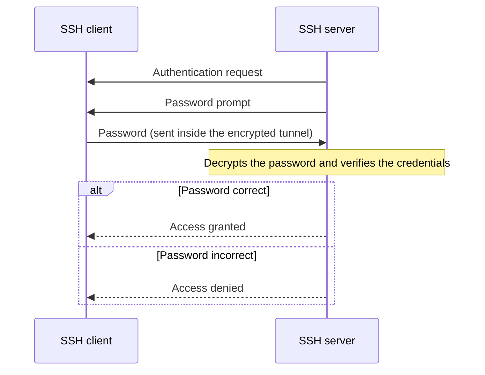

# 4. Connection handshake

What happens between typing `ssh user@server` and getting a prompt on the remote machine. It all takes milliseconds and finishes before any login prompt appears. This file follows the SSH-2 connection from the first TCP packet to the encrypted session.

---

## 4.1 The whole flow in one diagram

The same flow in plain words, one step at a time:

| Step | What happens |
|---|---|
| 1 | TCP connection to port 22 |
| 2 | Both sides announce their SSH version |
| 3 | Both sides negotiate the algorithms |
| 4 | Key exchange, and both sides compute the session key |
| 5 | The client checks the server's host key |
| 6 | The user proves their identity (password or key) |
| 7 | The encrypted session runs commands back and forth |

## 4.2 Step 1: TCP connection on port 22

Before anything specific to SSH happens, the client and the server set up an ordinary TCP connection, the standard reliable connection layer of the internet. The client sends it to port 22 of the server, the door where `sshd` listens.

## 4.3 Step 2: protocol version

Both sides send an identification string in the form `SSH-protoversion-softwareversion`, which announces the SSH protocol version and the software version they run.

- SSH version 1 is old, deprecated and has known security flaws.
- SSH version 2 is what everyone uses today.

If both sides support SSH-2, the connection continues. In effect, both sides confirm that they speak the same language.

## 4.4 Step 3: algorithm negotiation

Client and server exchange lists of algorithms they support (this is the `SSH_MSG_KEXINIT` message in the diagram). The lists cover the tasks needed for the connection:

- **Encryption** of the data, for example AES-256
- **Integrity checking**, for example SHA-2
- **Key exchange**, for example Diffie-Hellman or elliptic curve Diffie-Hellman (ECDH)

The strongest option supported by both sides is chosen. This happens automatically at the start of every connection, before any data is sent, and it lets SSH adapt to different security needs and different machines.

## 4.5 Step 4: key exchange and the session key

The two sides now run the ephemeral key exchange explained in [3. Encryption behind SSH](3-encryption-behind-ssh.md#36-ephemeral-key-exchange-diffie-hellman).

1. Each side generates a temporary key pair.
2. They exchange only the public keys.
3. Each side computes the **same shared secret** independently. The secret itself never crosses the network.
4. That shared secret becomes the **session key**.

`SSH_MSG_NEWKEYS` marks the end of the key exchange. From this moment everything is encrypted with the symmetric session key, and the **SSH tunnel** exists.

## 4.6 Step 5: verifying the server (host key)

The tunnel is encrypted at this point, but there is still a question: is the client talking to the real server and not an impostor in the middle?

Every SSH server has a unique fingerprint, its **host key**.

- The saved fingerprints live in a file called **known_hosts** on the client machine.
- A mismatch means that something changed. It could mean that someone is intercepting the connection (a **man-in-the-middle attack**). A warning like that should be treated as a stop sign and not clicked through.

## 4.7 Step 6: authentication (proving identity)

With the encrypted tunnel up, the server still has to know who is connecting. The client sends a login request (`SSH_MSG_SERVICE_REQUEST - LOGIN` in the diagram) and one of two methods is used.

### Method A: password authentication

The simplest method. The server asks for the password, the user types it, and the server checks it against its user database.

- The password travels through the encrypted tunnel, so it is protected from network sniffing.
- The remaining weakness is **guessing and brute force**. An attacker who can reach port 22 can try huge numbers of passwords automatically, and weak or reused passwords fall quickly.
- For that reason password authentication is often switched off on production servers.

### Method B: public key authentication (recommended)

The client has a key pair. The server holds the public key in `~/.ssh/authorized_keys`, and the client keeps the private key. In the login step:

1. The server looks in `~/.ssh/authorized_keys` for a matching public key.
2. If one is found, the server generates a random number, **encrypts it with that public key** and sends it to the client.
3. The client **decrypts it with its private key** and sends the result back.
4. The server checks that the answer is correct. A correct answer proves that the client owns the matching private key.
5. Access is granted.

The private key itself is never sent, and no password crosses the network. This method is described in full in [5. SSH key authentication](5-ssh-key-authentication.md).

## 4.8 Step 7: the encrypted session

After authentication the session is fully established:

1. The client encrypts each command with the **session key** and sends it.
2. The server decrypts the command with the session key and executes it.
3. The server encrypts the result with the same session key and sends it back.
4. The client decrypts the result.

This back-and-forth continues for the whole session. When the user logs out, the session key is discarded and the next connection creates a new one. SSH-2 can also replace the session key periodically during a long session.

## 4.9 Summary

- TCP on port 22, then version announcement, then algorithm negotiation.
- Diffie-Hellman key exchange gives both sides the same session key without sending it.
- The host key and the `known_hosts` file protect against talking to an impostor server.
- Authentication happens inside the encrypted tunnel, by password or by key.
- All commands and results are encrypted with the symmetric session key.

---

Previous: [3. Encryption behind SSH](3-encryption-behind-ssh.md) | [Back to chapter overview](README.md) | Next: [5. SSH key authentication](5-ssh-key-authentication.md)
