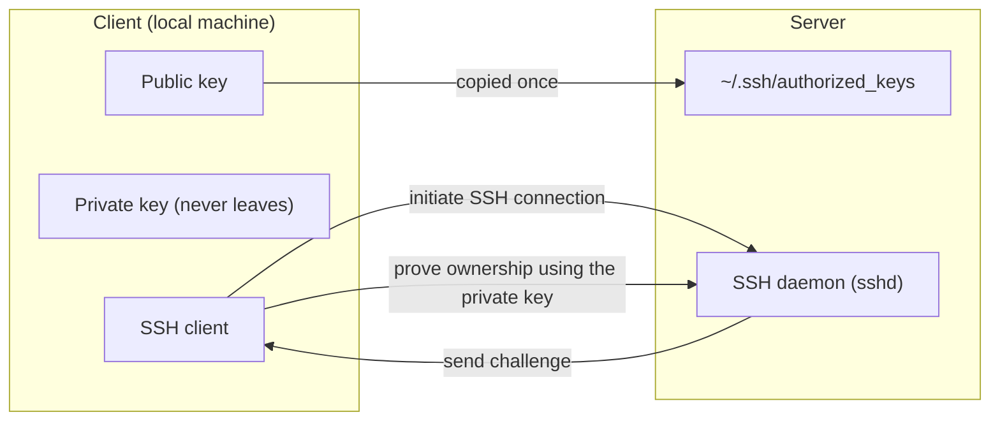
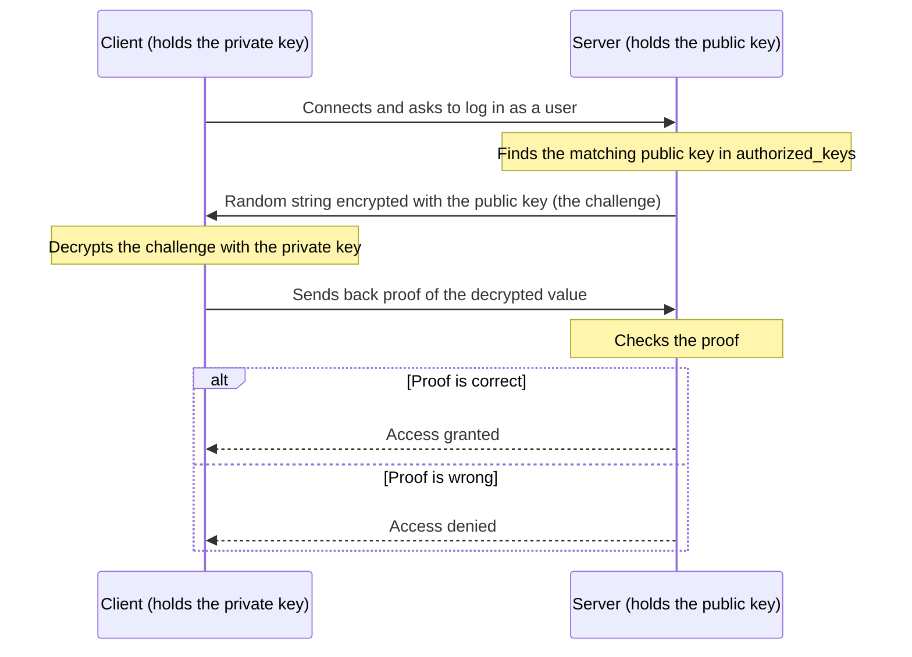
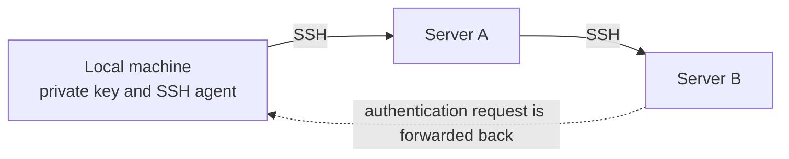
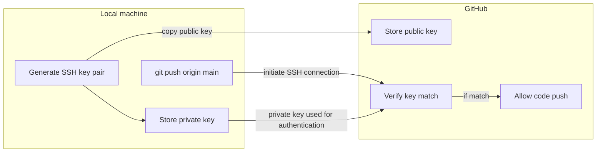

# 5. SSH key authentication

Logging in with a cryptographic key pair instead of a password. This file covers why keys are preferred, how the challenge works, the three setup steps (generate, copy, connect), key files and permissions, the passphrase and SSH agent, and how the same idea appears with AWS and GitHub.

---

## 5.1 Why keys instead of passwords

Password login has several weaknesses:

- Passwords are often weak, reused, or taken from common password lists that leaked in data breaches.
- They can be guessed or brute-forced by automated attacks on port 22.
- Typing a password on every connection is tedious.
- Automated scripts cannot easily supply a password when they connect to a remote server.

SSH keys remove these problems:

- **Nothing sensitive travels across the network.**
- **Private keys are much harder to brute force than passwords.**
- **Scripts and deployments can run without typing credentials.**

That is why cloud providers recommend or even require key authentication, and why keys are the standard for Git, CI/CD pipelines and cloud servers.

## 5.2 The key pair

Key authentication uses two mathematically related keys, created together.

| | Private key | Public key |
|---|---|---|
| Where it lives | Only on the **local machine** | On the **remote server** (and anywhere else access is wanted) |
| Can it be shared? | **Never.** Anyone holding it can impersonate the owner and access the server. | Yes, it is safe to share |
| Typical file name | `id_rsa` or `id_ed25519` | `id_rsa.pub` or `id_ed25519.pub` |
| Role | Proves identity, like a unique fingerprint | Used by the server to check that proof |

The public key can be derived from the private key, but the private key cannot be calculated from the public key.

## 5.3 How the login works (challenge and response)





The server never receives the private key and no password is sent. Only a client that holds the matching private key can decrypt the challenge. If the keys do not match, access is denied.

## 5.4 Setup in three steps

### Step 1: generate the key pair on the local machine

The simplest form:

```bash
ssh-keygen
```

It asks two things:

1. **Where to save the key.** Pressing Enter accepts the default location inside the hidden `~/.ssh` directory.
2. **A passphrase.** Optional (see 5.6).

Commonly used forms with options:

```bash
ssh-keygen -t ed25519 -C "label-for-this-key"
ssh-keygen -t rsa -b 4096 -C "label-for-this-key"
```

| Part | Meaning |
|---|---|
| `ssh-keygen` | The OpenSSH tool that creates, manages and converts key pairs |
| `-t` | **Type** of algorithm. `rsa` is one of the oldest and most widely supported. `ed25519` is a modern, highly secure algorithm that gives good security with shorter keys. |
| `-b 4096` | **Bits**, the key length. Longer keys resist brute force better. |
| `-C "label"` | **Comment** (capital C) stored at the end of the public key, so that a key can be identified later. An email address or something like `dev-laptop-key` works. |

After the keys are created, SSH prints a key fingerprint and a small text picture called randomart, which can be used to recognise the key.

Checking the result:

```bash
ls ~/.ssh
```

| File | What it is |
|---|---|
| `id_rsa` / `id_ed25519` | The **private key**, secret |
| `id_rsa.pub` / `id_ed25519.pub` | The **public key**, safe to share |

The file name depends on the key type, or on the custom name given when the key was created (for example `ssh_key` and `ssh_key.pub`).

Viewing the public key:

```bash
cat ~/.ssh/id_rsa.pub
```

The output is one line: the key type (such as `ssh-rsa`), a long string of characters, and the comment at the very end.

**Permissions on the private key.** The private key file has to be locked down so only its owner can use it, with permission `600` or `400`:

```bash
chmod 600 ~/.ssh/id_rsa
```

> **Risk:** loosening permissions on a private key, or sharing or copying it around, exposes the server it unlocks.
> **Safer way:** keep it at `600` or `400`, never paste or send the private key anywhere, and only ever copy the `.pub` file.

### Step 2: copy the public key to the remote server

The server must hold the public key so it can recognise this client.

```bash
ssh-copy-id username@remote_ip_address
```

This is the **last time the remote password is needed**. `ssh-copy-id` logs in once with the password and appends the public key to the `~/.ssh/authorized_keys` file of that user on the server.

**Manual method** (when `ssh-copy-id` is not an option, for example when a cloud provider's console is used):

1. Log in to the server once (with a password or through the cloud provider's interface).
2. Go to the hidden SSH directory: `cd ~/.ssh`
3. Open or create the key list: `vim authorized_keys`
4. Paste the contents of the local **public key** (`.pub`) file into it, then save and exit (`:wq`).

### Step 3: connect without a password

```bash
ssh username@remote_ip_address
```

Login now happens instantly, without a password prompt.

To point at a specific private key file (for example one that is not in the default location), use `-i`:

```bash
ssh -i /path/to/private_key username@remote_ip_address
```

## 5.5 Losing the private key

If the private key is deleted or lost, the challenges can no longer be decrypted. The public key on the server becomes useless for logging in, and a new key pair has to be created and set up again.

## 5.6 Passphrase, SSH agent and agent forwarding

A **passphrase** is a password that encrypts the private key file on disk.

- Leaving it blank gives a login with no prompt at all, but anyone who copies the key file can use it.
- A passphrase gives extra protection. Using one is the better habit for real servers.

> **Risk:** a private key with an empty passphrase is fully usable by whoever obtains the file.
> **Safer way:** set a passphrase on real keys. An empty passphrase is only reasonable for a throwaway practice lab.

Typing a passphrase on every connection would bring back the tedium of passwords, which is what the **SSH agent** solves:

- The agent is a background process that holds the decrypted key in memory.
- `ssh-add` is used to type the passphrase once, and then connections to any server work without typing it again for the whole session.

**Agent forwarding** handles a second case: logging in to server A and then needing to connect from there to server B. Normally the private key would have to be copied onto server A, which is risky. With agent forwarding, server A passes the authentication request back to the local SSH agent, so the private key never leaves the local machine.



## 5.7 Key authentication in real life

### AWS (EC2)

- AWS gives a `.pem` file, which is the **private key**. It has to be protected and never shared, because anyone who has it can access the server.
- The matching **public key** is placed on the instance when it is created. An own public key can also be uploaded to AWS to be placed on an instance at boot.
- The connection command names the key file and the default user:

```bash
ssh -i mykey.pem ec2-user@<ip-address>
```

For many Amazon Linux instances the default username is `ec2-user`. No password is used.

### GitHub

SSH keys allow pushing code to GitHub without typing a password or using a token.

1. Generate an SSH key pair locally. The private key stays on the machine.
2. Copy the **public key** to the GitHub account.
3. On `git push origin main`, an SSH connection starts, authenticated with the private key.
4. GitHub checks the key against the stored public key. If it matches, the push is allowed.



## 5.8 Quick reference

| Action / command | Purpose |
|---|---|
| `ssh-keygen` | Generate a key pair on the local machine |
| `ssh-keygen -t ed25519 -C "label"` | Generate an ed25519 key pair with a label |
| `ssh-keygen -t rsa -b 4096 -C "label"` | Generate a 4096-bit RSA key pair with a label |
| `ls ~/.ssh` | List the key files |
| `cat ~/.ssh/id_rsa.pub` | Show a public key |
| `ssh-copy-id user@ip` | Copy the public key to the remote server |
| `ssh user@ip` | Connect (no password prompt once the key is in place) |
| `ssh -i /path/to/key user@ip` | Connect with a specific private key |
| `ssh-add` | Load a key into the SSH agent (passphrase typed once) |

---

Previous: [4. Connection handshake](4-connection-handshake.md) | [Back to chapter overview](README.md) | Next: [6. Config file and hardening](6-config-file-and-hardening.md)
