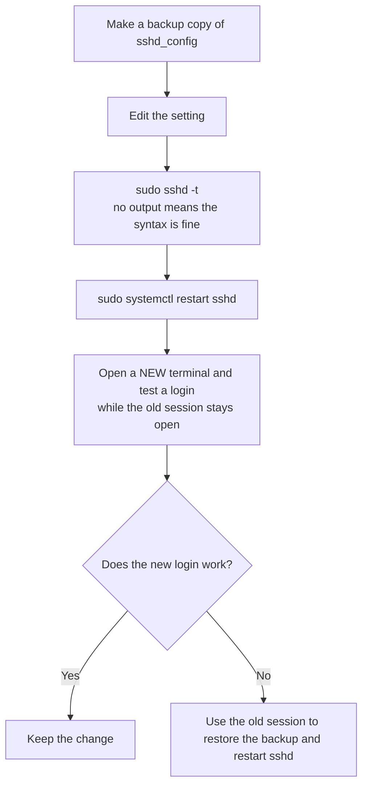

# 6. Config file and hardening

Two different configuration files are involved with SSH, and they are easy to mix up:

| File | Lives on | Purpose |
|---|---|---|
| `~/.ssh/config` | The **client** (local machine) | Stores shortcuts and connection details so that long commands are not typed every time |
| `/etc/ssh/sshd_config` | The **server** | Controls how the SSH daemon behaves, including security settings |

---

## 6.1 The client config file: `~/.ssh/config`

### The problem it solves

Connecting to a server that uses a non-default port, a specific key and a specific user means a long command:

```bash
ssh -i ~/.ssh/id_ed25519 -p 2222 ubuntu@192.168.1.10
```

| Option | Meaning |
|---|---|
| `-i` | Which private key file to use |
| `-p` | Which port to connect to (when it is not 22) |

With several servers, each with its own user, port and key, this becomes painful.

### The solution

Connection details are stored once in `~/.ssh/config` as a block:

```text
Host myserver
    HostName 192.168.1.10
    User ubuntu
    Port 2222
    IdentityFile ~/.ssh/id_ed25519
```

| Line | Meaning |
|---|---|
| `Host myserver` | The short name used on the command line |
| `HostName` | The real IP address or domain name |
| `User` | The account to log in as |
| `Port` | The port to connect to |
| `IdentityFile` | The private key file to use |

After that, the whole command becomes:

```bash
ssh myserver
```

Any number of `Host` blocks can be defined, one per server.

## 6.2 Hardening the SSH server (`/etc/ssh/sshd_config`)

Port 22 gives full control of a machine, so a production server needs it locked down. These are the standard settings and practices:

| Practice | Setting or tool | What it protects against |
|---|---|---|
| Disable password login | `PasswordAuthentication no` | Brute-force and password-guessing attacks. Only holders of a valid private key can log in. |
| Disable direct root login | `PermitRootLogin no` | Attackers logging in straight to the `root` account |
| Change the default port | For example from `22` to `2222` | Noise from bots that constantly scan the internet for port 22. A basic measure that reduces automated attacks. |
| Block repeated failures | **Fail2Ban** | A tool that blocks IP addresses after several failed login attempts |
| Use SSH-2 only | `Protocol 2` | SSH-1 is deprecated and insecure |
| Limit who can log in | `AllowUsers sshuser` | Restricts login to the named user(s) |
| Keep software updated | Regularly update OpenSSH | Patches known vulnerabilities |
| Firewall IP whitelisting | Firewall rules on port 22 | Only connections from trusted IP addresses (such as an office or home network) are accepted, so an attacker needs both a trusted location and the private key |

### Disabling password authentication, step by step

1. Open the configuration file on the server:

   ```bash
   sudo vim /etc/ssh/sshd_config
   ```

2. Find `PasswordAuthentication` and change it to `no` (uncomment the line if it starts with `#`).
3. Restart the service so the change takes effect:

   ```bash
   sudo systemctl restart sshd
   ```

> **Risk:** switching off password login before key login is confirmed to work, or making a typing mistake in `sshd_config`, can lock everyone out of the server. A server that cannot be logged in to cannot be fixed over SSH.
> **Safer way:** follow the routine in 6.3 every time this file is changed.

### Changing the port

The port is set in `sshd_config`, for example `Port 2222`. After that, clients must name the new port with `-p 2222`, or set `Port 2222` in their `~/.ssh/config` block.

> **Risk:** after a port change, the old port stops working, and if a firewall blocks the new one the server becomes unreachable.
> **Safer way:** keep an existing session open until a fresh connection on the new port has been tested successfully.

## 6.3 Safe routine for changing `sshd_config`



Commands for the routine:

```bash
sudo cp /etc/ssh/sshd_config /etc/ssh/sshd_config.bak   # backup first
sudo vim /etc/ssh/sshd_config                            # make the change
sudo sshd -t                                             # test the syntax, silence means fine
sudo systemctl restart sshd                              # apply
```

`sshd -t` checks the configuration file for syntax errors before the service is restarted.

The backup copy and the open second session are the safety net. Without them a mistake can be permanent.

## 6.4 Problems and pitfalls of SSH

- **It is a service.** SSH is not available until the system has fully started and the service is running. If the service is not started, no connection is possible.
- **Misconfiguration can lock a user out.** An accidental setting that turns off access can leave no way to log back in.
- **A lost private key cannot be recovered.** Without it, the public key on the server is useless and new keys have to be set up.

## 6.5 Summary

- `~/.ssh/config` (client) shortens long commands: `ssh myserver`.
- `/etc/ssh/sshd_config` (server) holds the security settings.
- The main hardening steps: key login only, no direct root login, non-default port, Fail2Ban, SSH-2 only, limited users, updates and IP-restricted firewall rules.
- Every change to the server config follows backup, edit, test, restart, verify in a second session.

---

Previous: [5. SSH key authentication](5-ssh-key-authentication.md) | [Back to chapter overview](README.md) | Next: [7. File transfer and tunneling](7-file-transfer-and-tunneling.md)
