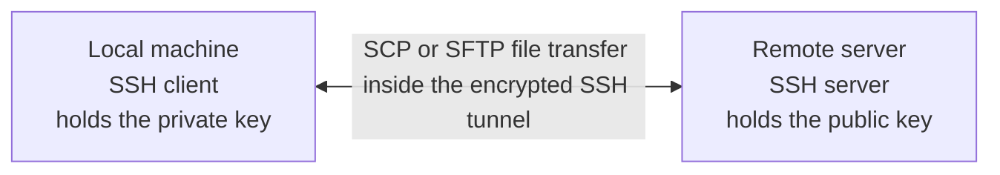
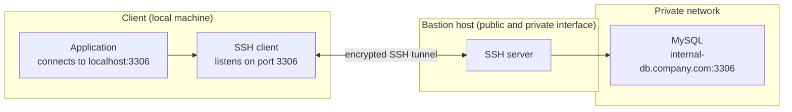

# 7. File transfer and tunneling

An SSH connection can carry more than a remote terminal. Files can be copied through it (SCP and SFTP), and other network traffic can be sent through it (port forwarding, also called SSH tunneling).

---

## 7.1 Copying files over SSH

Two tools are built on top of SSH and reuse exactly the same encryption layer that protects a normal SSH session.



### SCP (Secure Copy)

A simple, command-line based way to copy a file securely.

```bash
scp myfile.txt user@server:/destination/path
```

| Part | Meaning |
|---|---|
| `myfile.txt` | The local file to copy |
| `user@server` | The account and machine to copy to |
| `:/destination/path` | The folder on the remote machine, written right after the colon with no space |

Good for quick transfers.

### SFTP (SSH File Transfer Protocol)

An interactive session, in the style of FTP but fully encrypted. Inside it, directories can be browsed, files listed, and files uploaded and downloaded interactively.

Graphical tools such as **FileZilla** and **Cyberduck** support SFTP and give a visual file manager over SSH.

| | SCP | SFTP |
|---|---|---|
| Style | Single command | Interactive session |
| Best for | Quick copy of a file | Browsing, listing, uploading and downloading |
| Encryption | The SSH encryption layer | The SSH encryption layer |

## 7.2 Local port forwarding (SSH tunneling)

### The problem

A database such as MySQL runs on a **private network** and cannot be reached directly from outside. A **bastion host** can, though.

A **bastion host** is a publicly accessible server that sits in front of a private network. It works as a secure gateway: SSH into it first, then forward ports to reach the internal resources behind it.

### The command

```bash
ssh -L 3306:internal-db.company.com:3306 user@bastion.company.com
```

| Part | Meaning |
|---|---|
| `-L` | Local port forwarding |
| `3306` (first) | The port opened on the **local** machine |
| `internal-db.company.com` | The internal machine the traffic should finally reach |
| `3306` (second) | The port on that internal machine. 3306 is the default MySQL port. |
| `user@bastion.company.com` | The SSH login on the bastion host that carries the tunnel |

### What happens



1. The SSH client listens on local port 3306.
2. The application thinks it is talking to `localhost:3306`.
3. SSH carries that traffic, encrypted, through the bastion host.
4. The bastion host passes it to the MySQL server on the private network.

The database is never exposed publicly, the traffic is encrypted, and the firewall restrictions in front of the private network are worked around.

### A second example: a firewalled port on the server itself

A database runs on a remote server at port 5432, and that port is blocked by the firewall so the outside world cannot touch it.

```bash
ssh -L 5432:localhost:5432 user@server
```

Here the middle part is `localhost`, which from the point of view of the server means the server itself. The local machine's port 5432 is now connected straight to that remote database through the encrypted tunnel. No firewall rules have to be opened and no insecure connection is made.

### Where tunnels are useful

- databases
- web servers and admin panels
- dashboards
- internal tools
- anything that should not be exposed publicly

## 7.3 Summary

| Need | SSH feature |
|---|---|
| Copy a file quickly | `scp` |
| Browse and transfer files interactively | SFTP (graphical clients: FileZilla, Cyberduck) |
| Reach a private service through a gateway | `ssh -L local_port:target_host:target_port user@bastion` |
| Reach a firewalled port on the server itself | `ssh -L port:localhost:port user@server` |

---

Previous: [6. Config file and hardening](6-config-file-and-hardening.md) | [Back to chapter overview](README.md) | Next: [8. Practice lab on Fedora](8-practice-lab.md)
