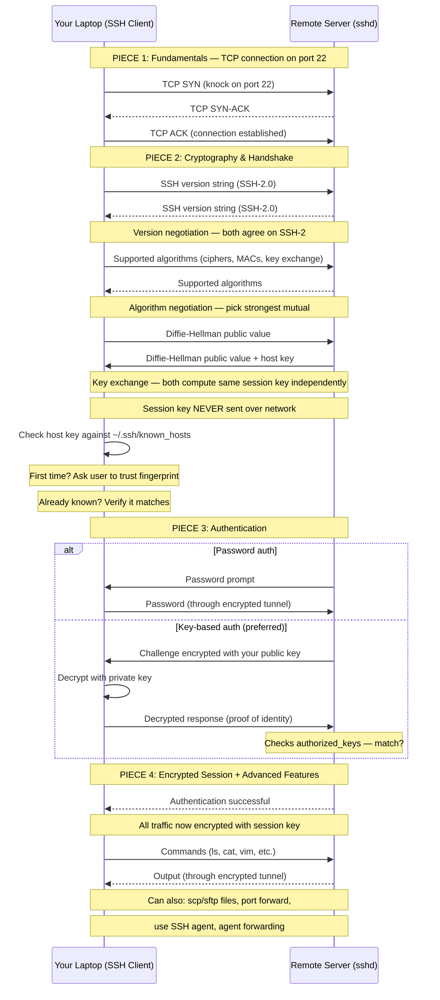

# Linux: SSH (Secure Shell)

SSH is the standard way to log in to and control another machine over a network. Commands typed on the local computer run on the remote one, and everything travelling between the two machines is encrypted. These notes cover what SSH is, how a connection is built, the cryptography that makes it safe, key-based login, configuration and hardening, file transfer, and tunneling.

## Chapter contents

| # | File | What it covers |
|---|---|---|
| 1 | [What is SSH?](1-what-is-ssh.md) | Definition, Telnet vs SSH, client and server (`sshd`), port 22, uses, SSH-1 vs SSH-2 |
| 2 | [Setup and first connection](2-setup-and-first-connection.md) | Checking, installing and managing the SSH service, PuTTY and Linux-to-Linux examples, troubleshooting |
| 3 | [Encryption behind SSH](3-encryption-behind-ssh.md) | Ciphers, symmetric vs asymmetric encryption, hybrid encryption, Diffie-Hellman, hashing, digital signatures |
| 4 | [Connection handshake](4-connection-handshake.md) | Step-by-step SSH-2 connection, host keys and `known_hosts`, password vs key authentication, the encrypted session |
| 5 | [SSH key authentication](5-ssh-key-authentication.md) | Key pairs, `ssh-keygen`, `ssh-copy-id`, passphrase and agent, AWS `.pem`, GitHub |
| 6 | [Config file and hardening](6-config-file-and-hardening.md) | `~/.ssh/config`, `sshd_config` security settings, safe change routine, pitfalls |
| 7 | [File transfer and tunneling](7-file-transfer-and-tunneling.md) | SCP, SFTP, local port forwarding and bastion hosts |
| 8 | [Practice lab on Fedora](8-practice-lab.md) | SSH into `localhost` to practise setup, keys and hardening |

**Related project:** [Go SSH client](../../../projects/go-ssh-client/README.md), a small Go program that applies this chapter in code: key login, host key verification and remote command execution.

## 🔗 Where They All Meet — The Full SSH Connection

Here's the complete flow that ties all contents together — from the moment you type `ssh user@server` to the moment you're running commands:

Every step in that sequence uses concepts from the four sub-notes:
- **TCP + port 22 + version negotiation** → Piece 1 (Fundamentals)
- **Algorithm negotiation + Diffie-Hellman + session key** → Piece 2 (Cryptography)
- **Host key verification + challenge-response** → Piece 3 (Keys & Auth)
- **Encrypted session + scp/sftp/port forwarding** → Piece 4 (Advanced)

> 🧭 **The DevOps takeaway:** SSH is the backbone of modern infrastructure. The engineers who understand *how* the handshake works, *why* key-based auth is superior, and *how* to harden a server are the ones who operate production systems safely. Everyone else just types `ssh user@ip` without thinking — and gets breached.

## Quick command reference 

| Command | Purpose |
|---|---|
| `ssh user@host` | Connect to a remote machine |
| `ssh -i key user@host` | Connect with a specific private key |
| `ssh -p 2222 user@host` | Connect to a non-default port |
| `ssh myserver` | Connect using a `Host` block from `~/.ssh/config` |
| `ls /etc/ssh/sshd_config` | Check that the server configuration file exists |
| `rpm -qa \| grep ssh` | Check whether OpenSSH packages are installed |
| `systemctl status sshd` | Check the SSH service |
| `systemctl start sshd` / `systemctl enable sshd` | Start the service / start it at boot |
| `sudo systemctl restart sshd` | Apply a configuration change |
| `sudo sshd -t` | Test `sshd_config` for syntax errors |
| `ssh-keygen -t ed25519 -C "label"` | Create a key pair |
| `ssh-copy-id user@host` | Copy the public key to the server |
| `ssh-add` | Load a key into the SSH agent |
| `scp file user@server:/path` | Copy a file over SSH |
| `ssh -L 3306:db-host:3306 user@bastion` | Local port forwarding through a bastion host |

## Key terms

| Term | Meaning |
|---|---|
| SSH client | The program on the local machine that starts the connection |
| SSH server / `sshd` | The background service on the remote machine that listens for connections |
| Port 22 | Default port for SSH |
| Cipher | An algorithm that encrypts and decrypts data |
| Symmetric encryption | One shared key for encrypting and decrypting. Fast. |
| Asymmetric encryption | A public/private key pair. Slow for large data. |
| Hybrid encryption | Asymmetric methods for the handshake, symmetric encryption for the data |
| Public key | Shareable half of a key pair, stored on servers |
| Private key | Secret half of a key pair, never leaves the local machine |
| Session key | Temporary symmetric key created for one SSH session |
| Diffie-Hellman | Key exchange where both sides compute the same secret without sending it |
| Host key / `known_hosts` | A server's fingerprint / the client's file of trusted server fingerprints |
| `authorized_keys` | File on the server (`~/.ssh/authorized_keys`) listing the public keys allowed to log in |
| Passphrase | Password that protects the private key file |
| SSH agent | Background process that holds a decrypted key in memory |
| Bastion host | Public server in front of a private network, used as a gateway |
| Hash / digest | Fixed-size fingerprint of a message of any size |
| Digital signature | A hash encrypted with a private key |

## My takeaways

- SSH is a locked door (port 22) plus a proof of identity. The door is guarded by encryption, and the proof is either a password or a private key.
- Before any login happens, client and server already share a temporary session key that was computed on both sides and never sent.
- With key login, the private key never leaves the local machine and no password crosses the network. That is the reason scripts, GitHub and cloud servers use it.
- A public key is meant to be copied around. A private key is not, and it needs `600` or `400` permissions and ideally a passphrase.
- The riskiest part of SSH is changing the server configuration. A backup, `sshd -t`, and a second open session are what prevent a lock-out.
- Port forwarding was the most surprising feature: a private database can feel like a local one through an encrypted tunnel.
