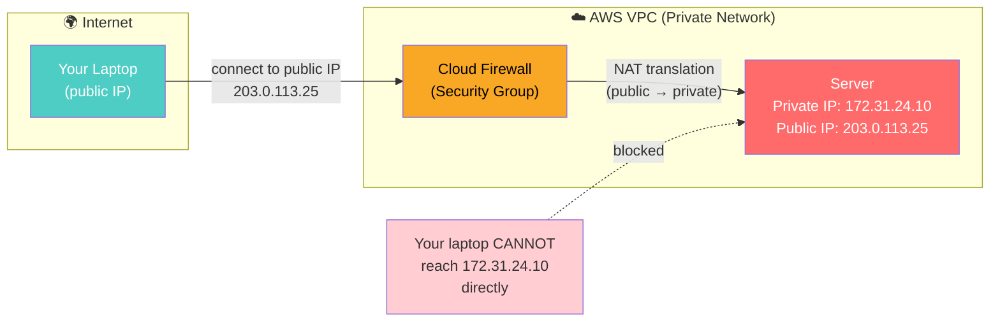
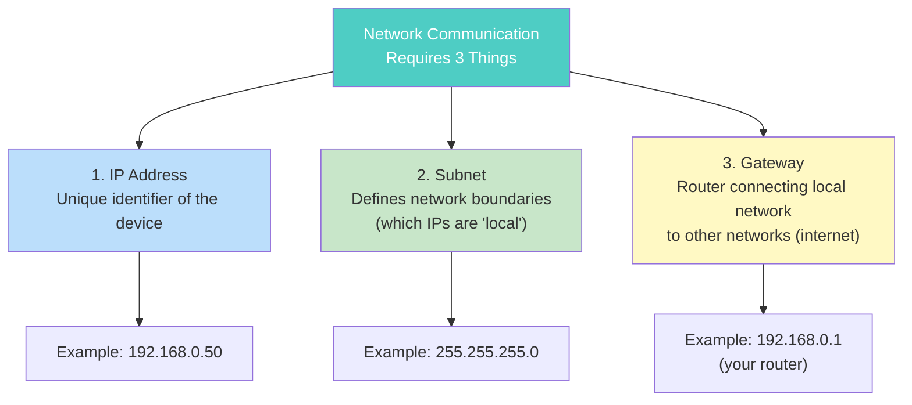
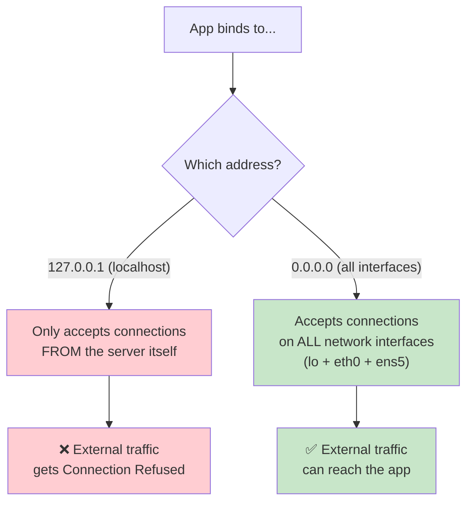

# 🌐 Fundamentals & The `ip` Command

> **Goal:** Understand the building blocks of Linux networking — IP addresses, network interfaces, MAC addresses, subnets, private vs public IPs, ports, the critical `0.0.0.0` vs `127.0.0.1` distinction — and master the `ip` command suite (`ip addr`/`ip link`/`ip route`).

---

## 📍 Why "Works on localhost" Fails Remotely

When you run `curl localhost:5000` on a server, the request stays completely inside the machine. When your laptop's browser tries to reach `http://<server-public-ip>:5000`, that packet has to cross the network, pass through firewalls, hit the right network interface, reach a process listening on the right IP/port, and complete a TCP handshake.

Understanding Linux networking starts with understanding **what's on the machine** — its interfaces, IPs, and how they're configured.

---

## 1️⃣ IP Addresses & Network Interfaces

Every machine on a network uses **IP (Internet Protocol) addresses** to send and receive packets.

### 🔍 Checking Interfaces: `ip a`

Running `ip a` (or `ip addr`) shows all network interfaces:

```bash
$ ip a
1: lo: <LOOPBACK,UP,LOWER_UP> mtu 65536
    inet 127.0.0.1/8 scope host lo
    inet6 ::1/128 scope host

2: eth0: <BROADCAST,MULTICAST,UP,LOWER_UP> mtu 1500
    inet 172.31.24.10/24 brd 172.31.31.255 scope global eth0
    inet6 fe80::4a2:15ff:fe8c:910a/64 scope link
    ether 06:a2:15:8c:91:0a

3: docker0: <NO-CARRIER,BROADCAST,MULTICAST,UP> mtu 1500
    inet 172.17.0.1/16 brd 172.17.255.255 scope global docker0
```

### 📋 Common Interface Names

| Interface | What it is |
|---|---|
| **`lo`** | **Loopback** — virtual interface (`127.0.0.1`) where the machine talks to itself. Traffic never leaves the server. |
| **`eth0` / `ens5` / `enp3s0`** | Primary network interface (Ethernet or virtual cloud NIC). Connected to the network. |
| **`docker0`** | Virtual bridge interface created when Docker is installed. Networks containers. |
| **`wlo1` / `wlan0`** | Wireless (Wi-Fi) interface. |

### 📊 The Three Types of Addresses

| Type | Example | What it identifies |
|---|---|---|
| **IP Address (IPv4)** | `172.31.24.10` | Logical network address identifying a host |
| **IP Address (IPv6)** | `fe80::4a2:15ff:fe8c:910a` | Newer, 128-bit address space |
| **MAC Address** | `06:a2:15:8c:91:0a` | Unique physical/hardware identifier burned into the NIC |

> 💡 **MAC vs IP:** MAC addresses identify the *hardware* (physical NIC). IP addresses identify the *host* on a network. MAC addresses never change; IP addresses can change (DHCP reassignment, moving networks).

---

## 2️⃣ Private IP vs Public IP (Crucial on Cloud Servers)

This distinction is critical for cloud servers (AWS, GCP, Azure):



| Type | Example | Reachable from |
|---|---|---|
| **Private IP** | `172.31.24.10` | Only inside the cloud provider's private virtual network (VPC) |
| **Public IP** | `203.0.113.25` | From anywhere on the internet |

> 🧭 **Practical takeaway:** If you can SSH into the server from your laptop, basic reachability to the machine is already working. The issue is usually how traffic reaches your *specific application* — not whether the machine is reachable.

### 📋 Private IP Ranges (RFC 1918)

| Range | Common Use |
|---|---|
| `10.0.0.0` – `10.255.255.255` | Large private networks |
| `172.16.0.0` – `172.31.255.255` | AWS VPC default range |
| `192.168.0.0` – `192.168.255.255` | Home/small office networks |

---

## 3️⃣ Subnets & Subnet Masks

A **subnet** divides a network into smaller, manageable parts.

### 📊 How Subnet Masks Work

| Mask | Fixed Bits | Meaning |
|---|---|---|
| `255.255.0.0` (`/16`) | 16 bits fixed | First two octets are locked; last two are free (0-255) |
| `255.255.255.0` (`/24`) | 24 bits fixed | First three octets locked; last is free (0-255) |

**The rule:**
- **`255`** in an octet → that octet is **fixed** (cannot change)
- **`0`** in an octet → that octet is **free** (can be 0-255)

### 📋 Examples

```
   Network: 192.168.0.0
   Mask:   255.255.255.0

   → 192.168.0.0  through 192.168.0.255  are all on the SAME LAN
   → 192.168.1.0  is on a DIFFERENT subnet
```

```
   Network: 192.168.0.0
   Mask:   255.255.0.0

   → 192.168.0.0  through 192.168.255.255  are all on the SAME LAN
   → 192.169.0.0  is on a DIFFERENT subnet
```

> 💡 All IPs starting with `192.168.x.x` belong to a private LAN. All IPs starting with `192.168.0.x` (with a `/24` mask) belong to the *same* LAN.

---

## 4️⃣ Device Communication Requirements

Any device needs **3 pieces of data** to communicate over a network:



| Requirement | What it does | Example |
|---|---|---|
| **IP Address** | Unique identifier of the device | `192.168.0.50` |
| **Subnet** | Defines which IPs are on the same local network | `255.255.255.0` |
| **Gateway** | The router that connects your local network to other networks (internet) | `192.168.0.1` |

> 💡 Without the gateway, your machine can only talk to other devices on the *same subnet*. The gateway is the "door" to the outside world.

---

## 5️⃣ Ports & Listening Addresses

**Ports** are numbered from **0 to 65,535** and let a single machine run multiple network services simultaneously.

### 📋 Common Ports

| Port | Service |
|---|---|
| **22** | SSH |
| **53** | DNS |
| **80** | HTTP |
| **443** | HTTPS |
| **3306** | MySQL |
| **5000** | Flask (dev server) |
| **8080** | Alternative HTTP / app port |

### 🎯 The Critical Distinction: `0.0.0.0` vs `127.0.0.1`

This is the #1 reason "localhost works but remote doesn't":



| Bind Address | What it means | External access? |
|---|---|---|
| **`127.0.0.1`** | Listen only on loopback (localhost) | ❌ No — only the server itself can connect |
| **`0.0.0.0`** | Listen on ALL IPv4 interfaces (lo + eth0 + ens5) | ✅ Yes — external traffic can reach it |
| **`::`** | Listen on all IPv6 interfaces | ✅ Yes (IPv6) |

### 📋 Example: Flask Binding

```bash
# ❌ Default — binds to 127.0.0.1 (localhost only)
$ flask run
 * Running on http://127.0.0.1:5000

# ✅ Correct — binds to 0.0.0.0 (all interfaces)
$ flask run --host=0.0.0.0
 * Running on http://0.0.0.0:5000
```

> 🧭 **DevOps gotcha:** Many dev servers (Flask, Django dev server, Node.js) default to `127.0.0.1`. Always set `--host=0.0.0.0` (or equivalent) when you need external access. In production, apps often stay on `127.0.0.1` and a reverse proxy (Nginx) handles external traffic on 80/443.

---

## 6️⃣ The `ip` Command Suite

The **`ip`** command is part of the **`iproute2`** utility suite. It replaces two older, deprecated commands:
- `ifconfig` (viewing/configuring interfaces)
- `route` (viewing/configuring the routing table)

### 📋 Read vs Write Operations

| Type | Example | Needs `sudo`? |
|---|---|---|
| **Read** (view info) | `ip a`, `ip route show` | ❌ No |
| **Write** (change state) | `ip link set down`, `ip addr add` | ✅ Yes |

> ⚠️ Commands that change network state can **disconnect you** if run over SSH on a live server (e.g., bringing down your active interface).

### 📊 Quick Reference

| Task | Command | `sudo`? |
|---|---|---|
| **List all interfaces & IPs** | `ip a` (or `ip addr show`) | No |
| **Inspect one interface** | `ip addr show dev eth0` | No |
| **Enable interface** | `sudo ip link set eth0 up` | Yes |
| **Disable interface** | `sudo ip link set eth0 down` | Yes |
| **Add IP address** | `sudo ip addr add 192.168.0.123/24 dev eth0` | Yes |
| **Remove IP address** | `sudo ip addr del 192.168.0.123/24 dev eth0` | Yes |
| **View routing table** | `ip route show` | No |
| **Add static route** | `sudo ip route add 172.16.252.0/24 via 172.16.250.1 dev wlo1` | Yes |
| **Delete route** | `sudo ip route del 172.16.252.0/24 via 172.16.250.1 dev wlo1` | Yes |
| **Check packet stats** | `ip -s link show eth0` | No |

---

## 7️⃣ `ip addr` — Viewing Interfaces

```bash
# Show all interfaces (shortcut)
$ ip a

# Full syntax
$ ip addr show

# Filter to one interface
$ ip addr show dev eth0
```

### 📋 Reading the Output

```
2: eth0: <BROADCAST,MULTICAST,UP,LOWER_UP> mtu 1500
    link/ether 06:a2:15:8c:91:0a brd ff:ff:ff:ff:ff:ff
    inet 172.31.24.10/24 brd 172.31.31.255 scope global eth0
         │           │
         │           └── subnet mask (/24 = 255.255.255.0)
         └────────────── IPv4 address
```

---

## 8️⃣ `ip link` — Managing Interfaces

Controls the interface itself (link layer) — turning it on/off or checking statistics.

```bash
# Bring interface down (disable)
$ sudo ip link set eth0 down

# Bring interface up (enable)
$ sudo ip link set eth0 up

# View packet statistics (errors & dropped packets)
$ ip -s link show eth0

# Monitor live with watch
$ watch "ip -s link show eth0"
```

> 💡 On DHCP networks, cycling an interface `down` then `up` typically refreshes its assigned IP address automatically.

---

## 9️⃣ `ip route` — The Routing Table

Your system's **routing table** tells Linux how to reach other networks — especially which **default gateway** to use for outbound traffic.

```bash
# View the routing table
$ ip route show
default via 172.31.16.1 dev eth0 proto dhcp metric 600
172.31.16.0/24 dev eth0 proto kernel scope link src 172.31.24.10

# Add a static route
$ sudo ip route add 172.16.252.0/24 via 172.16.250.1 dev wlo1

# Delete a route
$ sudo ip route del 172.16.252.0/24 via 172.16.250.1 dev wlo1
```

### 📋 Reading the Output

```
default via 172.31.16.1 dev eth0     ← DEFAULT GATEWAY (your router)
172.31.16.0/24 dev eth0              ← This subnet is directly on eth0
```

The **`default via <gateway_ip>`** line is your default gateway — where all outbound traffic goes when the destination isn't on your local subnet.

> 🧭 **DevOps tip:** If a server can't reach a specific subnet that other machines can, check `ip route show` — a missing route is a common culprit.

---

## 🔟 Legacy Tools (Still Around)

These older tools from the `net-tools` suite are deprecated but still installed on many systems:

| Legacy | Modern Replacement | Notes |
|---|---|---|
| **`ifconfig`** | `ip a` | Shows interface info (legacy) |
| **`route`** | `ip route` | Shows routing table (legacy) |
| **`netstat`** | `ss` | Shows sockets (legacy) |
| **`arp`** | `ip neigh` | Maps IPs to MAC addresses |

### 📋 `hostname` and `/etc/hosts`

```bash
$ hostname
app-server-01

$ cat /etc/hosts
127.0.0.1   localhost
127.0.1.1   app-server-01
```

`/etc/hosts` maps IP addresses to hostnames **locally** — before (or independently of) external DNS queries. If you add `192.168.1.50 myserver` to `/etc/hosts`, then `ping myserver` resolves to `192.168.1.50` without any DNS lookup.

### 📋 `arp` — Address Resolution Protocol

Maps IPv4 addresses on the local network segment to MAC addresses:

```bash
$ arp -n
Address       HWaddress         Iface
172.31.16.1   06:11:22:33:44:55 eth0
```

---

## 🧾 Summary

| Concept | One-line takeaway |
|---|---|
| **IP address** | Logical network address identifying a host (IPv4/IPv6). |
| **Network interface** | NIC — `lo` (loopback), `eth0`/`ens5` (primary), `docker0` (Docker bridge). |
| **MAC address** | Unique physical hardware identifier burned into the NIC. |
| **`ip a`** | Show all interfaces and IP addresses. Replaces `ifconfig`. |
| **Private IP** | Only reachable inside a private network (e.g., `172.31.x.x` in AWS). |
| **Public IP** | Internet-reachable. Assigned by cloud provider. |
| **Private IP ranges** | `10.x.x.x`, `172.16-31.x.x`, `192.168.x.x` (RFC 1918). |
| **Subnet mask** | Defines network boundaries. `255.255.255.0` (`/24`) = first 3 octets fixed. |
| **`255` in mask** | That octet is fixed (cannot change). |
| **`0` in mask** | That octet is free (0-255). |
| **Same LAN** | All IPs in the same subnet (e.g., all `192.168.0.x` with `/24`). |
| **3 communication requirements** | IP address + subnet + gateway. |
| **Gateway** | Router connecting local network to other networks (internet). |
| **Ports** | 0-65535. 22=SSH, 80=HTTP, 443=HTTPS, 5000=Flask. |
| **`0.0.0.0`** | Listen on ALL IPv4 interfaces — external traffic can reach it. |
| **`127.0.0.1`** | Listen on localhost only — blocks external connections. |
| **Flask binding** | `flask run --host=0.0.0.0` for external access. |
| **`ip addr show dev eth0`** | Inspect one specific interface. |
| **`ip link set up/down`** | Enable/disable an interface (needs sudo). |
| **`ip addr add/del`** | Add/remove an IP address (needs sudo). |
| **`ip route show`** | View the routing table. Look for `default via <gateway>`. |
| **`ip route add/del`** | Add/remove a static route (needs sudo). |
| **`ip -s link show`** | View packet statistics (errors, dropped packets). |
| **`ifconfig`/`route`/`netstat`** | Legacy `net-tools` — superseded by `ip`/`ss`. |
| **`hostname`** | Print the system's hostname. |
| **`/etc/hosts`** | Local IP-to-hostname mapping (before DNS). |
| **`arp -n`** | Map local IPs to MAC addresses. |
| **DevOps relevance** | The `ip` command + understanding interfaces/IPs = the foundation of all network debugging. |

---

← Back to [Linux Networking](./README.md) | Next: [Diagnostic Tools](./2-diagnostic-tools.md) →
