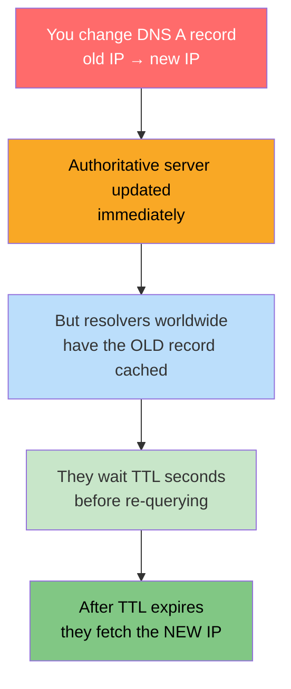

# 🌍 DNS Tools — `nslookup`, `dig`, `whois`

> **Goal:** Understand DNS (Domain Name System), A/AAAA records, TTL (Time To Live), and master the three DNS lookup tools — `nslookup`, `dig`, and `whois` — that every DevOps engineer uses to verify domain resolution.

---

## 📍 What Is DNS and Why It Matters

**DNS (Domain Name System)** maps human-readable domain names (like `example.com`) to IP addresses (like `93.184.216.34`). Without DNS, you'd have to type IP addresses into your browser instead of domain names.

When you type `curl http://myapp.com:5000`:
1. Your system checks `/etc/hosts` for a local mapping
2. If not found, it queries a DNS resolver
3. The resolver returns the IP address
4. Your system connects to that IP

If DNS is broken or returning the wrong IP, nothing else works — no matter how correctly your server is configured.


---

## 1️⃣ DNS Records

### 📋 Common Record Types

| Record | What it maps | Example |
|---|---|---|
| **A** | Domain → IPv4 address | `example.com → 93.184.216.34` |
| **AAAA** | Domain → IPv6 address | `example.com → 2606:2800:220:1:...` |
| **CNAME** | Domain → another domain (alias) | `www.example.com → example.com` |
| **MX** | Domain → mail server | `example.com → mail.example.com` |
| **TXT** | Arbitrary text (SPF, DKIM, verification) | `example.com → "v=spf1..."` |
| **NS** | Domain → name server | `example.com → ns1.example.com` |

> 💡 The **A record** is the most common — it's what maps your domain to your server's public IP.

---

## 2️⃣ TTL (Time To Live)

**TTL (Time To Live)** is the number of seconds a DNS resolver/cache can keep serving an old record before it must re-query the authoritative server.



### 📋 TTL in Practice

| TTL | Effect |
|---|---|
| **3600 (1 hour)** | Common default. Changes propagate within an hour. |
| **86400 (1 day)** | Longer caching, less DNS query traffic. Changes take up to a day. |
| **300 (5 min)** | Low TTL for frequent changes (deployments, failovers). |
| **60 (1 min)** | Very low — for rapid DNS-based switching. |

> 🧭 **DevOps gotcha:** If you recently changed a DNS record and still see the old IP, **TTL is why**. You may have to wait for it to expire across all resolvers. Always lower the TTL *before* making a DNS change if you need it to propagate quickly.

---

## 3️⃣ `nslookup` — Quick DNS Query

**`nslookup`** (Name Server Lookup) queries DNS to resolve domain names to IP addresses:

```bash
$ nslookup example.com
Server:     127.0.0.53
Address:    127.0.0.53#53

Non-authoritative answer:
Name:       example.com
Address:    93.184.216.34
```

### 📋 What the Output Shows

| Field | Meaning |
|---|---|
| **`Server: 127.0.0.53`** | The DNS resolver your system is using (systemd-resolved) |
| **`Non-authoritative answer`** | The answer came from a cache, not the authoritative name server directly |
| **`Name: example.com`** | The domain you queried |
| **`Address: 93.184.216.34`** | The resolved IPv4 address (A record) |

### 📝 Query a Specific Record Type

```bash
# Query for MX records (mail servers)
$ nslookup -type=mx example.com

# Query for NS records (name servers)
$ nslookup -type=ns example.com

# Query a specific DNS server
$ nslookup example.com 8.8.8.8
```

---

## 4️⃣ `dig` — Detailed DNS Query

**`dig`** (Domain Information Groper) provides more detailed output than `nslookup` — answer sections, record metadata, query timing.

### 📝 Quick Resolution (Most Common)

```bash
$ dig example.com +short
93.184.216.34
```

The `+short` flag gives you just the IP — perfect for scripts and quick checks.

### 📝 Full Output

```bash
$ dig example.com

; <<>> DiG 9.18 <<>> example.com
;; QUESTION SECTION:
;example.com.            IN  A

;; ANSWER SECTION:
example.com.     86400  IN  A   93.184.216.34

;; Query time: 14 msec
;; SERVER: 127.0.0.53#53
```

### 📋 Useful Flags

| Flag | What it does |
|---|---|
| **`+short`** | Print just the resolved IP (no headers) |
| **`+noall +answer`** | Show only the answer section |
| **`-t MX`** | Query MX records |
| **`-t AAAA`** | Query IPv6 records |
| **`@8.8.8.8`** | Query a specific DNS server (`dig @8.8.8.8 example.com`) |

### 📝 Query a Specific DNS Server

```bash
# Use Google's public DNS
$ dig @8.8.8.8 example.com +short

# Use Cloudflare's DNS
$ dig @1.1.1.1 example.com +short
```

> 🧭 **DevOps tip:** If `dig example.com` returns the wrong IP but `dig @8.8.8.8 example.com` returns the right one, your local DNS resolver has a cached old record. Wait for TTL to expire, or flush your DNS cache.

### 📝 Check TTL

```bash
$ dig example.com
;; ANSWER SECTION:
example.com.     86400  IN  A   93.184.216.34
                 ^^^^^
                 This is the TTL (in seconds) = 24 hours
```

---

## 5️⃣ `whois` — Domain Registration Lookup

**`whois`** queries domain registration records — registrar info, creation/expiration dates, name servers.

```bash
$ whois example.com
   Domain Name: EXAMPLE.COM
   Registrar: RESERVED-INTERNET ASSIGNED NUMBERS AUTHORITY
   Creation Date: 1995-08-14T04:00:00Z
   Name Server: A.IANA-SERVERS.NET
   Name Server: B.IANA-SERVERS.NET
```

### 📋 What `whois` Shows

| Field | What it tells you |
|---|---|
| **Registrar** | Who the domain was registered through (GoDaddy, Namecheap, etc.) |
| **Creation Date** | When the domain was first registered |
| **Expiration Date** | When the domain expires (needs renewal) |
| **Name Servers** | The authoritative DNS servers for the domain |

> 🧭 **DevOps use case:** Use `whois` to check if a domain is available, who owns it, when it expires, and what name servers it's using. If a domain's name servers are wrong, DNS resolution fails entirely.

---

## 6️⃣ Production DNS Scenario

Here's the real-world DNS debugging flow:

```bash
# 1. You deployed a new server with a new IP (203.0.113.50)
#    You updated the A record for myapp.com → 203.0.113.50

# 2. Check if the authoritative server has the new IP
$ dig @8.8.8.8 myapp.com +short
203.0.113.50          ← ✅ Google DNS sees the new IP

# 3. Check if your local resolver has the new IP
$ dig myapp.com +short
93.184.216.34         ← ❌ Still seeing the OLD IP!

# 4. Check the TTL
$ dig myapp.com
;; ANSWER SECTION:
myapp.com.    3600  IN  A   93.184.216.34
              ^^^^
              TTL = 3600 seconds (1 hour)

# 5. Diagnosis: Your local resolver cached the old IP.
#    Wait 1 hour for TTL to expire, then it'll fetch the new one.

# 6. Verify the domain registration is correct
$ whois myapp.com
# Check: name servers, expiration date
```

> 🧭 **The DevOps lesson:** Always lower the TTL *before* making DNS changes. Set TTL to 300 (5 minutes) a day before the change, make the change, verify propagation, then raise TTL back to 3600 for efficiency.

---

## 🧾 Summary

| Concept | One-line takeaway |
|---|---|
| **DNS** | Domain Name System — maps domain names to IP addresses. |
| **A record** | Maps a domain to an IPv4 address. Most common record type. |
| **AAAA record** | Maps a domain to an IPv6 address. |
| **CNAME** | Alias — maps one domain to another (`www → example.com`). |
| **MX** | Mail exchange record — maps domain to mail server. |
| **TXT** | Text record — used for SPF, DKIM, domain verification. |
| **NS** | Name server record — which DNS servers are authoritative. |
| **TTL** | Time To Live — seconds a resolver can cache a record before re-querying. |
| **TTL gotcha** | If you changed DNS but see the old IP, wait for TTL to expire. |
| **Pre-change tip** | Lower TTL to 300 before making DNS changes for fast propagation. |
| **`/etc/hosts`** | Checked BEFORE DNS. Local IP-to-hostname mapping. |
| **`nslookup domain`** | Quick DNS query — shows resolved IP and resolver server. |
| **`nslookup -type=mx`** | Query a specific record type (MX, NS, AAAA, etc.). |
| **`dig domain +short`** | Print just the resolved IP. Perfect for scripts. |
| **`dig domain`** | Full output — answer section, TTL, query time. |
| **`dig @8.8.8.8 domain`** | Query a specific DNS server (Google, Cloudflare). |
| **`dig -t MX domain`** | Query MX records. |
| **`+noall +answer`** | Show only the answer section (no headers). |
| **`whois domain`** | Domain registration info — registrar, creation/expiry, name servers. |
| **DNS debug flow** | `dig +short` (local) vs `dig @8.8.8.8 +short` (external) → if different, it's a caching/TTL issue. |
| **DevOps relevance** | DNS issues = "my domain points to the wrong server." Master `dig` to diagnose in seconds. |

---

← Back to [Linux Networking](./README.md) | Previous: [Diagnostic Tools](./2-diagnostic-tools.md) | Next: [The `ss` Command](./4-ss-sockets.md) →
