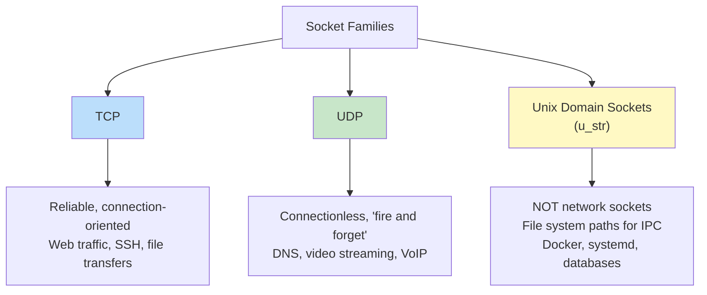
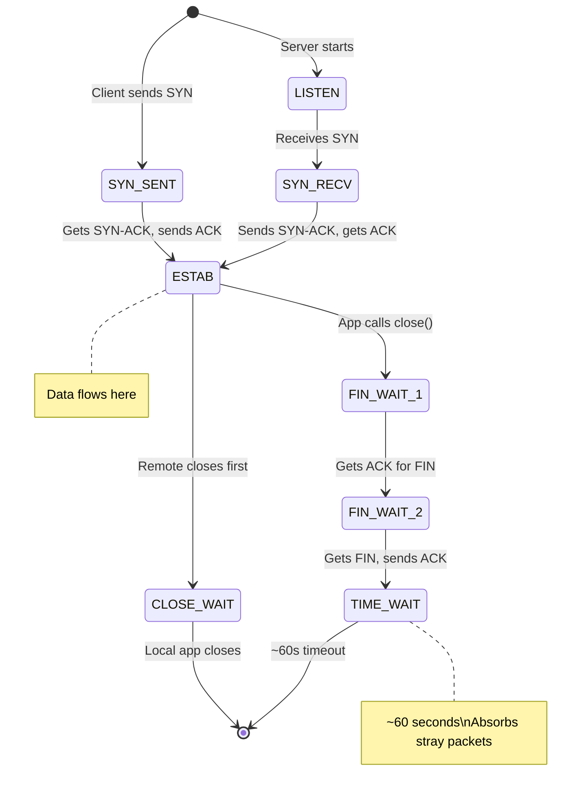

# 📊 The `ss` Command — Socket Statistics

> **Goal:** Master `ss` (Socket Statistics) — the modern replacement for `netstat`. Understand socket families (TCP/UDP/Unix), socket states (LISTEN/ESTAB/TIME-WAIT), all the essential flags, and the `ss -tulpn` sysadmin one-liner that answers "what's listening, and where?"

---

## 📍 What Is `ss`?

**`ss`** is a command-line utility that prints statistical information about **sockets** — the endpoints of network communication. It's part of the **`iproute2`** toolkit and is installed by default on most Linux systems.

### 🆚 `ss` vs `netstat`

| | `ss` (modern) | `netstat` (legacy) |
|---|---|---|
| **How it gets data** | Talks directly to the kernel via **netlink sockets** | Parses slow text files in `/proc` |
| **Speed** | Dramatically faster | Slow on busy systems |
| **Detail** | More detail per socket | Limited |
| **Status** | ✅ Current standard | ❌ Deprecated |

> 💡 `netstat` reads `/proc` files (slow text parsing). `ss` reads live kernel data structures via netlink — which is why it's so much faster.

### 📝 Installation

```bash
# Already installed by default on most distros
# If missing:
$ sudo dnf install iproute        # RHEL/Fedora
$ sudo apt install iproute2       # Debian/Ubuntu
```

---

## 1️⃣ What Is a Socket?

A **socket** is like a phone line that lets two computers (or programs) connect and talk to each other over a network or locally. `ss` shows details like source/destination IPs, port numbers, and connection states.

### 📋 Three Socket Families



| Family | Code in `ss` output | Characteristics | Used for |
|---|---|---|---|
| **TCP** | `tcp` | Reliable, connection-oriented byte stream | Web traffic, SSH, file transfers |
| **UDP** | `udp` | Connectionless, "fire and forget" datagrams | DNS, video streaming, VoIP, DHCP |
| **Unix Domain** | `u_str` | Not network sockets — file system paths for IPC | Docker, systemd, databases (same-host communication) |

> 💡 **Unix domain sockets** never traverse the network. They're file system paths used for lightning-fast inter-process communication (IPC) on the *same host*. That's why you see entries like `/run/systemd/private` in `ss` output instead of IP:Port pairs.

---

## 2️⃣ Socket States

TCP connections go through a lifecycle of states. `ss` shows the current state of each socket:

| State | Code | What it means |
|---|---|---|
| **LISTEN** | `LISTEN` | A server is waiting for incoming connections |
| **ESTAB** | `ESTAB` | **Established** — handshake completed, data is flowing |
| **SYN-SENT** | `SYN-SENT` | Your client sent SYN, waiting for SYN-ACK |
| **SYN-RECV** | `SYN-RECV` | Server received SYN, sent SYN-ACK |
| **FIN-WAIT-1** | `FIN-WAIT-1` | Side sent FIN, waiting for ACK |
| **FIN-WAIT-2** | `FIN-WAIT-2` | FIN acknowledged, waiting for the other side's FIN |
| **CLOSE-WAIT** | `CLOSE-WAIT` | Remote side closed, waiting to read remaining data |
| **TIME-WAIT** | `TIME-WAIT` | Lingering ~60s after close to absorb stray packets |
| **UNCONN** | `UNCONN` | Unconnected (UDP sockets) |



> 🧭 **DevOps tip:** A spike in `TIME-WAIT` sockets usually signals **connection churn** — lots of short-lived connections opening and closing. This is common with HTTP/1.1 without keep-alive. If you see thousands of TIME-WAIT sockets, investigate connection pooling.

---

## 3️⃣ The `ss -tulpn` Command — The Sysadmin One-Liner

This is the **#1 most-used `ss` command** for DevOps. It answers: "What's listening, and on what address?"

```bash
$ sudo ss -tulpn
Netid  State   Recv-Q  Send-Q  Local Address:Port  Peer Address:Port  Process
tcp    LISTEN  0       128     127.0.0.53:53       0.0.0.0:*          users:(("systemd-resolve",pid=512,fd=13))
tcp    LISTEN  0       128     0.0.0.0:22          0.0.0.0:*          users:(("sshd",pid=801,fd=3))
tcp    LISTEN  0       128     127.0.0.1:5000      0.0.0.0:*          users:(("flask",pid=2417,fd=3))
udp    UNCONN  0       0       127.0.0.53:53       0.0.0.0:*          users:(("systemd-resolve",pid=512,fd=12))
```

### 📊 Decoding the Flags

```
   ss -tulpn
      │││││
      │││││
      ││││└── n = Numeric (show port numbers, not service names)
      │││└─── p = Process (show which process owns the socket)
      ││└──── l = Listening (only show sockets waiting for connections)
      │└────── u = UDP sockets
      └─────── t = TCP sockets
```

| Flag | Stands for | What it does |
|---|---|---|
| **`-t`** | **T**CP | Show TCP sockets |
| **`-u`** | **U**DP | Show UDP sockets |
| **`-l`** | **L**istening | Show only listening sockets (not established connections) |
| **`-p`** | **P**rocess | Show the process name and PID owning each socket |
| **`-n`** | **N**umeric | Show numeric IPs and ports (don't resolve to names — faster) |

### 🎯 Reading the Output

```
tcp    LISTEN  0  128  127.0.0.1:5000  0.0.0.0:*  users:(("flask",pid=2417,fd=3))
│      │           │      │              │            │
│      │           │      │              │            └── process: flask, PID 2417
│      │           │      │              └── peer: any (waiting for connections)
│      │           │      └── local address: 127.0.0.1, port 5000
│      │           └── send queue size: 128 (backlog)
│      └── state: LISTEN (waiting for connections)
└── protocol: TCP
```

### 🚨 The Problem in the Output

Look at the Flask line: `127.0.0.1:5000` — Flask is bound to **localhost only**. External traffic cannot reach it. This is the root cause of "works on localhost but fails remotely."

Compare with SSH: `0.0.0.0:22` — SSH is bound to **all interfaces**. External traffic CAN reach it. That's why you can SSH in but can't reach Flask.

> 🧭 **The debugging insight:** `ss -tulpn` instantly tells you if an app is bound to `0.0.0.0` (external access works) or `127.0.0.1` (external access blocked). This is step 2 of the troubleshooting checklist.

---

## 4️⃣ Essential `ss` Flags

`ss` flags are **compositional** — you stack them to narrow down what you want:

| Flag | What it does |
|---|---|
| **`-t`** | Show TCP sockets |
| **`-u`** | Show UDP sockets |
| **`-x`** | Show Unix domain sockets |
| **`-l`** | Show only listening sockets |
| **`-p`** | Show the owning process and PID |
| **`-n`** | Numeric IPs and ports (no DNS resolution — faster) |
| **`-4`** | Force IPv4 only |
| **`-6`** | Force IPv6 only |
| **`-s`** | Print summary statistics |
| **`-o`** | Show timer information |

---

## 5️⃣ Practical Commands

### A. The Baseline Dump (Everything)

```bash
$ ss
```
Dumps every socket (TCP, UDP, Unix) across every state. Overwhelming on a busy host.

### B. Listening Ports (Most Common)

```bash
$ ss -tln
Netid  State  Recv-Q  Send-Q  Local Address:Port  Peer Address:Port
tcp    LISTEN 0       128     0.0.0.0:22          0.0.0.0:*
tcp    LISTEN 0       128     127.0.0.1:5000      0.0.0.0:*
tcp    LISTEN 0       511     0.0.0.0:443         0.0.0.0:*
udp    UNCONN 0       0       127.0.0.53:53       0.0.0.0:*
```

TCP listening sockets only, numeric ports. Add `-p` to see processes (needs sudo), `-u` to include UDP.

### C. Summary Statistics

```bash
$ ss -s
Total: 12
TCP:   12 (estab 4, closed 3, orphaned 0, timewait 2, 0 ports, 0 created)
Transport  Total  IP  IPv6
RAW        2      1   1
UDP        7      5   2
TCP        9      7   2
INET       18     13  5
FRAG       0      0   0
```

Quick health check — aggregated totals by state and protocol. No need to scroll through individual sockets.

### D. Established Connections Only

```bash
$ ss -t state established
Recv-Q  Send-Q  Local Address:Port  Peer Address:Port
0       0       192.168.1.20:22      203.0.113.45:51234
0       52      192.168.1.20:443     198.51.100.7:49102
0       0       192.168.1.20:3306    10.0.0.114:54022
```

Shows only active, live sessions — SSH sessions, database queries, HTTPS connections.

### E. Listening Sockets (Using State Filter)

```bash
$ ss -t state listening
State  Recv-Q  Send-Q  Local Address:Port  Peer Address:Port
LISTEN 0       128     0.0.0.0:22          0.0.0.0:*
LISTEN 0       80      127.0.0.1:5000      0.0.0.0:*
```

### F. Time-Wait Sockets (Connection Churn Detection)

```bash
$ ss -t -o state time-wait
Recv-Q  Send-Q  Local Address:Port  Peer Address:Port  Timer
0       0       192.168.1.20:443     198.51.100.7:49103 timer:(timewait,39sec,0)
0       0       192.168.1.20:443     203.0.113.78:52044 timer:(timewait,53sec,0)
```

The `-o` flag adds a **Timer** column showing how long each connection has been in TIME-WAIT. A sudden spike here signals connection churn.

### G. Unix Domain Sockets

```bash
$ ss -x | head -5
Netid  State  Recv-Q  Send-Q  Local Address:Port  Peer Address:Port
u_str  ESTAB  0      0       /run/systemd/private 32488  * 0
u_str  ESTAB  0      0       /var/run/docker.sock  12345  * 0
```

Surfaces Unix sockets used for local IPC. Notice `u_str` entries where addresses are file paths, not IP:Port pairs.

---

## 6️⃣ The 7 Columns of `ss` Output

When you run basic `ss`, the output has 7 columns:

| Column | What it shows |
|---|---|
| **Netid** | Protocol (TCP, UDP, or `u_str` for Unix) |
| **State** | Connection status (ESTAB, LISTEN, TIME-WAIT, etc.) |
| **Recv-Q** | Amount of data queued for receiving (0 = nothing waiting) |
| **Send-Q** | Amount of data queued for sending |
| **Local Address** | Your machine's IP and port |
| **Peer Address** | The remote device's IP and port |
| **Process** | Which process is using the connection (with `-p`) |

> 💡 Non-zero **Recv-Q** that persists = your application isn't reading data fast enough. Non-zero **Send-Q** that persists = the remote side isn't acknowledging your data.

---

## 🧾 Summary

| Concept | One-line takeaway |
|---|---|
| **`ss`** | Modern replacement for `netstat`. Socket statistics from the kernel via netlink. Part of `iproute2`. |
| **`ss` vs `netstat`** | `ss` reads kernel data directly (fast). `netstat` parses `/proc` files (slow). |
| **TCP sockets** | Reliable, connection-oriented. Web traffic, SSH, file transfers. |
| **UDP sockets** | Connectionless, "fire and forget". DNS, video, VoIP, DHCP. |
| **Unix domain sockets (`u_str`)** | NOT network sockets. File system paths for IPC on same host. Docker, systemd, databases. |
| **LISTEN** | Server waiting for incoming connections. |
| **ESTAB** | Established — handshake complete, data flowing. |
| **TIME-WAIT** | Lingering ~60s after close to absorb stray packets. Spike = connection churn. |
| **CLOSE-WAIT** | Remote side closed, waiting to read remaining data. |
| **FIN-WAIT-1/2** | States during the shutdown handshake. |
| **SYN-SENT** | Client sent SYN, waiting for SYN-ACK. |
| **UNCONN** | Unconnected (UDP sockets). |
| **`ss -tulpn`** | The sysadmin one-liner: TCP+UDP, Listening, Process, Numeric. |
| **`-t`** | TCP sockets. |
| **`-u`** | UDP sockets. |
| **`-l`** | Listening sockets only. |
| **`-p`** | Show process name + PID (needs sudo). |
| **`-n`** | Numeric IPs/ports (no DNS resolution — faster). |
| **`-x`** | Unix domain sockets. |
| **`-s`** | Summary statistics (quick health check). |
| **`-o`** | Show timer info (how long in current state). |
| **`-4` / `-6`** | Force IPv4 / IPv6 only. |
| **`state established`** | Filter: show only established connections. |
| **`state listening`** | Filter: show only listening sockets. |
| **`state time-wait`** | Filter: show only TIME-WAIT sockets (churn detection). |
| **7 columns** | Netid, State, Recv-Q, Send-Q, Local Address, Peer Address, Process. |
| **`0.0.0.0:5000`** | App listens on ALL interfaces → external access works. |
| **`127.0.0.1:5000`** | App listens on localhost only → external access blocked. |
| **TIME-WAIT spike** | Connection churn — investigate connection pooling / keep-alive. |
| **DevOps relevance** | `ss -tulpn` = the #1 command for "what's listening?" Step 2 of the debug checklist. |

---

← Back to [Linux Networking](./README.md) | Previous: [DNS Tools](./3-dns-tools.md) | Next: [TCP & Packet Analysis](./5-tcp-packet-analysis.md) →
