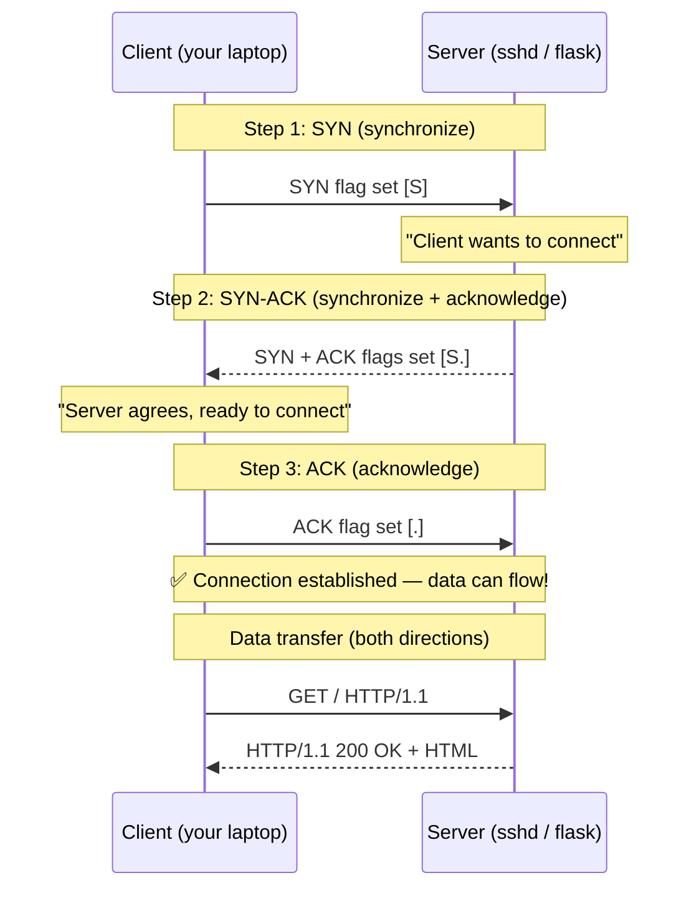
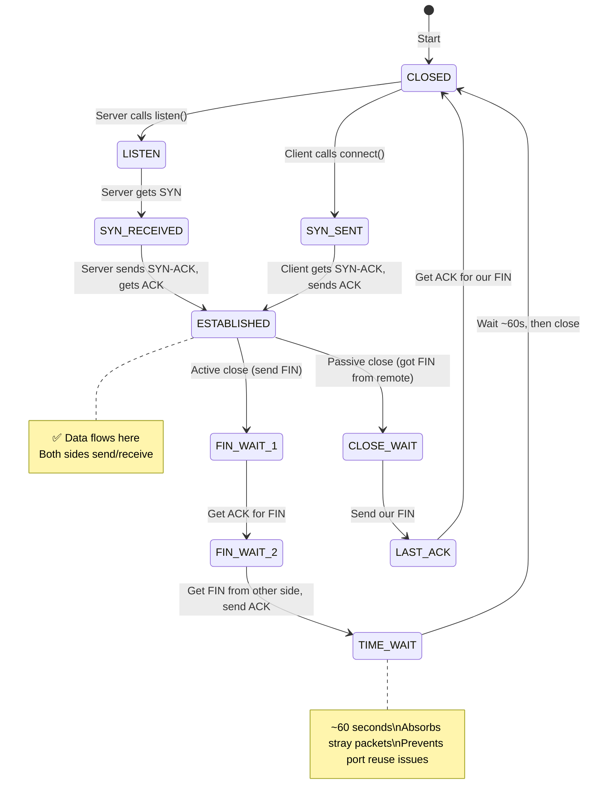
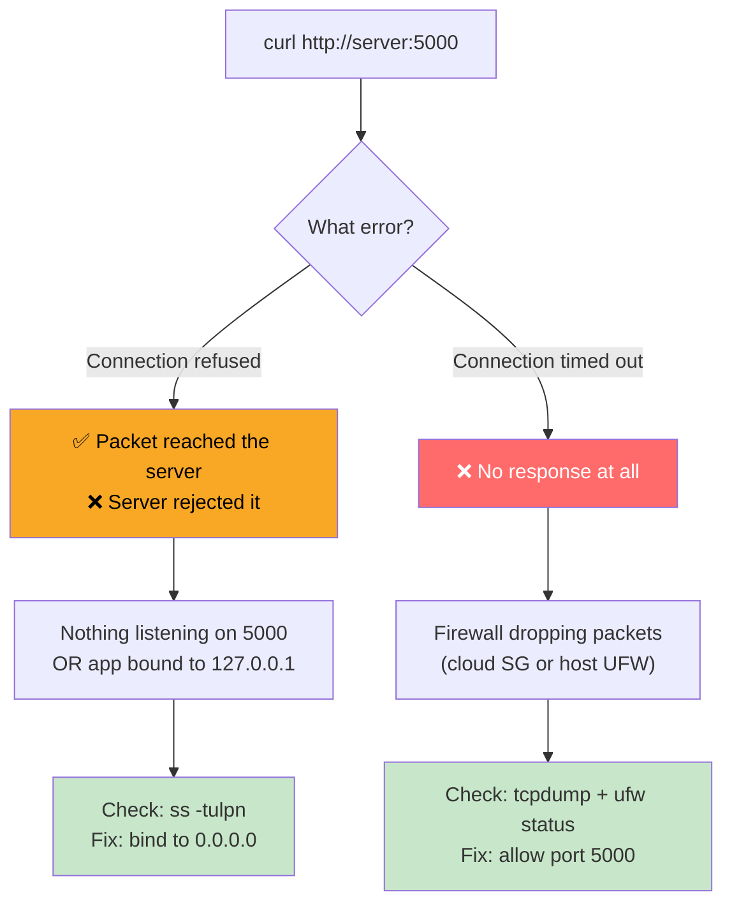
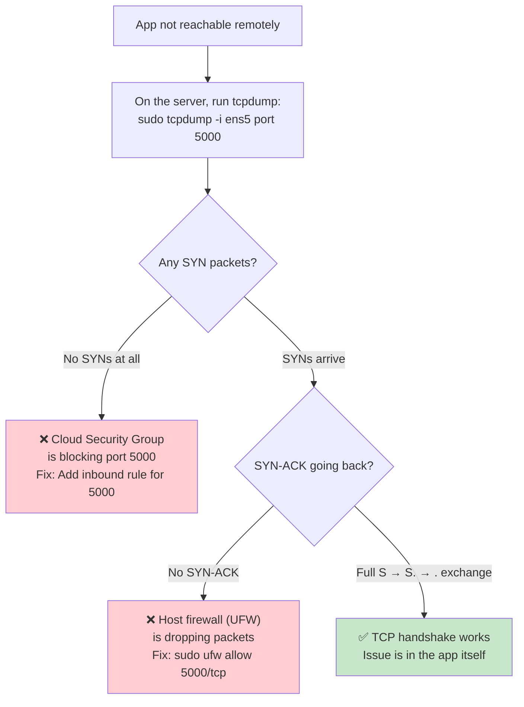

# 🔍 TCP & Packet Analysis — Handshake, States, `tcpdump`

> **Goal:** Understand the TCP three-way handshake, the full TCP connection state lifecycle, packet sniffing with `tcpdump`, and port testing with `telnet`/`nc`/`nmap` — the tools that tell you *where* packets stop.

---

## 📍 Where Packets Stop

When a connection fails, there are only a few places it can break:

1. **Packets never reach the server** → cloud firewall (Security Group) blocking
2. **Packets reach the server but get dropped** → host firewall (UFW) blocking
3. **Packets reach the app but the app rejects them** → nothing listening, or bound to localhost
4. **Connection establishes but no data flows** → app issue

`tcpdump` tells you which case you're in by showing you the actual packets arriving at the server's network interface.

---

## 1️⃣ The TCP Three-Way Handshake

**TCP (Transmission Control Protocol)** is connection-oriented — it starts every connection with a **three-way handshake**:



### 📋 The Three Steps

| Step | Packet | tcpdump notation | Who sends it | What it means |
|---|---|---|---|---|
| **1** | SYN | `[S]` | Client → Server | "I want to connect" |
| **2** | SYN-ACK | `[S.]` | Server → Client | "I agree, let's connect" |
| **3** | ACK | `[.]` | Client → Server | "Confirmed, connection open" |

Only after all three packets does **application data** flow. This is why it's called a "handshake" — both sides agree before communicating.

> 💡 The `.` in tcpdump means ACK. `[S]` = SYN only. `[S.]` = SYN + ACK. `[.]` = ACK only. `[F.]` = FIN + ACK (connection close).

---

## 2️⃣ TCP Connection States — The Full Lifecycle

A TCP connection goes through a series of states from start to finish:



### 📋 State Descriptions

| State | Who's in it | What it means |
|---|---|---|
| **LISTEN** | Server | Waiting for incoming connections |
| **SYN_SENT** | Client | Sent SYN, waiting for SYN-ACK |
| **SYN_RECEIVED** | Server | Got SYN, sent SYN-ACK, waiting for ACK |
| **ESTABLISHED** | Both | ✅ Handshake complete, data flowing |
| **FIN_WAIT_1** | Either | Sent FIN to close, waiting for ACK |
| **FIN_WAIT_2** | Either | FIN acknowledged, waiting for other side's FIN |
| **CLOSE_WAIT** | Either | Remote side closed, waiting to read remaining data |
| **LAST_ACK** | Either | Sent our FIN after remote closed, waiting for final ACK |
| **TIME_WAIT** | The one who closed first | Lingering ~60s to absorb stray packets |
| **CLOSED** | Both | Connection fully terminated |

### 🕐 Why TIME_WAIT Lasts ~60 Seconds

When a connection closes, the side that initiated the close enters **TIME_WAIT** for about 60 seconds. This ensures:
1. Any stray packets still in transit are absorbed (not mistaken for a new connection)
2. The remote side receives the final ACK (if it gets lost, the remote can re-send FIN)

> 🧭 **DevOps tip:** A spike in TIME_WAIT sockets means **connection churn** — lots of short-lived connections. Common with HTTP/1.1 without keep-alive. Solutions: enable keep-alive, use connection pooling, or tune `net.ipv4.tcp_tw_reuse`.

---

## 3️⃣ `tcpdump` — Packet Sniffing

**`tcpdump`** captures and displays network packets in real time. It's the tool that tells you *exactly* what's hitting your server's network interface.

### 📝 Basic Syntax

```bash
sudo tcpdump -i <interface_name> port <port_number>
```

| Part | Meaning |
|---|---|
| **`-i <interface>`** | Which network interface to listen on (from `ip a`, e.g., `eth0` or `ens5`) |
| **`port <N>`** | Filter: only show traffic on this port |
| **`-n`** | Don't resolve hostnames (show numeric IPs — faster) |
| **`-c N`** | Capture N packets then stop |

### 📝 Practical Example: Watching Port 5000

```bash
$ sudo tcpdump -i ens5 port 5000
tcpdump: verbose output suppressed, use -v for full protocol decode
listening on ens5, link-type EN10MB (Ethernet), capture size 262144 bytes
```

Now refresh the page on your laptop (`curl http://<server-ip>:5000`). You'll see:

```text
14:30:01.123456 IP 203.0.113.10.54122 > 172.31.24.10.5000: Flags [S], seq 123456, win 65535, length 0
14:30:01.123489 IP 172.31.24.10.5000 > 203.0.113.10.54122: Flags [S.], seq 789012, ack 123457, win 65535, length 0
14:30:01.123501 IP 203.0.113.10.54122 > 172.31.24.10.5000: Flags [.], ack 1, win 65535, length 0
```

### 📊 Reading the Output

```
14:30:01  IP  203.0.113.10.54122  >  172.31.24.10.5000:  Flags [S]  seq 123456  win 65535  length 0
   │         │  │                  │  │                    │         │          │           │
   │         │  │                  │  │                    │         │          │           └── payload size (0 = handshake)
   │         │  │                  │  │                    │         │          └── sequence number
   │         │  │                  │  │                    │         └── TCP flags [S]=SYN
   │         │  │                  │  │                    └── destination port (5000)
   │         │  │                  │  └── destination IP (your server)
   │         │  │                  └── source port (54122, random)
   │         │  └── source IP (your laptop)
   │         └── protocol (IP)
   └── timestamp
```

### 🎯 The Diagnostic Power

The tcpdump output tells you **exactly where the problem is**:

| What you see | What it means | Fix |
|---|---|---|
| **No SYN packets at all** | Traffic blocked BEFORE reaching the server | Cloud Security Group not allowing port 5000 |
| **SYN arrives, but no SYN-ACK goes back** | Server received the packet but dropped it | Host firewall (UFW) blocking port 5000 |
| **Full `[S] → [S.] → [.]` exchange** | TCP handshake completed | Connection works — check app for other issues |
| **SYN-ACK sent but no ACK back** | Client didn't complete the handshake | Client-side issue (rare) |

> 🧭 **This is step 3 of the debug checklist.** If `ss -tulpn` shows the app is listening on `0.0.0.0:5000`, the next question is: "Are packets even arriving?" `tcpdump` answers that definitively.

---

## 4️⃣ `curl` Errors: "Connection Refused" vs "Timed Out"

When testing from your laptop, the error message tells you *where* the connection failed:

| Error | What it means | Typical cause |
|---|---|---|
| **Connection refused** | Packet reached the server, OS actively rejected it | Nothing listening on that port, OR app bound to `127.0.0.1` instead of `0.0.0.0` |
| **Connection timed out** | No response came back within the wait window | Firewall silently dropping packets (cloud SG or host UFW) |



> 🧭 **The golden debugging rule:**
> - **Refused** → check `ss -tulpn` (nothing listening or wrong bind address)
> - **Timed out** → check `tcpdump` + firewalls (packets being dropped)

---

## 5️⃣ `telnet` — Port Reachability Check

**`telnet`** tests TCP connectivity to a specific host and port:

```bash
$ telnet example.com 80
Trying 93.184.216.34...
Connected to example.com.
Escape character is '^]'.
```

- **"Connected"** → port is open and reachable ✅
- **"Connection refused"** → port closed or firewalled
- **Timeout** → firewall dropping packets

> 💡 `telnet` is the simplest port-testing tool. Type `Ctrl+]` then `quit` to exit. It's old but still useful for quick port checks.

---

## 6️⃣ `nc` (Netcat) — TCP Port Check

**`nc`** (Netcat) is more versatile than `telnet` for port testing:

```bash
$ nc -zv example.com 80
Connection to example.com (93.184.216.34) 80 port [tcp/http] succeeded!
```

| Flag | What it does |
|---|---|
| **`-z`** | Zero-I/O mode — just check if the port is open (don't send data) |
| **`-v`** | Verbose output (shows the result) |
| **`-w N`** | Timeout after N seconds |

### 📋 Scanning a Range of Ports

```bash
# Check ports 20-30
$ nc -zv example.com 20-30

# Check a specific port with 5s timeout
$ nc -zv -w 5 example.com 5000
```

> 🧭 `nc -zv` is the modern preferred way to test a single port. It's cleaner than `telnet` and doesn't require an interactive session.

---

## 7️⃣ `nmap` — Port Scanning

**`nmap`** (Network Mapper) scans target hosts for open ports:

```bash
$ nmap -v example.com
Starting Nmap 7.94
Initiating Ping Scan at 14:09
Scanning example.com (93.184.216.34) [4 ports]
Nmap scan report for example.com (93.184.216.34)
Host is up (0.014s latency).
PORT   STATE SERVICE
80/tcp open  http
443/tcp open  https
```

### 📋 Useful Flags

| Flag | What it does |
|---|---|
| **`-v`** | Verbose output |
| **`-p 1-1000`** | Scan ports 1 through 1000 |
| **`-p 80,443,22`** | Scan specific ports |
| **`-sV`** | Detect service versions |
| **`-A`** | Aggressive scan (OS detection, version detection, scripts) |

> ⚠️ **Ethical note:** Only scan systems you are authorized to test. Port scanning without permission is illegal in many jurisdictions.

---

## 8️⃣ Putting It All Together — The Packet Analysis Workflow



### 📋 The Complete Debugging Sequence

```bash
# 1. On the server: start tcpdump watching port 5000
$ sudo tcpdump -i ens5 port 5000

# 2. From your laptop: try to connect
$ curl -v http://<server-public-ip>:5000

# 3. Watch the tcpdump output:
#    - No packets? → Cloud firewall (Security Group)
#    - SYN but no SYN-ACK? → Host firewall (UFW)
#    - Full handshake? → App issue (check app logs)
```

---

## 🧾 Summary

| Concept | One-line takeaway |
|---|---|
| **TCP handshake** | SYN → SYN-ACK → ACK. Three packets to establish a connection. |
| **SYN `[S]`** | Client → Server: "I want to connect." |
| **SYN-ACK `[S.]`** | Server → Client: "I agree, let's connect." |
| **ACK `[.]`** | Client → Server: "Confirmed, connection open." |
| **TCP states** | CLOSED → LISTEN/SYN_SENT → SYN_RECEIVED → ESTABLISHED → FIN_WAIT → TIME_WAIT → CLOSED. |
| **LISTEN** | Server waiting for connections. |
| **ESTABLISHED** | Handshake complete, data flowing. |
| **TIME_WAIT** | ~60s lingering after close. Absorbs stray packets. Spike = connection churn. |
| **CLOSE_WAIT** | Remote closed, waiting to read remaining data. |
| **FIN_WAIT_1/2** | States during the shutdown handshake. |
| **`tcpdump`** | Packet sniffer. `sudo tcpdump -i ens5 port 5000`. |
| **`tcpdump -i`** | Specify interface to listen on (from `ip a`). |
| **`tcpdump -n`** | Don't resolve hostnames (numeric IPs, faster). |
| **`tcpdump -c N`** | Capture N packets then stop. |
| **`[S]` / `[S.]` / `[.]`** | tcpdump flag notation: SYN / SYN-ACK / ACK. |
| **No SYN in tcpdump** | Traffic blocked before reaching server → cloud Security Group. |
| **SYN but no SYN-ACK** | Server received but dropped packet → host firewall (UFW). |
| **Full handshake in tcpdump** | TCP works — issue is in the app. |
| **Connection refused** | Packet reached server, OS rejected it. Usually nothing listening or bound to `127.0.0.1`. |
| **Connection timed out** | No response. Firewall silently dropping packets. |
| **Refused → check** | `ss -tulpn` (is anything listening? on what address?). |
| **Timed out → check** | `tcpdump` + `ufw status` (are packets arriving? is firewall blocking?). |
| **`telnet host port`** | Simple port reachability check. "Connected" = port open. |
| **`nc -zv host port`** | Modern port check. `-z` = zero-I/O (just check), `-v` = verbose. |
| **`nmap -v host`** | Port scanner. Shows all open ports on a target. |
| **`nmap -p 80,443,22`** | Scan specific ports. |
| **`nmap -sV`** | Detect service versions. |
| **Ethical scanning** | Only scan systems you're authorized to test. |
| **Debug workflow** | `tcpdump` on server → `curl` from laptop → read tcpdump output → identify where packets stop. |
| **DevOps relevance** | `tcpdump` = the tool that tells you exactly where packets stop. Step 3 of the debug checklist. |

---

← Back to [Linux Networking](./README.md) | Previous: [The `ss` Command](./4-ss-sockets.md) | Next: [Firewalls & Production](./6-firewalls-production.md) →
