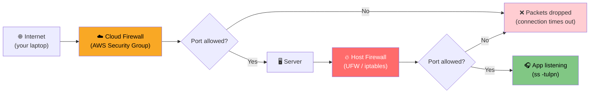
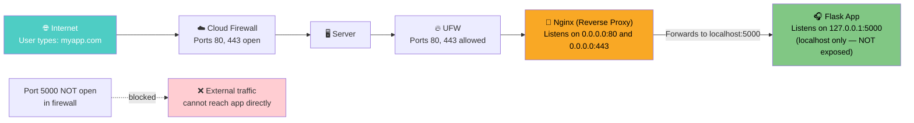
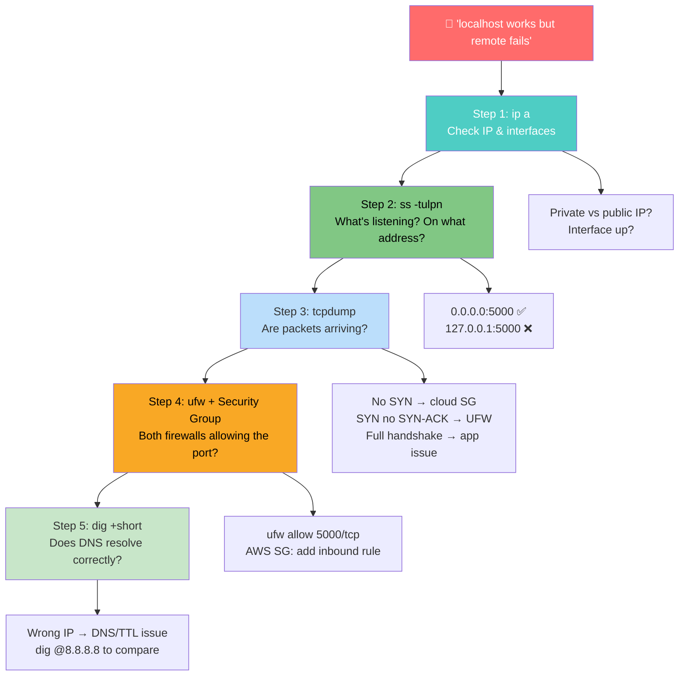

# 🔥 Firewalls & Production Architecture

> **Goal:** Understand the two firewall layers (cloud Security Groups + host UFW/iptables), how to open ports and check rules, the production architecture pattern (reverse proxy on 80/443 → app on localhost), and DNS/TTL considerations in production.

---

## 📍 The Two Firewall Layers

Cloud servers typically have **two** independent firewall layers. Both must allow your port for traffic to get through:



| Layer | Where it runs | What it controls | How to check |
|---|---|---|---|
| **Cloud Firewall** (AWS Security Group) | In front of the instance (cloud-level) | Which inbound/outbound traffic reaches the VM at all | AWS Console → Security Groups |
| **Host Firewall** (UFW / iptables) | Inside the OS | Which traffic the OS accepts, even after the cloud firewall lets it through | `sudo ufw status` or `sudo iptables -L` |

> 🧭 **Key insight:** Even if the cloud Security Group allows port 5000, the host firewall (UFW) can still block it. **Both** must allow the port.

---

## 1️⃣ Cloud Firewall — AWS Security Groups

**AWS Security Groups** (and equivalents on GCP/Azure) sit in front of your instance and filter traffic at the cloud level.

### 📋 How Security Groups Work

| Property | Behavior |
|---|---|
| **Default** | **Deny all inbound** (everything blocked unless explicitly allowed) |
| **Stateful** | If you allow inbound, the response is automatically allowed (no separate outbound rule needed) |
| **Rules** | Allow-list based (you add rules to permit traffic) |

### 📋 Example Inbound Rules

| Type | Protocol | Port | Source | Meaning |
|---|---|---|---|---|
| **SSH** | TCP | 22 | `178.191.162.12` | Only this specific IP can SSH in |
| **HTTP** | TCP | 80 | `0.0.0.0/0` | Anyone can access HTTP |
| **HTTPS** | TCP | 443 | `0.0.0.0/0` | Anyone can access HTTPS |
| **Custom** | TCP | 5000 | `0.0.0.0/0` | Anyone can access port 5000 |
| **Custom** | TCP | 5000 | `203.0.113.50/32` | Only your office IP can access port 5000 |

> 💡 **`0.0.0.0/0`** means "all IPv4 addresses" (anyone on the internet). **`203.0.113.50/32`** means only that specific IP.

### 📋 Security Group Best Practices

- **Restrict SSH (port 22)** to specific IPs (your office, your home) — never `0.0.0.0/0` in production
- **HTTP/HTTPS (80/443)** can be `0.0.0.0/0` (public web traffic)
- **App ports (5000, 8080, etc.)** — restrict to your IP during testing, or don't open at all in production (use a reverse proxy instead)
- **Principle of least access** — only open what you need

> 🧭 **DevOps tip:** During testing, restrict port 5000 to your own IP (`your.ip.add.ress/32`). This way only you can reach the app — not the entire internet. Once you move to production with a reverse proxy, close port 5000 entirely.

---

## 2️⃣ Host Firewall — UFW (Uncomplicated Firewall)

**UFW** is the default host firewall on Ubuntu/Debian. It's a frontend for `iptables` that makes rule management simpler.

### 📝 Checking UFW Status

```bash
$ sudo ufw status verbose
Status: active
Default: deny (incoming), allow (outgoing)
                          ↑
                default deny incoming = unapproved ports silently dropped
```

### 📝 Allowing Ports

```bash
# Allow TCP port 5000
$ sudo ufw allow 5000/tcp
Rule added
Rule added (v6)

# Allow a specific port from a specific IP only
$ sudo ufw allow from 203.0.113.50 to any port 5000

# Allow HTTP (port 80)
$ sudo ufw allow 80/tcp

# Allow HTTPS (port 443)
$ sudo ufw allow 443/tcp

# Allow SSH (port 22) — important if enabling UFW for the first time!
$ sudo ufw allow 22/tcp
```

> ⚠️ **NEVER enable UFW without first allowing SSH (port 22)!** If you enable UFW and port 22 isn't allowed, you'll be locked out of your server immediately. Always `sudo ufw allow 22/tcp` BEFORE `sudo ufw enable`.

### 📝 Enabling and Disabling UFW

```bash
# Enable UFW (starts enforcing rules)
$ sudo ufw enable

# Disable UFW (stops enforcing — all traffic allowed)
$ sudo ufw disable

# Reset UFW to default (removes all rules)
$ sudo ufw reset
```

### 📝 Deleting Rules

```bash
# Delete by rule syntax
$ sudo ufw delete allow 5000/tcp

# Or delete by numbered rule
$ sudo ufw status numbered
$ sudo ufw delete 3
```

### 📋 UFW Default Policies

```bash
# Default: deny all incoming, allow all outgoing
$ sudo ufw default deny incoming
$ sudo ufw default allow outgoing
```

With `default deny incoming`, any port without an explicit allow rule is **silently dropped** — causing connection timeouts.

> 🧭 **DevOps tip:** With `default deny incoming`, unapproved ports cause **timeouts** (not refusals). This is the "connection timed out" error from the debugging scenario.

---

## 3️⃣ `iptables` — The Kernel Firewall

**`iptables`** is the low-level Linux kernel packet filtering system. UFW is a frontend for it. You'll see `iptables` rules when Docker is installed (Docker manipulates iptables directly).

### 📝 Viewing iptables Rules

```bash
$ sudo iptables -L -n
Chain INPUT (policy ACCEPT)
target     prot opt source               destination

Chain FORWARD (policy DROP)
target     prot opt source               destination
DOCKER-USER  all  --  0.0.0.0/0            0.0.0.0/0
DOCKER     all  --  0.0.0.0/0            0.0.0.0/0

Chain OUTPUT (policy ACCEPT)
target     prot opt source               destination
```

### 📋 The Three Chains

| Chain | What it filters |
|---|---|
| **INPUT** | Packets coming TO the server |
| **FORWARD** | Packets being routed THROUGH the server (e.g., Docker containers) |
| **OUTPUT** | Packets going FROM the server |

### 📋 Common Flags

| Flag | What it does |
|---|---|
| **`-L`** | **L**ist rules |
| **`-n`** | **N**umeric (don't resolve IPs — faster) |
| **`-F`** | **F**lush all rules (clear them) |
| **`-A`** | **A**ppend a rule |
| **`-D`** | **D**elete a rule |

> 🧭 **Docker and iptables:** When Docker runs, it manipulates iptables directly to manage container networking. That's why you'll see `DOCKER` and `DOCKER-USER` chains in the FORWARD table. Don't manually edit iptables on a Docker host — let Docker manage it.

---

## 4️⃣ Production Architecture — Reverse Proxy Pattern

Typing `<public-ip>:5000` isn't ideal for real users. In production, you use a **reverse proxy** pattern:



### 📋 How It Works

1. **User types `myapp.com`** in their browser
2. **DNS resolves** `myapp.com` → your server's public IP
3. **Browser connects** to port 443 (HTTPS) or port 80 (HTTP)
4. **Nginx** (reverse proxy) receives the request on `0.0.0.0:443`
5. **Nginx forwards** the request to `127.0.0.1:5000` (your Flask app, on localhost)
6. **Flask processes** the request and sends the response back to Nginx
7. **Nginx sends** the response back to the user

### 🎯 Why This Pattern?

| Benefit | Why it matters |
|---|---|
| **App stays on localhost** | Flask binds to `127.0.0.1:5000` — not exposed to the internet. Port 5000 stays closed in firewalls. |
| **Standard ports** | Users type `myapp.com` (port 443) — no `:5000` in the URL |
| **SSL/TLS termination** | Nginx handles HTTPS certificates — the app doesn't need to |
| **Load balancing** | Nginx can forward to multiple app instances |
| **Static files** | Nginx can serve static files (images, CSS) directly without hitting the app |
| **Security** | Only ports 80 and 443 are open — port 5000 is closed to external traffic |

> 🧭 **DevOps best practice:** In production, apps should bind to `127.0.0.1` (localhost only). A reverse proxy (Nginx/Apache/HAProxy) listens on `0.0.0.0:80/443` and forwards to the app. This is more secure and more flexible than exposing the app port directly.

---

## 5️⃣ DNS & A Records in Production

In production, users don't type IP addresses — they type domain names.

### 📝 Setting Up DNS

1. **Register a domain** (e.g., `myapp.com`) through a registrar (GoDaddy, Namecheap, Route 53)
2. **Create an A record** pointing your domain to your server's public IP:
   ```
   myapp.com  →  A  →  203.0.113.25
   www.myapp.com  →  CNAME  →  myapp.com
   ```
3. **Wait for propagation** (TTL determines how long this takes)

### 📝 Verifying DNS

```bash
# Quick check
$ dig +short myapp.com
203.0.113.25

# Detailed check (includes TTL)
$ dig myapp.com
;; ANSWER SECTION:
myapp.com.    3600  IN  A   203.0.113.25
              ^^^^
              TTL = 3600 seconds (1 hour)

# Check from a specific DNS server
$ dig @8.8.8.8 myapp.com +short

# Check domain registration
$ whois myapp.com
```

### 🕐 TTL Considerations

| Scenario | Recommended TTL | Why |
|---|---|---|
| **Stable production** | 3600 (1 hour) | Balances caching efficiency with update speed |
| **Before a migration** | 300 (5 min) | Lower TTL so changes propagate fast. Set this 24h BEFORE the change. |
| **After migration (confirmed working)** | Raise back to 3600 | Reduce DNS query load |
| **Active failover system** | 60 (1 min) | Rapid DNS-based switching between servers |

> 🧭 **The TTL trap:** If you change your DNS A record but still see the old IP, it's because resolvers worldwide have the old record cached for TTL seconds. **Always lower the TTL before making DNS changes** if you need fast propagation.

---

## 6️⃣ The Complete Troubleshooting Checklist

Here's the full 5-step debug flow, bringing together everything from this note set:



### 📋 The Checklist

| Step | Command | What You're Checking | If It Fails |
|---|---|---|---|
| **1** | `ip a` | IP addresses, interfaces | Wrong IP, interface down |
| **2** | `sudo ss -tulpn` | What's listening, on what address | App bound to `127.0.0.1` — fix: `--host=0.0.0.0` |
| **3** | `sudo tcpdump -i ens5 port 5000` | Are packets arriving? | No SYN → cloud firewall; SYN but no SYN-ACK → host firewall |
| **4** | `sudo ufw status` + AWS Security Group | Both firewalls allowing port 5000? | `sudo ufw allow 5000/tcp` + add SG inbound rule |
| **5** | `dig +short yourdomain.com` | DNS resolving to correct IP? | Old cached IP — wait for TTL, or lower TTL first |

### 🎯 The Golden Rules

> **"Connection refused"** → Check `ss -tulpn` (nothing listening, or bound to localhost)
>
> **"Connection timed out"** → Check `tcpdump` + firewalls (packets being dropped silently)

---

## 7️⃣ Firewall Rule Examples

### 📋 Typical Production Firewall Configuration

```bash
# UFW setup for a production web server
$ sudo ufw default deny incoming       # block all incoming by default
$ sudo ufw default allow outgoing      # allow all outgoing

# Allow SSH (restricted to your IP for security)
$ sudo ufw allow from 203.0.113.50 to any port 22

# Allow HTTP and HTTPS (public)
$ sudo ufw allow 80/tcp
$ sudo ufw allow 443/tcp

# Do NOT allow port 5000 — the reverse proxy handles it internally

# Enable
$ sudo ufw enable
$ sudo ufw status verbose
```

### 📋 Development/Testing Firewall Configuration

```bash
# During testing — allow direct access to your app port
$ sudo ufw allow 5000/tcp              # anyone can access (fine for testing)

# Or restrict to your IP
$ sudo ufw allow from 203.0.113.50 to any port 5000
```

### 📋 AWS Security Group Configuration

| Type | Protocol | Port | Source | When |
|---|---|---|---|---|
| SSH | TCP | 22 | Your IP only | Always |
| HTTP | TCP | 80 | `0.0.0.0/0` | Production (with reverse proxy) |
| HTTPS | TCP | 443 | `0.0.0.0/0` | Production (with reverse proxy) |
| Custom | TCP | 5000 | Your IP only | Testing only — remove in production |

---

## 🧾 Summary

| Concept | One-line takeaway |
|---|---|
| **Two firewall layers** | Cloud Security Group (external) + Host UFW (internal). Both must allow the port. |
| **AWS Security Group** | Cloud-level firewall. Default: deny all inbound. Stateful. Allow-list based. |
| **Security Group default** | Deny all inbound — you must explicitly allow each port. |
| **`0.0.0.0/0`** | All IPv4 addresses (anyone on the internet). |
| **`203.0.113.50/32`** | Only that specific IP. |
| **UFW** | Uncomplicated Firewall — host firewall on Ubuntu/Debian. Frontend for iptables. |
| **`ufw status verbose`** | Check UFW state and rules. |
| **`ufw allow 5000/tcp`** | Allow TCP port 5000. |
| **`ufw allow from IP to any port N`** | Restrict a port to a specific IP. |
| **`ufw enable`** | Start enforcing rules. ⚠️ Always allow SSH first! |
| **`ufw default deny incoming`** | Block all incoming traffic unless explicitly allowed. |
| **UFW + SSH lockout** | NEVER enable UFW without first `ufw allow 22/tcp`. |
| **`iptables`** | Low-level kernel firewall. UFW is a frontend for it. Docker manipulates iptables directly. |
| **Three iptables chains** | INPUT (to server), FORWARD (through server, e.g., Docker), OUTPUT (from server). |
| **`iptables -L -n`** | List all rules, numeric IPs. |
| **Reverse proxy pattern** | Nginx on 0.0.0.0:80/443 → app on 127.0.0.1:5000. App not exposed directly. |
| **Why reverse proxy** | Standard ports (80/443), SSL termination, load balancing, static files, security. |
| **Production app binding** | App binds to `127.0.0.1` (localhost only). Nginx handles external traffic. |
| **A record** | Maps domain → IPv4 address. `myapp.com → 203.0.113.25`. |
| **TTL in production** | Stable: 3600. Before migration: 300 (lower 24h before). After: raise back. |
| **TTL trap** | Changed DNS but see old IP? Resolvers cached it. Wait for TTL or lower it first. |
| **`dig +short domain`** | Quick DNS resolution check. |
| **`dig @8.8.8.8 domain`** | Check from Google's DNS (compare with local resolver). |
| **5-step debug** | `ip a` → `ss -tulpn` → `tcpdump` → `ufw`/SG → `dig`. |
| **Refused → check** | `ss -tulpn` (nothing listening or wrong bind). |
| **Timed out → check** | `tcpdump` + firewalls (packets dropped). |
| **Production firewall** | Allow 22 (your IP), 80, 443 (public). Do NOT allow app ports — reverse proxy handles them. |
| **DevOps relevance** | Firewalls + reverse proxy + DNS = the production network architecture. Master this to deploy apps safely. |

---

← Back to [Linux Networking](./README.md) | Previous: [TCP & Packet Analysis](./5-tcp-packet-analysis.md) |
