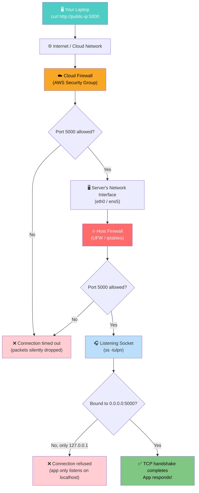
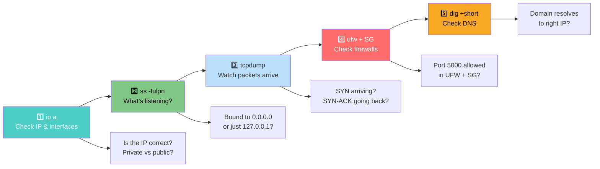

# 🐧 Linux Learning Journey: Linux Networking — From Interfaces to Firewalls

> **Goal:** Master Linux networking from the ground up — IP addresses and interfaces, the `ip` command, diagnostic tools (`ping`/`traceroute`/`mtr`), DNS lookup, the `ss` socket command, TCP handshake & packet analysis with `tcpdump`, and firewalls (UFW + cloud security groups) — all tied together by the real-world troubleshooting scenario every DevOps engineer faces.

---

## 📍 The Scenario That Ties It All Together

Every DevOps engineer eventually hits this exact problem:

```
   You deploy a web app on a Linux server (e.g., Flask on port 5000).

   On the server itself:
   $ curl localhost:5000
   Hello from Flask!           ← ✅ Works!

   From your laptop:
   $ curl http://<server-public-ip>:5000
   curl: (28) Connection timed out   ← ❌ Fails!
```

Why does it work locally but fail remotely? The answer requires understanding **every layer** of Linux networking — and that's what this note set covers.



Every box in that diagram is a concept covered in one of the sub-notes. The troubleshooting flow goes: **interfaces → listeners → packet capture → firewalls → DNS**.

---

## 🧩 The Six Pieces

### 🌐 Piece 1: Fundamentals & The `ip` Command

IP addresses, network interfaces (`lo`/`eth0`/`ens5`/`docker0`), MAC addresses, subnets (subnet masks, `255`/`0` octets), private vs public IPs, ports (0-65535), the critical difference between binding to `0.0.0.0` vs `127.0.0.1`, and the `ip` command suite (`ip addr`/`ip link`/`ip route`).

→ **Full note:** [`1-fundamentals-ip-command.md`](./1-fundamentals-ip-command.md)

### 🔧 Piece 2: Diagnostic Tools

`ping` (ICMP reachability + latency), `traceroute`/`tracepath`/`mtr` (hop-by-hop path tracing), `ifconfig`/`arp`/`ifplugstatus` (legacy interface tools), `hostname`/`/etc/hosts`, `curl` (HTTP requests), `wget` (downloads), `jq` (JSON processing), `watch` (live monitoring).

→ **Full note:** [`2-diagnostic-tools.md`](./2-diagnostic-tools.md)

### 🌍 Piece 3: DNS Tools

DNS concepts (domain → IP mapping), A/AAAA records, TTL (Time To Live), `nslookup`, `dig`, `whois`. Essential for verifying domain resolution and debugging "why does my domain point to the wrong IP?"

→ **Full note:** [`3-dns-tools.md`](./3-dns-tools.md)

### 📊 Piece 4: The `ss` Command — Socket Statistics

The modern replacement for `netstat`. Shows every socket on the system — TCP, UDP, Unix domain sockets. The `ss -tulpn` command is the #1 tool for answering "what's listening, and on what address?" Deep dive into socket families, states (LISTEN/ESTAB/TIME-WAIT/etc.), and all the flags.

→ **Full note:** [`4-ss-sockets.md`](./4-ss-sockets.md)

### 🔍 Piece 5: TCP & Packet Analysis

The TCP three-way handshake (SYN → SYN-ACK → ACK), the full TCP connection state diagram (LISTEN → SYN_SENT → ESTABLISHED → FIN_WAIT → TIME_WAIT), packet sniffing with `tcpdump`, and port testing with `telnet`/`nc`/`nmap`. This is where you find out *where* packets stop.

→ **Full note:** [`5-tcp-packet-analysis.md`](./5-tcp-packet-analysis.md)

### 🔥 Piece 6: Firewalls & Production Architecture

Two firewall layers: cloud (AWS Security Groups) + host (UFW/iptables). How to open ports, check rules, and the production architecture pattern (reverse proxy on 80/443 → app on localhost:5000). DNS & A records, TTL considerations.

→ **Full note:** [`6-firewalls-production.md`](./6-firewalls-production.md)

---

## 🔗 Where They All Meet — The 5-Step Debug Checklist

Here's the troubleshooting flow that ties every piece together — the exact order to debug when "localhost works but remote doesn't":



| Step | Command | What You're Checking | If It Fails |
|---|---|---|---|
| **1** | `ip a` | IP addresses, interfaces (lo/eth0/ens5) | Wrong IP, interface down |
| **2** | `sudo ss -tulpn` | What's listening and on what address | App bound to `127.0.0.1` instead of `0.0.0.0` |
| **3** | `sudo tcpdump -i ens5 port 5000` | Are packets arriving? Is the handshake completing? | No SYN = cloud firewall blocking; SYN but no SYN-ACK = host firewall |
| **4** | `sudo ufw status` + AWS Security Group | Are both firewalls allowing port 5000? | Port not allowed → timeout |
| **5** | `dig +short yourdomain.com` | Does DNS resolve to the right IP? | Old cached IP (TTL issue) |

> 🧭 **The golden debugging rule:** "Connection refused" → check `ss -tulpn` (nothing listening, or bound to localhost). "Connection timed out" → check `tcpdump` + firewalls (packets being dropped).

---

## 📚 Reading Order

| # | Note | What it covers |
|---|---|---|
| 1 | [`1-fundamentals-ip-command.md`](./1-fundamentals-ip-command.md) | IPs, interfaces, MAC, subnets, ports, `0.0.0.0` vs `127.0.0.1`, the `ip` command |
| 2 | [`2-diagnostic-tools.md`](./2-diagnostic-tools.md) | `ping`, `traceroute`/`mtr`, `ifconfig`/`arp`, `curl`/`wget`/`jq`/`watch` |
| 3 | [`3-dns-tools.md`](./3-dns-tools.md) | DNS concepts, A/AAAA records, TTL, `nslookup`/`dig`/`whois` |
| 4 | [`4-ss-sockets.md`](./4-ss-sockets.md) | Socket statistics, `ss -tulpn`, socket families/states, all flags |
| 5 | [`5-tcp-packet-analysis.md`](./5-tcp-packet-analysis.md) | TCP handshake, connection states, `tcpdump`, `telnet`/`nc`/`nmap` |
| 6 | [`6-firewalls-production.md`](./6-firewalls-production.md) | UFW, cloud security groups, `iptables`, reverse proxy, DNS/TTL in production |

Read in order — each builds on the previous. Together they form a complete Linux networking toolkit for DevOps.

---

## 🧾 Summary

| Concept | One-line takeaway |
|---|---|
| **IP address** | Logical network address identifying a host (IPv4/IPv6). |
| **Network interface** | NIC — `lo` (loopback), `eth0`/`ens5` (primary), `docker0` (Docker bridge). |
| **`ip a`** | Show all interfaces and IP addresses. |
| **Private vs public IP** | Private (e.g., `172.31.x.x`) = internal only. Public = internet-reachable. Cloud servers have both. |
| **Subnet mask** | Defines network boundaries. `255.255.255.0` = 24 bits fixed, last octet free (0-255). |
| **Ports** | 0-65535. Common: 22 (SSH), 80 (HTTP), 443 (HTTPS), 5000 (Flask). |
| **`0.0.0.0` vs `127.0.0.1`** | `0.0.0.0` = listen on ALL interfaces. `127.0.0.1` = listen on localhost only (blocks external). |
| **Device communication** | Needs 3 things: IP address + subnet + gateway. |
| **`ip addr`/`ip link`/`ip route`** | View/configure addresses, interface up/down, routing table. Replaces `ifconfig`/`route`. |
| **`ping`** | ICMP echo — checks reachability, latency, packet loss. |
| **`traceroute`/`mtr`** | Trace hop-by-hop path to a destination. `mtr` = continuous ping + traceroute combined. |
| **DNS** | Domain Name System — maps domain names to IP addresses. |
| **A record** | Maps a domain to an IPv4 address. AAAA = IPv6. |
| **TTL** | Time To Live — seconds a DNS record can be cached before re-querying. |
| **`dig +short domain`** | Quick DNS resolution check. |
| **`ss`** | Modern replacement for `netstat`. Socket statistics from the kernel. |
| **`ss -tulpn`** | The sysadmin one-liner: TCP+UDP, listening, process, numeric ports. |
| **Socket states** | LISTEN, ESTAB, TIME-WAIT, CLOSE-WAIT, FIN-WAIT, SYN-SENT. |
| **TCP handshake** | SYN → SYN-ACK → ACK. Three packets to establish a connection. |
| **`tcpdump`** | Packet sniffer. `sudo tcpdump -i ens5 port 5000` watches traffic on a port. |
| **`[S]`/`[S.]`/`[.]`** | tcpdump notation: SYN / SYN-ACK / ACK. |
| **Connection refused** | Packet reached server but OS rejected it. Usually nothing listening or bound to localhost. |
| **Connection timed out** | No response. Usually firewall dropping packets silently. |
| **UFW** | Uncomplicated Firewall — host firewall. `sudo ufw allow 5000/tcp`. |
| **Cloud Security Group** | Cloud-level firewall (AWS). Sits in front of the instance. |
| **Two firewall layers** | Cloud SG (external) + UFW (host). Both must allow the port. |
| **Reverse proxy** | Nginx on 80/443 forwards to app on localhost:5000. Production pattern. |
| **Debug order** | `ip a` → `ss -tulpn` → `tcpdump` → `ufw`/SG → `dig`. |
| **DevOps relevance** | Networking = the #1 debugging skill for cloud infrastructure. Every deployment issue is a networking issue until proven otherwise. |
