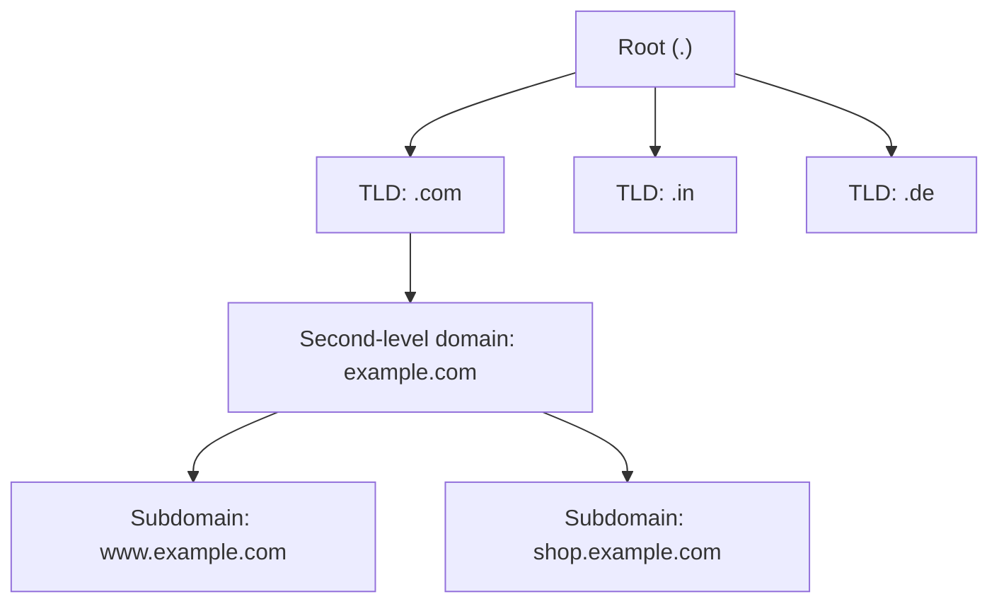

# 1. DNS Basics

## What DNS is

**DNS (Domain Name System)** is the naming system of the internet. It translates human-readable domain names such as `google.com` into the IP addresses that computers actually use, and it can also translate in the other direction, from an IP address back to a name. It is often described as the phonebook of the internet: a name is looked up and a number comes back.

DNS was created by the computer scientist Paul Mockapetris. In the networking model it works at the **Application Layer (Layer 7)**.

---

## Why DNS exists

There are two core reasons.

1. **Human usability.** People remember names and words easily, while computers communicate with numeric addresses (IPv4 or IPv6).
2. **IP addresses change.** An application can move from one cloud or hosting provider to another, or be scaled out behind several servers, and its IP address changes. The domain name stays the same for users, and only the DNS record behind it is updated.

---

## Before DNS: the `hosts` file

Before DNS existed, every computer kept a local file that mapped names to IP addresses. That file is still used locally today.

| System | Location |
|---|---|
| Windows | `C:\Windows\System32\drivers\etc\hosts` |
| Linux / Unix | `/etc/hosts` |

Maintaining such a file by hand cannot scale to billions of internet hosts. That limit is what led to a distributed system, DNS.

---

## Transport protocol and port

| Situation | Protocol and port |
|---|---|
| Normal queries and replies | **UDP port 53**. UDP is fast and skips the three-way handshake that TCP needs. |
| Reply too large for one UDP packet | **TCP port 53**. The answer is cut short (truncated) and the lookup is repeated over TCP. |
| Zone transfers (large data) | TCP port 53 |
| DNSSEC (security-related exchanges) | TCP port 53 is used here as well, because these answers can be large |

The number **17** sometimes appears next to DNS. It is the IP protocol number of **UDP**, the protocol DNS normally rides on. DNS has no IP protocol number of its own.

### The three kinds of DNS messages

1. **Query message**: sent by a client or resolver to ask for information, such as the IP address for a domain name.
2. **Reply message**: sent back by a server with the answer (an IP address) or with a referral to another server.
3. **Update message**: used to add, change or delete DNS records dynamically.

---

## Structure of a domain name

A domain name is organised as a hierarchy and is resolved from **right to left**.

For `www.example.com` the parts are:

| Part | In the example | Meaning |
|---|---|---|
| Root | the hidden dot after `com` | The top of the hierarchy. It is normally invisible, but a full name really ends with a dot. |
| Top-level domain (TLD) | `com` | The extension at the end of the name |
| Second-level domain | `example` | The registered name |
| Subdomain | `www` | Any extra label to the left of the second-level domain. `www` is the most common one. |

### Common top-level domains

**Generic TLDs**

| TLDs | Typical purpose |
|---|---|
| `.com` | Commercial |
| `.org` | Non-profit organisations |
| `.info` | Informational |
| `.net` | Network |
| `.biz` | Business |
| `.edu` | Education |
| `.mil` | Military |
| `.gov` | Government |
| `.int` | International organisations |

**Country-code TLDs (ccTLDs)** are specific to a country or region.

| TLD | Country |
|---|---|
| `.in` | India |
| `.us` | United States |
| `.uk` | United Kingdom |
| `.au` | Australia |
| `.ch` | Switzerland |
| `.jp` | Japan |
| `.de` | Germany |
| `.fr` | France |

---

## Zones and lookup directions

- **DNS zone**: a portion of the DNS namespace that is administered as one unit. It holds the records of a domain and is served by authoritative DNS servers. Zones are covered in detail in [3-dns-records-and-zones.md](3-dns-records-and-zones.md).
- **Forward lookup** (forward lookup zone): translates a **domain name into an IP address**, for example finding the IP of `example.com`.
- **Reverse lookup** (reverse lookup zone, also called backward lookup): translates an **IP address into a domain or host name**. It uses `PTR` records.

The lab in this chapter builds a **forward** zone only.
