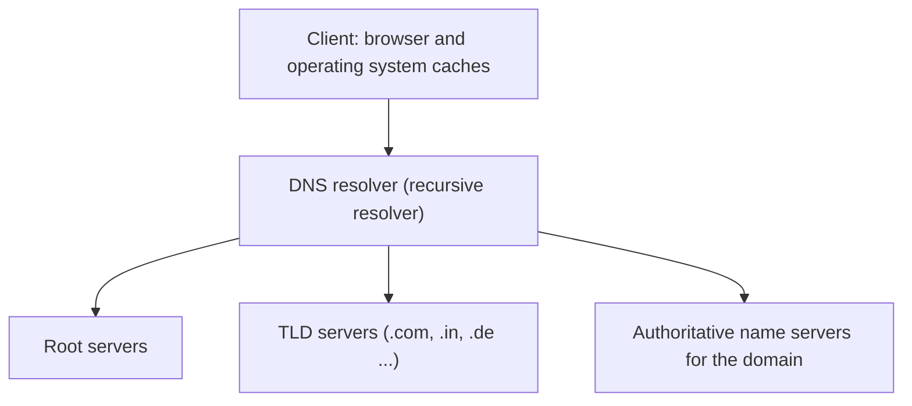
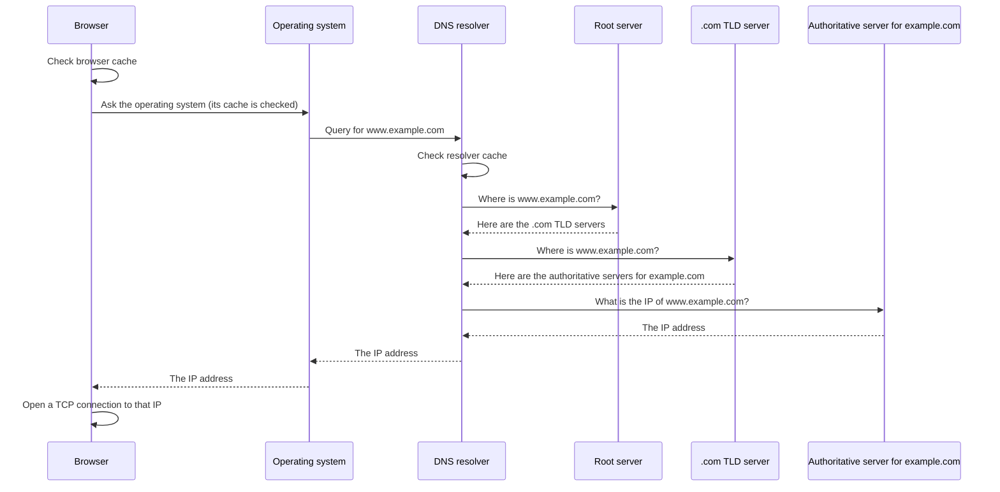

# 2. How a DNS Lookup Is Resolved

## The problem DNS has to solve

To open a site, a browser needs the IP address of the machine to connect to, because the connection (TCP) is made to an address, not to a name. Somewhere a mapping such as "`www.example.com` means this IP" has to be stored and served.

A single giant database holding every domain would not work. It would hold billions of entries, take an enormous number of reads and writes, be impossible to manage, and be a single point of failure: if it went down, the whole internet would go down. DNS therefore uses a **decentralised, hierarchical** design in which no single machine knows everything.

---

## The roles in the hierarchy

| Role | What it does | What it does not do |
|---|---|---|
| **Client** (browser, operating system) | Checks its own cache first, then asks a resolver | |
| **DNS resolver** (also called recursive resolver) | Receives the question, checks its cache, and on a miss walks the hierarchy to find the answer | |
| **Root servers** | Know where the TLD servers are | Do not know the IP address of any individual website |
| **TLD servers** | Manage one extension each (`.com`, `.in`, `.edu`, `.de`, ...) and know the authoritative servers for every domain under it | Do not hold the final IP address of a site |
| **Authoritative name servers** | Hold the real records for a domain, including its IP addresses. They are the source of truth. | |

### Where the resolver lives

A resolver can run in several places:

- **At the ISP**: the ISP resolves names for its customers.
- **On the home router**: on a Wi-Fi network the router itself can do the resolution and cache the results.
- **A public resolver**: for example Google's `8.8.8.8` or Cloudflare's `1.1.1.1`. A device can be set to use one of these instead of the default.

On Windows, the command `ipconfig /all` shows a "DNS Servers" entry. That address is the resolver in use. On a home network it is often the router's own address.

### Root servers and anycast

- There are **13 logical root servers**, named `A` through `M` (`a.root-servers.net` up to `m.root-servers.net`). Each one has a fixed IP address, and these 13 addresses are hard-coded into resolvers.
- 13 does **not** mean 13 physical machines. Behind each address there are many physical servers spread around the world, and every one of them advertises the same IP address. This technique is called **anycast**. A request sent to that address reaches the **nearest** server advertising it.
- Each root server identity is run by a different organisation.

### Authoritative servers and registrars

- Authoritative servers hold the zone for a domain and answer for it. Their names look like `ns1.something.com`.
- When a domain is registered, the registrar's own name servers are the default authoritative servers. They can be changed. A domain can be bought at one provider and managed on another provider's name servers, for example a cloud provider's DNS service where the zone is called a **hosted zone**.
- Updating the DNS records of a domain means updating its authoritative name server.

---

## The life of one lookup

This is the full path when nothing is cached anywhere.

Step by step:

1. The browser checks its own cache.
2. If nothing is found, it makes an operating system call. The operating system has a cache too.
3. If that fails as well, the question goes to the DNS resolver.
4. The resolver checks its cache. On a miss, or if the cached answer has expired, it asks a **root server**.
5. The root server replies with the list of `.com` TLD servers.
6. The resolver asks a **TLD server**, which replies with the authoritative servers for the domain.
7. The resolver asks the **authoritative server**, which replies with the IP address.
8. The resolver passes the IP address back to the operating system, which passes it to the browser.
9. The browser connects to that IP and sends the HTTP request.

Every step narrows the question: the root points to the TLD, the TLD points to the domain's servers, and those servers know the final answer.

---

## Caching and TTL

Asking the root and TLD servers for every single lookup would add latency and load. So answers are cached at several levels: the browser, the operating system, and the resolver (ISP or router). Since the addresses of TLD servers such as the `.com` ones rarely change, a resolver usually already has them cached and does not need to contact the root again.

**TTL (Time To Live)** is set on each record by the authoritative server. It tells a resolver or cache how long it may keep the answer before throwing it away and asking again. Browsers and operating systems also keep entries for a limited time.

---

## Recursive vs iterative resolution

| Mode | Meaning |
|---|---|
| **Recursive** | The client asks a recursive resolver, and that resolver takes responsibility for getting the final answer and handing it back. |
| **Iterative** | Each server that is asked answers with either the data or a **referral** (the address of the next server to ask). The asker follows the referrals step by step. |

In practice the two work together. A client asks a **recursive resolver** for the final answer. The resolver then queries the root, TLD and authoritative servers **iteratively**, and each of them returns a referral to the next server until the authoritative server returns the IP address.

---

## Changing a record on a live system

DNS changes do not take effect instantly, because every cached copy lives until its TTL runs out, and some defaults are long. On top of that, not every resolver respects the TTL. Two practical steps reduce the risk when an IP address has to change on a busy production system:

1. **Shorten the TTL well in advance**, for example to about 60 seconds, so that all resolvers pick up the short TTL before the real change is made. The actual update then spreads quickly.
2. **Keep the old server running for a while** after the switch. Decommission it only when traffic to it has died down, because resolvers that ignore the TTL will keep sending visitors there.

---

## Basic troubleshooting when a site does not load by name

1. **Flush the local DNS cache** to remove stale entries (on Windows: `ipconfig /flushdns`) and retry.
2. **Try the IP directly.** Look up the IP with `nslookup <domain>` and open that IP in the browser. If the IP works and the name does not, the problem is in DNS or the resolver.
3. **Bypass the default resolver.** Test with a public resolver such as `8.8.8.8`. If it resolves there but not through the default resolver, the fault lies with the default (ISP or router) resolver and not with the website itself.

The same idea, testing the DNS server directly and then the web server directly, is what the lab in the next files uses.
