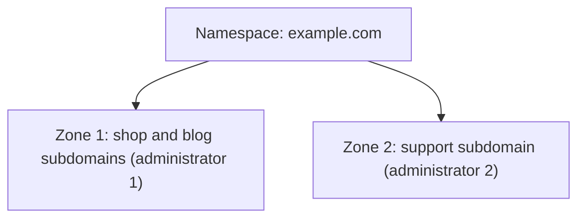
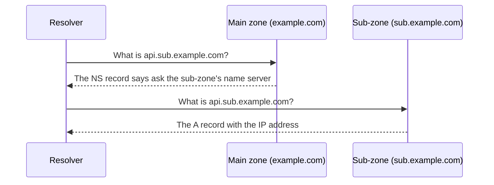

# 3. DNS Zones and Record Types

## What a zone is

A **DNS zone** is an area of administrative control over a portion of the DNS namespace. It is a logical grouping of a domain, its subdomains and all the DNS records that belong to them. The records are stored in a **zone file** (a cloud DNS service shows the same thing as a **hosted zone**).

An authoritative name server **hosts** zones. When a request arrives for a name inside a zone it owns, it reads the matching record and sends back the value. One person or company can own many zones, one per domain.

### Why zones are split

A domain such as `example.com` can be divided into sections so that different administrators manage different parts. Zones exist for manageability.

If `shop` and `blog` have only a few machines each, one zone can cover both. If `support` has many machines, it can get its own zone with its own administrator. Every zone has its own zone file, and every zone file contains an **SOA record**.

### Delegating a zone with an NS record

A special record type, the **NS (name server) record**, can hand a part of a domain over to another group. The main zone holds an NS record that points to the name server of the sub-zone. A lookup for a name inside the sub-zone first reaches the main zone, gets redirected through the NS record, and finds the answer in the sub-zone.

---

## Anatomy of a record

Every record is one row in the zone database and has these fields:

| Field | Meaning | Example |
|---|---|---|
| **Owner (name)** | The name the record is for | `www` |
| **TTL** | How long the record may be cached | `86400` (seconds) |
| **Class** | Almost always `IN` (Internet). Other classes exist but are experimental and practically never seen. | `IN` |
| **Type** | What kind of record it is | `A` |
| **Value** | The data | an IP address |

### Resource record set (RRset)

When several records share the **same name and the same type** but have **different values**, they form a resource record set. For example, two `A` records for `www` with two different IP addresses. The name then has more than one valid answer.

---

## Record types

### A (Address)

Maps a domain name to an **IPv4** address (a 32-bit numeric address). It is the most common record and the one used to resolve a name to an IP.

### AAAA ("quad A")

Works like the A record but maps a name to an **IPv6** address (a 128-bit address in hexadecimal, replacing the older IPv4 format).

### CNAME (Canonical Name)

Makes one name an **alias** of another name. It resolves a name to another **name**, whereas an A record resolves a name to an **IP address**. The lookup simply continues with the target name, a straight replacement.

- A common use is pointing `www.example.com` to `example.com`, so both lead to the same site.
- It is also used when a site is deployed behind a content delivery network, which provides the name to alias to.

### MX (Mail Exchanger)

Says which mail server receives email for a domain. When mail is sent to `tom@example.com`, the sending mail server looks up the MX records of `example.com` and gets back the mail server's name, for example `mail1.example.com`.

An MX record has two parts: a **priority number** and a server name. A domain usually has a primary and a secondary entry. The **lower the number, the higher the preference**. The sender tries priority 1 first, and if that server is down or overloaded, it falls back to priority 2. This gives built-in redundancy.

### NS (Name Server)

Names the authoritative name server of a domain. It is the final authority in the hierarchy. A domain normally lists two, a primary and a secondary. NS records are also what delegates a zone to another group (see above).

### SOA (Start of Authority)

Stores administrative information about a zone. Every zone file has one. Its fields:

| Field | Meaning |
|---|---|
| **MNAME** | The primary name server of the zone |
| **RNAME** | The administrator's email address. The first dot stands for the `@` sign, so `admin.example.com.` means `admin@example.com`. |
| **Serial** | A version number of the zone. It is increased whenever the zone is edited. A changed serial tells secondary servers that they must update their copy. |
| **Refresh, Retry, Expire, Minimum TTL** | The timing values that follow the serial in the record |

### PTR (Pointer)

The reverse of an A or AAAA record. It maps an **IP address to a domain name** and is what a **reverse DNS lookup** uses. Mail servers use it as one check against spam: the name in an incoming email is compared with the name that the sender's IP address resolves back to. If they do not match, the mail can be flagged.

### TXT (Text)

Holds free-form text about a domain: general or contact information, domain verification, and security policies. Mail systems also use TXT records to confirm that incoming email comes from a trusted, authorised source.

### SRV (Service)

Where the records above point to a server or an IP address, an SRV record points to a **server and a specific service on it by including a port number**. An application that needs to find a service on a domain, such as voice over IP, instant messaging or a printer, looks for the matching SRV record and is sent to the right server and port.

### CAA (Certification Authority Authorization)

States which Certificate Authorities are allowed to issue SSL/TLS certificates for the domain.

---

## Summary table

| Record | Purpose |
|---|---|
| `A` | Name to IPv4 address |
| `AAAA` | Name to IPv6 address |
| `CNAME` | Name to another name (alias) |
| `MX` | Mail server for the domain, with priority |
| `NS` | Authoritative name server for the domain, also used for delegation |
| `SOA` | Administrative data for the zone, including the serial |
| `PTR` | IP address to name (reverse lookup) |
| `TXT` | Text data for verification and policies |
| `SRV` | Server and port for a specific service |
| `CAA` | Which Certificate Authorities may issue certificates |

The lab in [5-bind-dns-server.md](5-bind-dns-server.md) uses three of these: `SOA`, `NS` and `A`.
