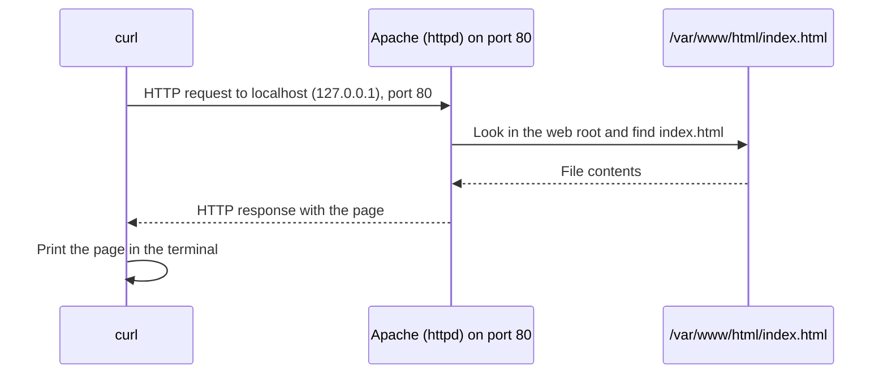

# 4. Apache Web Server on Fedora

The web server has to be running before the DNS part makes sense, because DNS only points a name at a machine. Something on that machine must answer on port 80.

---

## Packages: `dnf`, `rpm` and the name `httpd`

- Modern Fedora uses **`dnf`** (not `yum`) to install and manage software.
- On Fedora and Red Hat systems the Apache HTTP Server package is called **`httpd`**.

Two ways to check whether it is installed:

```bash
rpm -q httpd                      # asks the RPM database; prints the exact version, or says it is not installed
dnf list --installed httpd        # asks dnf the same question
```

A version looks like `httpd-2.4.71-1.fc45.x86_64`.

Installing it, if it is missing:

```bash
sudo dnf install -y httpd
```

---

## Managing the service with `systemctl`

| Command | Effect |
|---|---|
| `systemctl status httpd` | Shows whether Apache is `active (running)`, `inactive (dead)` or `failed`, the latest log lines, and whether it is `enabled` or `disabled` at boot |
| `sudo systemctl start httpd` | Starts the service right now |
| `sudo systemctl stop httpd` | Stops it |
| `sudo systemctl enable httpd` | Starts it automatically at every boot |
| `sudo systemctl disable httpd` | Stops it from starting at boot |
| `sudo systemctl enable --now httpd` | Enables it and starts it immediately, in one command |
| `systemctl is-active httpd` | Prints just `active` or `inactive`, handy for a quick check |

At the start of the lab, `status` showed `httpd` as installed but `disabled` and `inactive (dead)`.

### Reading a healthy status output

After a successful start the output showed these points:

- `Loaded: ... enabled` means it will start at boot.
- `Active: active (running)` means it is running now.
- `Main PID` and the list of `httpd` processes under `CGroup` are the Apache worker processes.
- The log said the server was listening on port 80.
- A line starting with `AH00558` said Apache could not reliably determine the server's fully qualified domain name. This is only a **warning** and does not stop Apache. It can be silenced by adding `ServerName localhost` to `/etc/httpd/conf/httpd.conf`, or to a small file inside `/etc/httpd/conf.d/`.

---

## Problem: "Address already in use" on port 80

The first attempt to start Apache failed. The log contained:

```text
(98)Address already in use: AH00072: make_sock: could not bind to address 0.0.0.0:80
```

**Why it happens.** HTTP uses **port 80** by default, and only **one program can listen on a given IP address and port at a time**. Something else was already holding port 80.

### Finding the culprit

```bash
sudo ss -tulpn 'sport = :80'
```

`ss` lists network sockets. The flags mean TCP (`t`), UDP (`u`), listening (`l`), show the process (`p`) and numeric addresses (`n`). The filter `'sport = :80'` limits the output to sockets on port 80.

The output showed **nginx** listening on `0.0.0.0:80` (IPv4) and `[::]:80` (IPv6), with many nginx worker processes. A shorter form that gives the same information is `sudo ss -tulpn | grep :80`.

If `ss` is unavailable, `sudo fuser -v 80/tcp` can show the process.

### Freeing the port

```bash
sudo systemctl stop nginx          # releases port 80 right now
sudo systemctl start httpd         # Apache can now bind to it
```

> **Risky command: `sudo systemctl disable nginx`**
> This changes what starts at boot and can break anything else that depends on nginx.
> **Safer alternative:** only `stop` nginx for the duration of the lab, and start it again afterwards with `sudo systemctl start nginx`. If nginx was disabled, `sudo systemctl enable --now nginx` brings it back. Only one web server should be configured to listen on port 80 at a time.

If a container or a local development server holds the port instead, stop it or change its port mapping.

---

## Important paths and why they live there

These follow the Filesystem Hierarchy Standard used on Fedora and Red Hat systems.

### `/etc/httpd/conf/httpd.conf`: main configuration file

- `/etc` holds system-wide configuration files for installed programs, kept in one place so that backups and updates are simpler.
- `/httpd/conf` groups Apache's configuration files together. Extra snippets often sit nearby in `/etc/httpd/conf.d/`.
- `httpd.conf` is the main control file. Apache reads from it which port to listen on, where the website files live, and how requests are handled.

### `/var/www/html/index.html`: the default web page

- `/var` holds **variable** data that changes while the system runs, such as logs, caches and website content, kept apart from the static system files.
- `/var/www/html` is Apache's default **DocumentRoot**, the folder from which public web files are served.
- `index.html` is the file Apache serves automatically when a directory URL such as `http://localhost/` is requested. Creating this file gives Apache a page of its own to show instead of a placeholder or a directory listing.

For plain static HTML, restarting `httpd` after editing a file in `/var/www/html` is not strictly required.

---

## Creating the web page

A one-line page:

```bash
echo "<h1>Hello from Fedora</h1>" | sudo tee /var/www/html/index.html
```

`tee` writes whatever it receives into the file, and running it under `sudo` gives it permission to write into `/var/www/html`.

For a longer page, the same idea works with a here-document:

```bash
sudo tee /var/www/html/index.html > /dev/null <<'EOF'
<!DOCTYPE html>
<html lang="en">
<head><meta charset="UTF-8"><title>DevOps Learning Lab</title></head>
<body><h1>Custom DNS and Apache Server Lab</h1></body>
</html>
EOF
```

`> /dev/null` hides the copy of the text that `tee` would otherwise print on the screen. The quotes around `'EOF'` stop the shell from changing anything inside the block. In this lab the page was a longer single-file HTML page with its styling written inside the same file.

Check what Apache will serve:

```bash
cat /var/www/html/index.html
```

---

## How `curl http://localhost` works



1. **Request sent.** `curl http://localhost` makes an HTTP request to the machine itself (`localhost`, `127.0.0.1`) on port 80.
2. **Request received.** Apache, listening on port 80, picks it up.
3. **File looked up.** Apache checks its web root, `/var/www/html`, and finds `index.html`.
4. **Response returned.** Apache sends the file's contents back over HTTP and `curl` prints them.

---

## Finding the server's IP address

Other devices cannot use `localhost`, so the machine's LAN address is needed. Either `ifconfig` or `ip a` shows it. Output from this lab, simplified:

| Interface | Address | Meaning |
|---|---|---|
| `lo` | `127.0.0.1` | Loopback. Works only from inside the same computer (`localhost`). |
| `wlo1` | `192.168.110.86` | The Wi-Fi interface. This is the machine's address on the local network, and the address used as the server IP in this lab. |
| `docker0`, `br-...` | `172.17.0.1`, `172.18.0.1` | Virtual bridges created by Docker for containers. Not the server IP. |

The address `192.168.110.86` is handed out by the router, so it can change on another network or after reconnecting. The lab files stay on disk, but any file that contains the IP (the BIND configuration and the zone file) would then need updating.

### Opening the page in a browser

`http://192.168.110.86` and `http://192.168.110.86:80` are the same address, because port 80 is the default for `http://`. Chrome shows a "Not secure" mark because plain HTTP is not encrypted, which is normal for a local lab.

---

## Opening port 80 in the firewall (`firewalld`)

Fedora's firewall blocks incoming connections from other devices on the network by default. Ports can be pictured as numbered doors on the machine: Apache sits behind door 80, and the firewall keeps it locked from the outside.

```bash
sudo firewall-cmd --add-service=http --permanent   # allow HTTP (TCP port 80); --permanent keeps the rule after a reboot
sudo firewall-cmd --reload                         # apply the saved rule now
sudo firewall-cmd --list-services                  # confirm that http is listed
```

The list after the change was `dhcpv6-client http samba-client ssh`.

**When it is needed:**

- **Needed** if another device, such as a phone or another laptop on the same Wi-Fi, has to open the page.
- **Not needed** if everything is tested on the same machine. Traffic from the machine to itself (`127.0.0.1`, or its own `192.168.110.86`) is not blocked.

**Why it matters.** On a real Wi-Fi network (not an isolated virtual machine), an open port 80 exposes the web server to everyone on that network. The rule should be removed when the lab ends:

```bash
sudo firewall-cmd --remove-service=http --permanent
sudo firewall-cmd --reload
```

With the rule in place and Apache running, a phone on the same Wi-Fi could load `http://192.168.110.86` directly over the local network, without going out to the internet.
