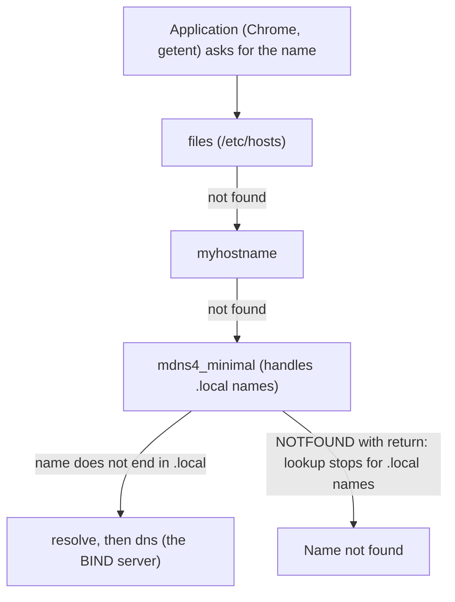
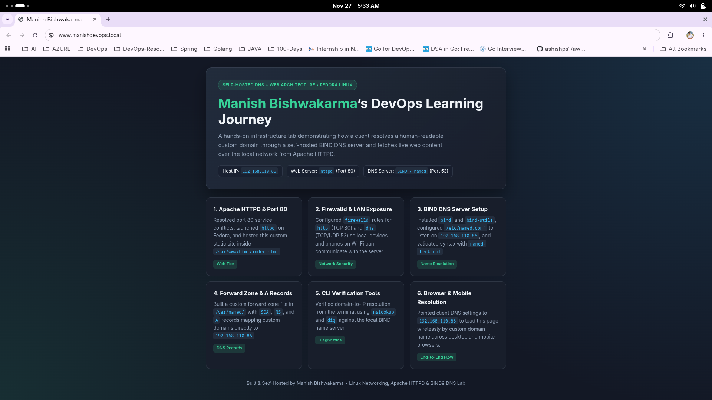
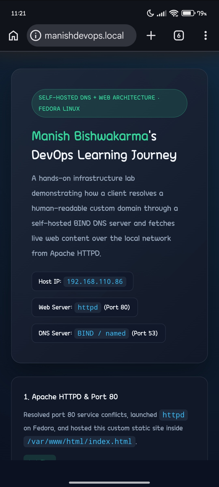

# 6. Using the DNS Server from the Laptop and the Phone

The BIND server answers correctly when it is asked directly ([5-bind-dns-server.md](5-bind-dns-server.md)). This file covers the last part of the goal: making real clients use it, so that the web page opens by a custom domain name instead of an IP address. The laptop that hosts the servers comes first, then a phone on the same Wi-Fi.

---

## How Fedora resolves names by default

`/etc/resolv.conf` is the file that tells command-line DNS tools which DNS server to ask. On this Fedora machine it is **not a normal file**. It is a symbolic link:

```bash
ls -la /etc/resolv.conf
# /etc/resolv.conf -> ../run/systemd/resolve/stub-resolv.conf
```

The file it points to is generated by `systemd-resolved`, and its header says it should not be edited. Its content:

```text
nameserver 127.0.0.53
options edns0 trust-ad
search lan
```

`127.0.0.53` is the local stub resolver. It forwards questions to the DNS server learned from the network, which for the Wi-Fi link is the router at `192.168.110.1`. A home router has no entry for a private domain such as `manishdevops.local`, so the new DNS server has to be put into the path of the lookup. Editing a managed file directly is also fragile, because it can be overwritten when the network changes.

---

## Part 1: The laptop

### Three ways to use the new DNS server

| Approach | Changes the system? |
|---|---|
| **A. Ask the server directly** with `dig @IP` or `nslookup name IP` | No |
| **B. Set the DNS server on the Wi-Fi connection** with `nmcli` | Only that connection's profile |
| **C. Replace `/etc/resolv.conf`** with a plain file | Yes, system-wide |

**A. Ask the server directly.** This is the safest test and needs no change at all:

```bash
nslookup www.manishdevops.local 192.168.110.86
dig @192.168.110.86 www.manishdevops.local +short
```

**B. Set DNS on the Wi-Fi profile with `nmcli`:**

```bash
nmcli -t -f NAME,DEVICE connection show --active          # find the active Wi-Fi connection name (the device was wlo1)

sudo nmcli connection modify "<wifi-connection-name>" ipv4.dns "192.168.110.86" ipv4.ignore-auto-dns yes
sudo nmcli connection up "<wifi-connection-name>"
resolvectl status wlo1                                     # should list 192.168.110.86 as a DNS server
```

- `ipv4.dns` sets the DNS server for that connection.
- `ipv4.ignore-auto-dns yes` tells NetworkManager to ignore the DNS server handed out by the router.
- `connection up` re-activates the profile so the change applies.
- `resolvectl status wlo1` confirms which DNS server the link really uses. Running it before testing removes the guesswork.

The way back:

```bash
sudo nmcli connection modify "<wifi-connection-name>" ipv4.dns "" ipv4.ignore-auto-dns no
sudo nmcli connection up "<wifi-connection-name>"
```

**C. Replace `/etc/resolv.conf`:**

> **Risky command: `sudo rm -f /etc/resolv.conf`**
> This deletes the link that every command-line DNS lookup depends on. If the next step is mistyped or skipped, the machine has no working DNS configuration until it is repaired.
> **Safer alternatives:** use approach A (no change at all), or approach B (only one connection profile is touched and the commands above undo it).
> If the file really has to be replaced, make a backup first (`sudo cp -L /etc/resolv.conf ~/resolv.conf.backup`, which copies the real content, not the link), keep the restore commands from [7-cleanup-and-safety.md](7-cleanup-and-safety.md) ready in the same terminal, and run the whole replacement in one go.

```bash
ls -la /etc/resolv.conf                          # confirm it is a symlink
sudo cp -L /etc/resolv.conf ~/resolv.conf.backup # backup of the content
sudo rm -f /etc/resolv.conf                      # remove the link
sudo tee /etc/resolv.conf > /dev/null <<'EOF'
nameserver 192.168.110.86
nameserver 8.8.8.8
EOF
nslookup www.manishdevops.local
```

With this file in place `nslookup` printed `Server: 192.168.110.86` and resolved the name. The `8.8.8.8` line was later removed so that only the BIND server is listed, because a public server cannot answer for a private name.

### Terminal checks before the browser

Two tools, two lookup paths. `nslookup` and `dig` read `/etc/resolv.conf` and send the query straight to the DNS server found there. Applications such as Chrome follow the lookup order in `/etc/nsswitch.conf`, which `getent` also uses:

```bash
getent hosts www.manishdevops.local          # what an application would get
grep '^hosts:' /etc/nsswitch.conf
# hosts:      files myhostname mdns4_minimal [NOTFOUND=return] resolve [!UNAVAIL=return] dns
```



`.local` is reserved for multicast DNS (mDNS). The `mdns4_minimal [NOTFOUND=return]` entry takes `.local` names first, and if the local network does not answer, the lookup ends there. For an application to reach the BIND server with a name that does not end in `.local`, a reserved test suffix is the cleaner choice.

### Optional second zone: `manishdevops.test`

Names ending in `.test` are reserved for testing and do not trigger mDNS. A second zone was added to `/etc/named.conf`, pointing at the same zone file:

```bash
sudo tee -a /etc/named.conf > /dev/null <<'EOF'

zone "manishdevops.test" IN {
    type master;
    file "manishdevops.local.forwardzone";
    allow-update { none; };
};
EOF

sudo named-checkconf
sudo named-checkzone manishdevops.test /var/named/manishdevops.local.forwardzone    # zone loaded, OK
sudo systemctl restart named
```

`allow-update { none; }` means no dynamic updates are accepted for this zone.

### Browser settings that have to agree

| Setting | What it does | Needed state while testing |
|---|---|---|
| **Use secure DNS** in Chrome (`chrome://settings/security`) | Can send encrypted lookups to a public resolver, which knows nothing about a private domain | Off, and turned back on afterwards |
| **Clear host cache** (`chrome://net-internals/#dns`) and **Flush socket pools** (`chrome://net-internals/#sockets`) | Remove Chrome's own stored lookups and open connections | Run once after changing DNS. Clearing the host cache does not log out of accounts or delete cookies, passwords, bookmarks or tabs. |
| Public DNS next to the BIND server | A public server answers that a private name does not exist | Only the BIND server listed |
| GNOME Wi-Fi settings, IPv4 tab | The DNS box stays greyed out while the **Automatic** switch is on | Automatic off, then `192.168.110.86` entered. The IPv6 tab can carry its own DNS servers as well. |

### Result on the laptop

With lookups reaching the BIND server, `http://` plus the custom domain name opened the page served by Apache on the same laptop.

<!-- TODO(Manish): add the exact change that made the name resolve in the browser, and the domain name used -->



---

## Part 2: The phone on the same Wi-Fi

The phone needs two things: a route to the servers (same Wi-Fi, with the `http` and `dns` firewall services open on the laptop) and the BIND server set as its DNS server.

On Android, in the settings of the connected Wi-Fi network:

1. Change **IP settings** from **DHCP** to **Static**, because DNS entries can only be typed in manually in that mode. Values used: IP `192.168.110.50`, router (gateway) `192.168.110.1`, prefix length `24`.
2. Set **DNS 1** to the server address, `192.168.110.86`.
3. Clear **DNS 2** (it held `8.8.4.4`). A public server cannot answer for a private name.
4. Set **Private DNS** (Android's encrypted DNS feature) to **Off** while testing.
5. In Chrome on the phone, turn **Use secure DNS** off for the test.
6. Open the custom domain name in the phone's browser.

A phone resolves the name by asking the BIND server on port 53, then loads the page from Apache on port 80. Both firewall doors have to be open for that, which is why the `dns` service was added next to `http` in [5-bind-dns-server.md](5-bind-dns-server.md).

### Result on the phone

The same page opened by the custom domain name on the phone, over the same Wi-Fi.



---

## Learning journey: what the first attempts taught

The first tests by name showed `DNS_PROBE_FINISHED_NXDOMAIN` in Chrome. Working through that taught more about name resolution on Fedora than the BIND setup itself:

- **A plain `nslookup` goes to the stub resolver.** Before the system was pointed at BIND, `nslookup www.manishdevops.local` printed `Server: 127.0.0.53` and `REFUSED`, because that resolver does not know the private zone.
- **`dig` and `nslookup` are not browsers.** They resolved the name while Chrome did not, because applications follow `/etc/nsswitch.conf` and `.local` is claimed by mDNS.
- **Pages open fine by IP while names do not.** That isolates the problem to DNS, because it shows that Apache and the firewall are working.
- **Browser and phone settings can bypass the system's DNS.** Secure DNS, Private DNS and a public second DNS server each have to be checked.
- **One change at a time.** Changing the resolver file, the Wi-Fi profile, the browser and the phone together makes it impossible to tell which change mattered.

---

## Takeaways

- I learned that "works with `nslookup`" does not automatically mean "works in the browser". The two use different lookup paths.
- I learned that a private domain ending in `.local` collides with multicast DNS, and that a reserved test name such as `.test` is the cleaner choice for a lab.
- I learned that a name resolving on the phone depends on three things at once: the Wi-Fi network, the DNS server entry, and the firewall doors for ports 53 and 80.
- I learned that the way back (a backup and the restore commands) has to exist before a change is made.
