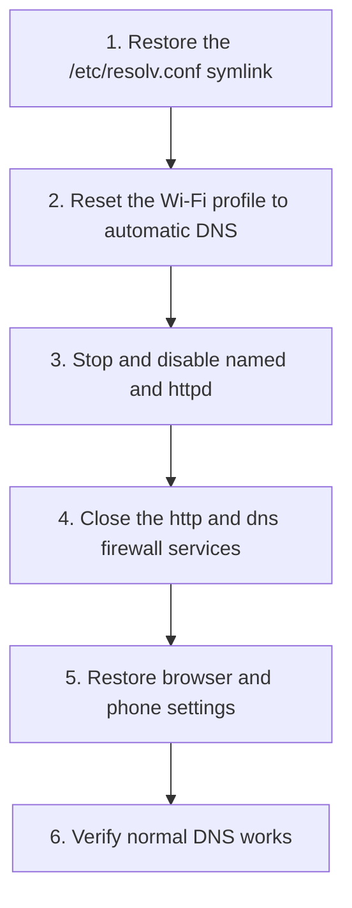

# 7. Cleanup and Safety

The lab ran on a real Wi-Fi network, not on an isolated virtual machine. While `httpd` and `named` were running with ports 80 and 53 open, every device on that network could reach them. Everything that was changed should therefore be reverted when the lab is over. The configuration files and `/var/www/html/index.html` can stay on disk for later.



---

## 1. Restore the `/etc/resolv.conf` symlink

Only needed if the file was replaced with a plain file (approach C in [6-client-setup-and-testing.md](6-client-setup-and-testing.md)).

```bash
sudo rm -f /etc/resolv.conf
sudo ln -sf ../run/systemd/resolve/stub-resolv.conf /etc/resolv.conf
sudo systemctl restart systemd-resolved
ls -la /etc/resolv.conf
# /etc/resolv.conf -> ../run/systemd/resolve/stub-resolv.conf
```

`rm -f` here removes only the plain file that was created for the test. The target of the link, `/run/systemd/resolve/stub-resolv.conf`, and the backups in the home folder are not touched. The link is recreated with the same relative path it had originally.

## 2. Reset the Wi-Fi profile to automatic DNS

```bash
sudo nmcli connection modify "<wifi-connection-name>" \
    ipv4.dns "" ipv4.ignore-auto-dns no \
    ipv6.dns "" ipv6.ignore-auto-dns no ipv6.method auto
sudo nmcli connection up "<wifi-connection-name>"
```

This clears any manual DNS entries, lets the router hand out DNS again, and sets IPv6 back to automatic in case it was changed in the network settings window.

## 3. Stop and disable the servers

```bash
sudo systemctl stop named httpd
sudo systemctl disable named httpd
systemctl is-active named httpd
# inactive
# inactive
```

Disabling removed the boot links (`httpd.service` and `bind.service`). The zone file, `named.conf` and the web page stay on disk.

## 4. Close the firewall doors

The commands in steps 1 to 3 do not touch `firewalld`. The `http` and `dns` services stay allowed until they are removed:

```bash
sudo firewall-cmd --remove-service=http --permanent
sudo firewall-cmd --remove-service=dns --permanent
sudo firewall-cmd --reload
sudo firewall-cmd --list-services
# http and dns should no longer appear
```

## 5. Restore browser and phone settings

- **Chrome on the laptop:** turn **Use secure DNS** back on at `chrome://settings/security`.
- **Phone, Wi-Fi settings:** change **IP settings** from **Static** back to **DHCP** and clear the manual DNS entries.
- **Phone, Private DNS:** put it back to the setting it had before the test.

## 6. Verify

```bash
nslookup example.com       # a normal public lookup resolves again, through 127.0.0.53
```

---

## Risky commands in this chapter and safer options

| Command | Why it is risky | Safer alternative |
|---|---|---|
| `sudo rm -f /etc/resolv.conf` | Removes the link all DNS lookups rely on. A slip leaves the machine without DNS. | Do not replace the file at all. Test with `nslookup name IP`, `dig @IP name` or `curl --resolve`, or set DNS on the Wi-Fi profile with `nmcli`. If replacing is unavoidable: back up with `sudo cp -L`, keep the restore commands in the same terminal. |
| `sudo systemctl disable nginx` | Changes what starts at boot and can break other things that depend on nginx. | Only `stop` nginx during the lab and `start` it again afterwards. |
| `sudo firewall-cmd --add-service=http/dns --permanent` | Opens ports 80 and 53 to everyone on the Wi-Fi network. | Skip the rules if everything is tested on the same machine. Otherwise remove them afterwards (step 4 above). |
| `allow-query { any; };` in a zone block | Lets any client query the zone. | Use it only on a private lab network, never on a server reachable from the internet. |
| `sudo cp /etc/named.conf.bak /etc/named.conf` | Overwrites the current configuration with the backup. | Use it only to roll back on purpose, then run `sudo named-checkconf /etc/named.conf`. |
| `sudo rm /etc/named.conf.bak` | Deletes the only backup of the original configuration. | Keep the backup until the lab is finished and verified. |
| `sudo chgrp named ...` and `sudo restorecon -v ...` | Change group ownership and the SELinux label. | In this chapter each was applied to one named file only, which keeps the effect small. Always name the exact file. |

---

## Takeaways

- I learned that setting something up is only half of a lab. The revert steps, and checking that nothing stays exposed on a shared Wi-Fi, matter just as much.
- I learned that stopping and disabling a service does not close its firewall rule. They are separate switches.
- I learned to prefer a test that changes nothing (`dig @IP`) over one that changes the system.
