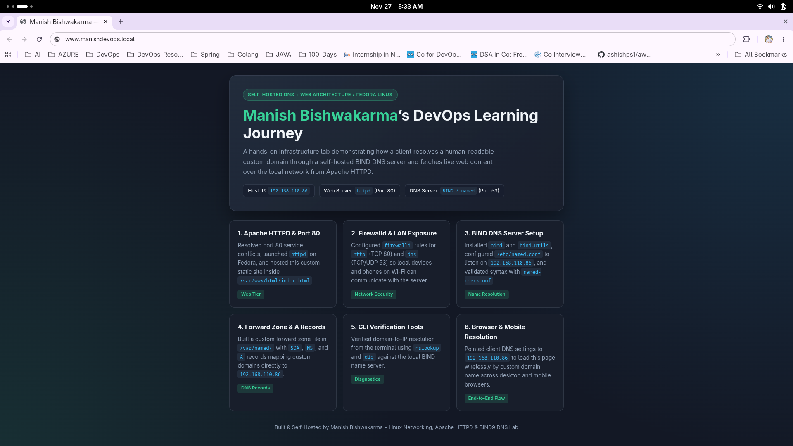
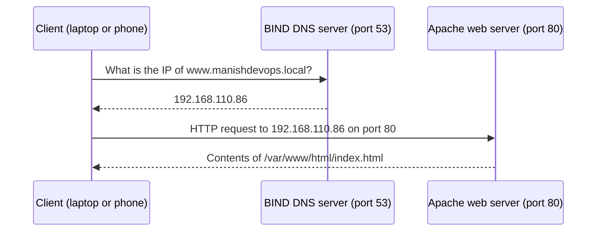

# Linux DNS: Concepts, an Apache Web Server and a Custom BIND DNS Server

This chapter goes deep into DNS (the Domain Name System) and then puts it into practice on a Fedora Linux machine. An Apache web server (`httpd`) hosts a static page, and a BIND DNS server (`named`) is built from scratch so that the page opens with a **custom domain name** instead of a raw IP address. The result: the site opens by its custom name in the browser on the laptop that hosts it, and then on a phone connected to the same Wi-Fi.

---

## Result

**On the laptop**

**On the phone, same Wi-Fi** [Phone: web page opened by the custom domain name over the same Wi-Fi](images/02-phone-custom-domain.png)

---

## Lab at a glance

| Item | Value |
|---|---|
| Operating system | Fedora Linux |
| Web server | Apache HTTP Server (`httpd`), port 80 |
| DNS server | BIND (`named`), port 53 |
| Server IP | `192.168.110.86` (Wi-Fi interface `wlo1`, a private LAN address) |
| Custom domain | `manishdevops.local` (a second zone, `manishdevops.test`, was added as well) |
| Clients | The same laptop first, then an Android phone on the same Wi-Fi |
| Firewall | `firewalld`, with the `http` and `dns` services opened |

---

## The idea in one diagram

DNS only translates a name into an IP address. It never forwards the visitor to port 80. The browser takes the IP address it got back and then connects to the web server on its own.

---

## Verification steps, in the order they were done

| Step | Result |
|---|---|
| Apache serving the page by IP address (laptop and phone on the same Wi-Fi) | Worked |
| BIND answering for `www.manishdevops.local` when asked directly (`dig` and `nslookup` with the server IP) | Worked |
| Fetching the page by name from the terminal with `curl --resolve` | Worked |
| Laptop browser opening the site by the custom domain name | Worked |
| Phone browser (same Wi-Fi) opening the site by the custom domain name | Worked |

The path to the last two steps, including what the first attempts taught about name resolution on Fedora, is in [6-client-setup-and-testing.md](6-client-setup-and-testing.md).

---

## Chapter map

| File | What it covers |
|---|---|
| [1-dns-basics.md](1-dns-basics.md) | What DNS is, why it exists, the `hosts` file, port 53, message types, domain structure, TLDs, forward and reverse lookup |
| [2-how-resolution-works.md](2-how-resolution-works.md) | Resolver, root, TLD and authoritative servers, anycast, caching, TTL, recursive vs iterative, changing records safely, basic troubleshooting |
| [3-dns-records-and-zones.md](3-dns-records-and-zones.md) | Zones, delegation, record format, resource record sets, every record type (A, AAAA, CNAME, MX, NS, SOA, PTR, TXT, SRV, CAA) |
| [4-apache-web-server.md](4-apache-web-server.md) | Installing and checking `httpd`, `systemctl`, the port 80 conflict, important paths, `curl`, finding the server IP, opening the firewall |
| [5-bind-dns-server.md](5-bind-dns-server.md) | Installing BIND, `named.conf`, the zone block, the zone file line by line, validating and testing |
| [6-client-setup-and-testing.md](6-client-setup-and-testing.md) | Pointing the laptop and then the phone at the DNS server, `resolv.conf`, `nmcli`, browser settings, `.local` vs `.test`, learning journey |
| [7-cleanup-and-safety.md](7-cleanup-and-safety.md) | Reverting every change after the lab, risky commands with safer alternatives |
| [8-command-cheat-sheet.md](8-command-cheat-sheet.md) | All commands used in this chapter, grouped by task |

---

## Key takeaways

- I learned that DNS is only a translator. It turns a name into an IP address, and the browser then connects to that address on a port of its own choosing (80 for `http://`).
- I learned that one machine can run two separate servers on two separate ports: Apache on 80 and BIND on 53. Each needs its own firewall rule.
- I learned that terminal tools such as `dig` and `nslookup` and applications such as Chrome do not take the same path to resolve a name, and that `.local` names are claimed by multicast DNS.
- I learned that a phone can use the laptop as its DNS server and web server over the same Wi-Fi, once its DNS entry points at the laptop's address.
- I learned to back up a file before editing it (`named.conf`, `resolv.conf`) and to write the way back before making the change.

---

## Why this matters

Names stay the same while IP addresses change, for example when an application moves from one hosting provider to another or is spread over several servers. DNS is the layer that absorbs that change, and TTL values decide how fast the change reaches users. Knowing the full path of a lookup, from browser to resolver to authoritative server, makes it possible to trace a "site not loading by name" problem step by step.
