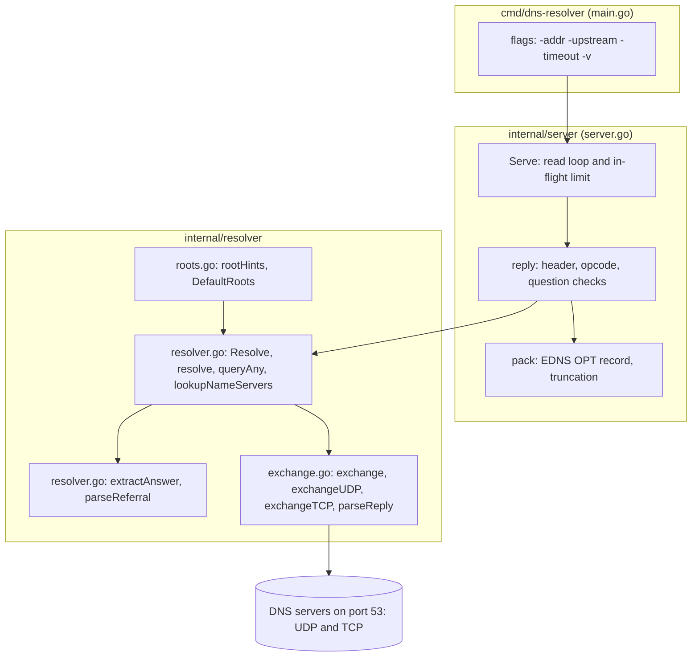
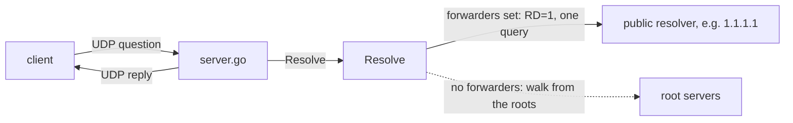

# 1. Architecture

## The packages

The project has three packages, and each one has a single job.

| Package | Job | Does not deal with |
|---|---|---|
| `cmd/dns-resolver` | Reads the flags, sets up logging and shutdown, and connects the other two packages | DNS packets |
| `internal/server` | Talks to clients: receives questions over UDP and sends replies | How referrals are followed |
| `internal/resolver` | Finds answers by asking other DNS servers. `exchange.go` is the part that sends one query to one server. | Client sockets |

The resolver never touches a client socket, and the server never looks at a referral. That split makes each part testable on its own. The server tests use a fake resolver, and the resolver tests use a fake DNS server.

---

## Architecture diagram

With the `-upstream` flag, the walk is skipped. The resolver sends one recursive query per question to the forwarders, and it still uses the same `exchange` function.

---

## Where each function lives

### `cmd/dns-resolver/main.go`

| Function | Purpose |
|---|---|
| `main` | Calls `run`. If `run` returns an error, prints it to stderr and exits with status 1. |
| `run` | Defines the four flags, builds the logger, parses `-upstream`, creates the resolver and the server, sets up the shutdown context, logs the mode, and calls `srv.Serve(ctx)`. |
| `parseAddrs` | Splits the comma-separated `-upstream` list, trims spaces, skips empty items, and parses each address. IPv4 and IPv6 are both accepted. |

### `internal/server/server.go`

| Identifier | Purpose |
|---|---|
| `typeIXFR` | The IXFR query type (251). It is defined by hand because the `dnsmessage` package does not have it. |
| `minUDPSize`, `maxUDPSize` | 512 and 1232 bytes. 512 is the old limit for UDP replies. 1232 is the largest reply sent, which fits in one packet without IP fragmentation. |
| `Resolver` (interface) | What the server needs from a resolver: one `Resolve` method. Tests use a fake one. |
| `Config` | `Addr`, `QueryTimeout`, `MaxInFlight`, `Logger` |
| `Server` | The listener (`conn`), the resolver, the config, the logger, and `slots`, a channel that limits how many queries run at once |
| `New`, `Addr`, `Serve`, `handle`, `reply`, `resolve`, `supported`, `clientUDPSize`, `pack` | See [02-server.md](02-server.md) |

### `internal/resolver/resolver.go`

| Identifier | Purpose |
|---|---|
| `maxDepth`, `maxQueries`, `maxCNAMEChain`, `maxNameServerTry`, `maxServersPerStep` | The limits. The table in [03-resolver-walk.md](03-resolver-walk.md), section 3.10, lists them with their effect. |
| `Config` | `Roots`, `Forwarders`, `Port`, `AttemptTimeout`, `Logger` |
| `Response` | `RCode` and `Answers`. The only result type the resolver gives back to the server. |
| `Resolver` | Holds the config. It has no per-question state, so one resolver can serve many questions at once. |
| `New`, `Resolve`, `resolve`, `lookupNameServers`, `queryAny` | See [03-resolver-walk.md](03-resolver-walk.md) |
| `budget` | Counts upstream queries. One budget is shared by a question and all the lookups it causes. |
| `answerSet`, `extractAnswer` | Keeps only the records that belong to the question |
| `referral`, `parseReferral` | Turns the Authority section of a reply into the next step |
| `sameName`, `isSubdomain`, `labelCount`, `shuffled` | Small helpers |

### `internal/resolver/exchange.go`

| Identifier | Purpose |
|---|---|
| `maxUDPReply` | 4096. The buffer size used when reading UDP replies. |
| `exchange` | One query to one server. Builds the message, sends it over UDP, and retries over TCP if the reply is truncated. |
| `exchangeUDP`, `exchangeTCP` | The two ways of sending the query |
| `watch` | Applies the context deadline to the socket, and closes the socket if the context is cancelled |
| `parseReply`, `sameQuestion` | The reply checks: ID, response flag, one question, and the same name, type and class |
| `randomID` | Two random bytes for each transaction ID |

### `internal/resolver/roots.go`

| Identifier | Purpose |
|---|---|
| `rootHints` | The IPv4 addresses of `a.root-servers.net` to `m.root-servers.net`, as strings |
| `DefaultRoots` | Converts them to `netip.Addr` values. Used when `Config.Roots` is empty. |

The comment in this file says that `b.root-servers.net` changed address from `199.9.14.201` to `170.247.170.2` in November 2023. The old list in the first version of the code still used the previous address.

---

## What moves through the code for one question

| Stage | What it is |
|---|---|
| UDP packet from the client | Raw bytes. The server reads at most 1232 bytes (see [02-server.md](02-server.md)). |
| After `Unpack` | A `dnsmessage.Message` with one question: a name, a type and a class |
| Input to `Resolve` | A `dnsmessage.Question` |
| Inside the walk | Each step sends a new message with a random ID and the same question |
| Output of the walk | A `*resolver.Response`: a reply code and a list of records |
| Output of `pack` | The bytes of one UDP reply. The TC flag is set if they did not fit. |
