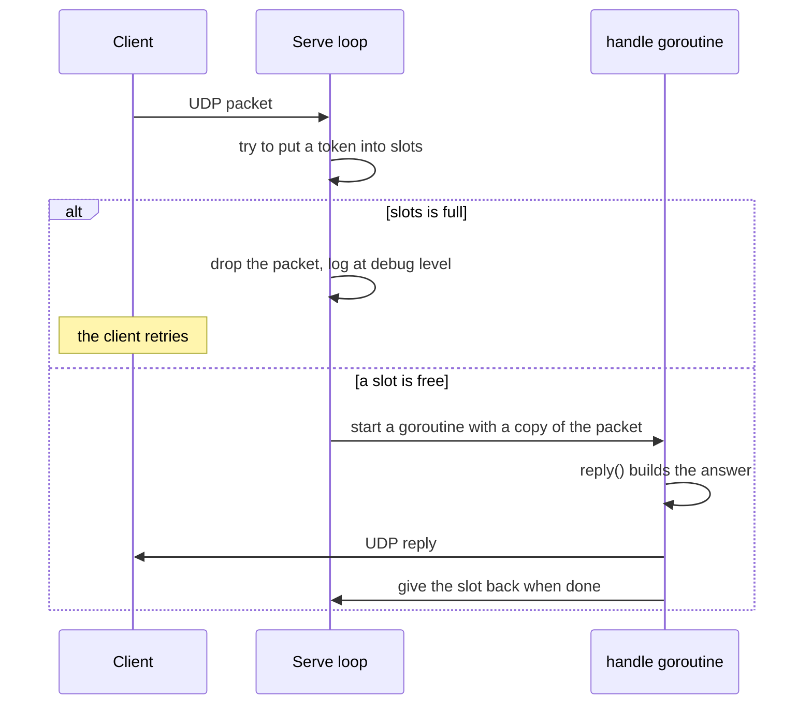
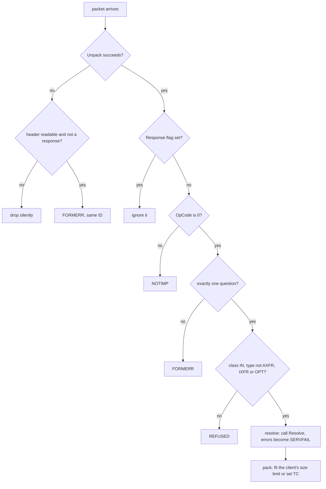

# 2. The Server (`internal/server/server.go`)

The server is the front door. It receives one DNS question per UDP packet, asks the resolver for the answer, and sends one UDP reply.

---

## 2.1 Start-up: `New`

`New(res, cfg)` fills in the defaults and opens the socket. Nothing is answered until `Serve` is called.

| Setting | Default | Used for |
|---|---|---|
| `Addr` | `127.0.0.1:1053` | `net.ListenPacket("udp", addr)` |
| `QueryTimeout` | 10 seconds | The time limit for each `Resolve` call |
| `MaxInFlight` | 100 | Size of `slots`, the limit on queries handled at once |
| `Logger` | Discards output | Replaced by a text logger in `main.go` |

The socket is opened in `New`, so a port that is already in use fails at start-up, before `Serve` runs.

`Addr()` returns the address the socket is bound to. The tests listen on `127.0.0.1:0`, which lets the operating system pick a free port, and read it back with `Addr()`.

---

## 2.2 The read loop: `Serve`

`Serve(ctx)` keeps reading packets until the context is cancelled. Each packet is handed to its own goroutine.

1. `context.AfterFunc` is registered. When the context is cancelled, it sets the read deadline to now, which wakes up the blocked `ReadFrom`.
2. A `sync.WaitGroup` counts the goroutines that are still running.
3. `work := context.WithoutCancel(ctx)` gives queries in progress a context that is not cancelled at shutdown. They finish within their own `QueryTimeout`.
4. The packet is read into a buffer of 1232 bytes (`maxUDPSize`). A bigger packet is cut to that size, so it cannot be parsed. Normal queries are far smaller than this.
5. The server tries to put a token into `slots`. If the channel is full, the packet is dropped and logged at debug level. The client is expected to retry.
6. `bytes.Clone` copies the packet, because `buf` is reused by the next `ReadFrom`.
7. A goroutine runs `handle` and gives back its slot when it returns.

On shutdown, a read error after cancellation makes `Serve` return `nil`. `wg.Wait()` then waits for the goroutines still running, and the socket is closed last. Other read errors are logged as warnings, and the loop carries on. A closed socket (`net.ErrClosed`) makes `Serve` return the error.

### The in-flight limit

---

## 2.3 Handling one packet: `handle`

`handle` runs `reply` and writes the result with `WriteTo`. It begins with a `recover()`, so a panic while handling one packet is logged, that packet gets no reply, and the server keeps running. The client then times out.

If `reply` returns `nil`, nothing is sent.

---

## 2.4 Building the reply: `reply`

`reply(ctx, client, packet)` returns the bytes of the reply, or `nil` to stay silent.

### The order of the checks

### Why each check is there

| Check | Reason |
|---|---|
| Header is readable but the body is broken | The client is told the packet was malformed, so it does not wait for a reply that will never come. |
| Response flag is set | The server never answers a reply. If two servers answered each other, the messages could bounce back and forth forever. |
| OpCode other than 0 | Only standard queries are handled. NOTIFY (opcode 4) gets NOTIMP. |
| Not exactly one question | Packets with zero or several questions get FORMERR. |
| Class is not IN | CHAOS queries such as `version.bind` are refused. `supported` only resolves class IN. The test `TestRefusesUnsupportedQueries` checks this. |
| Type is AXFR or IXFR | Zone transfers are refused. A resolver should not hand out a zone's full contents. |
| Type is OPT | OPT is a record used for EDNS, not a question a client can ask. |

### Reply codes used by the server

The reply code (RCode) is a small number in the reply header that says how the question went.

| Code | Meaning |
|---|---|
| NOERROR | Everything went fine. The answer may be empty. |
| FORMERR | The packet could not be understood. |
| SERVFAIL | The server could not get an answer. For example, every upstream server failed, or the time ran out. |
| NXDOMAIN | The name does not exist. For example, a made-up name under `example.com`. It is a normal answer, not an error. |
| NOTIMP | The kind of request is not supported. |
| REFUSED | The server will not answer this question. |

### What goes into the reply

- `ID` is copied from the request.
- `Response` is set to true.
- `OpCode` and `RecursionDesired` are copied from the request. `RecursionDesired` (RD) means the client wants the server to do the whole job.
- `RecursionAvailable` (RA) is always true. The server does the whole job for its clients.
- `Questions` is copied from the request.
- `RCode` and `Answers` come from `resolve`.

---

## 2.5 Calling the resolver: `resolve`

This `resolve` is the server's method. It is different from the walk's `resolve` in the resolver package.

1. It applies `QueryTimeout` to the context.
2. It calls `s.res.Resolve(ctx, q)` and measures how long that takes.
3. If `Resolve` returns an error, the reply gets SERVFAIL and a warning is logged.
4. Otherwise the reply copies the resolver's `RCode` and `Answers`, and one line is logged at info level. The line shows the client, the name, the type, the reply code, the number of answers, and the time taken.

An NXDOMAIN answer is not treated as an error. The resolver returns it as a normal result, and the server passes it on unchanged.

---

## 2.6 Which questions are answered: `supported`

`supported(q)` returns true only for class IN, and for any type except AXFR, IXFR (251) and OPT. Anything else gets REFUSED before the resolver is called.

---

## 2.7 Size limits, EDNS and truncation

DNS over UDP has a size limit. Without EDNS, a reply can be at most 512 bytes. EDNS (RFC 6891) lets a client say that its computer can accept bigger replies. The client does this with an OPT record in the Additional section.

### `clientUDPSize`

Looks for an OPT record in the request. If one is there, the limit is the size it announces (stored in the record's class field), kept between 512 and 1232. Without OPT, the limit is 512, and `pack` adds no OPT record to the reply.

### `pack`

1. If the client used EDNS, an OPT record announcing 1232 bytes is added to the reply.
2. The message is packed into bytes.
3. If the bytes fit in the client's limit, they are returned.
4. If they do not fit, the TC (truncated) flag is set and the answers are removed. The reply is packed again and returned.
5. If packing fails, the reply is sent as SERVFAIL with no answers.

The TC flag tells the client that the reply is incomplete and should be asked for again over TCP. This server has no TCP listener (see the Limitations section of the [README](README.md)), so a client that follows that advice gets no answer.

The test `TestBigReplyIsTruncatedForPlainClientsButFitsWithEDNS` checks both cases. A reply with 60 addresses (about 1 KB) is truncated for a client without EDNS, and it fits for a client that announces 1232 bytes.

---

## 2.8 Shutdown

`main.go` creates a context that is cancelled on Ctrl+C (`os.Interrupt`) or on `SIGTERM`. That is the signal sent by `systemctl stop` and `kill`.

When the context is cancelled:

1. The read loop stops taking new packets.
2. Queries already in progress finish, each within its `QueryTimeout` of 10 seconds by default. So Ctrl+C can take up to 10 seconds to take effect.
3. The socket is closed.

---

## 2.9 What the server tests check

See [05-tests.md](05-tests.md) for the full list. In short, the server tests check that the header and question are echoed back, that RA is set, that a resolver error becomes SERVFAIL, that NXDOMAIN is passed through, that a broken body gets FORMERR, that responses are ignored, that unsupported questions are refused, that truncation works with and without EDNS, and one full run through a real resolver.
