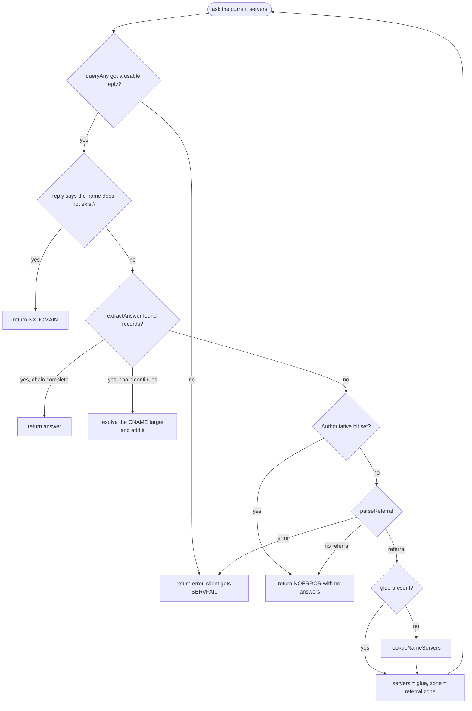
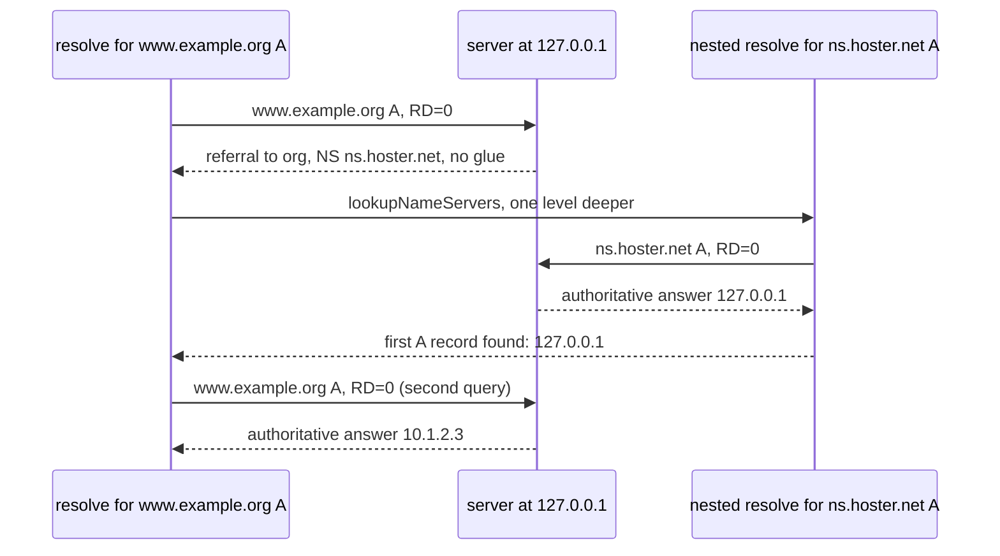
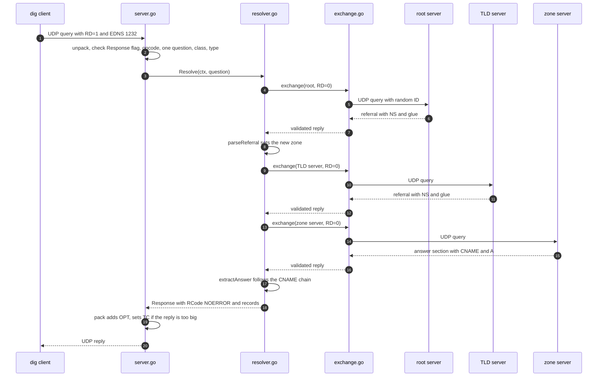

# 3. The Walk (`internal/resolver/resolver.go`)

This is the core of the project. Given a question, it asks one server, reads the reply, and then either has the answer or knows which server to ask next.

---

## 3.1 Key ideas before the code

**Referral.** A reply that does not contain the answer, but says which servers to ask next. For example, the root server answers "ask the `.com` servers".

**Delegation.** A parent zone handing responsibility for part of the DNS tree to other servers. The handover is written as NS records.

**Glue.** The IP addresses of those name servers, sent in the same reply. The resolver needs them because a name server for `example.com` lives inside `example.com`. Without glue, the resolver would need the answer to find the server that gives the answer.

**The rule for glue.** A server may only give addresses for name servers inside its own zone. The code ignores any other glue.

**Iterative and recursive.** In iterative mode the resolver sends each query with RD (recursion desired) turned off. Each server then answers or refers, and the resolver does the rest. In forwarding mode the resolver turns RD on, so the upstream resolver does the whole walk.

**NODATA.** The name exists, but it has no record of the type that was asked for. For example, a name can have an IPv4 address (A record) but no IPv6 address (AAAA record). The reply is a success with an empty answer.

---

## 3.2 Configuration and defaults

`New(cfg)` fills in any empty field.

| Field | Default | Meaning |
|---|---|---|
| `Roots` | `DefaultRoots()`, 13 addresses | The servers every lookup starts from |
| `Port` | `"53"` | The port used for every upstream query |
| `AttemptTimeout` | 2 seconds | The time limit for one query to one server |
| `Logger` | Discards output | Debug messages about each upstream query |
| `Forwarders` | none | If set, the resolver switches to forwarding mode |

---

## 3.3 Entry point: `Resolve`

`Resolve(ctx, q)` is the only function the server calls.

1. It creates a `budget` of 40 upstream queries. The budget belongs to one client question, and every lookup that question causes uses it.
2. If `Forwarders` is set, it sends one recursive query with `queryAny(..., recurse=true, ...)` and returns the upstream's records as they are.
3. Otherwise it calls `resolve(ctx, q, depth=0, budget)`.

---

## 3.4 The loop: `resolve`

`resolve(ctx, q, depth, b)` does the walk. It keeps two variables:

- `servers`: the addresses to ask now. It starts as a shuffled copy of `Roots`.
- `zone`: the zone those servers answer for. It starts as `"."`, the root.

Each time round the loop, it does the following.

1. Calls `queryAny(ctx, servers, q, recurse=false, b)`. If every server fails, the error is returned, with the current zone in the message.
2. If the reply says the name does not exist (NXDOMAIN), returns that at once.
3. Calls `extractAnswer(q, msg.Answers)`. If it found records:
   - if no CNAME target is still pending, returns them;
   - if the CNAME chain continues past this reply, calls `resolve` again for the target (at `depth+1`) and joins the two parts together.
4. If there are no records and the reply has the Authoritative bit set, returns success with no answers. This is NODATA.
5. Otherwise calls `parseReferral(msg, q.Name, zone)`:
   - no referral and no error: returns success with no answers;
   - an error: returns the error.
6. Sets `servers` to the referral's glue. If there is no glue, calls `lookupNameServers` to find addresses for the name servers.
7. Sets `zone` to the referral's zone and goes round again.

### The decisions as a flowchart

### One lookup where the referral has no glue

The example is the one in the test `TestLooksUpNameServersWhenReferralHasNoGlue`. The referral names the `.org` name server but gives no IP address, so the resolver has to look that name server up first.

In the test, one fake server at `127.0.0.1` plays the root, the `.org` server and the authoritative server all at once (see [05-tests.md](05-tests.md)). That is why the diagram shows a single participant. On the real Internet, the lookup for `ns.hoster.net` would go through the root, the TLD and the authoritative servers, one step per referral, and it would use the same budget.

### The full path of one client question

The number of root, TLD and zone steps depends on the zone. The diagram shows one of each.

---

## 3.5 Extracting the answer: `extractAnswer`

`extractAnswer(q, answers)` keeps only the records that belong to the question. This matters for safety, because a server can put anything in its answer section.

- It starts with `current = q.Name`.
- For each name in the CNAME chain, it looks through the answer section for:
  - records whose owner is `current`, with the same class and the same type as the question (or type ANY). These are kept, and the function returns.
  - a CNAME whose owner is `current`. It is kept, and `current` moves to its target.
- It remembers each name it visits. Seeing the same name twice is an error ("CNAME loop").
- It follows at most `maxCNAMEChain + 1` (nine) steps. If the chain is still going, `pending` is set to the last name.
- If a chain was followed but the reply does not have records for its target, `pending` is set to that target, and the caller looks it up.
- Records owned by other names are ignored. The test `TestCNAMEChainInsideOneReply` checks that an unrelated record (`6.6.6.6`) in the same reply is dropped.

---

## 3.6 Accepting a referral: `parseReferral`

`parseReferral(msg, qname, currentZone)` decides whether the Authority section really is a referral, and reads the next step from it. A server's reply is only data, so each rule below is a check.

1. **Find NS records that cover the name.** Every NS record in the Authority section is examined. Only those whose owner is a parent of the name (`isSubdomain(name, zone)`) count. The first covering zone is kept, and NS records for any other zone are ignored.
2. **NS records exist, but none cover the name:** an error, "referral does not cover the name we asked about".
3. **No NS records at all:** returns `(nil, nil)`. This is not a referral.
4. **The referral must go deeper.** If `labelCount(ref.zone) <= labelCount(currentZone)`, the result is an error, "does not lead anywhere new". This stops a server from sending the resolver round in circles. The test `TestReferralLoopIsStopped` shows the error after two queries.
5. **Glue is kept only if it is safe.** An A record in the Additional section is kept only if its owner is one of the referral's name servers and it sits inside the zone of the server that sent the reply.

The test `TestParseReferralDropsUntrustedGlue` checks rule 5 with three glue records: one good, one for a name server outside the sending zone, and one for a name that is not a name server at all. Only the good one is kept.

---

## 3.7 Glue-less referrals: `lookupNameServers`

When a referral has no usable glue, the resolver has to find an address for one of its name servers.

1. The names are shuffled.
2. At most `maxNameServerTry` (three) of them are tried.
3. For each name, `resolve` is called one level deeper, to find its A record.
4. The first A record found is used. One working name server is enough.
5. If none of them work, the error is "cannot find an address for any name server".

Only A records are used. AAAA records are ignored.

---

## 3.8 Asking several servers: `queryAny`

`queryAny(ctx, servers, q, recurse, b)` asks up to `maxServersPerStep` (four) servers, one after another.

For each server, it does the following.

1. Checks that the context has not ended.
2. Uses one unit of the budget.
3. Calls `exchange` (see [04-exchange-and-trust.md](04-exchange-and-trust.md)).
4. If that fails, records the error and moves on.
5. If the reply has an error code other than NOERROR or NXDOMAIN (for example SERVFAIL or REFUSED), records it as a failure and moves on.
6. Otherwise, returns the reply.

If every server fails, the last error is returned. If there are no servers at all, the error is "no servers to ask".

The test `TestTriesNextServerAfterFailure` puts a dead address first (`127.0.0.2`, where nothing listens). The resolver moves on to the second address and gets the answer.

---

## 3.9 The budget

`budget` is a counter that starts at 40 for each client question. `spend()` takes one away and returns an error when the counter reaches zero. The budget is passed by pointer, so the nested lookups (for CNAME targets and glue-less name servers) use the same counter. The test `TestBudgetStopsRunawayLookups` checks that two spends succeed and the third fails.

---

## 3.10 Limits used in this file

| Limit | Value | Where | What happens when it is reached |
|---|---|---|---|
| Nested lookup depth | 5 | `resolve` | Error "too many nested lookups" |
| Upstream queries per client question | 40 | `budget.spend` | Error "too many upstream queries for one question" |
| CNAME steps inside one reply | 8 (nine steps are checked) | `extractAnswer` | The rest of the chain is looked up in a nested call |
| Name servers tried when glue is missing | 3 | `lookupNameServers` | Error if none of them gives an address |
| Servers asked at each step | 4 | `queryAny` | Only the first four are used |

The server has its own limits too, listed in [02-server.md](02-server.md).
