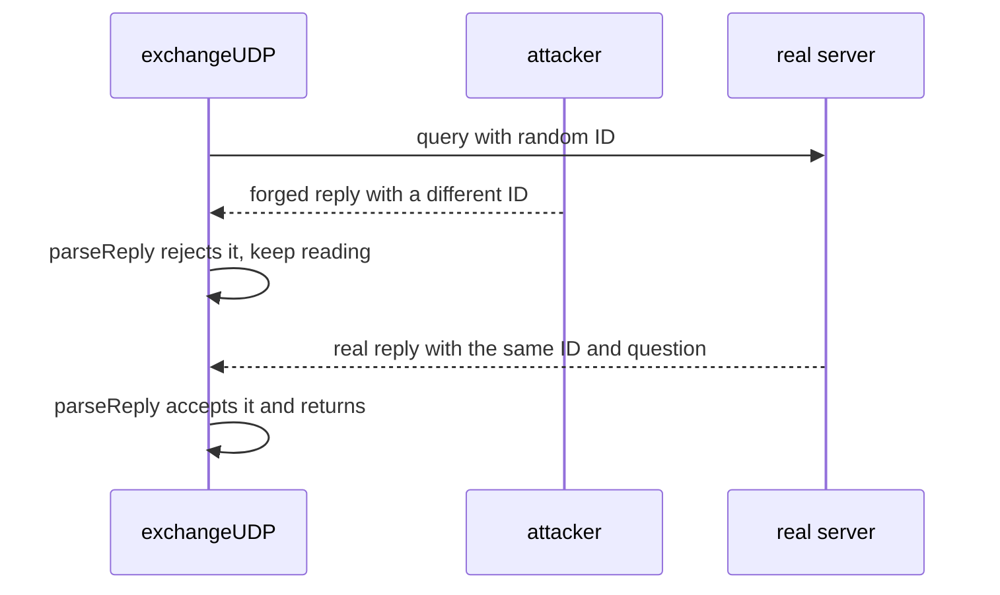

# 4. One Query to One Server (`internal/resolver/exchange.go`)

`exchange` is the only function that talks to another DNS server. Everything above it (the walk, the referrals, the CNAMEs) depends on the replies it returns being real answers to the question that was asked.

---

## 4.1 What `exchange` does

`exchange(ctx, server, q, recurse)`:

1. Creates a random 16-bit transaction ID with `randomID()`.
2. Builds a `dnsmessage.Message` with that ID, `RecursionDesired` set from `recurse`, and one question `q`. No OPT record is added, so the server assumes the old 512-byte limit.
3. Packs the message into bytes.
4. Creates a context that expires after `AttemptTimeout` (2 seconds by default).
5. Calls `exchangeUDP`. If the reply comes back with the TC (truncated) flag set, it calls `exchangeTCP` with the same context.

The address is built with `net.JoinHostPort(server.String(), r.cfg.Port)`, so IPv6 addresses work too.

---

## 4.2 UDP: `exchangeUDP`

1. `net.Dialer.DialContext` with `"udp"` creates a **connected** socket. The operating system then drops any datagram that does not come from the address the socket was connected to. The operating system also picks a new source port for each query.
2. `watch(ctx, conn)` applies the context deadline to the socket, and closes the socket if the context is cancelled early.
3. The query is written to the socket.
4. The function reads in a loop with a 4096-byte buffer. Each datagram goes through `parseReply`.
   - If `parseReply` rejects the datagram, it is ignored and the loop reads again.
   - If it is accepted, it is returned.
5. When the deadline passes, the read fails and the attempt fails.

The loop matters. A forged or stray packet cannot end the wait early. Only a valid reply or the deadline can.

---

## 4.3 TCP fallback: `exchangeTCP`

This is used only when the UDP reply has the TC flag set.

1. Dials `"tcp"`.
2. Writes the query with its length in front, as two bytes in big-endian order. TCP needs this because it is a stream with no packet boundaries (RFC 7766).
3. Reads the two-byte length of the reply, then exactly that many bytes with `io.ReadFull`.
4. Passes those bytes to `parseReply`.

The TCP attempt uses the same context, so it shares the 2-second `AttemptTimeout`. A reply too big for UDP gets one TCP try.

---

## 4.4 Reply checks: `parseReply`

`parseReply(buf, id, q)` accepts a reply only when all four checks pass.

| Check | Why |
|---|---|
| The bytes can be unpacked as a DNS message | Garbage is rejected |
| The response flag is set | A question is not a reply |
| `msg.ID == id` | The reply must answer this query. The ID is random, so it is hard to guess. |
| There is exactly one question, and it matches `q` | The reply must repeat the name, type and class that were asked |

`sameQuestion` compares the type, the class and the name. The name comparison ignores upper and lower case, because DNS names do.

The test `TestForgedRepliesAreIgnored` makes the fake server send a reply with a wrong ID before every real reply. The resolver still gets the right answer.

---

## 4.5 Why replies are not trusted

A DNS reply is data from a server that may be wrong, misconfigured, or hostile. The code assumes the worst and checks each reply. The checks in this file come first. The checks in `parseReferral` and `extractAnswer` (see [03-resolver-walk.md](03-resolver-walk.md)) come second.

### What a forged reply looks like

To inject a fake answer, an attacker would have to guess three things at once: the 16-bit ID, the source port the operating system picked, and the timing. This code picks the ID with `crypto/rand`. The operating system picks the source port for each socket.

---

## 4.6 Why `watch` exists

`watch` is what makes the timeouts work.

- `SetDeadline` puts the deadline on the socket, so a blocked read or write returns when the deadline passes.
- `context.AfterFunc` closes the connection if the context is cancelled before that. This happens, for example, when the client gives up or the server shuts down.

It returns the stop function from `AfterFunc`. The caller defers it, so the cancellation hook is removed when the exchange ends.

---

## 4.7 When an attempt fails

An attempt fails when the deadline passes, the connection is refused, the reply cannot be parsed, or the reply was truncated and the TCP retry also fails. The error goes back to `queryAny` (see [03-resolver-walk.md](03-resolver-walk.md)), which tries the next server.

A reply with NOERROR or NXDOMAIN is accepted. Any other code, such as SERVFAIL or REFUSED, counts as a failed attempt.

The worst case for one step is four servers at 2 seconds each, which is 8 seconds, plus any TCP retries. The 10-second `QueryTimeout` on the server limits the whole question.

---

## 4.8 `randomID`

Reads two bytes from `crypto/rand` and returns them as a `uint16`. If the random source fails, the error is returned and the query is not sent.

---

## 4.9 Tests that cover this file

| Test | What it shows |
|---|---|
| `TestForgedRepliesAreIgnored` | A reply with the wrong ID is skipped (section 4.4) |
| `TestRetriesOverTCPWhenTruncated` | A truncated UDP reply is followed by a TCP query, and the TCP answer is used |
| `TestTriesNextServerAfterFailure` | A connection refused by the first server leads to the second server |

No test calls `parseReply` or `sameQuestion` directly. They are covered through the fake network in the tests above. The fake server also answers TCP queries (keyed with a `" tcp"` suffix), so the TCP path is tested from start to end.
