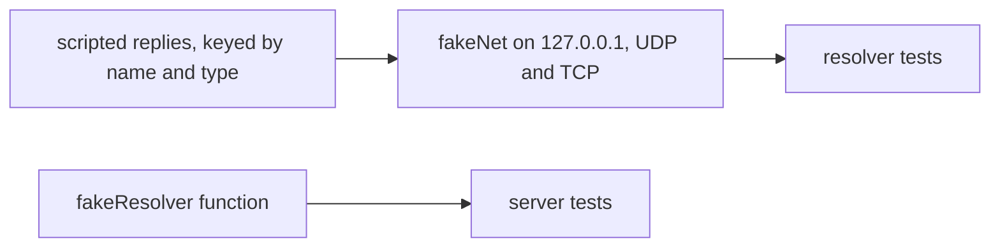

# 5. Tests

There are 26 tests in two packages. None of them uses the real Internet. Each one runs on localhost, against a fake DNS server that the test controls.

| Package | Tests | File |
|---|---|---|
| `internal/resolver` | 18 | `resolver_test.go` |
| `internal/server` | 8 | `server_test.go` |
| `cmd/dns-resolver` | 0 | none |

---

## 5.1 The fake DNS server

The resolver tests need a DNS hierarchy, so `fakeNet` is a fake server that answers as the root, the TLD and the zone server, one after another.

- It opens a UDP listener and a TCP listener on the same loopback port.
- For each question, it looks up a script keyed by `"<name> <TYPE>"`, for example `"www.example.com. A"`. TCP queries use the same key with `" tcp"` added to the end.
- It returns the scripted replies in order. The last reply repeats for any later question.
- It can send a fake reply with a wrong ID before each real reply (`setSpoofing`).
- A question with no script gets REFUSED.

A referral with glue pointing at `127.0.0.1` sends the resolver straight back to the same fake server, which then plays the next role. `newTestResolver` sets `Roots` to `127.0.0.1` and `Port` to the fake server's port, so every step of the walk goes to the fake.



The server tests do not use `fakeNet`. They use `fakeResolver`, a plain function, except for `TestEndToEnd`, which starts a small UDP upstream of its own.

---

## 5.2 Resolver tests (`resolver_test.go`)

| Test | What it proves |
|---|---|
| `TestFollowsReferralsFromRootToAnswer` | The full walk: a root referral, a `.com` referral, then the answer. Exactly three queries are sent. |
| `TestLooksUpNameServersWhenReferralHasNoGlue` | The referral gives no IP for its name server, so the name server is looked up first, once. |
| `TestFollowsCNAMEToAnotherZone` | A CNAME that points into another zone is followed, and both records come back in order (CNAME, then A). |
| `TestCNAMEChainInsideOneReply` | A complete chain in one reply is followed without an extra query. An unrelated record in the same reply is dropped. |
| `TestNXDOMAIN` | A name that does not exist gets the NXDOMAIN reply code. |
| `TestNoDataIsSuccessWithoutAnswers` | A name with no record of the type asked for (NODATA) gets NOERROR with no answers. |
| `TestReferralLoopIsStopped` | A server that keeps referring to the same zone is stopped with an error after two queries. |
| `TestCNAMELoopIsStopped` | A CNAME loop gives an error. |
| `TestForgedRepliesAreIgnored` | A reply with a wrong ID, sent before each real reply, is ignored. |
| `TestRetriesOverTCPWhenTruncated` | A truncated UDP reply is retried over TCP, and the TCP answer is used. |
| `TestTriesNextServerAfterFailure` | A server that refuses the connection is skipped, and the second server answers. |
| `TestForwardingMode` | Forwarding mode sends one recursive query and returns its records. |
| `TestBudgetStopsRunawayLookups` | The budget allows two uses and refuses the third. |
| `TestParseReferralDropsUntrustedGlue` | Only the safe glue is kept (the rules are in [03-resolver-walk.md](03-resolver-walk.md)). |
| `TestParseReferralRejectsWrongZone` | A referral for an unrelated zone is an error. |
| `TestParseReferralWithoutNSIsNotAReferral` | A reply with no NS records returns `(nil, nil)`. |
| `TestExtractAnswerIsCaseInsensitive` | `WWW.Example.COM.` matches `www.example.com.`. |
| `TestIsSubdomainAndLabelCount` | `badexample.com.` is not under `example.com.`, and the label counts are correct. |

---

## 5.3 Server tests (`server_test.go`)

| Test | What it proves |
|---|---|
| `TestAnswersAQuery` | The message ID and question are echoed back, the response and RA flags are set, RD is echoed, and the answer is returned. |
| `TestResolverFailureBecomesSERVFAIL` | An error from the resolver becomes SERVFAIL. |
| `TestNXDOMAINIsPassedOn` | A "name does not exist" answer reaches the client unchanged. |
| `TestMalformedQueryGetsFORMERR` | A readable header with a broken body gets FORMERR with the same ID, and the resolver is not called. |
| `TestNeverAnswersAResponse` | A packet with the response flag set gets no reply, and the resolver is not called. |
| `TestRefusesUnsupportedQueries` | AXFR and CHAOS get REFUSED. NOTIFY (opcode 4) gets NOTIMP. |
| `TestBigReplyIsTruncatedForPlainClientsButFitsWithEDNS` | Without EDNS, a reply with 60 addresses is truncated. With EDNS it fits, and the reply includes an OPT record. |
| `TestEndToEnd` | A client query goes through the real resolver to a small fake upstream on localhost, and the right address comes back. |

---

## 5.4 Running the tests

```bash
go test ./...              # all packages
go test -race ./...        # the same, with the race detector
```

Both commands pass. The `cmd/dns-resolver` package has no test files.

---

## 5.5 What is not tested

| Area | Why |
|---|---|
| `cmd/dns-resolver/main.go` (`run`, the flags, `parseAddrs`) | No tests yet |
| `roots.go` | Nothing checks that the root addresses are correct or reachable |
| The real Internet and the real root servers | Every test runs on localhost |
| Load | No test sends many queries at once. The behaviour when `MaxInFlight` is reached is not tested. |
| Forwarding mode through the server | Only tested at the resolver level |
| Several name servers in a glue-less referral, where the first ones fail | Not tested. The test has a single name server that works. |
| EDNS on outgoing queries | Not implemented, so there is nothing to test |
