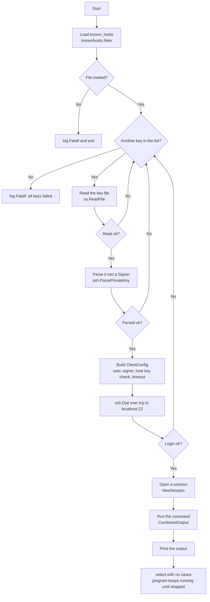
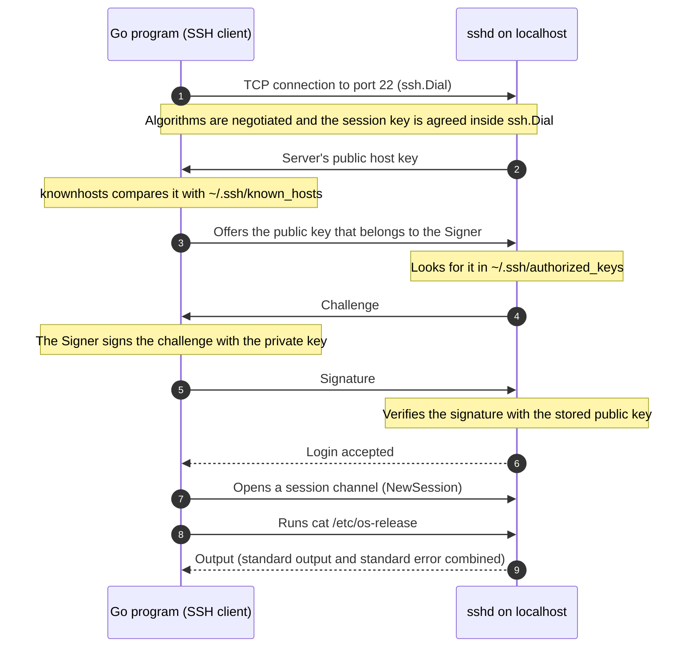
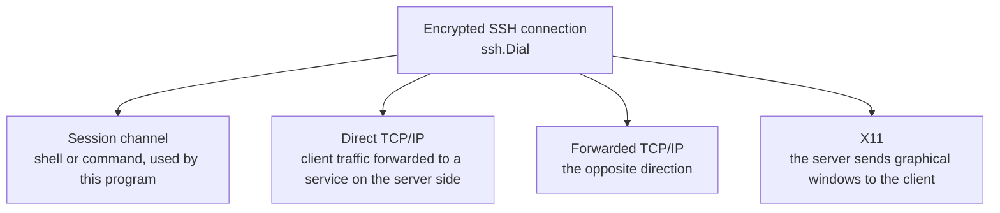

# Project: Go SSH Client

A small command-line program in Go that logs in to a Linux machine over SSH with private keys, verifies the server's identity against `known_hosts`, runs one command and prints the result. It is the practical follow-up to the [SSH chapter](../../notes/linux/12-ssh-depth-study/README.md).

| | |
|---|---|
| **Language** | Go |
| **Main library** | `golang.org/x/crypto/ssh` and its `knownhosts` package |
| **Tested against** | The local Fedora machine acting as the SSH server (`localhost`, port 22) |
| **Source code** | [github.com/Manish-Bishwakarma/go-ssh-client](https://github.com/Manish-Bishwakarma/go-ssh-client) |
| **Scope** | A learning project, deliberately small |

---

## 1. Why I built it

After studying SSH in theory (handshake, key pairs, host keys, sessions), I wanted to see the same pieces working inside real code instead of through the `ssh` command.

This turned out to be a valuable exercise because it connected **Linux administration, networking, cryptography and Go programming in one practical project**:

| Area | What the project exercised | Where it shows up |
|---|---|---|
| **Linux administration** | Running the SSH daemon (`systemctl start/enable sshd`), generating Ed25519 keys with `ssh-keygen`, `authorized_keys`, file permissions `700` and `600`, `known_hosts` | Setup steps in section 4 |
| **Networking** | A TCP connection to port 22, a server address, a connection timeout, a server fingerprint | `ssh.Dial("tcp", serverAdd, sshConf)` and `Timeout: 4 * time.Second` |
| **Cryptography** | Public/private key pairs, a private key used as a signer to prove identity, host key verification against man-in-the-middle attacks | `ssh.ParsePrivateKey`, `ssh.PublicKeys(signer)`, `knownhosts.New` |
| **Go programming** | Modules and dependencies, slices and loops, error handling, `defer`, converting `[]byte` to `string` | The whole of `main.go` |

---

## 2. What the program does

1. Loads the trusted server fingerprints from `~/.ssh/known_hosts`.
2. Goes through a list of private key files (an RSA path and an Ed25519 path). A key that is missing or cannot be parsed is skipped.
3. Tries to log in with each key in turn and keeps the first one that works.
4. Opens a session on the encrypted connection.
5. Runs one command on the server (`cat /etc/os-release`) and prints its output, with standard output and standard error combined.
6. Exits with a clear message if `known_hosts` cannot be loaded, if every key fails, or if the session or command fails.

### Program flow



### What happens on the wire



The private key never leaves the local machine. Only the signature is sent.

> **Terminology:** the Go library describes the proof as the private key *signing* the server's challenge, and the server *verifying* the signature with the public key. [5. SSH key authentication](../../notes/linux/12-ssh-depth-study/5-ssh-key-authentication.md) explains the same idea as the server encrypting a random value and the client decrypting it. Both describe a proof that only the holder of the private key can give.

---

## 3. Security design: strict host key verification

A common shortcut in Go SSH examples is `ssh.InsecureIgnoreHostKey()`. It accepts whatever server answers, so a man-in-the-middle can pretend to be the real server, intercept the connection and capture credentials.

This program uses `knownhosts.New(...)` instead.

- The server's public key must already be listed in `~/.ssh/known_hosts`.
- If the key is missing or does not match, the connection is refused.
- This is the same check the `ssh` command performs when it asks whether to trust a fingerprint on the first connection (see [4. Connection handshake](../../notes/linux/12-ssh-depth-study/4-connection-handshake.md)). Because the program cannot ask that question, the server has to be trusted beforehand, which is why setup step 4 exists.

---

## 4. Setup for a local test (Fedora)

### Prerequisites

- **Go**, at the version declared in `go.mod` (`go 1.27.3` at the time of writing)
- A running SSH daemon (`sshd`)
- A private/public key pair
- An entry for the server in `~/.ssh/known_hosts`

### Step 1: start the SSH server

```bash
sudo systemctl start sshd
sudo systemctl enable sshd
```

### Step 2: generate a key (if none exists)

```bash
ssh-keygen -t ed25519 -C "local-test"
```

### Step 3: authorize the key

The public key is appended to the list of keys the server accepts, and the permissions OpenSSH requires are set:

```bash
cat ~/.ssh/id_ed25519.pub >> ~/.ssh/authorized_keys
chmod 700 ~/.ssh
chmod 600 ~/.ssh/authorized_keys
```

> **Risk:** `>>` appends to the file. A single `>` would overwrite `authorized_keys` and remove every key already authorized.
> **Safer way:** `ssh-copy-id localhost` adds the key without touching the existing ones (see [5. SSH key authentication](../../notes/linux/12-ssh-depth-study/5-ssh-key-authentication.md)).

### Step 4: trust the local server's host key

```bash
ssh-keygen -R localhost
ssh-keyscan -H localhost >> ~/.ssh/known_hosts
```

> **Risk:** `ssh-keygen -R` deletes the existing entries for that host from `known_hosts`. For a remote server, `ssh-keyscan` fetches whatever key answers and does not verify it.
> **Safer way:** back up the file first with `cp ~/.ssh/known_hosts ~/.ssh/known_hosts.bak`. This step is fine for `localhost`. For a remote server, confirm the fingerprint first (for example by connecting once with `ssh` and checking it).

### Step 5: configure and run

Edit the values listed in section 5, then:

```bash
git clone https://github.com/Manish-Bishwakarma/go-ssh-client.git
cd go-ssh-client
go run main.go
```

### Expected output

The terminal shows, in order:

- a line for every key that was skipped or failed
- `Successfully logged in using <key path>!`
- `Running command: cat /etc/os-release`
- the server's output between `--- SERVER OUTPUT ---` and a closing line of dashes


After printing, the program keeps running and has to be stopped with `Ctrl+C` (see section 8).

---

## 5. Configuration

All settings are constants inside `main.go`. The paths and the username in the repository belong to the author's machine and must be changed.

| What | Where in `main.go` | Example |
|---|---|---|
| Private key files to try | the `sshKeys` slice | `/home/<username>/.ssh/id_rsa`, `/home/<username>/.ssh/id_ed25519` |
| Server address and port | `serverAdd` | `localhost:22` or `192.168.1.50:22` |
| Trusted hosts file | the path passed to `knownhosts.New` | `/home/<username>/.ssh/known_hosts` |
| Remote username | `User` in `ssh.ClientConfig` | `<username>` |
| Connection timeout | `Timeout` in `ssh.ClientConfig` | `4 * time.Second` |
| Command to run | the string passed to `session.CombinedOutput` (and the `Running command` message) | `whoami`, `ls -la` |

---

## 6. Code walkthrough

Paths and the username are shown as `<username>` placeholders.

### 6.1 Imports

| Package | Used for |
|---|---|
| `fmt` | Printing to the terminal |
| `log` | Printing a fatal error and exiting (`log.Fatalf`) |
| `os` | Reading the key files (`os.ReadFile`) |
| `time` | The connection timeout |
| `golang.org/x/crypto/ssh` | The SSH protocol itself |
| `golang.org/x/crypto/ssh/knownhosts` | Verifying the server's identity from `known_hosts` |

### 6.2 Setup

```go
sshKeys := []string{
    "/home/<username>/.ssh/id_rsa",
    "/home/<username>/.ssh/id_ed25519",
}

serverAdd := "localhost:22"

var sshClient *ssh.Client
var dialErr error
```

`sshKeys` is the list of key files to try in order. `serverAdd` is the target (here the local machine on port 22). `sshClient` starts as `nil` and will hold the live connection if a login succeeds. `dialErr` keeps the last connection error.

### 6.3 Host key verification

```go
hostKeyCallback, err := knownhosts.New("/home/<username>/.ssh/known_hosts")
if err != nil {
    log.Fatalf("Could not load known_hosts file: %v", err)
}
```

`knownhosts.New` reads the fingerprints of servers already trusted and returns a function (the callback) that checks the key a server presents. If the file cannot be read, the program stops immediately.

### 6.4 Trying each key

```go
for _, key := range sshKeys {
    keyBytes, err := os.ReadFile(key)
    if err != nil {
        fmt.Printf("Skipping %s: %v\n", key, err)
        continue
    }

    signer, err := ssh.ParsePrivateKey(keyBytes)
    if err != nil {
        fmt.Printf("Failed to parse key %s: %v\n", key, err)
        continue
    }
    // ... build the config and dial (6.5 and 6.6)
}
```

- `os.ReadFile` returns the key file as raw bytes (`[]byte`).
- `ssh.ParsePrivateKey` turns those bytes into an `ssh.Signer`. The SSH library cannot use the raw file directly. A Signer is the object that can sign the server's challenge to prove identity.
- `continue` moves on to the next key instead of stopping, so a missing `id_rsa` does not prevent `id_ed25519` from being tried.

### 6.5 Client configuration

```go
sshConf := &ssh.ClientConfig{
    User: "<username>",
    Auth: []ssh.AuthMethod{
        ssh.PublicKeys(signer),
    },
    HostKeyCallback: hostKeyCallback,
    Timeout:         4 * time.Second,
}
```

| Field | Meaning |
|---|---|
| `User` | The account to log in as on the server |
| `Auth` | The list of authentication methods. `ssh.PublicKeys(signer)` wraps the Signer from the previous step. |
| `HostKeyCallback` | The `known_hosts` check from 6.3 |
| `Timeout` | Give up on a connection attempt after 4 seconds |

### 6.6 Connecting

```go
sshClient, dialErr = ssh.Dial("tcp", serverAdd, sshConf)
if dialErr != nil {
    fmt.Printf("Key login failed using %s\n", key)
    continue
}
fmt.Printf("Successfully logged in using %s!\n", key)
break
```

`ssh.Dial` opens the TCP connection, performs the SSH handshake and authenticates. It returns the live client and any error. A failed login prints a message and moves to the next key. A successful one prints a message and `break` leaves the loop.

### 6.7 Checking the result and scheduling cleanup

```go
if sshClient == nil {
    log.Fatalf("All keys didn't work! Last error: %v", dialErr)
}

defer sshClient.Close()
```

If `sshClient` is still `nil` after the loop, every key failed and the program exits with the last error. `defer` schedules `sshClient.Close()` to run when `main` returns.

### 6.8 Session and command

```go
session, err := sshClient.NewSession()
if err != nil {
    log.Fatalf("Failed to create session: %v", err)
}
defer session.Close()

output, sessErr := session.CombinedOutput("cat /etc/os-release")
if sessErr != nil {
    log.Fatalf("Failed to run command: %v", sessErr)
}
```

`NewSession` opens a channel inside the encrypted connection for one task. `CombinedOutput` sends the command to the server, waits for it to finish and returns standard output and standard error together as `[]byte`.

### 6.9 Printing

```go
fmt.Println("--- SERVER OUTPUT ---")
fmt.Println(string(output))
fmt.Println("---------------------")

select {}
```

`string(output)` converts the bytes into readable text. `select {}` is a `select` with no cases, which blocks forever.

---

## 7. What I learned

### 7.1 Go modules

- `go get` needs a `go.mod` file, so a module has to be initialised first with `go mod init <module-name>`.
- When the default module proxy timed out, setting the `GOPROXY` environment variable to a mirror such as `goproxy.cn` allowed the library to download.
- `go get` records the library version in `go.mod` and its checksums in `go.sum`, which keeps builds reproducible.

### 7.2 Keys and signers

SSH uses a mathematically linked key pair: the private key stays on the client and the public key sits in the server's `authorized_keys`. In code, the private key file is read as bytes and parsed into a `Signer`, the object that proves identity by signing without ever sending the private key.

### 7.3 Host key verification

`InsecureIgnoreHostKey` blindly trusts any server and leaves the client open to a man-in-the-middle attack. Checking the presented key against `known_hosts` with the `knownhosts` package closes that gap, at the cost of having to trust the server first.

### 7.4 Client, sessions and channels

`ssh.Dial` creates one persistent encrypted connection (the tunnel). Inside it, any number of sessions can be opened, each a dedicated channel for one task such as a shell, a command or a file transfer. The SSH protocol defines four kinds of channel:



OpenSSH adds two more channel types on top of these four. Forwarding is the idea behind the tunnel in [7. File transfer and tunneling](../../notes/linux/12-ssh-depth-study/7-file-transfer-and-tunneling.md).

### 7.5 Remote execution and errors

- `CombinedOutput` runs a command on the server and returns the result as bytes, which have to be converted with `string(output)` to be readable.
- Recoverable problems (a missing or unparseable key, a failed login) print a message and `continue` to the next key. Unrecoverable ones (no `known_hosts`, all keys failed, no session, command failed) end with `log.Fatalf`.

### 7.6 The Linux side

Testing meant turning the local Fedora machine into an SSH server: starting and enabling `sshd`, generating an Ed25519 key, authorizing it, and setting the permissions (`700` on `~/.ssh`, `600` on `authorized_keys`) that OpenSSH insists on.

---

## 8. Limitations and possible improvements

| Current behaviour | Possible improvement |
|---|---|
| Key paths, `known_hosts` path, username, address and command are fixed in the source | Read them from command-line flags or a config file |
| Runs one fixed command | Accept the command as an argument |
| The key list is two fixed paths. It is not a scan of `~/.ssh`. | Build the list from the files found in `~/.ssh` |
| The program ends in `select {}`, so `main` never returns. The deferred `Close()` calls do not run, and the program has to be stopped with `Ctrl+C`. | Remove `select {}` so the program prints the output, runs the deferred cleanup and exits |
| `log.Fatalf` exits immediately, so deferred calls do not run on those error paths either | Return errors from a helper function and call `log.Fatalf` only in `main`, after cleanup |
| `CombinedOutput` merges standard output and standard error and returns only when the command has finished | Read the two as separate streams to handle errors separately and see output in real time |

---

## 9. Related notes

- [4. Connection handshake](../../notes/linux/12-ssh-depth-study/4-connection-handshake.md): host keys, `known_hosts` and the authentication steps this program performs
- [5. SSH key authentication](../../notes/linux/12-ssh-depth-study/5-ssh-key-authentication.md): key pairs, `authorized_keys`, permissions
- [7. File transfer and tunneling](../../notes/linux/12-ssh-depth-study/7-file-transfer-and-tunneling.md): forwarding, the channel idea in practice
- [8. Practice lab on Fedora](../../notes/linux/12-ssh-depth-study/8-practice-lab.md): the same Fedora machine as both client and server, using the `ssh` command

## 10. What I take from this project

- A working login depends on all four areas at once: `sshd` running (Linux), port 22 reachable (networking), matching keys and a trusted host key (cryptography), and correct code (Go).
- Replacing the insecure host key shortcut with `known_hosts` verification was the most important design decision. It turned a program that merely connects into one that checks who it is connecting to.
- Writing the client in Go made the handshake from the notes concrete: `ssh.Dial` is the tunnel, the Signer is the key proof, and a session is a channel inside the tunnel.
- The limitations in section 8 are the next things to improve.

---

[Back to the SSH chapter](../../notes/linux/12-ssh-depth-study/README.md)
