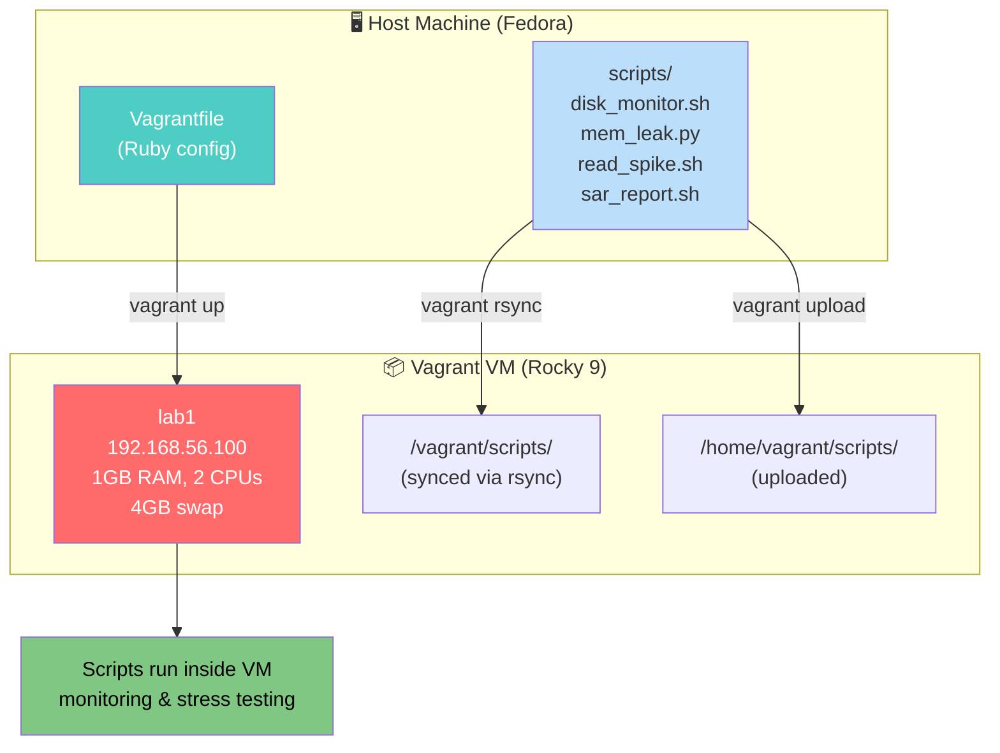
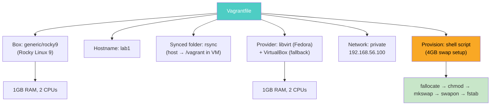
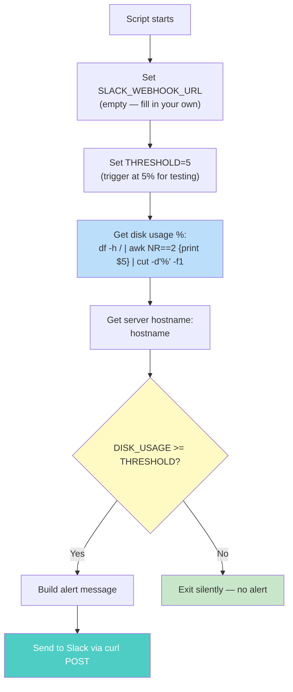
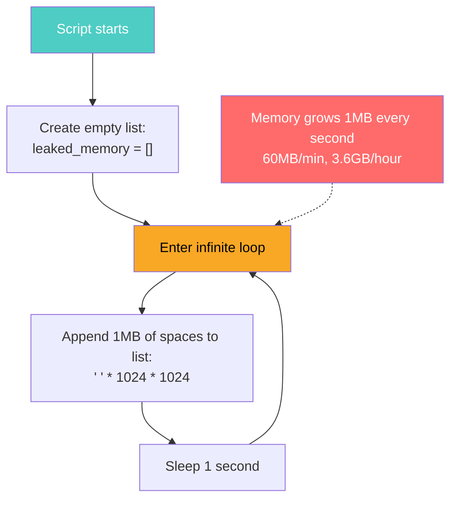
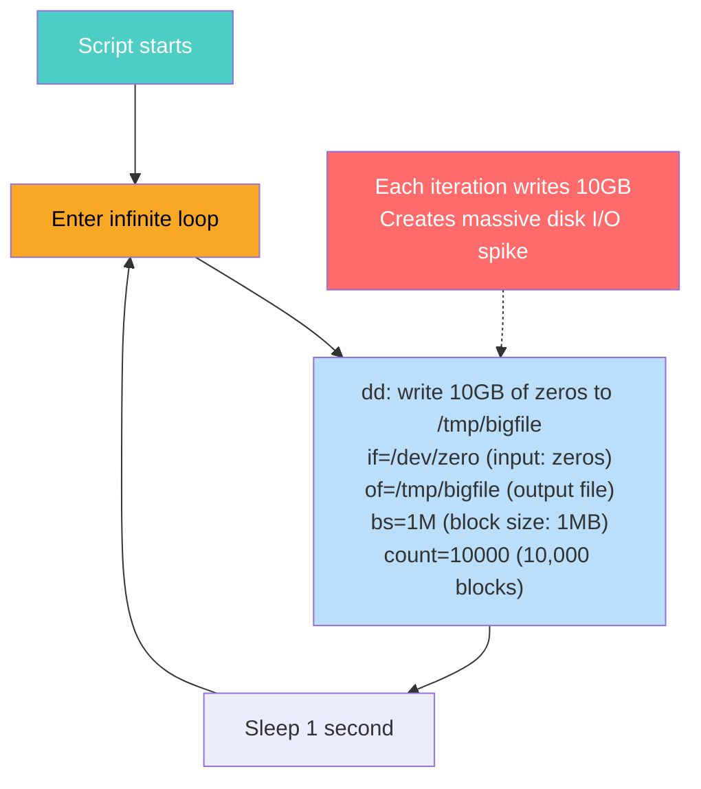
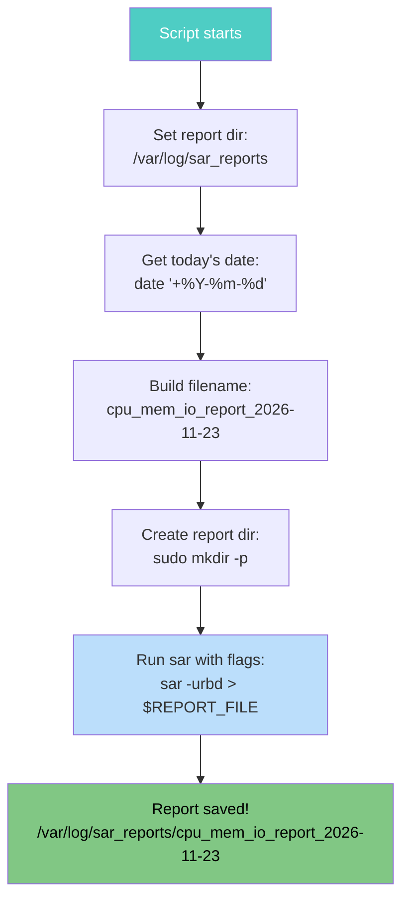
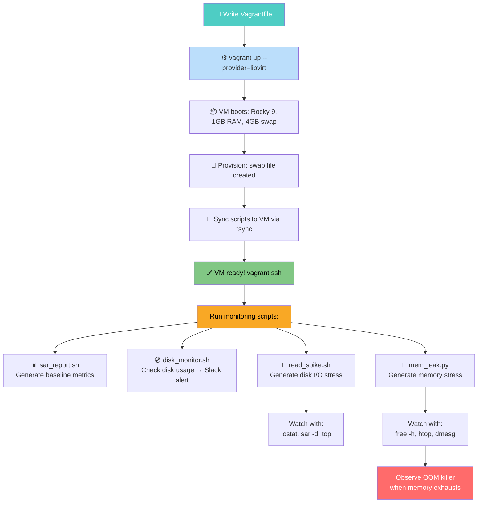
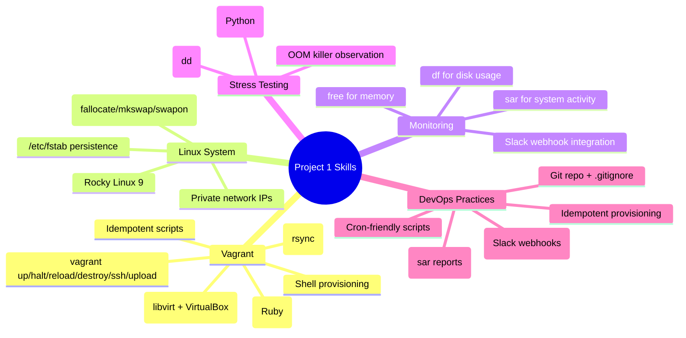

# 🐧 Linux Project — System Health & Performance Monitoring

## 📍 Project Overview

This is my first real Linux project — a complete system health and performance monitoring lab built on a Vagrant-managed virtual machine. The project demonstrates how to:

1. **Provision a Linux VM** automatically using Vagrant (Rocky 9 on libvirt/KVM)
2. **Configure the VM** with swap space, networking, and synced folders
3. **Monitor disk usage** and send Slack alerts when thresholds are crossed
4. **Simulate a memory leak** to observe OOM killer behavior
5. **Generate disk I/O spikes** to test disk monitoring tools
6. **Generate SAR reports** for CPU, memory, and I/O analysis



### 📋 Project Structure

```
linux-projects/
└── Project 1: System Health & Performance Monitoring/
    ├── Vagrantfile               # VM configuration (Ruby)
    └── scripts/
        ├── disk_monitor.sh       # disk usage → Slack alert
        ├── mem_leak.py           # simulate memory leak
        ├── read_spike.sh         # generate disk I/O spikes
        └── sar_report.sh         # generate SAR activity report
```

> 🧭 **DevOps angle:** This project simulates real-world operations tasks — monitoring disk space, detecting memory leaks, analyzing system performance with SAR, and sending alerts to Slack. These are the exact scripts you'd run on production servers, just in a safe sandbox VM.

---

## 1️⃣ Vagrant — The VM Management Tool

### 🎯 What Is Vagrant?

**Vagrant** is an open-source tool (written in Ruby) that simplifies the process of creating and managing virtual development environments. Instead of manually creating and configuring VMs, you write a **Vagrantfile** that describes the VM's configuration, and Vagrant handles the rest.

### 📋 Why Vagrant Matters

| Benefit | What it solves |
|---|---|
| **Reproducible environments** | Eliminates "works on my machine" — same Vagrantfile = same VM every time |
| **Simplified collaboration** | Share the Vagrantfile, not the VM. Team members run `vagrant up` and get an identical environment |
| **Portability** | Vagrantfiles work across operating systems and virtualization platforms (VirtualBox, libvirt/KVM, VMware) |
| **Automation** | Provisioning with shell scripts, Ansible, Puppet, or Chef — no manual config |
| **Resource efficiency** | Lightweight VMs that minimize impact on your host machine |

### 📊 How Vagrant Works


### 📋 Essential Vagrant Commands

| Command | What it does |
|---|---|
| **`vagrant init`** | Create a new Vagrantfile in the current directory |
| **`vagrant up`** | Read Vagrantfile, create and boot the VM |
| **`vagrant ssh`** | SSH into the running VM |
| **`vagrant ssh -c "command"`** | Run a command inside the VM without opening a shell |
| **`vagrant halt`** | Graceful shutdown of the VM (preserves disk state) |
| **`vagrant reload`** | Halt + up (restart the VM, applies Vagrantfile changes) |
| **`vagrant destroy`** | Completely remove the VM and its resources (Vagrantfile stays) |
| **`vagrant validate`** | Check Vagrantfile syntax |
| **`vagrant rsync`** | Manually sync folders (for rsync-type synced folders) |
| **`vagrant upload src dest`** | Upload a file/directory to the VM |
| **`vagrant status`** | Check if the VM is running |
| **`vagrant global-status`** | List all Vagrant VMs on your system |

> 💡 **`vagrant halt` vs `vagrant destroy`:** Halt = shutdown (VM still exists, restart with `vrant up`). Destroy = delete entirely (must re-provision with `vagrant up`). Use halt for "I'll come back to this tomorrow," destroy for "I'm done with this project."

---

## 2️⃣ The Vagrantfile — Configuration Breakdown

The Vagrantfile is written in **Ruby** and describes everything about the VM: which OS, how much RAM, networking, and provisioning.

### 📝 Full Vagrantfile

```ruby
Vagrant.configure("2") do |config|

  config.vm.define "lab1" do |lab1|
    lab1.vm.box = "generic/rocky9"
    lab1.vm.hostname = "lab1"
    lab1.vm.synced_folder ".", "/vagrant", type: "rsync"

    lab1.vm.provider "virtualbox" do |vb|
      vb.name = "lab1-virtualbox"
      vb.memory = "1024"
      vb.cpus = 2
    end

    # Fedora (libvirt/KVM)
    lab1.vm.provider "libvirt" do |lv|
      lv.memory = 1024
      lv.cpus = 2
      lv.qemu_use_session = false
    end

    lab1.vm.network "private_network", ip: "192.168.56.100"

    lab1.vm.provision "shell", inline: <<-SHELL
      if [ ! -f /swapfile ]; then
        sudo fallocate -l 4G /swapfile
        sudo chmod 600 /swapfile
        sudo mkswap /swapfile
      fi

      if ! swapon -s | grep -q '/swapfile'; then
        sudo swapon /swapfile
      fi

      if ! grep -q '/swapfile none swap sw 0 0' /etc/fstab; then
        echo '/swapfile none swap sw 0 0' | sudo tee -a /etc/fstab
      fi
    SHELL
  end
end
```

### 📊 Configuration Breakdown



### 📋 Section-by-Section

#### 📦 Box Selection

```ruby
lab1.vm.box = "generic/rocky9"
```

The **box** is the base OS image. `generic/rocky9` is Rocky Linux 9 (a RHEL-compatible distro). Vagrant downloads this from Vagrant Cloud on first `vagrant up`.

#### 🏷️ Hostname

```ruby
lab1.vm.hostname = "lab1"
```

Sets the VM's hostname — visible when you run `hostname` inside the VM.

#### 📂 Synced Folder

```ruby
lab1.vm.synced_folder ".", "/vagrant", type: "rsync"
```

Syncs the current directory (`.`) on the host to `/vagrant` inside the VM using **rsync**. This is how your `scripts/` folder becomes accessible inside the VM.

> 💡 The `rsync` type was chosen because the default shared folder type doesn't work well with libvirt/KVM. After changing the Vagrantfile, you need `vagrant reload` to apply it, then `vagrant rsync` to sync.

#### 🖥️ Provider Configuration

```ruby
# VirtualBox (original course setup)
lab1.vm.provider "virtualbox" do |vb|
  vb.name = "lab1-virtualbox"
  vb.memory = "1024"
  vb.cpus = 2
end

# libvirt/KVM (Fedora)
lab1.vm.provider "libvirt" do |lv|
  lv.memory = 1024
  lv.cpus = 2
  lv.qemu_use_session = false
end
```

Both providers are configured so the Vagrantfile works on:
- **VirtualBox** (Windows/macOS/any OS) — the original course setup
- **libvirt/KVM** (Fedora/Linux) — the user's actual setup

The `qemu_use_session = false` is needed for the static private_network IP to work with libvirt.

#### 🌐 Network

```ruby
lab1.vm.network "private_network", ip: "192.168.56.100"
```

Creates a **private network** with a static IP `192.168.56.100`. This lets you `ping` and `ssh` to the VM at that IP from your host machine.

#### 🔧 Provisioning (Swap Setup)

```ruby
lab1.vm.provision "shell", inline: <<-SHELL
  if [ ! -f /swapfile ]; then
    sudo fallocate -l 4G /swapfile
    sudo chmod 600 /swapfile
    sudo mkswap /swapfile
  fi

  if ! swapon -s | grep -q '/swapfile'; then
    sudo swapon /swapfile
  fi

  if ! grep -q '/swapfile none swap sw 0 0' /etc/fstab; then
    echo '/swapfile none swap sw 0 0' | sudo tee -a /etc/fstab
  fi
SHELL
```

This inline shell script creates a **4GB swap file** on first boot. The three `if` checks make it **idempotent** — safe to run multiple times without errors:

| Step | Command | What it does |
|---|---|---|
| 1 | `fallocate -l 4G /swapfile` | Allocate 4GB for the swap file |
| 2 | `chmod 600 /swapfile` | Owner read/write only (security) |
| 3 | `mkswap /swapfile` | Format it as swap space |
| 4 | `swapon /swapfile` | Activate the swap |
| 5 | `echo '/swapfile none swap sw 0 0' >> /etc/fstab` | Make it persistent across reboots |

> 🧭 **DevOps pattern:** The idempotent checks (`if [ ! -f ... ]`, `if ! grep -q ...`) are a Vagrant/Ansible best practice — provisioning should be safe to re-run. Without them, a second `vagrant provision` would fail trying to create an existing swap file.

---

## 3️⃣ Script 1: `disk_monitor.sh` — Disk Usage Alerting

### 📝 Full Code

```bash
#!/bin/bash

# Slack webhook URL
SLACK_WEBHOOK_URL=''

# The threshold for disk usage (90%)
THRESHOLD=5

# Get the current disk usage %
DISK_USAGE=$(df -h / | awk 'NR==2 {print $5}' | cut -d'%' -f1)

# Server Hostname
SERVER_HOSTNAME=$(hostname)

if [ "$DISK_USAGE" -ge "$THRESHOLD" ]; then
  MESSAGE=":exclamation: ALERT - Disk usage on $SERVER_HOSTNAME is at $DISK_USAGE%."
  # Sending the alert message to Slack
  curl -X POST -H 'Content-type: application/json' --data "{'text':'$MESSAGE'}" "$SLACK_WEBHOOK_URL"
fi
```

### 📊 Code Logic Walkthrough



### 📋 Line-by-Line

| Line | Code | What it does |
|---|---|---|
| **4** | `SLACK_WEBHOOK_URL=''` | Slack incoming webhook URL (empty — you'd paste your real URL here) |
| **7** | `THRESHOLD=5` | Alert threshold (set to 5% for testing; production would be 80-90%) |
| **10** | `df -h /` | Show disk usage for root partition `/` |
| **10** | `awk 'NR==2 {print $5}'` | Extract the 5th column (usage %) from line 2 (skip header) |
| **10** | `cut -d'%' -f1` | Remove the `%` sign → just the number |
| **13** | `hostname` | Get the server's hostname for the alert message |
| **15** | `if [ "$DISK_USAGE" -ge "$THRESHOLD" ]` | If usage is greater than or equal to threshold... |
| **16** | `MESSAGE="..."` | Build the Slack message with hostname and usage % |
| **18** | `curl -X POST ...` | Send the message to Slack via HTTP POST |

### 🎯 DevOps Use Case

This is a **cron-friendly disk alert script**. In production, you'd:
1. Set `THRESHOLD=85` (alert at 85% usage)
2. Add your real Slack webhook URL
3. Schedule it with cron: `*/10 * * * * /opt/scripts/disk_monitor.sh` (every 10 minutes)

When disk usage crosses 85%, you get a Slack alert like: `⚠️ ALERT - Disk usage on prod-server-01 is at 87%.`

> 🧭 **Why THRESHOLD=5 in the script?** For testing in the VM — with a fresh VM, disk usage is low, so setting the threshold to 5% ensures the alert triggers immediately for demonstration. In production, set it to 80-90%.

---

## 4️⃣ Script 2: `mem_leak.py` — Memory Leak Simulation

### 📝 Full Code

```python
#!/usr/bin/env python3
import time

leaked_memory = []
while True:
    leaked_memory.append(' ' * 1024 * 1024)  # Allocating 1MB in each iteration
    time.sleep(1)
```

### 📊 Code Logic Walkthrough



### 📋 Line-by-Line

| Line | Code | What it does |
|---|---|---|
| **1** | `#!/usr/bin/env python3` | Shebang — run with Python 3 |
| **2** | `import time` | Import the time module (for `sleep`) |
| **4** | `leaked_memory = []` | Create an empty list that will hold the "leaked" memory |
| **5** | `while True:` | Infinite loop — runs forever until killed |
| **6** | `leaked_memory.append(' ' * 1024 * 1024)` | Append a 1MB string (1024×1024 = 1,048,576 space characters) to the list |
| **7** | `time.sleep(1)` | Pause for 1 second before the next iteration |

### 🎯 Why This Script Exists

This script **deliberately leaks memory** — 1MB per second, 60MB per minute, 3.6GB per hour. It's a stress-testing tool to:

1. **Observe the OOM killer in action** — when memory runs out, the kernel kills the process (recall Day 3: OOM killer)
2. **Test memory monitoring tools** — watch `free -h`, `top`, `htop`, `vmstat` as memory fills up
3. **Test swap behavior** — when RAM fills, the kernel starts swapping (recall Day 3: swap)
4. **Practice debugging memory issues** — see what `dmesg | grep -i oom` shows after the kill

> 🧭 **DevOps use case:** Run this in the VM with `python3 mem_leak.py &`, then watch `htop` or `free -h -s 1` to see memory fill up. Eventually the OOM killer will kill the Python process — check `dmesg` for the OOM log. This is exactly how you'd test a real memory leak in production, but safely in a sandbox.

### ⚠️ Safety Note

```bash
# Run it in the VM (not your host!)
vagrant ssh
python3 /vagrant/scripts/mem_leak.py &

# Watch memory fill
watch -n 1 "free -h"

# When you're done, kill it before OOM does:
killall python3
```

> ⚠️ The VM has only 1GB RAM + 4GB swap = 5GB total. At 1MB/second, the script will exhaust memory in about 83 minutes — but the OOM killer typically kicks in before that.

---

## 5️⃣ Script 3: `read_spike.sh` — Disk I/O Spike Generation

### 📝 Full Code

```bash
while true; do
  dd if=/dev/zero of=/tmp/bigfile bs=1M count=10000
  sleep 1
done
```

### 📊 Code Logic Walkthrough



### 📋 Line-by-Line

| Line | Code | What it does |
|---|---|---|
| **1** | `while true; do` | Infinite loop |
| **2** | `dd if=/dev/zero of=/tmp/bigfile bs=1M count=10000` | Write 10GB of zeros to `/tmp/bigfile` |
| **3** | `sleep 1` | Pause for 1 second |
| **4** | `done` | End of loop |

### 📋 The `dd` Command Explained

| Flag | Meaning |
|---|---|
| **`if=/dev/zero`** | **I**nput **F**ile = `/dev/zero` (an infinite stream of zeros) |
| **`of=/tmp/bigfile`** | **O**utput **F**ile = `/tmp/bigfile` |
| **`bs=1M`** | **B**lock **S**ize = 1 megabyte |
| **`count=10000`** | Write 10,000 blocks (10,000 × 1MB = 10GB) |

### 🎯 Why This Script Exists

This script generates **massive disk I/O spikes** — writing 10GB per iteration. It's used to:

1. **Test disk monitoring tools** — watch `iostat`, `sar -d`, `iotop` during the spike
2. **Trigger the disk alert script** — fill up the disk to test `disk_monitor.sh`
3. **Observe system behavior under I/O pressure** — see CPU `wa` (I/O wait) spike in `top`
4. **Test storage performance** — measure how fast your disk can write

> 🧭 **DevOps use case:** Run this alongside `sar_report.sh` to capture what a disk I/O spike looks like in system metrics. In production, you'd use similar (but controlled) tools like `fio` for proper I/O benchmarking.

### ⚠️ Safety Note

This writes 10GB to `/tmp/bigfile` repeatedly. On the 128GB VM disk, this will fill up `/tmp` quickly. Run it briefly, then:

```bash
# Kill the script
killall read_spike.sh

# Clean up
rm /tmp/bigfile
```

---

## 6️⃣ Script 4: `sar_report.sh` — System Activity Report

### 📝 Full Code

```bash
#!/bin/bash

REPORT_DIR="/var/log/sar_reports"

DATE=$(date '+%Y-%m-%d')

REPORT_FILE="$REPORT_DIR/cpu_mem_io_report_$DATE"

sudo mkdir -p $REPORT_DIR

sudo sh -c "sar -urbd > $REPORT_FILE"
```

### 📊 Code Logic Walkthrough



### 📋 Line-by-Line

| Line | Code | What it does |
|---|---|---|
| **4** | `REPORT_DIR="/var/log/sar_reports"` | Define where reports will be stored |
| **6** | `DATE=$(date '+%Y-%m-%d')` | Get current date in `YYYY-MM-DD` format |
| **8** | `REPORT_FILE="$REPORT_DIR/cpu_mem_io_report_$DATE"` | Build the full filename with date |
| **10** | `sudo mkdir -p $REPORT_DIR` | Create the report directory (if it doesn't exist) |
| **12** | `sudo sh -c "sar -urbd > $REPORT_FILE"` | Run `sar` with flags and save output to the report file |

### 📋 The `sar` Command Flags

| Flag | What it reports |
|---|---|
| **`-u`** | **U**tilization — CPU usage statistics |
| **`-r`** | Memory utilization |
| **`-b`** | I/O and transfer rate statistics |
| **`-d`** | Block device (disk) statistics |

### 🎯 What Is `sar`?

**`sar`** (System Activity Reporter) is part of the **sysstat** package. It collects and reports system activity data — CPU usage, memory, disk I/O, network — either in real-time or from historical data collected by `sad` (system activity data collector).

```bash
# View today's CPU stats
$ sar -u

# View today's memory stats
$ sar -r

# View today's disk I/O stats
$ sar -d

# View stats from a specific day (the 23rd)
$ sar -u -f /var/log/sa/sa23
```

> 🧭 **DevOps use case:** Schedule `sar_report.sh` as a daily cron job to automatically archive system activity reports. When something goes wrong, you have historical data to compare against: "what was CPU usage doing at 3 AM when the alert fired?"

### 📦 Installation

`sar` is part of the `sysstat` package:

```bash
# RHEL/Rocky/Fedora
$ sudo dnf install sysstat

# Debian/Ubuntu
$ sudo apt install sysstat

# Enable data collection (if not already)
$ sudo systemctl enable --now sysstat
```

---

## 7️⃣ The Full Workflow — How It All Fits Together



### 📋 The Workflow Explained

1. **Provision the VM** — `vagrant up` creates a Rocky 9 VM with swap, networking, and your scripts synced
2. **Generate baseline** — Run `sar_report.sh` to capture normal system state
3. **Test disk monitoring** — Run `disk_monitor.sh` to check for alerts
4. **Stress test disk I/O** — Run `read_spike.sh` and watch with `iostat` / `sar -d`
5. **Stress test memory** — Run `mem_leak.py` and watch with `free -h` / `htop`
6. **Observe OOM killer** — When memory exhausts, check `dmesg` for the OOM event
7. **Generate post-stress report** — Run `sar_report.sh` again to compare before/after

---

## 8️⃣ Commands Used in This Project

### 📋 Vagrant Workflow

```bash
# Add the Rocky 9 box (libvirt provider)
$ vagrant box add generic/rocky9 --provider=libvirt

# Validate Vagrantfile syntax
$ vagrant validate

# Boot the VM
$ vagrant up --provider=libvirt

# Check VM is running
$ virsh -c qemu:///system list --all

# Ping the VM
$ ping -c 2 192.168.56.100

# SSH into the VM
$ vagrant ssh

# Run a command inside the VM
$ vagrant ssh -c "hostname; free -h; swapon --show"

# Sync folders after Vagrantfile change
$ vagrant rsync

# Reload (restart) the VM
$ vagrant reload

# Upload files to the VM
$ vagrant upload scripts /home/vagrant/scripts

# Shut down the VM
$ vagrant halt

# Destroy the VM entirely
$ vagrant destroy
```

### 📋 Git Setup

```bash
# Initialize git repo
$ git init

# Ignore Vagrant's internal files
$ printf '.vagrant/\n' > .gitignore
```

> 💡 `.vagrant/` contains VM-specific state (UUIDs, machine IDs) that shouldn't be committed — each developer's Vagrant environment is local.

---

## 9️⃣ What I Learned From This Project



### 🎯 Key Takeaways

| Skill | How this project taught it |
|---|---|
| **Vagrant** | Full VM lifecycle — init, up, ssh, reload, halt, destroy |
| **Vagrantfile** | Ruby config with multiple providers, networking, provisioning |
| **Swap management** | Creating swap files with `fallocate`/`mkswap`/`swapon`, making persistent via `/etc/fstab` |
| **Disk monitoring** | `df` + `awk` + `cut` to extract usage %, threshold checks |
| **Alerting** | Slack webhook integration via `curl` POST |
| **Memory stress testing** | Python memory leak simulation, OOM killer observation |
| **Disk I/O testing** | `dd` for generating massive I/O, watching with `sar`/`iostat` |
| **System reporting** | `sar` for CPU/memory/disk activity, automated report generation |
| **Idempotent scripting** | `if [ ! -f ... ]` checks to make provisioning safe to re-run |
| **Git practices** | `.gitignore` for `.vagrant/`, project structure |

---

## 🧾 Summary

| Concept | One-line takeaway |
|---|---|
| **Project purpose** | Vagrant-managed Rocky 9 VM with monitoring and stress-testing scripts. |
| **Vagrant** | Open-source tool for creating reproducible VM environments via a Vagrantfile. |
| **Vagrantfile** | Ruby config file describing the VM: box, provider, network, provisioning. |
| **`vagrant up`** | Create and boot the VM. Downloads box image on first run. |
| **`vagrant ssh`** | SSH into the running VM. |
| **`vagrant reload`** | Restart the VM (halt + up). Applies Vagrantfile changes. |
| **`vagrant halt`** | Graceful shutdown — VM preserved, restart with `vagrant up`. |
| **`vagrant destroy`** | Completely remove the VM. Vagrantfile stays for reuse. |
| **`vagrant rsync`** | Manually sync rsync-type synced folders. |
| **`vagrant upload`** | Upload files/dirs to the VM. |
| **Box** | Base OS image (`generic/rocky9` = Rocky Linux 9). |
| **Provider** | Virtualization backend (libvirt/KVM on Fedora, VirtualBox on other OSes). |
| **Synced folder** | Maps host directory to VM directory (rsync type for libvirt). |
| **Provisioning** | Automated VM setup (shell script for swap creation). |
| **Idempotent checks** | `if [ ! -f ... ]` — safe to re-run without errors. Vagrant best practice. |
| **`.gitignore`** | Ignores `.vagrant/` (VM-specific state shouldn't be committed). |
| **disk_monitor.sh** | Checks disk usage with `df`+`awk`+`cut`, sends Slack alert if over threshold. |
| **Slack webhook** | HTTP POST to a Slack URL to send alerts. `curl -X POST -H 'Content-type: application/json' --data`. |
| **THRESHOLD=5** | Testing value (triggers immediately). Production: 80-90%. |
| **mem_leak.py** | Infinite loop appending 1MB strings to a list. 1MB/sec, 60MB/min. |
| **mem_leak purpose** | Stress test to observe OOM killer, swap behavior, memory monitoring tools. |
| **read_spike.sh** | Infinite loop running `dd if=/dev/zero of=/tmp/bigfile bs=1M count=10000`. Writes 10GB per iteration. |
| **dd** | Low-level data duplicator. `if` (input), `of` (output), `bs` (block size), `count` (blocks). |
| **read_spike purpose** | Generate disk I/O stress to test disk monitoring tools (`iostat`, `sar -d`). |
| **sar_report.sh** | Runs `sar -urbd` and saves output to `/var/log/sar_reports/cpu_mem_io_report_DATE`. |
| **sar** | System Activity Reporter (sysstat package). Collects CPU/memory/disk/network metrics. |
| **sar -u** | CPU utilization. |
| **sar -r** | Memory utilization. |
| **sar -b** | I/O and transfer rates. |
| **sar -d** | Block device (disk) statistics. |
| **sysstat** | Package that provides `sar`. Install: `dnf install sysstat` / `apt install sysstat`. |
| **Swap setup** | `fallocate` → `chmod 600` → `mkswap` → `swapon` → `/etc/fstab`. |
| **4GB swap** | VM has 1GB RAM + 4GB swap = 5GB total memory. |
| **192.168.56.100** | Static private IP assigned to the VM. Pingable from host. |
| **DevOps relevance** | This project = real-world ops skills: VM provisioning, monitoring, alerting, stress testing, performance reporting. |
